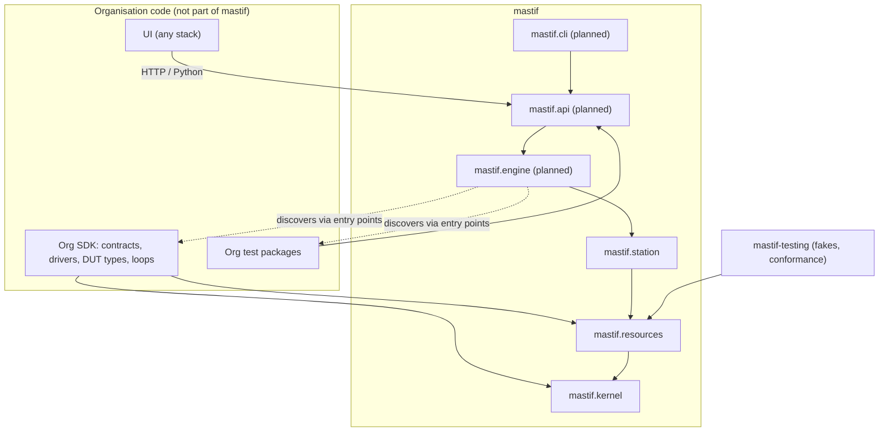
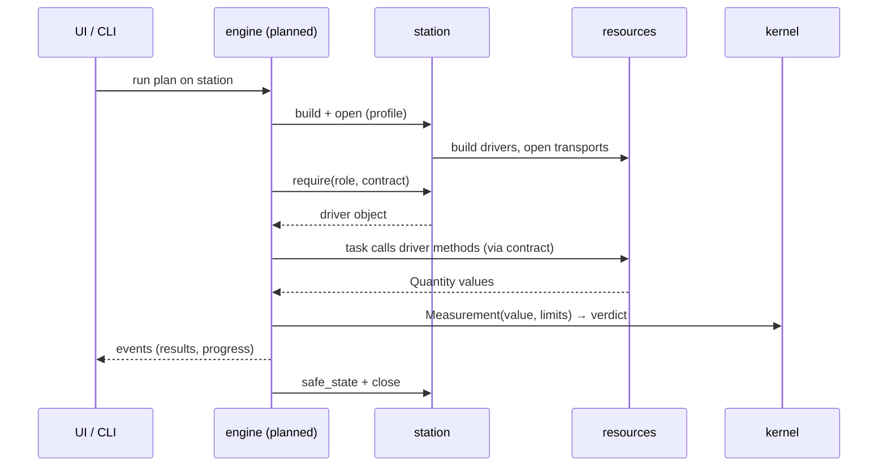

# ADR-0001: Layered architecture and dependency rules

| | |
|---|---|
| **Status** | accepted |
| **Date** | 2026-10-21 |
| **Module(s)** | all of `mastif`, plus `mastif-testing` |
| **Layer** | cross-cutting |
| **Related** | ADR-0002 (error model, which follows the same layers); every module ADR |

> **Who this is for:** an engineer who joined today. Read this first. Every other ADR
> assumes you know the layers described here.

## 1. Summary

mastif is split into layers, stacked so that each one may only use the layers below
it. From the bottom up they are:

1. `kernel` (pure vocabulary: units, limits, results)
2. `resources` (how to describe and talk to hardware)
3. `station` (one physical bench, built from a profile)
4. `engine` (running tests; planned)
5. `api` (stable public surface; planned)
6. `cli` (command line; planned)

On top sit two things mastif never imports: **organisation SDKs** (an org's own
contracts, drivers and DUT types) and **UIs**. The one idea to remember: *dependencies
only point downwards, and org code is plugged in, never imported by name.*

## 2. The problem, from first principles

mastif's purpose is to be a **generic** foundation that any organisation can build its
own test SDK and UI on. That creates three forces.

- **Generality.** Concepts such as "this amplifier's calibration table", or the commands of
  one company's power supply, must never leak into the core. If they do, the core
  becomes one company's tool again, and every other org has to work around it. The
  core can only contain ideas that are true at *every* test station: values with
  units, limits, verdicts, instruments with lifecycles, stations, runs.
- **Change isolation.** A test station is a long-lived system. Instruments get
  replaced, UIs get rewritten, new product lines arrive. The parts that change often
  (drivers, UIs, product tests) must be able to change without touching the parts that
  must stay stable (how verdicts are computed, how a run is recorded).
- **Testability without hardware.** Most code must be testable on a laptop in CI.
  That is only possible if the logic that *decides* things (is this value in limits?
  what runs next?) doesn't depend on the code that *does* I/O.

What goes wrong without layering:

- **Import cycles.** For example, the engine imports a driver that imports the engine.
- **Hidden coupling.** Changing how results are stored breaks a driver.
- **Untestable logic.** A pure verdict calculation that can only run with a socket open.

## 3. Where it sits in the system

This ADR *is* the system map.

Solid arrows mean "imports". Dotted arrows mean "finds at run time through Python entry
points, without importing by name".

## 4. Decision

1. **Six layers, in a strict order:** `cli → api → engine → station → resources →
   kernel`. A module may import from its own layer and from layers to its right
   (below it), never from layers to its left.
2. **`kernel` is pure.** It does no I/O, uses no threads, and touches no hardware or
   clock other than for generating ids. It may use Pydantic.
3. **The core never imports org code.** Org drivers, DUT types, loop types and test
   packages are found through Python **entry points** (named hooks a package declares
   in its `pyproject.toml`). Only a registry collects them, and only when asked (see
   ADR-0012).
4. **Nothing domain-specific in core.** If a concept only makes sense for one kind of
   product, it belongs in an org SDK, and the core offers an *extension point* for it.
   For example, the core has generic "loops"; an org defines a "firmware profile" loop
   type.
5. **The rules are enforced, not just written down.** An `import-linter` contract in
   `pyproject.toml` fails CI if a lower layer imports a higher one. Layers that don't
   exist yet are marked optional, as `(mastif.engine)`.
6. **Separate packages for separate audiences.**
   - `mastif` is the core plus its Python API.
   - `mastif-testing` holds fakes and conformance helpers for SDK authors' test
     suites.
   - A future `mastif-service` will hold the network API.

   All of them are versioned in lockstep (see `CONTRIBUTING.md`).

## 5. Abstractions

| Layer | Responsibility | Typical contents | Status |
|---|---|---|---|
| `kernel` | The shared vocabulary every layer speaks | `Quantity`, `Limits`, `Verdict`, `Measurement`, `Position`, `MastifError` | built |
| `resources` | Describing hardware and talking to it | contracts, `@driver`/`@dut`, transports, `Registry` | built |
| `station` | One physical bench: which resources exist, where, under which role names, and their lifecycle | `StationProfile`, `Station`, `ResourceManager` | built |
| `engine` | Running test plans: tasks, loops, results, events, snapshots | `Task`, plan expansion, runner, run store | planned |
| `api` | The stable surface for test authors, SDKs and UIs | facade over engine + station | planned |
| `cli` | Command-line entry points | `mastif run`, `mastif validate` | planned |
| `mastif-testing` | Helping SDK authors test without hardware | `FakeLineIO`, `check_lifecycle` | built |

**Extension points**, where org code plugs in:

| What | How | Defined in |
|---|---|---|
| Contracts | plain `typing.Protocol` | ADR-0008 |
| Drivers and DUT types | `@driver` / `@dut` and the `mastif.drivers` entry point | ADR-0011, ADR-0012 |
| Loop types, test packages | planned (engine) | — |

## 6. Data flow

At the highest level, a run will flow down and back up through the layers:

The walk-through, step by step:

1. **The UI asks the engine to run a plan.** The UI and CLI talk only to the engine,
   through the api layer once it exists.
2. **The engine has the station build and open itself.** This is configuration only.
   The engine knows nothing about which hardware is involved.
3. **Tasks get their hardware by role.** A role name is the only way a task reaches
   hardware. A task never names a driver class.
4. **Values travel back up as kernel types.** Drivers return `Quantity` values, and the
   kernel turns them into self-judging results.
5. **Results go out to the UI as events.** Events are the only thing the UI sees.

## 7. Errors

Layering also shapes errors: each layer defines its own exception subclasses under a
single root, `MastifError`. See ADR-0002.

## 8. Guarantees and invariants

- A module in layer *N* never imports from layer *N+1* or above. `uv run lint-imports`
  verifies this.
- Importing any mastif module has no side effects. In particular, nothing registers
  itself globally.
- The kernel can be imported and fully exercised without network, serial ports or
  threads.

## 9. Consequences

- **Positive:**
  - Logic can be tested in isolation. The kernel alone has around 80 doctests and
    unit tests running in under a second.
  - Org code can evolve without touching core.
  - It's always clear where new code belongs.
- **Negative:**
  - Some indirection. For example, the station must translate driver errors into
    station errors with context, instead of letting each layer see everything.
  - A small amount of duplication across layer boundaries is accepted, e.g.
    `Station.require` re-checks contracts that `@driver` also checks.
- **Risks:** a layer becoming a dumping ground. When something is hard to place,
  write an ADR before writing the code.

## 10. Alternatives considered

- **A flat package.** Rejected. Nothing stops lower-level code from depending on
  higher-level code, and the result is import cycles and untestable logic.
- **Hexagonal ("ports and adapters") applied everywhere.** Rejected as the *primary*
  structure. Its idea survives inside layers: contracts are ports, drivers are
  adapters. But a full hexagon per feature is too much ceremony for the size of this
  system.
- **Microservices per concern.** Rejected. A test station is a single machine
  controlling local hardware. Network boundaries inside it add failure modes and buy
  nothing. A network API will exist at the edge (`mastif-service`), not inside.

## 11. Open questions and future work

- The exact split between `engine` and `api` is decided when the engine exists.
- `mastif-service` (REST + WebSocket) will sit beside `api` as a separate distribution.

## 12. Code map

| What | Where |
|---|---|
| Layer contract | `pyproject.toml`, `[tool.importlinter]` |
| Rules for contributors | `AGENTS.md`, *Layering* |
| Wiki overview | `docs/wiki/architecture.md` |

## History

- 2026-10-21: created. Replaces the informal layering notes in the step-1 plan.
