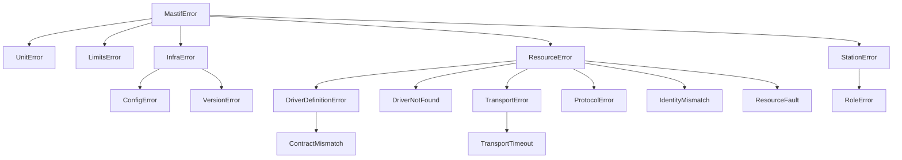
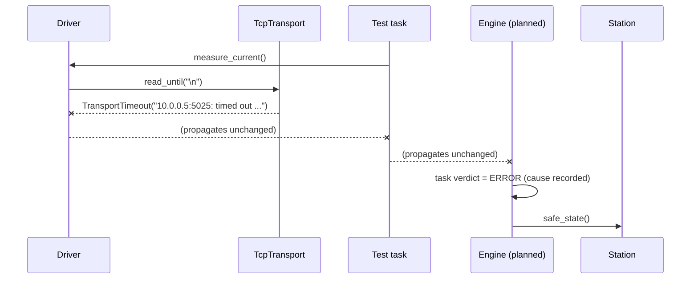

# ADR-0002: Error model: one typed hierarchy, layered by responsibility

| | |
|---|---|
| **Status** | accepted |
| **Date** | 2026-10-21 |
| **Module(s)** | `mastif.kernel.errors`, `mastif.infra.errors`, `mastif.resources.errors`, `mastif.station.errors` |
| **Layer** | cross-cutting (each layer owns its errors) |
| **Related** | ADR-0001 (layers); ADR-0005 (verdicts: how errors become ERROR); every module ADR's *Errors* section |

## 1. Summary

Every error mastif raises derives from a single root, `MastifError`. Each layer adds
subclasses that describe *what kind of thing went wrong* in that layer's terms, for
example `TransportTimeout` in resources and `RoleError` in station. Errors are typed,
carry a human-readable message naming the resource or field involved, and are
**never** replaced by sentinel return values. The one idea to remember: *the type tells
you what happened; the message tells you where.*

## 2. The problem, from first principles

At a test station, *what went wrong* decides *what happens next*:

| Situation | Right reaction |
|---|---|
| The DUT's output was out of spec | Verdict **FAIL**. The unit is bad; nothing is wrong with the station. |
| A cable fell out (timeout) | Verdict **ERROR**. The test couldn't run; retest the same unit. |
| The wrong unit is on the bench | Stop before touching it; ask the operator. |
| A typo in a station profile | Refuse to start; show the file and field. |
| A bug in an org's driver class | Fail in the org's own CI, long before a station. |

If all of these surface as `Exception("something failed")`, none of these reactions can
be automated, and operators get messages they can't act on. If drivers return `0.0` or
`None` to mean "failed", a broken reading can **pass** a limit check. That is the worst
outcome in testing: shipping a bad unit with a PASS record.

**Forces:**

- Automation must branch on error *kind*.
- Operators need messages with context.
- Org code must be able to catch "anything mastif" without catching programming bugs.
- Pydantic validation must not swallow mastif's own errors.

## 3. Where it sits in the system

- **Upstream:** everything raises these errors. The planned engine is the main catcher:
  it turns any exception escaping a test task into an ERROR verdict, and never swallows
  it.
- **Downstream:** nothing. These are plain exception classes.

## 4. Decision

1. **One root.** `MastifError(Exception)` lives in the kernel. `except MastifError`
   catches every mastif failure, and nothing else.
2. **Each layer owns its subclasses,** named for *what happened* rather than *where*:
   `TransportTimeout`, not `TcpError`.
3. **No `ValueError` inheritance.** Pydantic converts any `ValueError` raised inside a
   validator into a generic `ValidationError`, which would hide a `LimitsError` raised
   while building limits. mastif errors therefore subclass `Exception` via
   `MastifError` only, so they reach callers as themselves.
4. **No sentinels.** A function that cannot produce its result raises. It never returns
   `0.0`, `None`, `-1` or `NaN` to mean failure. `Quantity` even rejects NaN at
   construction.
5. **Messages name the subject first:** `"bench_psu: serial is 'B999', expected 'A123'"`,
   `"resource 'psu': invalid config: nmae: Extra inputs are not permitted"`.
6. **Translate at layer boundaries, chaining the cause.** For example, the station turns
   `DriverNotFound` and Pydantic `ValidationError` into `StationError` with the resource
   name, using `raise ... from exc`, so the original traceback is kept.
7. **No naming suffix rule.** Ruff's N818 ("must end in Error") is disabled, because
   names like `TransportTimeout` and `IdentityMismatch` read better as sentences.

## 5. Abstractions

| Exception | Layer | Meaning | Typical raiser |
|---|---|---|---|
| `MastifError` | kernel | Root: "mastif failed" | never raised directly |
| `UnitError` | kernel | Incompatible units, or a meaningless dB operation | `Quantity`, `convert`, `evaluate` |
| `LimitsError` | kernel | Malformed limits or table; no limits for an index | `Range`, `Limits`, `IndexedLimits`, `Table` |
| `InfraError` | infra | Root of infrastructure errors | — |
| `ConfigError` | infra | Settings can't be loaded; a section is missing or invalid; invalid logging config | `create_settings`, `section`, `configure_logging` |
| `VersionError` | infra | A distribution isn't installed, or its version can't be parsed | `PackageVersion`, `VersionInfo.load` |
| `ResourceError` | resources | Root of hardware-side errors | — |
| `DriverDefinitionError` | resources | An org's driver class is wrong (bad id, `Config`, `__init__`) | `@driver`, `@dut`, `build_io` |
| `ContractMismatch` | resources | A driver lacks or mis-declares contract methods | `check_provides` |
| `DriverNotFound` | resources | No installed driver has this id | `Registry.get` |
| `TransportError` | resources | Bytes couldn't move: refused, closed, not open | transports |
| `TransportTimeout` | resources | No (complete) reply in time | transports |
| `ProtocolError` | resources | A reply arrived but made no sense, or the device reported a command error | `Scpi`, `LineShell` |
| `IdentityMismatch` | resources | A different device than expected is connected | `ResourceManager` |
| `ResourceFault` | resources | The device reports a fault, or its health check failed | drivers, `ResourceManager` |
| `StationError` | station | The profile is invalid, or the station can't be built from it | `StationProfile`, `Station.build` |
| `RoleError` | station | A role doesn't exist or can't serve the requested contract | `Station.role`, `Station.require` |

## 6. Data flow

How an error travels from a cable to a verdict (the engine part is planned):

The walk-through:

1. **The transport raises a precise error.** It names the endpoint and what it was
   waiting for.
2. **Drivers and tasks let it propagate.** They catch an error only if they can really
   recover, e.g. one retry of an idempotent query.
3. **The engine turns it into a verdict.** Any exception that escapes a task becomes the
   task's ERROR verdict, with the exception type and message kept as evidence. ERROR
   means "the test could not complete", which is different from FAIL ("the unit is
   bad").
4. **The engine makes the station safe.**

## 7. Errors

This ADR is the error catalogue. Who should catch what:

- **Test tasks:** generally nothing. Let errors propagate, so the verdict is honest.
- **Drivers:** catch library exceptions (socket, pyserial, pyvisa) and re-raise them as
  `TransportError`/`TransportTimeout`/`ProtocolError` with context.
- **The station:** translates build-time problems into `StationError` and lets
  run-time `ResourceError`s through.
- **The engine and CLI (planned):** catch `MastifError` at the top, turn it into
  verdicts and messages, and always run safe state.

## 8. Guarantees and invariants

- Every mastif-raised exception is a `MastifError`. The exception is Pydantic's own
  `ValidationError` for direct model validation, which the station wraps.
- Messages begin with the subject (resource, endpoint, field) whenever one exists.
- Causes are chained (`__cause__`), so tracebacks show the original library error.

## 9. Consequences

- **Positive:**
  - Precise automated reactions.
  - Operators get actionable messages.
  - A bad reading can never pose as a valid one.
- **Negative:**
  - More classes to learn. This ADR and the wiki's error map exist to make that easy.
  - Code that wants to treat a mastif error as a `ValueError` must catch it explicitly.
- **Risks:** a proliferation of tiny exception types. New ones must earn their place by
  enabling a *different reaction*.

## 10. Alternatives considered

- **Error codes or result objects** (`Result[ok, err]`). Rejected. They are unidiomatic
  in Python and easy to ignore, and an ignored error code is how sentinels sneak back
  in.
- **Subclassing `ValueError`/`IOError`.** Rejected because of how Pydantic wraps errors
  (point 3), and because a `TransportTimeout` isn't really an `OSError` from the
  caller's point of view.
- **One exception type with a `kind` field.** Rejected. Callers couldn't use `except`
  clauses, and they would end up branching on strings.

## 11. Open questions and future work

- Engine-level errors (plan invalid, preflight failed, aborted) will extend this
  hierarchy when the engine is built.
- Whether to add structured fields to exceptions, e.g. `resource=` and `endpoint=`, for
  UIs. Today the message carries this.

## 12. Code map

| What | Where |
|---|---|
| Root and kernel errors | `packages/mastif/src/mastif/kernel/errors.py` |
| Infra errors | `packages/mastif/src/mastif/infra/errors.py` |
| Resource errors | `packages/mastif/src/mastif/resources/errors.py` |
| Station errors | `packages/mastif/src/mastif/station/errors.py` |
| Wiki error map | `docs/learn/architecture/errors.md` |

## History

- 2026-10-21: created. Consolidates the error notes from the old result-model and
  resource-model ADRs.
- 2026-10-25: added `InfraError`, `ConfigError` and `VersionError` for the new infra
  layer. `ResourceError` is now also raised when a driver needs settings that weren't
  provided.
