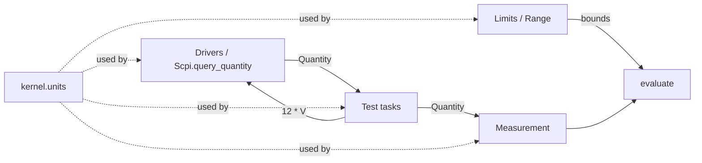
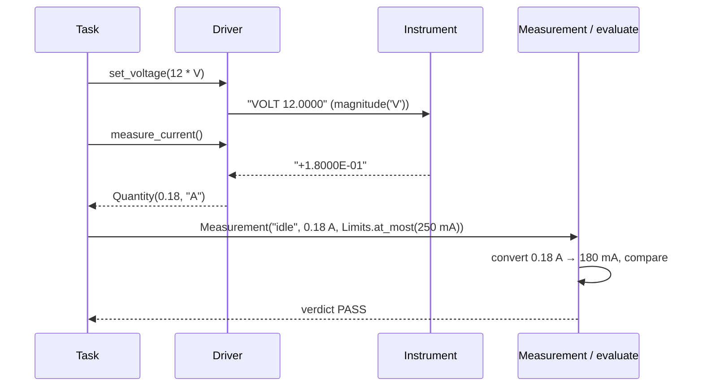

# ADR-0003: Units: quantities that carry their unit end to end

| | |
|---|---|
| **Status** | accepted |
| **Date** | 2026-10-21 |
| **Module(s)** | `mastif.kernel.units` |
| **Layer** | kernel |
| **Related** | ADR-0004 (limits compare quantities); ADR-0006 (measurements record them); ADR-0009 (standard contracts take and return them); ADR-0016 (SCPI parses them) |

## 1. Summary

A `Quantity` is a float plus a unit symbol, e.g. `12 V` or `-10 dBm`. Test code builds
quantities by multiplying with unit constants (`12 * V`). Quantities convert only
within a dimension (mV ↔ V, never V ↔ A), follow RF rules for dB arithmetic, and
serialise to JSON as `{"value", "unit"}`. The one idea to remember: *a number never
travels without its unit, from the driver to the report.*

## 2. The problem, from first principles

Almost every value a test station handles is physical: a supply voltage, a current
draw, a frequency, an RF level.

- **Units get lost at boundaries.** An instrument replies `"2.5E-01"` and a driver
  returns `0.25`. Amps or milliamps? The next person to touch the code guesses. A wrong
  guess means a limit of 250 compared against 0.25: every unit passes, and nobody
  notices until field returns.
- **Prefix arithmetic is error-prone.** A limit written in mA and a reading in A must be
  compared correctly, without the test author doing the conversion by hand.
- **dB is not linear.** `10 dBm + 3 dB = 13 dBm` (a level plus a gain), but
  `10 dBm + 10 dBm` has no meaning. Doubling a dB value is a classic bug.
- **Values must survive serialisation.** Results travel through events, run snapshots
  and a network API. A unit that exists only as a Python object is lost on the first
  `json.dumps`.

**Forces:**

- Test code must read like a spec (`12 * V`).
- No heavy dependencies in the kernel (ADR-0001).
- Orgs use units mastif has never heard of (psi, rpm, lux).
- Failure must be loud (ADR-0002).

## 3. Where it sits in the system

- **Layer:** kernel. It is pure vocabulary with no I/O, and every layer needs it.
- **Upstream:** driver contracts (`set_voltage(v: Volts)`), `Scpi.query_quantity`,
  `Limits`/`Range`, `Measurement`/`Table`.
- **Downstream:** Pydantic only.

## 4. Decision

1. **`Quantity(value: float, unit: str)` is an immutable Pydantic model.** It
   serialises as `{"value": 12.0, "unit": "V"}`.
2. **A small built-in unit table.** It covers SI prefixes of V, A, W, Hz, s and ohm;
   deg/rad; degC; %; dimensionless `""`; and the log units dB and dBm. Each symbol maps
   to a *dimension* and a *factor* relative to the dimension's base unit.
3. **Unknown symbols are accepted** as their own dimension, with factor 1. They convert
   only to themselves, so orgs never register units.
4. **dB-family arithmetic follows RF convention:**

   | Expression | Result |
   |---|---|
   | level ± gain (`dBm ± dB`) | level (`dBm`) |
   | gain + level | level |
   | gain ± gain | gain (`dB`) |
   | level − level of the same unit | gain (`dB`) |
   | anything else, including `dBm + dBm`, dB mixed with linear, or scaling a dB value | `UnitError` |

5. **Unit constants** (`V`, `mA`, `GHz`, `dBm`, …) are `Unit` objects. Multiplying a
   number by one builds a quantity.
6. **NaN is rejected** at construction (ADR-0002, "no sentinels").
7. **Not pint.** pint is the standard units library, but it is large, slow to import,
   needs adapters to work with Pydantic/JSON, and its dB handling surprises test
   engineers. The `Quantity` API is small enough to back with pint later, behind the
   same interface, if that ever becomes necessary.

## 5. Abstractions

| Name | Purpose | Invariants and behaviour |
|---|---|---|
| `Quantity` | A value with a unit | Immutable and hashable. `value` is never NaN. `==` compares after conversion, with a 1e-12 relative tolerance, so `2400 * MHz == 2.4 * GHz`. Hashes are equal for equal quantities. |
| `Quantity.to(unit)` | Re-express in another unit | Returns a new quantity. Raises `UnitError` across dimensions. |
| `Quantity.magnitude(unit=None)` | The bare float, optionally converted | Typically the last step in a driver before formatting a command. |
| `Quantity.is_log` | Whether the unit is in the dB family | Switches arithmetic to the RF rules. |
| Arithmetic | `+ -` between quantities; `* /` by plain numbers; unary `-` | The right operand is converted to the left operand's unit. A bare number in `+`/`-` counts as dimensionless, so `5 * V + 1` fails rather than guessing volts. |
| Comparisons `< <= > >=` | Ordering across prefixes | The right operand is converted to the left operand's unit. |
| `Unit(symbol)` | Constant used as `12 * V` | `number * Unit` gives a `Quantity`. Orgs can create their own (`psi = Unit("psi")`). |
| `convert(value, from, to)` | Low-level float conversion | For raw floats, e.g. from CSV. Raises `UnitError`. |
| `convertible(a, b)` | Whether two units share a dimension | Never raises. Useful for UIs and tooling. |
| `as_quantity(value, unit)` | Accept a number or a quantity | Passes quantities through unchanged. Gives bare numbers `unit`. |
| `Volts`, `Amps`, `Watts`, `Hertz`, `Seconds`, `Decibels` | Type aliases for contract signatures | Document intent only. Statically they are all `Quantity`. |

## 6. Data flow

The walk-through:

1. **The task writes a value with its unit.** It writes `12 * V`. The task never
   chooses the instrument's unit.
2. **The driver converts at the last moment.** It calls `magnitude("V")` just before
   formatting the command.
3. **The driver attaches the unit straight away.** It parses the reply and attaches the
   instrument's unit immediately, typically via `Scpi.query_quantity(cmd, "A")`.
4. **Limits convert the value as needed.** Limits may be written in any compatible unit,
   and evaluation converts the value to the limits' unit.

**Failure path:** a mismatch such as volts against amp limits raises `UnitError`. Inside
a task, the planned engine records it as ERROR. Inside `Measurement(...)` it is raised
at construction, at the line that made the mistake (ADR-0006).

## 7. Errors

| Exception | Raised when | Meaning | Who catches it, and what they do |
|---|---|---|---|
| `UnitError` | conversion across dimensions; dB combined with linear units; meaningless dB operations; scaling a dB value | a programming or specification mistake | Nobody should catch it routinely. Fix the code. The engine records it as ERROR. |
| `pydantic.ValidationError` | `Quantity(value=nan)` | a NaN reading, i.e. a broken driver | The driver must raise a meaningful error instead of producing NaN. |
| `TypeError` | arithmetic with non-numbers | a programming mistake | Fix the code. |

## 8. Guarantees and invariants

- Pure: no I/O, and thread-safe because everything is immutable.
- Equal quantities hash equally.
- A JSON round trip preserves value and unit exactly.
- dB-family units never silently convert to linear units.

## 9. Consequences

- **Positive:**
  - Unit bugs become loud.
  - Test code reads like a datasheet.
  - Zero extra dependencies.
- **Negative:**
  - No compound units (`V/m`, `W/Hz`). They can be used only as opaque symbols.
  - The `Volts` aliases are not checked statically.
  - Temperature in degC has no offset conversion to K or degF.
- **Risks:** someone adds conversions to the table without tests. Every new entry needs
  a doctest or unit test.

## 10. Alternatives considered

- **pint:** rejected for weight, import time, serialisation friction and dB semantics
  (point 7).
- **Bare floats with suffixed names** (`voltage_v`): rejected. The convention isn't
  enforced, and mistakes are silent.
- **Separate classes per dimension** (`Voltage`, `Current`): rejected. It means a class
  explosion, org units would need subclasses, and it makes generic results harder.

## 11. Open questions and future work

- Whether to support compound units if a real need appears, e.g. dBm/Hz for spectral
  density.
- Optional pint backing behind the same API.

## 12. Code map

| What | Where |
|---|---|
| Implementation | `packages/mastif/src/mastif/kernel/units.py` |
| Tests | `packages/mastif/tests/kernel/test_units.py`, plus module doctests |
| Wiki | `docs/wiki/kernel.md` |

## History

- 2026-10-21: rewritten to the comprehensive template. Replaces the old ADR-0001,
  "home-grown units".
