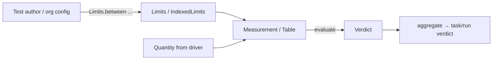
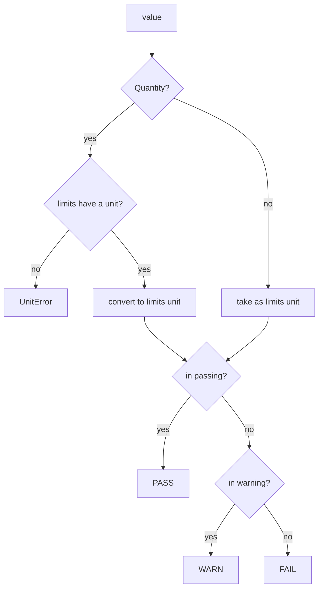

# ADR-0004: Limits and evaluation: turning a value into PASS, WARN or FAIL

| | |
|---|---|
| **Status** | accepted |
| **Date** | 2026-10-21 |
| **Module(s)** | `mastif.kernel.limits` |
| **Layer** | kernel |
| **Related** | ADR-0003 (units); ADR-0005 (verdicts); ADR-0006 (results use `evaluate`) |

## 1. Summary

`Limits` describe what is acceptable for one value: a passing `Range` and an optional,
wider warning `Range`. `IndexedLimits` give different limits per index, e.g. per
channel. The pure function `evaluate(value, limits)` is the **single source of truth**
for PASS/WARN/FAIL. The one idea to remember: *a verdict is a function of value and
limits, and nothing else.*

## 2. The problem, from first principles

A measurement only means something against a specification.

- **Specs have three zones, not two.** Many specifications say "4.75–5.25 V is good,
  4.5–5.5 V is tolerated but suspicious". Collapsing that to pass/fail either hides
  marginal units or rejects good ones.
- **Specs are often one-sided.** "Standby current at most 250 mA". "Output power at
  least 10 dBm".
- **Specs vary across a sweep.** Channels 7 and 8 drive longer cables, so their range is
  shifted. A spec that forgets some indices must not silently pass them.
- **Verdicts must be reproducible.** A report regenerated a year later, or a resumed
  run, must reach the same verdict from the same data. That rules out hidden state,
  such as "the limit file that was loaded at the time".
- **Unit mismatches must not pass.** A limit in V and a reading in mV must compare
  correctly. A limit in V and a reading in A must fail loudly.

**Forces:**

- Readability for test authors.
- Strictness: malformed limits are spec bugs.
- Determinism.
- JSON round trips: limits are recorded alongside results.

## 3. Where it sits in the system

- **Layer:** kernel. It is pure, and it is the core of judgement.
- **Upstream:** `Measurement` and `Table` call `evaluate` to compute their own verdicts.
  Later, the engine and org config files will build limits.
- **Downstream:** `units` (conversion) and `verdict` (the result type).

## 4. Decision

1. **`Range(low, high, inclusive=True, unit=None)`.**
   - Either bound may be `None`, which gives a one-sided range.
   - Bounds may be given as quantities. The first unit found becomes the range unit,
     and the other bound is converted to it.
   - A range with no bounds, or with `low > high`, is rejected.
2. **`Limits(passing, warning=None)`.**
   - The warning range must *contain* the passing range.
   - It is stored in the passing range's unit.
   - Shortcut constructors: `between`, `at_least`, `at_most`.
3. **Evaluation zones:**

   | Where the value falls | Verdict |
   |---|---|
   | inside `passing` | PASS |
   | else inside `warning` | WARN |
   | else | FAIL |

4. **Unit handling in `evaluate`.**
   - Quantities are converted to the limits' unit.
   - Bare numbers are assumed to already be in the limits' unit, which suits raw
     readings.
   - A quantity against unitless limits is a `UnitError`: ambiguous, so mastif refuses
     to guess.
5. **`IndexedLimits(by_index, default=None)`.**
   - It selects limits per index.
   - Index keys are stored as text, so `7` and `"7"` match, including after JSON.
   - With no default, an unlisted index is an error rather than a pass.
6. **One-sided warnings keep the other side failing.** `Limits.between(lo, hi,
   warn_high=x)` gives a warning range of `[lo, x]`, so values below `lo` FAIL. (A bug
   once fixed in this module; there is a regression test.)

## 5. Abstractions

| Name | Purpose | Invariants and behaviour |
|---|---|---|
| `Range` | One interval in one unit | At least one bound, `low <= high`, immutable. `contains(x)` expects `x` already in the range's unit. `in_unit(u)` re-expresses the range and raises `UnitError` if unitless and unit-bearing ranges are mixed. |
| `Limits` | Acceptance criteria for one value | `warning ⊇ passing`, with the warning stored in the passing unit. `unit` is the passing range's unit. |
| `Limits.between / at_least / at_most` | Readable constructors | A missing warning bound defaults to the passing bound on that side. |
| `IndexedLimits` | Limits that vary per index | Keys stored as `str`. `for_index(i)` returns specific limits, then the default, else raises `LimitsError`. |
| `evaluate(value, limits)` | **The** judging function | Pure and deterministic. Returns PASS, WARN or FAIL. Never returns ERROR or SKIPPED; those come from the engine. |

## 6. Data flow

For a table cell judged with `IndexedLimits`, the cell first picks its limits with
`for_index(row[index_column])` and then follows the same flow (ADR-0006).

## 7. Errors

| Exception | Raised when | Meaning | Who catches it, and what they do |
|---|---|---|---|
| `LimitsError` | a range with no bounds or `low > high`; a warning range that doesn't contain the passing range; `for_index` with no match and no default | the *specification* is wrong or incomplete | Nobody, routinely. Fix the spec. Raised at construction, before hardware moves. |
| `UnitError` | a quantity against unitless limits; incompatible dimensions; mixing unitless and unit-bearing ranges | a test or spec unit mistake | Fix the code or the spec. |

## 8. Guarantees and invariants

- `evaluate` is pure: same inputs, same output, no side effects, thread-safe.
- Limits are immutable and survive a JSON round trip unchanged.
- An unlisted index never silently passes unless a default was given on purpose.

## 9. Consequences

- **Positive:**
  - Marginal units are visible (WARN).
  - Specs read naturally.
  - Verdicts are reproducible from stored data.
- **Negative:**
  - Only interval limits are covered. Masks, curves and tolerance-around-nominal must be
    expressed as ranges, or built later as new limit types.
  - Bounds are floats, so exact decimal comparisons inherit binary floating-point
    behaviour.
- **Risks:** callers comparing values by hand instead of using `evaluate`. Results make
  this unnecessary by judging themselves.

## 10. Alternatives considered

- **Pass/fail only, without WARN:** rejected. It loses marginal-unit information that
  operators and process engineers need. See ADR-0005 for WARN as a verdict.
- **Limits as plain `(lo, hi)` tuples:** rejected. They carry no unit, no inclusivity
  and no validation.
- **Index keys typed as int|str:** rejected. JSON turns every key into a string, so
  int keys broke after a round trip.

## 11. Open questions and future work

- Nominal ± tolerance constructors (`Limits.around(5 * V, pct=5)`).
- Mask or curve limits for traces (spectra, frequency responses).
- Loading limits from org config files belongs to the planned config layer.

## 12. Code map

| What | Where |
|---|---|
| Implementation | `packages/mastif/src/mastif/kernel/limits.py` |
| Tests | `packages/mastif/tests/kernel/test_limits_and_verdicts.py`, plus doctests |
| Wiki | `docs/wiki/kernel.md` |

## History

- 2026-10-21: rewritten to the comprehensive template. The limits part of the old
  ADR-0002, "result model".
