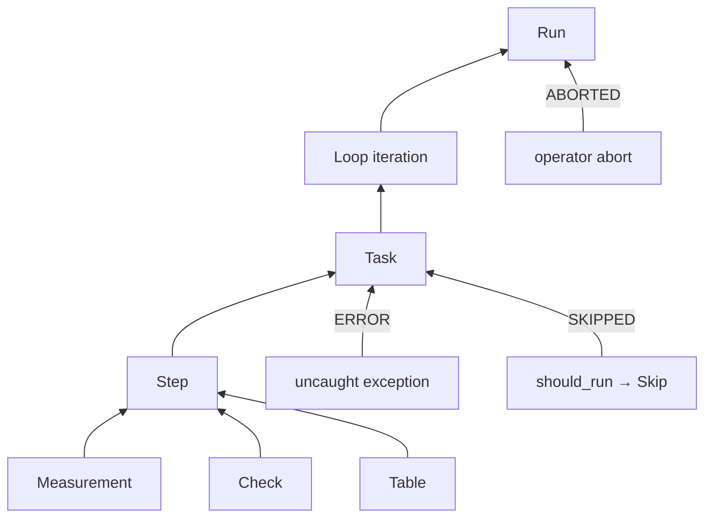

# ADR-0005: Verdicts and aggregation: one answer at every level

| | |
|---|---|
| **Status** | accepted |
| **Date** | 2026-10-21 |
| **Module(s)** | `mastif.kernel.verdict` |
| **Layer** | kernel |
| **Related** | ADR-0004 (limits produce PASS/WARN/FAIL); ADR-0006 (results); ADR-0002 (errors become ERROR) |

## 1. Summary

`Verdict` is the outcome of anything that can be judged: a measurement, a step, a task,
a loop iteration, a whole run. Its values are PASS, WARN, FAIL, ERROR, SKIPPED and
ABORTED. `aggregate(children)` combines child verdicts into a parent verdict by taking
the worst one. The one idea to remember: *ERROR (the test broke) is not FAIL (the unit
is bad), and the worst child always wins.*

## 2. The problem, from first principles

- **Operators need one answer.** A run with 500 measurements must still produce a
  single green or red light.
- **"Unit bad" and "test broken" lead to opposite actions.** FAIL means scrap or rework
  the unit. ERROR means the station or test has a problem, so retest the same unit.
  Merging the two either scraps good units or ships unverified ones.
- **Marginal units matter.** WARN lets process engineers spot drift before it becomes
  failures.
- **Skipped work must not make a run look better or worse.** A test that legitimately
  didn't apply shouldn't turn PASS into something else. But a run where *everything* was
  skipped didn't verify anything.
- **Aborts must be unmistakable.** A run stopped by an operator or a safety monitor must
  never look like a PASS.
- **The same rule at every level,** so a parent's verdict can always be recomputed from
  its children and audited.

## 3. Where it sits in the system



- **Layer:** kernel (pure).
- **Upstream:**
  - results compute PASS/WARN/FAIL
  - the planned engine adds ERROR, SKIPPED and ABORTED, and calls `aggregate` at every
    level
- **Downstream:** none.

## 4. Decision

1. **The six verdicts**, as lowercase string values (`StrEnum`), so they read naturally
   in JSON and YAML:

   | Verdict | Meaning | Produced by |
   |---|---|---|
   | `PASS` | everything judged was within passing limits | results |
   | `WARN` | nothing failed, but something was marginal | results |
   | `FAIL` | the unit did not meet a limit or check | results, `assert` in a task (planned) |
   | `ERROR` | the test could not complete | uncaught exception (planned engine) |
   | `SKIPPED` | deliberately not run | task `should_run`, missing inputs (planned) |
   | `ABORTED` | stopped early by an operator or monitor | engine (planned) |

2. **Precedence:** ABORTED > ERROR > FAIL > WARN > PASS > SKIPPED. `aggregate` returns
   the highest-ranked child verdict.
3. **No children gives SKIPPED,** because nothing was judged.
4. **WARN is a verdict, not a flag on PASS.** A flag would vanish during aggregation.
   As a verdict it propagates to the run.

## 5. Abstractions

| Name | Purpose | Invariants and behaviour |
|---|---|---|
| `Verdict` | The outcome enum | Its values are stable strings, part of stored formats. Never rename them without a schema version bump. |
| `aggregate(verdicts)` | Parent verdict from children | Pure. Order-independent. An empty input gives `SKIPPED`. Skipped children are ignored unless all were skipped. |

## 6. Data flow

Aggregation is applied bottom-up. Every level uses the same function:

```
cells → table → step → task → loop iteration → loop → run
```

Example: `[PASS, SKIPPED, WARN]` gives WARN. `[WARN, ERROR]` gives ERROR.
`[SKIPPED, SKIPPED]` gives SKIPPED.

## 7. Errors

None. `aggregate` accepts any iterable of `Verdict`. A non-`Verdict` element raises
`KeyError` from the rank lookup, which is a programming mistake.

## 8. Guarantees and invariants

- Deterministic and order-independent.
- A single child ERROR or FAIL anywhere always reaches the run verdict, unless the run
  was ABORTED.
- An aborted run is always ABORTED, whatever its children did.

## 9. Consequences

- **Positive:**
  - One rule, auditable at every level.
  - Reacting to FAIL and to ERROR can be automated separately.
- **Negative:**
  - A run with one ERROR in an unrelated task is ERROR overall. Reports must show
    *which* children decided the verdict. That is a reporting concern for later.
- **Risks:** org code inventing extra verdicts. Extending the enum is a format change
  and requires an ADR.

## 10. Alternatives considered

- **Boolean pass/fail:** rejected. It loses ERROR vs FAIL, and loses WARN.
- **ERROR ranked below FAIL:** rejected. A run where the test broke can't claim to have
  verified anything, so "unknown" must dominate "known bad" for automation purposes.
  The FAIL children remain visible in the report.
- **Empty gives PASS:** rejected. It would let a run that executed nothing report
  PASS.

## 11. Open questions and future work

- Dispositions, such as operator overrides like "accept with deviation", will be stored
  *beside* verdicts, never replacing them. That design comes with the engine and
  results store.

## 12. Code map

| What | Where |
|---|---|
| Implementation | `packages/mastif/src/mastif/kernel/verdict.py` |
| Tests | `packages/mastif/tests/kernel/test_limits_and_verdicts.py` |
| Wiki | `docs/learn/architecture/kernel.md` |

## History

- 2026-10-21: rewritten to the comprehensive template. The verdict part of the old
  ADR-0002, "result model".
