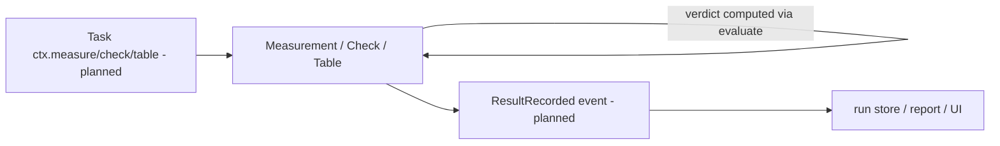
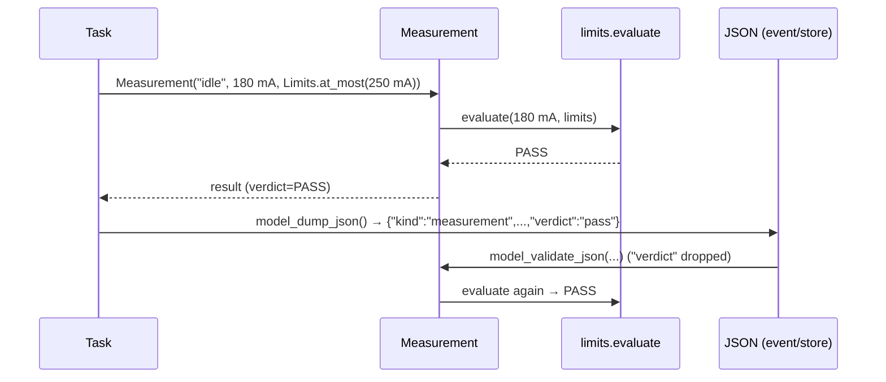

# ADR-0006: Results: self-judging measurements, checks and tables

| | |
|---|---|
| **Status** | accepted |
| **Date** | 2026-10-21 |
| **Module(s)** | `mastif.kernel.results` |
| **Layer** | kernel |
| **Related** | ADR-0003 (units); ADR-0004 (limits / `evaluate`); ADR-0005 (verdicts / `aggregate`); ADR-0007 (positions attach run context) |

## 1. Summary

A result is the evidence a test leaves behind. There are three kinds:

- a `Measurement`: one value, optionally against limits
- a `Check`: one boolean condition
- a `Table`: many values from an inner loop, judged per cell

Each kind **computes its own verdict** from its data and cannot be given one. A stored
verdict is dropped and recomputed whenever a result is loaded. The one idea to
remember: *a result can never claim a verdict its own numbers contradict.*

## 2. The problem, from first principles

- **Results are evidence.** Customers, auditors and process engineers rely on test
  records to decide whether a shipped unit was verified. A record whose PASS doesn't
  follow from its numbers is worse than no record.
- **Verdicts supplied by callers drift from the data.** Copy-paste errors, a forgotten
  `if`, a log-scraping script that misreads a line, an edited JSON file. If the verdict
  is a field anyone can set, all of these produce plausible-looking lies.
- **Inner loops produce lots of data.** Sweeping 8 channels × 3 frequencies × 2
  quantities as separate measurements scatters related data, and makes reports and
  plots painful. That data is naturally a table, but each cell still needs a verdict.
- **Results cross boundaries.** From the task to events, the run store, the UI and
  exports. They must round-trip through JSON without losing anything.
- **Mistakes should surface where they're made.** A measurement in volts against limits
  in amps should fail on the line that builds it, not in a report generator weeks later.

## 3. Where it sits in the system

- **Layer:** kernel, pure data with logic.
- **Upstream:**
  - test tasks, through the planned task context (`ctx.measure(...)` etc.)
  - reports and UIs, which read results
- **Downstream:**
  - `limits.evaluate`
  - `verdict.aggregate`
  - `units.Quantity`
- **Not in results:** run id, position, slot, timestamp. The engine attaches these once
  per event, so results stay small and reusable.

## 4. Decision

1. **Three result kinds** in a discriminated union, `Result`, keyed by `kind`:
   `"measurement"`, `"check"` or `"table"`.
2. **Verdicts are computed properties.** They are serialised for readers, but on input a
   `verdict` key (and the table's `cell_verdicts`/`row_verdicts`) is **dropped and
   recomputed**.
3. **Fail at construction.** Building a measurement or table evaluates it once, so unit
   or limit mistakes raise immediately.
4. **Measurements accept quantities.** `Measurement("idle", 180 * mA, limits)` splits the
   quantity into `value=180.0` and `unit="mA"`.
5. **Tables are judged cell by cell.**
   - Only columns listed in `limits` are judged; other columns (indices, notes) are
     carried along.
   - A judged cell that is missing or non-numeric is FAIL.
   - A column with `IndexedLimits` picks the limits for each row using the row's
     `index` column.
   - A row's verdict is its worst cell, or PASS if it has no judged cells. The table's
     verdict is its worst row, or PASS if it is empty.
6. **No limits gives PASS:** the value is recorded for information only.

## 5. Abstractions

| Name | Purpose | Invariants and behaviour |
|---|---|---|
| `Measurement(name, value, limits=None, *, unit=None)` | One numeric value | Immutable. `verdict` comes from `evaluate`, or PASS without limits. `quantity` gives the value as a `Quantity`. Raises `UnitError` at construction on a unit mismatch. |
| `Check(name, passed, detail="")` | One boolean condition | `verdict` is PASS if `passed`, else FAIL. `detail` should hold the evidence ("expected 2.1, got 2.0"). |
| `Table(name, columns, rows, index=None, units={}, limits={})` | Grid of values from an inner loop | The rectangular shape is enforced. Referenced columns must exist. `IndexedLimits` require `index`. Provides `cell_verdicts`, `row_verdicts`, `verdict` and `column(name)`. |
| `Result` | Union type for (de)serialising any result | Use `TypeAdapter(Result)` or `list[Result]` fields. |
| `Cell` | Allowed cell values | `float \| int \| str \| bool \| None`. Bools are *not* treated as numbers when judging. |

## 6. Data flow

**Failure path:** `Measurement("v", 1 * V, Limits.at_most(250 * mA))` raises `UnitError`
inside the constructor, so the task's line is in the traceback.

## 7. Errors

| Exception | Raised when | Meaning | Who catches it, and what they do |
|---|---|---|---|
| `UnitError` | the value's unit can't be compared with the limits | a test or spec unit mistake | Fix the code. The planned engine records it as ERROR. |
| `LimitsError` | ragged table rows; limits or units on unknown columns; `IndexedLimits` without `index`; an index missing from `IndexedLimits` with no default | a malformed table or incomplete spec | Fix the code or the spec. |
| `pydantic.ValidationError` | wrong field types; unknown fields | malformed input | Fix the input. |

## 8. Guarantees and invariants

- A result's verdict always equals what its data and limits imply, including after a
  JSON round trip.
- Results are immutable and hashable where their fields are.
- Constructing a result never does I/O.

## 9. Consequences

- **Positive:**
  - Tamper-evident records.
  - Mistakes surface at the line that made them.
  - Tables keep sweep data together while still judging every cell.
- **Negative:**
  - Re-judging on load costs a little CPU. That is negligible at test-station scale.
  - A table's limits are per column, not per cell. Two-dimensional limit grids would
    need a new limit type.
- **Risks:** someone adding a writable `verdict` "for convenience". The tests pin this
  behaviour down.

## 10. Alternatives considered

- **Caller-supplied verdicts:** rejected. That is the drift described in section 2.
- **Measurement per cell instead of tables:** rejected. It scatters related data and
  bloats events.
- **Results carrying their own run context:** rejected. It duplicates the run id and
  position into every result and couples the kernel to engine concepts.

## 11. Open questions and future work

- Attachments (plots, raw traces, files) will be a separate artefact concept with the
  engine, not a result kind.
- Whether `Check` should support a "skipped" state, or whether that stays a task-level
  concept.

## 12. Code map

| What | Where |
|---|---|
| Implementation | `packages/mastif/src/mastif/kernel/results.py` |
| Tests | `packages/mastif/tests/kernel/test_results_and_ids.py`, plus doctests |
| Wiki | `docs/wiki/kernel.md` |

## History

- 2026-10-21: rewritten to the comprehensive template. The results part of the old
  ADR-0002, "result model".
