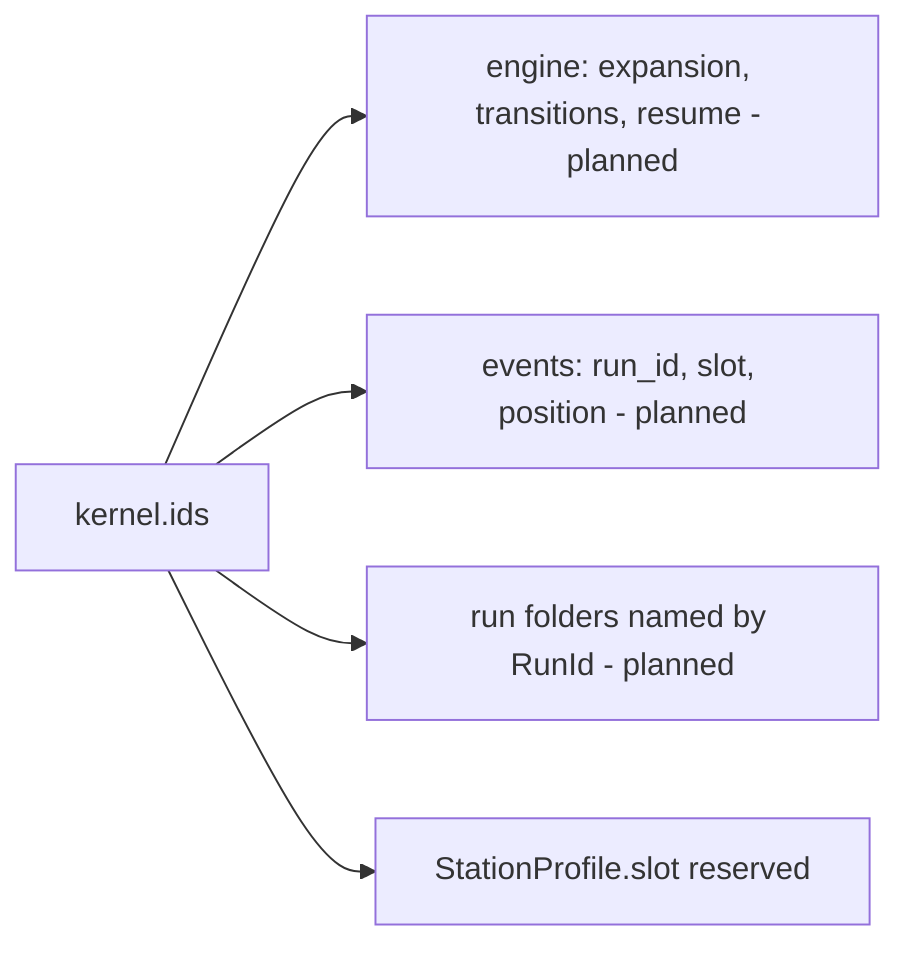
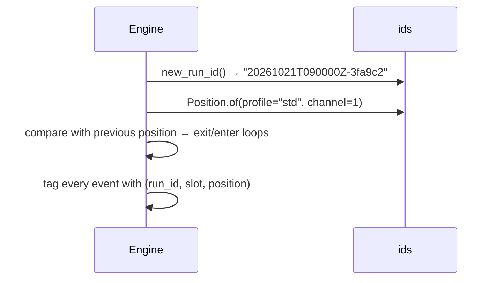

# ADR-0007: Identifiers: run ids, slot ids and plan positions

| | |
|---|---|
| **Status** | accepted |
| **Date** | 2026-10-21 |
| **Module(s)** | `mastif.kernel.ids` |
| **Layer** | kernel |
| **Related** | ADR-0006 (results get context from these); ADR-0021 (profile reserves `slot`); planned engine ADRs (positions drive loop transitions and resume) |

## 1. Summary

Three identifiers name *where a piece of data came from*:

- `RunId`: which run. It sorts by start time.
- `SlotId`: which DUT slot on a fixture.
- `Position`: where in the plan's nested loops.

They live in the kernel so the engine, stores, events and API all share exactly the
same keys. The one idea to remember: *every event will carry (run, slot, position), so
any result can be traced back to exactly when and where it was produced.*

## 2. The problem, from first principles

- **Traceability.** A result without "which run, which unit, which loop iteration" can't
  be audited or re-plotted.
- **Runs must sort and be unique.** Operators browse run folders chronologically. Two
  runs started in the same second on the same station must not collide.
- **Multi-DUT fixtures exist.** Many fixtures test several units at once. mastif runs
  one slot today. If slot ids were added later, every stored format would change, so
  they are carried from day one with a default.
- **Plans have nested loops**, e.g. "for each firmware profile, for each channel, run
  these tasks". The engine needs to know the current loop values. Comparing two
  consecutive positions tells it which loops to exit and which to enter: reflash
  firmware only when the profile changes. Resuming a crashed run also means "continue
  from position X". Positions must be ordered (outer loop first), comparable and
  hashable.

## 3. Where it sits in the system

- **Layer:** kernel.
- **Upstream:**
  - mostly the planned engine and stores
  - the station profile's reserved `slot` field

## 4. Decision

1. **`RunId` is a string, `YYYYMMDDTHHMMSSZ-xxxxxx`.** That is a UTC timestamp plus 6 hex
   characters of randomness. `new_run_id(now=None)` accepts an injected time, for
   predictable tests.
2. **`SlotId` is a string,** with `DEFAULT_SLOT = "0"` for single-DUT stations.
3. **`Position` is an immutable, hashable Pydantic model.**
   - It holds an ordered tuple of `(loop name, value)` pairs, outermost loop first.
   - Values are `str | int | float | bool`.
   - The empty position is the root, used for tasks outside any loop.
4. **Order is part of identity.** `Position.of(a=1, b=2) != Position.of(b=2, a=1)`,
   because loop nesting differs.
5. **A stable text key** `"profile=std/channel=1"` is used in item ids, logs and file
   names.

## 5. Abstractions

| Name | Purpose | Invariants and behaviour |
|---|---|---|
| `RunId` | Names a run | Sorts chronologically. Unique with very high probability. |
| `new_run_id(now=None)` | Create a run id | Uses UTC. The random suffix comes from `secrets`. |
| `SlotId`, `DEFAULT_SLOT` | Names a DUT slot | Single-slot stations always use `"0"`. |
| `LoopValue` | Allowed loop values | Scalars only, so positions stay hashable and JSON-friendly. |
| `Position` | Point in the loop nest | Immutable, hashable, ordered. |
| `Position.of(**values)` | Build from keywords | Keyword order is the nesting order. |
| `Position.get(name)` | Value of one loop | Raises `KeyError` if the loop is absent. |
| `Position.as_dict()` | Values as a dict | Order is preserved. |
| `Position.names` | Loop names | Outermost first. |
| `Position.key` | Stable text form | `""` for the root. `str()` shows `"<root>"`. |

## 6. Data flow

Planned usage by the engine:

## 7. Errors

| Exception | Raised when | Meaning | Who catches it |
|---|---|---|---|
| `KeyError` | `Position.get` for an absent loop | the task asked for a loop it isn't inside | Fix the task or the plan. |
| `pydantic.ValidationError` | non-scalar loop values | malformed position | Fix the input. |

## 8. Guarantees and invariants

- Positions are immutable and hashable, so they are safe as dict keys, e.g. for scoping
  context values.
- `key` is stable across processes and Python versions.
- Run ids sort by start time, to one-second resolution.

## 9. Consequences

- **Positive:**
  - Every later stored format can include full provenance from day one.
  - Multi-DUT support can be added later without changing data formats.
- **Negative:** run ids are tied to the station clock. A wrong clock makes ordering
  wrong; uniqueness is unaffected.

## 10. Alternatives considered

- **UUID4 run ids:** rejected. They are unique but not human-sortable.
- **Positions as plain dicts:** rejected. They aren't hashable, and their order isn't
  guaranteed in every serialisation.
- **Adding slots later:** rejected. It would change every event and result format.

## 11. Open questions and future work

- Whether run ids should include the station name. Today the run folder's location can
  carry it.

## 12. Code map

| What | Where |
|---|---|
| Implementation | `packages/mastif/src/mastif/kernel/ids.py` |
| Tests | `packages/mastif/tests/kernel/test_results_and_ids.py`, plus doctests |
| Wiki | `docs/wiki/kernel.md` |

## History

- 2026-10-21: created.
