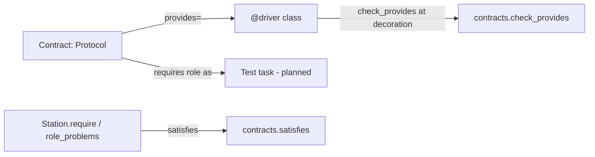

# ADR-0008: Contracts: describing what a test needs, not which device provides it

| | |
|---|---|
| **Status** | accepted |
| **Date** | 2026-10-21 |
| **Module(s)** | `mastif.resources.contracts` |
| **Layer** | resources |
| **Related** | ADR-0009 (built-in contracts); ADR-0011 (`@driver` checks contracts); ADR-0023 (station checks roles against contracts) |

## 1. Summary

A **contract** is a capability a test needs, written as a plain `typing.Protocol`. For
example, "something that can set a voltage and measure a current". Drivers declare
which contracts they provide. Tests ask for a contract by role. mastif checks the match
structurally, both when the driver is defined and when the station is built. The one
idea to remember: *tests depend on capabilities; only drivers know devices.*

## 2. The problem, from first principles

- **Hardware differs between stations; test intent doesn't.** "Power the board at 12 V
  and check idle current" is the same test whether the bench has brand A or brand B
  supply. If the test calls brand A's driver directly, it has to be rewritten for brand
  B, and two copies drift apart.
- **Hardware gets replaced.** Instruments break, go obsolete, or get upgraded. Swapping
  one should mean changing a station profile, not editing tests.
- **Simulation needs a stand-in.** CI and early development run without hardware. A
  simulator is just another thing that satisfies the same capability.
- **Mismatches must surface early.** A driver that claims to be a power supply but lacks
  `measure_current` should fail when the org's module is imported, not halfway through
  a production run.

**Forces:**

- Defining a contract must take seconds, with no mastif base classes. Orgs define most
  of their own contracts.
- Static type checkers should understand them.
- The runtime check must be strict enough to catch real mistakes, without forcing
  inheritance.

## 3. Where it sits in the system



- **Layer:** resources. It is the vocabulary of hardware capabilities.
- **Upstream:**
  - `@driver`/`@dut` (definition-time check)
  - `DriverSpec.provides_contract` and `Station` (role checks)
  - `mastif_testing.assert_satisfies`
- **Downstream:** `inspect` and `typing` only.

## 4. Decision

1. **A contract is any `typing.Protocol`.** Defining one needs no mastif import.
2. **The check is structural, and includes parameters.** For each public method or
   property the contract declares (inherited ones included):
   - The member must exist on the class.
   - A property must be a property.
   - A method must be callable.
   - A method must accept every call the contract allows. mastif binds dummy arguments
     shaped like the contract's signature to the implementation's signature.
     Implementations may add optional parameters or `*args/**kwargs`; they may not
     require more parameters, or accept fewer.
3. **Problems are structured.** Each problem is a `ContractProblem(member, ProblemKind)`,
   not free text, so tooling can react to it, e.g. generate stubs for `MISSING`.
4. **`@contract(...)` is optional metadata.** Today it carries `safe_state`: either a
   method name taking no arguments (`"open_all"`), or a function receiving the resource
   (`lambda psu: psu.output(False)`). The station uses it to make resources safe when
   the driver has no `safe_state()` of its own.
5. **Plain attribute annotations aren't checked.** A member like `channel_count: int` is
   usually set in `__init__`, so it isn't visible on the class.
6. **Why not `typing.runtime_checkable` + `isinstance`?** That check only looks at
   member *names*, never parameters. It also needs every contract decorated, works on
   instances rather than classes (`issubclass` refuses protocols with properties), and
   explains nothing. Static checkers do compare signatures, but only in projects that
   run one, and not when mastif loads a driver.

## 5. Abstractions

| Name | Purpose | Invariants and behaviour |
|---|---|---|
| `contract(*, name=None, safe_state=None)` | Optional decorator adding metadata | Returns the *same* class with `__mastif_contract__` set. No wrapper, hence no `functools.wraps`. |
| `ContractInfo(name, safe_state)` | The metadata | `contract_info(proto)` returns it, or a default holding just the class name. |
| `contract_members(proto)` | Required public members | Walks the Protocol MRO and skips `_private` names and plain annotations. Order is the definition order. |
| `ProblemKind` | Kinds of mismatch | `MISSING`, `NOT_CALLABLE`, `NOT_A_PROPERTY`, `INCOMPATIBLE_PARAMETERS`. |
| `ContractProblem(member, kind)` | One mismatch | `str()` gives `"member: kind"`. |
| `contract_problems(cls, proto)` | Explain every mismatch | An empty list means satisfied. |
| `satisfies(cls, proto)` | Yes/no check | `not contract_problems(...)`. |
| `check_provides(owner, cls, contracts)` | Enforce declared contracts | Raises one `ContractMismatch` listing every problem in every contract. |

## 6. Data flow

```mermaid
sequenceDiagram
    participant Org as Org module import
    participant Dec as @driver
    participant C as contracts
    Org->>Dec: @driver("acme.psu-x", provides=[PowerSupply]) class PsuX
    Dec->>C: check_provides("acme.psu-x", PsuX, (PowerSupply,))
    C->>C: contract_members(PowerSupply)
    loop each member
        C->>C: getattr_static(PsuX, name); bind dummy args
    end
    alt problems found
        C--xOrg: ContractMismatch("acme.psu-x does not provide PowerSupply: output: missing")
    else ok
        C-->>Dec: return → DriverSpec attached
    end
```

Later, when a task asks for `requires("psu_main")` as a `PowerSupply`,
`Station.require` checks again. The check passes if the driver *declared* the contract
or satisfies it structurally (ADR-0011, ADR-0023).

## 7. Errors

| Exception | Raised when | Meaning | Who catches it, and what they do |
|---|---|---|---|
| `ContractMismatch` (a `DriverDefinitionError`) | `check_provides` finds problems | the driver code doesn't implement what it claims | Nobody at run time. It fails the org's import or tests; fix the driver. |

## 8. Guarantees and invariants

- Pure introspection: no instances are created, no I/O happens.
- Deterministic problem order: contract member order.
- `@contract` never changes class identity or behaviour.

## 9. Consequences

- **Positive:**
  - Contracts take seconds to write.
  - Drivers stay plain classes.
  - Mismatches fail early with precise messages.
- **Negative:**
  - Parameter *types* aren't checked at run time, only their shape. Use a static
    checker for types.
  - Plain attribute members aren't checked.
- **Risks:** contracts so broad that every driver implements half of them. Prefer
  several small contracts.

## 10. Alternatives considered

- **ABC base classes:** rejected. They couple org classes to mastif and force
  inheritance (ADR-0011).
- **`runtime_checkable` only:** rejected (point 6).
- **One universal instrument interface** (`send/receive/configure`): rejected. It hides
  what a test actually needs, and pushes protocol details into tests.

## 11. Open questions and future work

- More contract metadata may come: required health checks, capability parameters such
  as "max voltage", and units for documentation.

## 12. Code map

| What | Where |
|---|---|
| Implementation | `packages/mastif/src/mastif/resources/contracts.py` |
| Tests | `packages/mastif/tests/resources/test_contracts_and_identity.py`, plus doctests |
| Wiki | `docs/wiki/resources.md`, `docs/wiki/guides/write-a-driver.md` |

## History

- 2026-10-21: created. `ProblemKind`/`ContractProblem` replaced the free-text problems,
  at the user's request.
