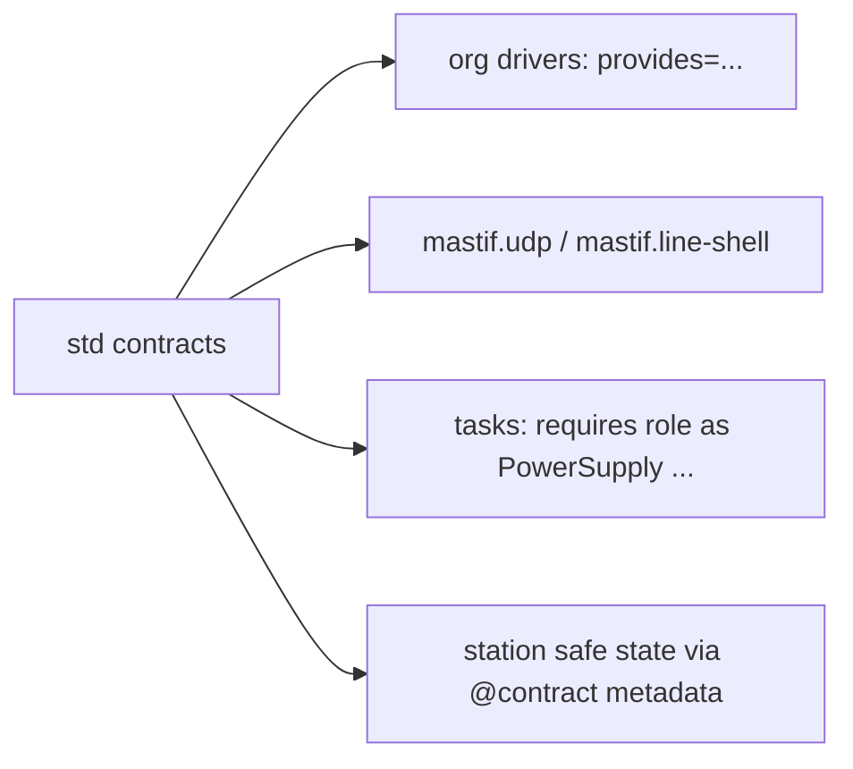

# ADR-0009: Standard contracts: a small, optional starter vocabulary

| | |
|---|---|
| **Status** | accepted |
| **Date** | 2026-10-21 |
| **Module(s)** | `mastif.resources.std` |
| **Layer** | resources |
| **Related** | ADR-0008 (what contracts are); ADR-0019/0020 (built-in channels implement `MessageChannel`/`Shell`); ADR-0022 (safe-state actions) |

## 1. Summary

mastif ships a handful of opt-in contracts for resources found at almost every station:

- `PowerSupply`, `SignalSource`, `PowerMeter`, `Switch`, `Relay`, `DigitalIO`, `Axis`
  for instruments
- `Shell` and `MessageChannel` for talking to DUTs

They are deliberately small. The one idea to remember: *these are a starting point and
a shared vocabulary, not the official model of these instruments. Orgs extend or
replace them freely.*

## 2. The problem, from first principles

- **Day-one productivity.** A new org shouldn't have to design a power-supply contract
  before its first test runs.
- **Shared examples.** Docs, simulators, the testing kit and the built-in channel
  drivers need *some* common contracts to refer to.
- **The opposite risk: lowest-common-denominator models.** A "complete" power-supply
  contract covering every feature of every brand would be huge, and wrong for everyone.
  mastif must not become the arbiter of what a power supply is.

**Forces:** be small enough to be uncontroversial, and useful enough to run real tests.

## 3. Where it sits in the system



## 4. Decision

1. **Conventions.**
   - Physical values are `Quantity` (ADR-0003).
   - Timeouts are float seconds, because they configure I/O rather than describe the
     device.
   - Port, channel and line names are strings or ints, chosen by the station profile.
2. **Safe states are declared where they're obvious:**

   | Contract | Safe-state action |
   |---|---|
   | `PowerSupply` | `output(False)` |
   | `SignalSource` | `output(False)` |
   | `Relay` | `open_all()` |
   | `Axis` | `stop()` |

   `Switch`, `DigitalIO`, `PowerMeter`, `Shell` and `MessageChannel` have no universal
   safe state, so they declare none.
3. **DUT communication contracts:**
   - `Shell.execute(cmd, timeout) -> ShellResult` covers consoles (serial, Telnet,
     SSH).
   - `MessageChannel` covers message protocols, with three patterns: `send`
     (fire-and-forget), `request(msg, match, timeout, retries)` (reply picked out by a
     matcher among other traffic), and `subscribe(handler)` (unsolicited messages). It
     returns an unsubscribe function.
4. **`ShellResult(command, output, exit_code=None, stderr="")`** is a model. Its `ok`
   property is True unless the exit code is non-zero; "unknown" counts as ok.
   `stderr` holds error output when the shell keeps it separate (SSH exec channels
   do, ADR-0033); consoles mix it into `output` and leave `stderr` empty.
5. **Extend by inheritance, replace by definition:**
   `class ProtectedSupply(PowerSupply, Protocol)` adds members. An org can also simply
   define its own `PowerSupply`.

## 5. Abstractions

| Contract | Members | Typical driver |
|---|---|---|
| `PowerSupply` | `set_voltage(Volts)`, `set_current_limit(Amps)`, `output(bool)`, `measure_voltage() -> Volts`, `measure_current() -> Amps` | bench DC supply |
| `SignalSource` | `set_frequency(Hertz)`, `set_level(Quantity)`, `output(bool)` | RF or function generator |
| `PowerMeter` | `measure_power() -> Watts` (dBm or W) | power sensor, analyser marker |
| `Switch` | `route(a, b)`, `clear()` | RF matrix, mux |
| `Relay` | `set(channel, closed)`, `is_closed(channel)`, `open_all()` | relay bank |
| `DigitalIO` | `write(line, high)`, `read(line) -> bool` | DIO card, fixture sensors |
| `Axis` | `move_to(Quantity)`, `position()`, `home()`, `stop()` | turntable, linear stage |
| `Shell` | `execute(command, timeout=5.0) -> ShellResult` | `mastif.line-shell`, `mastif.ssh-shell` |
| `MessageChannel` | `send`, `request`, `subscribe` | `mastif.udp` |

## 6. Data flow

There is no flow of its own. These are interface definitions, used along the flows in
ADR-0011 and ADR-0023. A typical task:

```
psu.set_voltage(12 * V)  →  driver → instrument
psu.measure_current()    →  Quantity → Measurement(..., Limits.at_most(250 * mA))
```

## 7. Errors

None are defined here. Implementations raise transport, protocol or fault errors
(ADR-0002).

## 8. Guarantees and invariants

- The contracts are plain Protocols. Importing them has no side effects.
- Safe-state actions take no arguments other than the resource.

## 9. Consequences

- **Positive:**
  - Immediate usefulness.
  - Shared examples.
  - Built-in channel drivers have a contract to implement.
- **Negative:** some orgs will outgrow these quickly. That is expected.
- **Risks:** pressure to grow these contracts over time. Additions need an ADR, and
  should be rare. Prefer new, separate contracts.

## 10. Alternatives considered

- **No built-in contracts:** rejected. Every example and simulator would need to invent
  its own, and onboarding would be slower.
- **Comprehensive instrument models** (an IVI-like scope): rejected as out of scope and
  domain-biased.

## 11. Open questions and future work

- Possibly `Oscilloscope`, `SpectrumAnalyzer` and `Multimeter`, if demand shows they can
  be kept small.

## 12. Code map

| What | Where |
|---|---|
| Implementation | `packages/mastif/src/mastif/resources/std.py` |
| Tests | `packages/mastif/tests/resources/test_contracts_and_identity.py` |
| Wiki | `docs/wiki/resources.md` |

## History

- 2026-10-21: created.
- 2026-10-25: `ShellResult` gained `stderr` (default empty), for SSH command execution (ADR-0033, ADR-0034). Backwards compatible.
