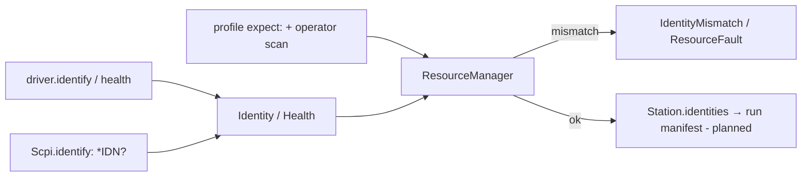
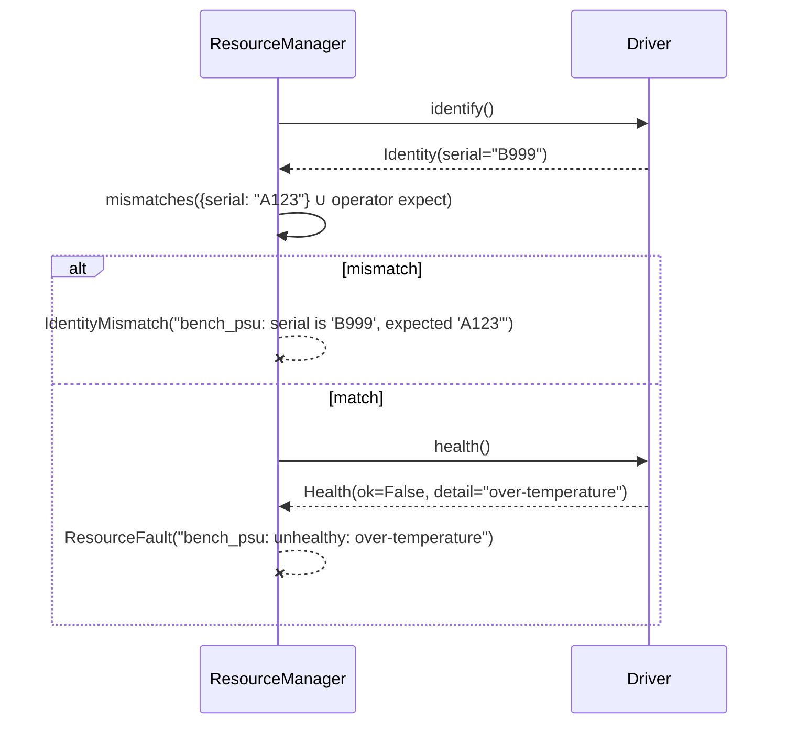

# ADR-0010: Identity and health: "who are you?" and "are you fit to use?"

| | |
|---|---|
| **Status** | accepted |
| **Date** | 2026-10-21 |
| **Module(s)** | `mastif.resources.identity` |
| **Layer** | resources |
| **Related** | ADR-0011 (drivers implement `identify`/`health`); ADR-0016 (`Scpi.identify`); ADR-0021 (`expect:` in profiles); ADR-0022 (manager checks both) |

## 1. Summary

`Identity` is what a resource reports about itself: vendor, model, serial, revision,
plus free-form `extra` facts. `Health` says whether the resource is fit for use right
now, with diagnostic readings. The station compares identities against the profile's
`expect:` block and refuses unhealthy resources, *before* any test touches them. The
one idea to remember: *never drive or measure the wrong device, or a sick one.*

## 2. The problem, from first principles

- **The wrong device is a silent disaster.** Two benches swap supplies, or an operator
  puts the previous unit back in the fixture. Everything "works", and the results are
  recorded against the wrong serial number or the wrong calibration. Checking identity
  before use turns that into an immediate, explained stop.
- **Traceability.** Every result should name the exact instruments and DUT that produced
  it, including revisions and serial numbers. That needs one common identity shape for
  all resources.
- **Fitness is not presence.** An instrument can answer `*IDN?` while reporting an
  over-temperature fault, or being out of calibration. Testing with it produces
  meaningless data.
- **Devices differ in what they report.** Some give everything, some only a serial. A
  DUT may need its part number checked. The model must allow partial information and
  arbitrary extra facts.

## 3. Where it sits in the system

## 4. Decision

1. **`Identity`** is immutable. Its fields are `vendor`, `model`, `serial`, `revision`
   (all optional) and `extra: dict[str, str]`.
2. **`Identity.get(field)`** looks up a standard field, or falls back to `extra`.
   Profiles can therefore `expect:` any fact with one syntax.
3. **`Identity.mismatches(expected)`** compares exactly, after converting expected values
   to text. YAML may parse a serial like `1234` as an int, and it still matches.
   **An unreported field counts as a mismatch**, because "unknown" isn't proof.
4. **`Health(ok, detail="", readings={})`**, plus the shortcut `Health.good(**readings)`.
   Readings are scalars recorded for diagnosis.
5. Both are optional for drivers. The consequences, enforced by the station
   (ADR-0022):
   - With `expect:` set, a driver that can't `identify()` is an `IdentityMismatch`.
   - With no `health()` hook, the resource is assumed healthy.

## 5. Abstractions

| Name | Purpose | Invariants and behaviour |
|---|---|---|
| `Identity` | Who a resource is | Immutable. All fields optional. |
| `Identity.get(field)` | Field lookup | Standard field, else `extra`, else `None`. |
| `Identity.mismatches(expected)` | Compare with expectations | Returns `{field: (expected, actual)}`. Empty means a match. Comparison is on text. |
| `Health` | Fitness right now | `ok` is required. `detail` explains a failure. |
| `Health.good(**readings)` | Shortcut | `ok=True`. |
| `Reading` | Allowed reading values | `float \| int \| str \| bool`. |

## 6. Data flow

## 7. Errors

This module raises none itself. The checks that use it raise errors in the
`ResourceManager` (ADR-0022):

| Exception | Raised when | Who catches it |
|---|---|---|
| `IdentityMismatch` | `mismatches` is non-empty, or `expect:` is set with no `identify()` | The operator must fix the bench. The engine aborts before any task runs. |
| `ResourceFault` | `health().ok` is False | Fix or replace the instrument. |

## 8. Guarantees and invariants

- Comparison is exact text equality. There is no fuzzy matching.
- Identities and health are plain data, safe to serialise into manifests.

## 9. Consequences

- **Positive:**
  - Wrong devices and faulty instruments are stopped before use.
  - Provenance is uniform.
- **Negative:**
  - Exact matching means firmware revisions must be expected precisely, or not at all.
  - There are no version ranges (yet).

## 10. Alternatives considered

- **Identity as a free-form dict:** rejected. Without standard fields, reports and UIs
  can't rely on a serial being present.
- **Treating unreported fields as matching:** rejected. Unsafe by construction.

## 11. Open questions and future work

- Version-range or pattern expectations, e.g. `revision: ">=1.4"`.
- Calibration-due dates as a first-class health input.

## 12. Code map

| What | Where |
|---|---|
| Implementation | `packages/mastif/src/mastif/resources/identity.py` |
| Tests | `packages/mastif/tests/resources/test_contracts_and_identity.py`; `packages/mastif/tests/station/test_station.py` |
| Wiki | `docs/learn/architecture/resources.md`, `docs/learn/architecture/station.md` |

## History

- 2026-10-21: created.
