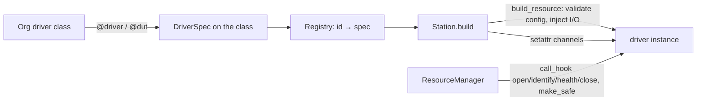
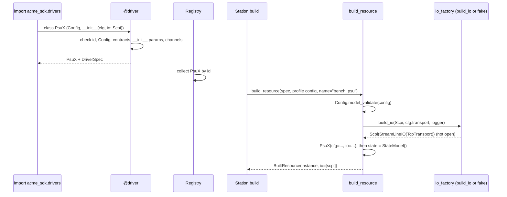

# ADR-0011: Drivers and DUT types: `@driver`, `@dut`, injection and lifecycle hooks

| | |
|---|---|
| **Status** | accepted |
| **Date** | 2026-10-21 |
| **Module(s)** | `mastif.resources.driver` (and the doc-only `mastif.resources._examples`) |
| **Layer** | resources |
| **Related** | ADR-0008 (contracts); ADR-0012 (registry); ADR-0013/0018 (transport configs and I/O injection); ADR-0022 (lifecycle order); ADR-0023 (channels attached by the station) |

## 1. Summary

A **driver** is a plain class marked `@driver("org.name", provides=[...])`. It is the
only place where knowledge of one specific device lives. It declares:

- its settings, as a nested `Config(DriverConfig)`
- the I/O it needs, by annotating `__init__` parameters (`io: Scpi`)
- optional lifecycle hooks: `open`, `identify`, `health`, `safe_state`, `close`,
  `children`

A **DUT type** is the same thing marked `@dut`, usually with **channels** (`console:
Shell = channel()`) and a **state** model. The decorators validate everything when the
class is defined and attach a `DriverSpec`. They register nothing. The one idea to
remember: *a driver says what to send; the station decides where it goes.*

## 2. The problem, from first principles

- **Device knowledge must live in exactly one place.** If command strings for a supply
  appear in tests, a firmware change means hunting through every test.
- **Writing a driver must be quick.** Orgs write many drivers. Base classes, factories
  and registration boilerplate slow them down, and invite copy-paste.
- **Where a device is connected varies per bench.** A driver that opens its own socket
  to a hard-coded IP can't be reused or tested. The connection belongs in the station
  profile and should be *given* to the driver.
- **Mistakes in org code should fail in the org's CI, not at a station.** Typos in ids,
  configs that skip validation, `__init__` parameters nobody can supply, missing
  contract methods.
- **DUTs need several ways in at once**, e.g. a serial console for commands and UDP for
  data. Which physical port each uses differs per bench. And DUTs have live state
  (booted, firmware loaded, mode) that matters for resuming runs.
- **Devices have a lifecycle** (connect, verify, check, make safe, release). Its order
  is safety-critical and must be identical for every device. It therefore belongs to
  the station, not to each driver (ADR-0022). Drivers only supply the steps.

## 3. Where it sits in the system

- **Layer:** resources.
- **Upstream:**
  - org SDK code (decorators)
  - `Registry`
  - `Station` (`build_resource`)
  - `ResourceManager` (hooks, `make_safe`)
  - `mastif_testing.check_lifecycle`
- **Downstream:**
  - contracts (`check_provides`)
  - the transport factory (`build_io`)
  - Pydantic

## 4. Decision

1. **Decorator, not base class.** `@driver(id, provides=(), state=None)` and
   `@dut(...)` return the class unchanged, with `__mastif_driver__ = DriverSpec(...)`
   attached. **Nothing is registered at import** (ADR-0001, ADR-0012).
2. **Definition-time validation**, raising `DriverDefinitionError`/`ContractMismatch`:
   - The id must look like `org.name`: lowercase, dot-separated (`^[a-z0-9_]+(\.[a-z0-9_-]+)+$`).
   - `Config`, if present, must subclass `DriverConfig`. If absent, `NoConfig` (empty)
     is used.
   - `state`, if given, must be a Pydantic model.
   - Every contract in `provides` must be satisfied (ADR-0008).
   - **Every `__init__` parameter must be suppliable:**

     | Annotation | What it receives |
     |---|---|
     | a `DriverConfig` subclass | the validated config |
     | one of `IO_TYPES` (`StreamTransport`, `LineIO`, `Scpi`, `DatagramChannel`) | built I/O |
     | `logging.Logger` | a logger named after the resource |
     | `Settings` (`mastif.infra.config`) | the application settings given to `Station.build(settings=...)` (ADR-0026) |
     | anything else | must have a default |

   - Asking for I/O requires a `transport` field on `Config`.
   - Every `channel()` needs a contract annotation.
3. **`DriverConfig`** is a frozen Pydantic model with `extra="forbid"`, so a typo in a
   profile's `config:` fails loudly.
4. **Injection happens at build time, I/O happens later.** `build_resource(spec,
   raw_config, name=, io_factory=build_io, logger=)` validates the config, builds (but
   does not open) the I/O objects, creates the instance, and creates `self.state` from
   the state model unless `__init__` set it. Tests pass an `io_factory` that returns
   fakes: the same path, no special mocking.
5. **Channels.**
   - `name: Contract = channel(optional=False)` declares a channel.
   - At class level, `channel()` returns a non-data descriptor (`_ChannelMarker`). Once
     the station attaches the real channel object as an instance attribute, that
     attribute wins.
   - Reading an unattached required channel raises `ResourceError`. An optional
     channel left unmapped reads as `None`.
6. **Lifecycle hooks are optional and found structurally.** `call_hook(obj, name)`
   calls the hook if present, and `has_hook` tests for one. The station decides the
   order (ADR-0022).
7. **Safe state: the driver's own hook wins.** `make_safe(built)` calls the driver's
   `safe_state()` if it has one. Otherwise it runs the `@contract` safe-state action
   of every provided contract. It returns whether anything ran.
8. **Contracts can be served without being declared.**
   `DriverSpec.provides_contract(proto)` is true if the contract is declared, *or* the
   class satisfies it structurally, so orgs can use contracts the driver author never
   knew about.
9. **DUT state.** For type checkers, DUT classes should annotate `state: MyState`,
   because the attribute is created by mastif.
10. **`_examples.ExamplePsu`** is a tiny SCPI power-supply driver used only by docstring
    examples. It is not public API, and is not registered.

## 5. Abstractions

| Name | Purpose | Invariants and behaviour |
|---|---|---|
| `driver(id, *, provides, state)` | Mark an instrument driver | Validates; attaches a spec; returns the same class. |
| `dut(id, *, provides, state)` | Mark a DUT type | Same, with `kind="dut"`. |
| `DriverConfig` | Base for a driver's settings | Frozen, `extra="forbid"`. |
| `NoConfig` | Config of drivers without one | Accepts only `{}`. |
| `channel(*, optional)` | Declare a DUT channel | Must be annotated with a contract. |
| `ChannelSpec(name, contract, optional)` | Recorded channel declaration | Stored in `DriverSpec.channels`. |
| `DriverSpec` | Everything learned at decoration | Fields: `id`, `cls`, `kind`, `provides`, `config_model`, `config_param`, `io_params`, `logger_param`, `channels`, `state_model`, `settings_param`. Frozen. |
| `DriverSpec.provides_contract(p)` | Can this driver serve role type `p`? | Declared, or structurally satisfied. |
| `spec_of(cls)` / `is_driver(obj)` | Read or detect a spec | `spec_of` raises `DriverDefinitionError` on undecorated classes. |
| `BuiltResource(name, spec, instance, config, io)` | A constructed driver plus its I/O | `io` lists injected objects in parameter order; the station opens them before the driver. |
| `build_resource(..., settings=None)` | Construct from a profile config | No I/O. Raises `ValidationError` or `DriverDefinitionError`, or `ResourceError` if the driver needs settings and none were given. |
| `call_hook` / `has_hook` | Optional hook helpers | A missing hook gives `None` / `False`. |
| `make_safe(built)` | Reach the safe state | Driver hook first, else contract actions. Returns bool. |
| `LIFECYCLE_HOOKS` | The recognised hook names | `open, identify, health, safe_state, close` (plus `children`, used by the station). |
| `IoFactory` | Type of the I/O factory | `(want, transport_config, logger) -> object`. |

## 6. Data flow

What follows: the station attaches channels; then `ResourceManager` opens the I/O,
channels, `open()`, `identify()`, `health()`, `children()` (ADR-0022).

## 7. Errors

| Exception | Raised when | Meaning | Who catches it, and what they do |
|---|---|---|---|
| `DriverDefinitionError` | bad id; `Config` not a `DriverConfig`; `state` not a model; an unsuppliable `__init__` parameter; I/O without a `transport` field; a channel without an annotation; `spec_of` on an undecorated class; unresolvable annotations | the org's driver code is wrong | It fails the import or the org's tests. Fix the class. |
| `ContractMismatch` | `provides` not satisfied | the driver doesn't implement what it claims | Fix the class. |
| `ResourceError` | reading an unattached required channel | a DUT used outside a station | Build the DUT through the station, or attach channels in tests. |
| `pydantic.ValidationError` | invalid profile config in `build_resource` | a profile mistake | The station wraps it in `StationError` with the resource name. |

Hooks may raise anything. The station handles hook errors (ADR-0022).

## 8. Guarantees and invariants

- Decorating never registers anything and never changes the class's behaviour.
- `build_resource` performs no I/O.
- Every driver instance receives exactly what its annotations asked for. Nothing is
  hidden or global.
- A spec is immutable once attached.

## 9. Consequences

- **Positive:**
  - A full driver is a decorator, a `Config` and a few methods.
  - It can be unit-tested with fakes through the real construction path.
  - Errors appear in the org's CI.
- **Negative:**
  - Injection is driven by annotations, so annotations must be resolvable at
    decoration time. Classes defined inside functions referencing local types can hit
    this.
  - `self.state` is created dynamically, so it needs an annotation for type checkers.
- **Risks:** drivers growing business logic. Keep test logic in tasks and device
  knowledge in drivers.

## 10. Alternatives considered

- **Base classes (`class PsuX(mastif.Driver, PowerSupply)`):** rejected. They couple org
  code to mastif internals, encourage deep inheritance, and make the lifecycle
  ambiguous (who calls `super()`?).
- **Global registration at import:** rejected (ADR-0012).
- **Drivers opening their own connections:** rejected. That defeats per-bench
  configuration and fake injection.
- **Generic `**kwargs` config dicts:** rejected. Typos pass silently, and IDEs can't
  help.

## 11. Open questions and future work

- Scope per resource (`run` vs `task`) for long-running resources.
- Locks for resources marked `shared` on multi-DUT stations.
- Whether to allow async drivers. The current decision is sync (ADR in the engine
  plan).

## 12. Code map

| What | Where |
|---|---|
| Implementation | `packages/mastif/src/mastif/resources/driver.py` |
| Doc example driver | `packages/mastif/src/mastif/resources/_examples.py` |
| Tests | `packages/mastif/tests/resources/test_drivers.py`, plus doctests |
| Wiki | `docs/learn/architecture/resources.md`, `docs/wiki/guides/write-a-driver.md`, `docs/wiki/guides/write-a-dut.md` |

## History

- 2026-10-21: created. Replaces part of the old ADR-0003, "resource model".
- 2026-10-25: drivers can receive the application settings by annotating an `__init__`
  parameter with `Settings` (dependency injection; ADR-0026). The injection rules are
  now an internal `_InitPlan`.
