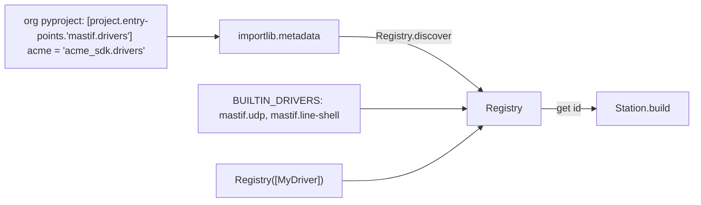
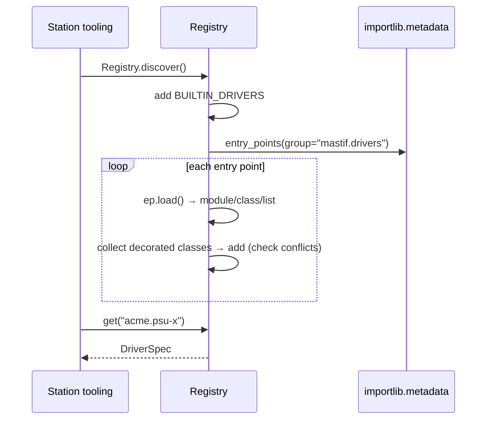

# ADR-0012: Driver registry: explicit, side-effect-free discovery

| | |
|---|---|
| **Status** | accepted |
| **Date** | 2026-10-21 |
| **Module(s)** | `mastif.resources.registry`, `mastif.resources.channels` (`BUILTIN_DRIVERS`) |
| **Layer** | resources |
| **Related** | ADR-0001 (core never imports org code); ADR-0011 (specs); ADR-0019/0020 (built-ins); ADR-0023 (station looks drivers up) |

## 1. Summary

The `Registry` maps driver ids (`"acme.psu-x"`) to `DriverSpec`s. It is an ordinary
object, built either from an explicit list of classes or modules (in tests), or by
reading the `mastif.drivers` **entry points** of every installed package (at a
station). mastif's built-in channel drivers are always included unless excluded. The one
idea to remember: *which drivers exist is decided by what is installed and what you ask
for, never by which modules happened to be imported.*

## 2. The problem, from first principles

- **A profile names a driver by id.** Something must map `driver: acme.psu-x` to a
  class, without mastif knowing org package names (ADR-0001).
- **Import-time registration is fragile.** If decorating a class registered it
  globally, the available drivers would depend on import order. A station could work
  only because some unrelated module imported the driver first. Tests would leak
  registrations into each other.
- **Id conflicts must be caught.** Two packages both claiming `acme.psu-x` make a
  profile ambiguous. That must fail loudly, never "last import wins".
- **Typos must be helpful.** "Driver not found" should list what *is* available.

## 3. Where it sits in the system

## 4. Decision

1. **The registry is explicit.** `Registry(classes=(), *, builtin=True)` accepts driver
   classes, modules containing them, or iterables of either.
2. **`Registry.discover(group="mastif.drivers", *, builtin=True)`** loads every entry
   point in the group. An entry point may name a module, a class or a list. Modules are
   imported only when `discover` is called.
3. **Conflicts are errors.** Adding the same class twice is harmless. Two different
   classes with one id raise `DriverDefinitionError`, naming both classes.
4. **Lookup errors help.** `get(id)` raises `DriverNotFound` listing all known ids.
5. **Built-ins are included by default.** `BUILTIN_DRIVERS` (`LineShell`,
   `UdpMessageChannel`) are added unless `builtin=False`, so a profile can always use
   `mastif.line-shell` and `mastif.udp`.

## 5. Abstractions

| Name | Purpose | Invariants and behaviour |
|---|---|---|
| `Registry` | id → `DriverSpec` | One spec per id. |
| `Registry.discover` | Build from installed packages | Raises `DriverDefinitionError` if an entry point fails to load. |
| `Registry.add(*items)` | Add classes, modules or iterables | Idempotent per class. Raises on id conflicts. |
| `Registry.get(id)` | Look up a spec | Raises `DriverNotFound`, listing the known ids. |
| `Registry.ids()` | Sorted known ids | For tooling and messages. |
| `id in registry` | Membership test | — |
| `ENTRY_POINT_GROUP` | `"mastif.drivers"` | — |
| `BUILTIN_DRIVERS` | Built-in channel drivers | Lives in `mastif.resources.channels`. |

## 6. Data flow

## 7. Errors

| Exception | Raised when | Meaning | Who catches it, and what they do |
|---|---|---|---|
| `DriverNotFound` | `get` with an unknown id | a typo in the profile, or the SDK isn't installed | The station wraps it in `StationError("resource 'x': ...")`. Fix the profile or install the package. |
| `DriverDefinitionError` | an id conflict; a failing entry point (its import error is chained) | a packaging or driver bug | Fix the org package. |

## 8. Guarantees and invariants

- No module is imported until `discover()` is called.
- Every id maps to exactly one class.
- Two registries never share state.

## 9. Consequences

- **Positive:**
  - Deterministic behaviour.
  - Tests are isolated (`Registry([MyDriver], builtin=False)`).
  - Conflicts are caught.
- **Negative:** org packages must declare an entry point. That is one line of
  `pyproject.toml`, documented in the driver guide.

## 10. Alternatives considered

- **Import-time global registration:** rejected (section 2).
- **Scanning directories for `.py` files:** rejected. It bypasses packaging, is slow,
  and leads to accidental imports.
- **Referencing drivers by import path in profiles** (`acme_sdk.drivers:PsuX`):
  rejected. It ties profiles to code layout, so a refactor would break every station
  profile.

## 11. Open questions and future work

- Version constraints per driver id, e.g. a profile requiring `acme.psu-x>=2`.
- Caching discovery results for large installations.

## 12. Code map

| What | Where |
|---|---|
| Implementation | `packages/mastif/src/mastif/resources/registry.py`, `packages/mastif/src/mastif/resources/channels/__init__.py` |
| Tests | `packages/mastif/tests/resources/test_drivers.py` |
| Wiki | `docs/learn/architecture/resources.md`, `docs/wiki/guides/write-a-driver.md` |

## History

- 2026-10-21: created.
