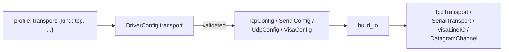

# ADR-0013: Transport configuration: where a device is, as validated data

| | |
|---|---|
| **Status** | accepted |
| **Date** | 2026-10-21 |
| **Module(s)** | `mastif.resources.transports.config` |
| **Layer** | resources |
| **Related** | ADR-0011 (drivers declare `Config.transport`); ADR-0014–0017 (the transports these configure); ADR-0018 (factory builds from these); ADR-0021 (profile YAML) |

## 1. Summary

These Pydantic models describe how to reach a device: `TcpConfig`, `SerialConfig`,
`UdpConfig`, `VisaConfig`, `TelnetConfig`, `SshConfig` and `NativeConfig`. They are joined in the `TransportConfig` union,
discriminated by a `kind` field. Line framing (terminators, encoding, timeout) is shared
through `LineSettings`. They appear in station profiles under `transport:`, and are
validated before anything is opened. The one idea to remember: *addresses are facts of
a bench, kept as data, never in driver code.*

## 2. The problem, from first principles

- **The same instrument model sits at different addresses on different benches.** The
  address belongs to the bench's profile, not the driver.
- **Typos must fail early, with the field named.** For example `potr: 5025`, or a baud
  rate of `115200O`. Discovering them as a socket error at 2 a.m. during a production
  run is too late.
- **Media differ.** The same SCPI supply may be reached over TCP on one bench and USB
  (VISA) on another. Drivers should accept several kinds where that makes sense.
- **Framing varies by device:** `\n` vs `\r\n`, ASCII vs Latin-1, and how long to wait.

## 3. Where it sits in the system



## 4. Decision

1. **One model per medium**, each frozen with `extra="forbid"` and with a literal `kind`:

   | Model | `kind` | Key fields | Defaults |
   |---|---|---|---|
   | `TcpConfig` | `tcp` | `host`, `port` (1–65535), `connect_timeout` | `connect_timeout` 5 s |
   | `SerialConfig` | `serial` | `port` (name, or a pyserial URL such as `loop://`), `baudrate`, `bytesize` (5–8), `parity` (N/E/O/M/S), `stopbits` (1, 1.5 or 2) | 9600 8N1 |
   | `UdpConfig` | `udp` | `host`, `port`, `local_host`, `local_port` | `0.0.0.0`, port `0` (OS-chosen) |
   | `VisaConfig` | `visa` | `resource`, `backend` | system backend |
   | `TelnetConfig` | `telnet` | `host`, `port`, optional login (`login_prompt`, `username`, `password_prompt`, `password`), `ready_prompt` | port 23, CRLF lines (ADR-0032) |
   | `NativeConfig` | `native` | `library` (path or name), `search_paths`, `calling_convention` (`cdecl`/`stdcall`), `thread_confined` | cdecl, confined (ADR-0035) |
   | `SshConfig` | `ssh` | `host`, `port`, `username`, `password` or `key_file` (+ `key_passphrase`), `known_hosts` (`strict`/`accept_new`), `known_hosts_file` | port 22, strict host keys (ADR-0033) |

2. **`LineSettings`** (`read_termination`, `write_termination`, `encoding`, `timeout > 0`)
   is the base of the TCP, serial, VISA, Telnet and SSH configs. UDP and native libraries
   have no lines, so they don't inherit it.
3. **`TransportConfig`** is the union of all seven, discriminated by `kind`. A driver
   chooses how strict to be: `transport: TcpConfig` (one kind), `SerialConfig |
   TcpConfig` (several), or `TransportConfig` (any).
4. **Stop bits** are validated with a validator, not a `Literal`, because `1.5` is a
   float and float literals aren't valid typing.
5. **Secrets are `pydantic.SecretStr`** (Telnet and SSH passwords, key passphrases), so
   they never appear in reprs, logs or error messages.
6. **Cross-field rules use model validators**, e.g. a Telnet `username` requires a
   `login_prompt` and vice versa.

## 5. Abstractions

The models are listed in section 4. Their invariants:

- They are immutable and reject unknown keys.
- Numeric ranges are enforced (ports, positive timeouts).
- `kind` determines the model when validating YAML or JSON.

## 6. Data flow

```
YAML → StationProfile (raw dict) → DriverConfig.model_validate → TransportConfig model
     → build_io(want, config) → unopened transport object → ResourceManager.open
```

## 7. Errors

| Exception | Raised when | Who catches it |
|---|---|---|
| `pydantic.ValidationError` | a wrong type, an out-of-range value, an unknown key, an unknown `kind`, odd stop bits, a half-specified Telnet login | The station wraps it: `StationError("resource 'x': invalid config: transport.port: ...")`. |

## 8. Guarantees and invariants

- A validated config always describes a structurally possible connection. Whether the
  device is actually there is only learned when the connection opens.
- Configs are pure data. No I/O happens at validation.

## 9. Consequences

- **Positive:**
  - Profile mistakes are caught before hardware is touched.
  - Drivers say which media they support, in their type annotations.
- **Negative:** new media mean new config models, plus factory support (ADR-0018).

## 10. Alternatives considered

- **Connection strings** (`"tcp://10.0.0.5:5025"`): rejected. They are harder to
  validate per field, and to extend with framing options.
- **Framing hard-coded in drivers:** rejected. Some devices let the user configure
  their terminators, so framing is a bench fact.

## 11. Open questions and future work

- `socket://` TCP-serial bridges already work through pyserial URLs.

## 12. Code map

| What | Where |
|---|---|
| Implementation | `packages/mastif/src/mastif/resources/transports/config.py` |
| Tests | `packages/mastif/tests/resources/test_transports.py` |
| Wiki | `docs/learn/architecture/transports.md`, `docs/wiki/guides/write-a-station-profile.md` |

## History

- 2026-10-21: created.
- 2026-10-25: added `TelnetConfig` (ADR-0032) and `SshConfig` (ADR-0033) to the union; secrets as `SecretStr`.
- 2026-10-25: added `NativeConfig` (ADR-0035).
