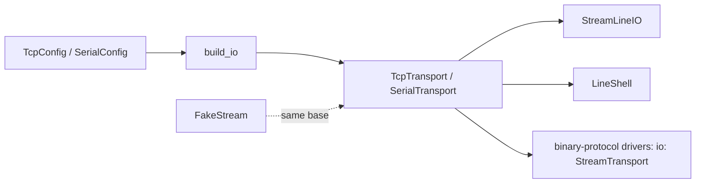
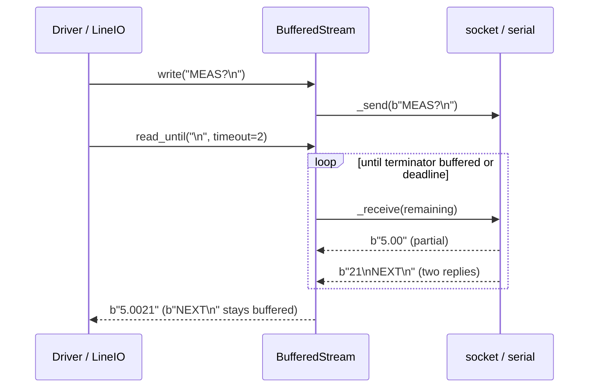

# ADR-0014: Byte streams: one shape for TCP and serial, with framing and honest timeouts

| | |
|---|---|
| **Status** | accepted |
| **Date** | 2026-10-21 |
| **Module(s)** | `mastif.resources.transports.stream` |
| **Layer** | resources |
| **Related** | ADR-0013 (configs); ADR-0015 (`LineIO` builds on streams); ADR-0020 (line shell uses a stream); ADR-0024 (`FakeStream` reuses `BufferedStream`) |

## 1. Summary

`StreamTransport` is the protocol for a bidirectional byte stream:

- `open` and `close`
- `write`
- `read_until(terminator)` and `read_exactly(n)`
- an `is_open` property

`BufferedStream` implements the shared logic once: buffering, framing, deadlines, I/O
tracing and error translation. `TcpTransport` and `SerialTransport` supply just the raw
connect, send and receive. The one idea to remember: *every read either returns what was
asked for, or raises within the timeout; it never hangs, and never loses bytes.*

## 2. The problem, from first principles

- **Most instruments and consoles are byte streams underneath:** raw TCP sockets,
  RS-232, USB-serial. Drivers need the same small set of operations regardless.
- **Packets don't align with messages.** TCP may deliver half a reply, or two replies in
  one packet. Naive code that reads one `recv()` and treats it as one reply loses or
  merges data.
- **Hanging is the worst failure mode.** A silent instrument must produce a timeout
  error, so that the run records ERROR and makes the station safe. It must never block
  forever.
- **Library exceptions are inconsistent.** `OSError`, `socket.timeout` and
  `SerialException` all need to become mastif's typed errors (ADR-0002).
- **Debugging needs a byte trace,** and that trace belongs in logs the station controls.
- **Optional dependencies.** pyserial should only be needed if serial is used.

## 3. Where it sits in the system

## 4. Decision

1. **`StreamTransport` is a `runtime_checkable` Protocol.** It is the type drivers
   annotate.
2. **`BufferedStream` is a template class.** Subclasses implement `_connect`,
   `_disconnect`, `_send(bytes)` and `_receive(timeout) -> bytes`. `_receive` returns
   `b""` on timeout. The base class provides:
   - `open()`/`close()`: idempotent. `close()` is safe to call repeatedly.
   - `write(data)`: accepts `bytes` or `str`. Text is encoded with the configured
     encoding. **No terminator is added** (see point 4).
   - `read_until(terminator, timeout=None)`: returns the bytes before the terminator
     and consumes the terminator. **Bytes after it stay buffered** for the next read.
   - `read_exactly(n, timeout=None)`: for fixed-length binary frames.
   - **Deadline handling.** The timeout covers the *whole* read, not each chunk.
   - Using a closed stream raises `TransportError("... not open")`.
   - Every write and read is traced at DEBUG: `name >> b'...'` and `name << b'...'`.
3. **The concrete transports:**

   | Transport | Behaviour |
   |---|---|
   | `TcpTransport` | `socket.create_connection` with `connect_timeout`. A refused connection becomes `TransportError("... cannot connect")`. A peer close becomes `TransportError("connection closed by peer")`. A `TimeoutError` in `recv` becomes an empty chunk, which the base class turns into a timeout. |
   | `SerialTransport` | pyserial's `serial_for_url` (so `loop://` and `socket://` work), imported only on `open`. A missing pyserial gives a `TransportError` with the install hint. `_receive` reads at least one byte, plus whatever is waiting. |

4. **Why no terminator on `write`.** Streams also carry binary protocols, where an extra
   `\n` corrupts a frame. Appending terminators is `LineIO.write_line`'s job (ADR-0015).
   A text-oriented driver should ask for `LineIO`.
5. **Loggers are injected,** defaulting to `logging.getLogger("mastif.io")`. There are
   no module-level loggers.

## 5. Abstractions

| Name | Purpose | Invariants and behaviour |
|---|---|---|
| `StreamTransport` | The protocol drivers ask for | See point 1. |
| `BufferedStream(name, timeout, logger=None, encoding="ascii")` | Shared implementation | Buffer cleared on open. Reads never drop bytes. |
| `TcpTransport(config, logger=None)` | TCP client | `name` is `"host:port"`. |
| `SerialTransport(config, logger=None)` | Serial port / pyserial URL | `name` is the port. |

## 6. Data flow

**Failure path:** the deadline passes without the terminator arriving, giving
`TransportTimeout("10.0.0.5:5025: timed out waiting for terminator b'\n'")`.

## 7. Errors

| Exception | Raised when | Meaning | Who catches it, and what they do |
|---|---|---|---|
| `TransportError` | not open; connect refused; send or receive `OSError`; peer closed; text can't be encoded; pyserial missing; port can't be opened | the bytes couldn't move | Let it propagate. The engine records ERROR, and the station makes things safe. |
| `TransportTimeout` | the deadline passed before a terminator or enough bytes arrived | the device didn't answer in time | Same. A driver may retry *idempotent* queries once. |

## 8. Guarantees and invariants

- Reads never block past their deadline (plus one OS receive granularity).
- No received byte is ever dropped. Leftovers stay buffered.
- `open`/`close` are idempotent.
- Not thread-safe: one stream is used by one driver on one thread (see the open
  question in section 11).

## 9. Consequences

- **Positive:**
  - Every stream behaves identically.
  - Fakes inherit the real framing logic.
  - Timeouts are honest.
- **Negative:**
  - No async API.
  - A slow trickle of bytes can still use up the whole timeout (by design).
- **Risks:** drivers sharing one stream from several threads. That needs a lock, and is
  out of scope today.

## 10. Alternatives considered

- **Exposing raw sockets or pyserial objects:** rejected. Every driver would re-implement
  framing and timeouts, and none could be faked uniformly.
- **asyncio streams:** rejected for drivers. The author API is synchronous by decision;
  async stays inside the engine where needed.
- **Adding terminators in `write`:** rejected (point 4).

## 11. Open questions and future work

- A thread-safety lock for streams shared by composite drivers. Today the parent owns
  the stream and calls into it serially.
- Reconnect policies (auto-reconnect on drop) as an explicit, opt-in feature.

## 12. Code map

| What | Where |
|---|---|
| Implementation | `packages/mastif/src/mastif/resources/transports/stream.py` |
| Tests | `packages/mastif/tests/resources/test_transports.py` (real localhost TCP, serial `loop://`) |
| Wiki | `docs/learn/architecture/transports.md` |

## History

- 2026-10-21: created. `write`/`read_until` accept `str`, at the user's request; adding
  terminators stays in `LineIO`.
