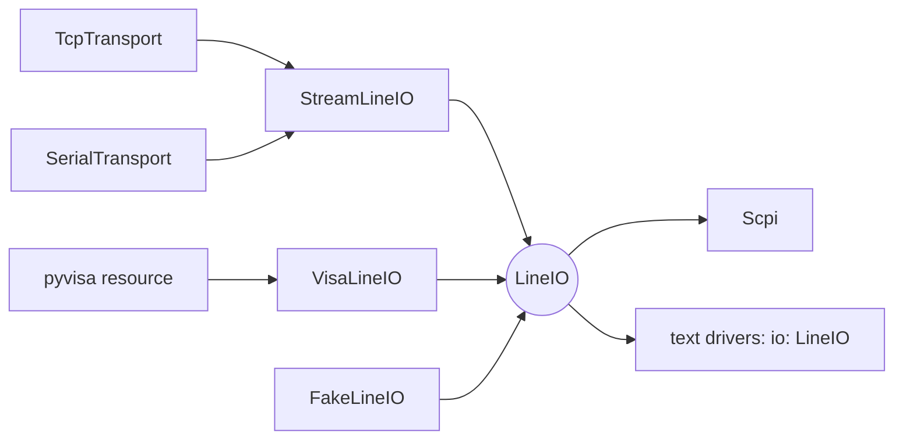
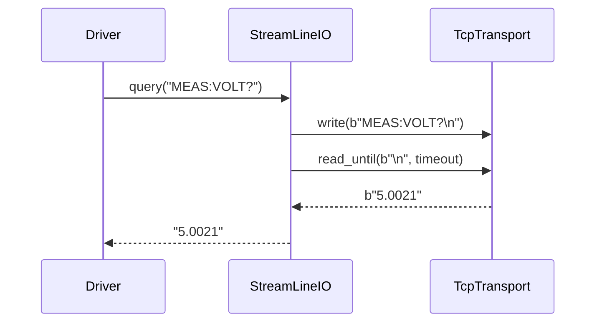

# ADR-0015: Line I/O: text conversations over streams or VISA

| | |
|---|---|
| **Status** | accepted |
| **Date** | 2026-10-21 |
| **Module(s)** | `mastif.resources.transports.lineio` |
| **Layer** | resources |
| **Related** | ADR-0013 (`LineSettings`, `VisaConfig`); ADR-0014 (streams); ADR-0016 (SCPI wraps `LineIO`); ADR-0024 (`FakeLineIO`) |

## 1. Summary

`LineIO` is the protocol for line-based text protocols:

- `write_line(text)`
- `read_line(timeout)`
- `query(text)`
- `open()` / `close()`

`StreamLineIO` implements it over any byte stream, adding encoding and terminators.
`VisaLineIO` implements it over a VISA resource, where the VISA library frames
messages itself. The one idea to remember: *a text driver is written once, and works
over TCP, serial or VISA.*

## 2. The problem, from first principles

- **Most instrument protocols are lines of text:** SCPI, many proprietary ASCII command
  sets, and consoles.
- **The same instrument is reached over different media.** It may be LAN on one bench
  and USB-TMC through VISA on another. The driver shouldn't care.
- **Encoding and terminators are fiddly.** Each driver repeating `.encode()`,
  `+ "\n"` and `.rstrip()` invites bugs.
- **VISA is different underneath.** It is message-based, its library handles
  terminators, it reports timeouts as its own error codes, and it's an optional heavy
  dependency.

## 3. Where it sits in the system

## 4. Decision

1. **`LineIO`** is a `runtime_checkable` Protocol with `open`, `close`, `write_line`,
   `read_line(timeout=None)` and `query(line, timeout=None)`.
2. **`StreamLineIO(stream, settings)`**:
   - `write_line` encodes text with `settings.encoding` and appends
     `write_termination`.
   - `read_line` reads until `read_termination`, then decodes. Encode and decode
     failures raise `TransportError`.
   - `open` and `close` pass through to the stream.
3. **`VisaLineIO(config, logger=None, resource_manager=None)`**:
   - `open` creates a pyvisa `ResourceManager(backend)`, unless one was injected (as
     in tests). It then opens the resource and applies the timeout (in milliseconds),
     terminators and encoding.
   - Every call runs through `_call`, which translates exceptions. Any error whose text
     mentions "timeout" becomes `TransportTimeout`, and everything else becomes
     `TransportError`. Matching on text avoids importing pyvisa's error codes, so the
     module works without pyvisa installed.
   - `read_line`'s `timeout` argument is ignored. VISA uses the resource timeout.
4. **The factory picks the implementation** from the transport kind (ADR-0018). Drivers
   never construct these directly.

## 5. Abstractions

| Name | Purpose | Invariants and behaviour |
|---|---|---|
| `LineIO` | The protocol text drivers ask for | Lines exclude terminators. |
| `StreamLineIO` | Lines over streams | Inherits the stream's buffering and deadline guarantees. |
| `VisaLineIO` | Lines over VISA | Optional dependency. `open` is idempotent. `close` is safe to repeat. |

## 6. Data flow

## 7. Errors

| Exception | Raised when | Meaning | Who catches it |
|---|---|---|---|
| `TransportError` | encode or decode failure; VISA open failure; pyvisa missing; other VISA errors; any stream error passing through | the I/O failed | Let it propagate. |
| `TransportTimeout` | no complete line in time (stream), or a VISA timeout | the device didn't answer | Let it propagate. Retry only idempotent queries. |

## 8. Guarantees and invariants

- Returned lines never contain the read terminator.
- `query` is exactly a `write_line` followed by a `read_line`. It doesn't flush or
  discard earlier unread lines (see section 11).

## 9. Consequences

- **Positive:**
  - Text drivers are short and medium-independent.
  - Tests use `FakeLineIO` with scripted replies.
- **Negative:**
  - Per-read timeouts aren't honoured on VISA.
  - Stray unread lines, such as asynchronous device messages, can desynchronise
    `query`. Drivers for chatty devices must handle that, or use a message channel.

## 10. Alternatives considered

- **Requiring pyvisa for everything:** rejected. It is heavy, needs a backend, and isn't
  needed for TCP or serial.
- **One class with media flags:** rejected. Two small implementations behind a Protocol
  are clearer.

## 11. Open questions and future work

- An optional `drain()` that discards stale input before a query.
- Per-call VISA timeouts.

## 12. Code map

| What | Where |
|---|---|
| Implementation | `packages/mastif/src/mastif/resources/transports/lineio.py` |
| Tests | `packages/mastif/tests/resources/test_transports.py` |
| Wiki | `docs/wiki/transports.md` |

## History

- 2026-10-21: created.
