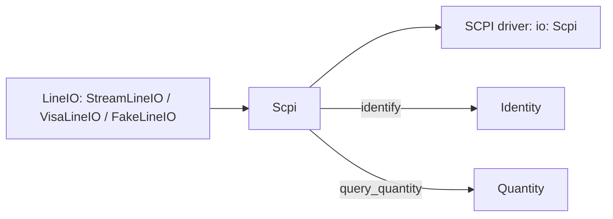
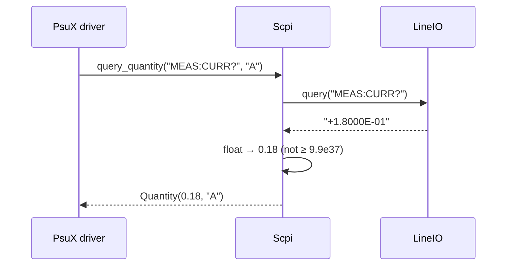

# ADR-0016: SCPI helper: the chores every SCPI driver needs, done once

| | |
|---|---|
| **Status** | accepted |
| **Date** | 2026-10-21 |
| **Module(s)** | `mastif.resources.transports.scpi` |
| **Layer** | resources |
| **Related** | ADR-0015 (wraps `LineIO`); ADR-0003 (returns `Quantity`); ADR-0010 (`identify()` returns `Identity`) |

## 1. Summary

`Scpi` wraps any `LineIO` with helpers for SCPI, the command language spoken by most
bench instruments:

- writing and querying
- number and quantity parsing, including overflow detection
- `*IDN?` into an `Identity`
- draining the `SYST:ERR?` queue
- `*RST;*CLS` and `*OPC?`

A SCPI driver becomes a list of one-line methods. The one idea to remember: *never
return a number the instrument didn't really measure.*

## 2. The problem, from first principles

- **SCPI is everywhere, and so are its chores.** Every SCPI driver parses
  `+5.0021E+00`, reads `*IDN?`, checks the error queue and resets state.
  Re-implementing these per driver leads to subtle differences.
- **SCPI has an overflow sentinel.** Instruments return `9.9E37` (and `9.91E37` for NaN)
  when a reading is over range or invalid. Parsed naively, that is a huge but valid
  float. It can pass an `at_least` limit, or corrupt averages. This is the sentinel
  problem from ADR-0002, coming from the device side.
- **Rejected commands are silent.** An instrument that doesn't understand `VOLT 12`
  simply queues an error and carries on. Unless the error queue is read, the test
  proceeds with the old setpoint.
- **Identities must be uniform** for the station's `expect:` checks (ADR-0010).

## 3. Where it sits in the system

## 4. Decision

1. **`Scpi(io, *, check_errors=False)`** wraps a `LineIO`. `open` and `close` pass
   through.
2. **Writing.** `write(cmd)` sends a command that produces no reply. With
   `check_errors=True`, each write is followed by an error-queue check, which raises
   immediately. That is slower, but useful while developing a driver.
3. **Querying and parsing:**
   - `query(cmd)` returns the stripped reply text.
   - `query_float(cmd)` parses a number. A non-number raises `ProtocolError`, and so
     does `abs(value) >= 9.9e37`.
   - `query_quantity(cmd, unit)` wraps the result in a `Quantity`.
4. **`identify()`** sends `*IDN?` and splits the reply on commas. Fields are
   stripped, empty ones become `None`, and a short reply is padded with `None`.
5. **Error queue and housekeeping:**
   - `errors(limit=32)` drains `SYST:ERR?` until the code is `0` or `+0`. The limit
     protects against a device that never reports empty.
   - `raise_on_errors(after="")` raises `ProtocolError` listing every queued error.
   - `reset()` sends `*RST` then `*CLS`.
   - `wait()` sends `*OPC?` and requires the reply `1`.

## 5. Abstractions

| Method | Returns | Raises |
|---|---|---|
| `write(cmd)` | `None` | `ProtocolError` if `check_errors` is on and the queue is non-empty |
| `query(cmd, timeout=None)` | stripped `str` | transport errors |
| `query_float(cmd, timeout=None)` | `float` | `ProtocolError` (non-number or overflow marker) |
| `query_quantity(cmd, unit, timeout=None)` | `Quantity` | as `query_float` |
| `identify()` | `Identity` | transport errors |
| `errors(limit=32)` | `list[str]` | transport errors |
| `raise_on_errors(after="")` | `None` | `ProtocolError` |
| `reset()` | `None` | transport errors |
| `wait(timeout=None)` | `None` | `ProtocolError` if the reply is not `1` |

## 6. Data flow

**Failure path:** the reply is `9.9E37`, so the query raises `ProtocolError("MEAS:CURR?
returned overflow/invalid marker '9.9E37'")`. The task gets ERROR instead of a fake
PASS.

## 7. Errors

| Exception | Raised when | Meaning | Who catches it, and what they do |
|---|---|---|---|
| `ProtocolError` | a non-numeric reply where a number is expected; an overflow or NaN marker; errors in the queue (with `check_errors`, or `raise_on_errors`); `*OPC?` not `1` | the instrument answered, but not with a valid result | Usually nobody. The task ends in ERROR. A driver may catch it to re-range and retry. |
| `TransportError` / `TransportTimeout` | pass through from `LineIO` | I/O failure | Let it propagate. |

## 8. Guarantees and invariants

- Numeric results are always real readings. Overflow and NaN markers never escape as
  numbers.
- `errors()` always terminates.

## 9. Consequences

- **Positive:**
  - Short drivers.
  - Consistent identities.
  - Silent command rejection can be detected.
- **Negative:**
  - The overflow threshold is the SCPI standard value. A device with legitimate
    readings above 9.9e37 is assumed not to exist.
  - Error-queue checks cost an extra round trip per command.

## 10. Alternatives considered

- **Leaving SCPI parsing to each driver:** rejected (section 2).
- **Always checking the error queue:** rejected as the default, for speed. It is
  available per instance.

## 11. Open questions and future work

- Binary block transfers (`#<n><len><data>`) for traces and screenshots.
- Helpers for status registers (`*STB?`, `*ESR?`).

## 12. Code map

| What | Where |
|---|---|
| Implementation | `packages/mastif/src/mastif/resources/transports/scpi.py` |
| Tests | `packages/mastif/tests/resources/test_transports.py`, plus doctests (using `FakeLineIO`) |
| Wiki | `docs/wiki/transports.md`, `docs/wiki/guides/write-a-driver.md` |

## History

- 2026-10-21: created.
