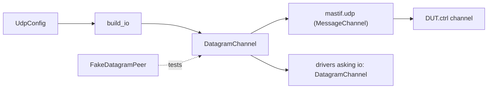
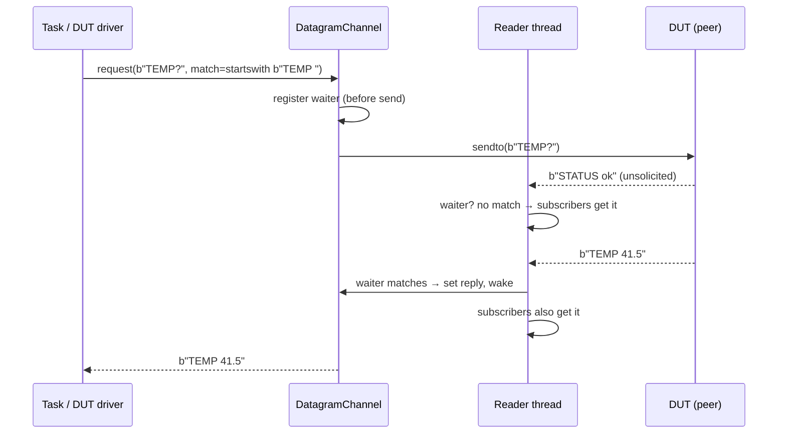

# ADR-0017: Datagram channel: UDP request/response among unsolicited traffic

| | |
|---|---|
| **Status** | accepted |
| **Date** | 2026-10-21 |
| **Module(s)** | `mastif.resources.transports.datagram` |
| **Layer** | resources |
| **Related** | ADR-0009 (`MessageChannel` contract); ADR-0013 (`UdpConfig`); ADR-0019 (`mastif.udp` wraps this); ADR-0024 (`FakeDatagramPeer`) |

## 1. Summary

`DatagramChannel` is a UDP endpoint that talks to one peer. A background reader thread
receives every datagram and routes it two ways:

- to the **oldest waiting `request`** whose matcher accepts it
- to **every subscriber**

It offers fire-and-forget `send`, `request(msg, match, timeout, retries)` and
`subscribe(handler)`. The one idea to remember: *replies are found by matching, not by
order, because a status broadcast may arrive between a command and its reply.*

## 2. The problem, from first principles

- **Many DUTs speak message protocols over UDP:** commands out, replies back, and
  unsolicited traffic (status broadcasts, streamed data, alarms) on the same socket.
- **"Send, then read the next packet" breaks.** An unsolicited message arriving first is
  mistaken for the reply. The real reply is then read as the answer to the *next*
  command. Everything shifts by one, silently.
- **Replies can be lost.** UDP doesn't retransmit, so a request needs bounded waits and
  optional retries.
- **Fast replies can be missed.** If the code starts listening only after sending, a
  reply arriving in that gap is dropped.
- **Monitoring needs all the traffic.** Loggers, alarm watchers and stream recorders
  must see every message, including replies.
- **A bug in one listener must not kill communication** for everyone else.

## 3. Where it sits in the system

## 4. Decision

1. **A plain socket plus one daemon reader thread per open channel.**
   - The socket uses a 0.1 s receive timeout, so the reader notices `close` promptly.
   - The public methods are thread-safe, under one lock around the waiters and
     subscribers.
   - The step-1 plan proposed an asyncio loop on a background thread. A plain reader
     thread delivers the same behaviour with less machinery, and keeps the synchronous
     author API (see section 10).
2. **`request` registers before sending.** A `_Pending(match)` waiter is added *before*
   the first send, so even an instant reply is caught. Each attempt sends the message
   and waits up to `timeout`. After `retries + 1` attempts it raises `TransportTimeout`.
   The waiter is always removed in `finally`.
3. **Dispatch order, per datagram:**
   - The **oldest** waiter not yet satisfied whose `match` returns True gets the reply.
     At most one waiter per datagram.
   - Then **every** subscriber is called, including for matched replies.
   - A matcher or handler that raises is logged and treated as "not interested".
4. **`close`** stops the reader, closes the socket, and wakes all waiters. A waiter
   woken by close raises `TransportError("closed while waiting for a reply")` instead of
   timing out.
5. **`subscribe(handler)` returns an unsubscribe function.** Calling it twice is
   harmless. Handlers run on the reader thread, so they must be quick.
6. **Messages from any source address are accepted.** Some DUTs reply from a different
   port. Filtering can be added if needed.

## 5. Abstractions

| Name | Purpose | Invariants and behaviour |
|---|---|---|
| `DatagramChannel(config, logger=None)` | UDP endpoint to one peer | `name` is `"host:port"`. |
| `open()` / `close()` | Bind and start the reader / stop it | Both idempotent. A bind failure raises `TransportError`. |
| `is_open`, `local_port` | State and bound port | `local_port` raises if closed. |
| `send(message)` | Fire-and-forget | Raises `TransportError` if closed or the send fails. |
| `request(message, match, timeout=1.0, retries=0)` | Request/response by matching | Returns the first matching datagram. |
| `subscribe(handler) -> unsubscribe` | Observe all traffic | Handlers run on the reader thread. |
| `Handler`, `Matcher` | Callable types | `bytes -> None`, `bytes -> bool`. |

## 6. Data flow

**Failure paths:**

- No match within `timeout`: resend, up to `retries` more times, then
  `TransportTimeout`.
- `close()` during the wait: `TransportError`.

## 7. Errors

| Exception | Raised when | Meaning | Who catches it, and what they do |
|---|---|---|---|
| `TransportError` | bind failure; send on a closed channel; send `OSError`; closed while waiting | the channel can't communicate | Let it propagate. |
| `TransportTimeout` | no matching reply after all attempts | the DUT didn't answer (or the matcher is wrong) | Let it propagate. Check the matcher if this happens often. |

Matcher and handler exceptions are **logged, never raised**. This is deliberate, so one
listener can't break the channel.

## 8. Guarantees and invariants

- A reply that arrives after `request` was called is never missed.
- Each datagram satisfies at most one waiter, the oldest matching one.
- Subscribers see every datagram, in arrival order.
- `close` never leaves a caller blocked.

## 9. Consequences

- **Positive:**
  - Robust against interleaved traffic.
  - Testable over real localhost UDP with `FakeDatagramPeer`.
  - No asyncio is needed by drivers.
- **Negative:**
  - One thread per open channel.
  - Slow handlers delay delivery.
  - Two concurrent requests with overlapping matchers resolve oldest-first, which may
    surprise. Matchers should be specific (e.g. include a sequence number).

## 10. Alternatives considered

- **asyncio endpoint on a background loop:** rejected for now. It adds a loop to manage,
  cross-thread futures and shutdown complexity, with no benefit at test-station message
  rates. The plan's decision to keep the author API synchronous makes the threaded
  design the natural fit.
- **Read-after-send without matching:** rejected (section 2).
- **One queue per message type:** rejected as too protocol-specific. Matchers are
  general.

## 11. Open questions and future work

- Source-address filtering.
- Bounded subscriber queues, so handlers run off the reader thread.
- Request correlation helpers (sequence numbers) for protocols that support them.

## 12. Code map

| What | Where |
|---|---|
| Implementation | `packages/mastif/src/mastif/resources/transports/datagram.py` |
| Tests | `packages/mastif/tests/resources/test_transports.py` (real UDP with `FakeDatagramPeer`) |
| Wiki | `docs/learn/architecture/transports.md` |

## History

- 2026-10-21: created. Threaded design chosen over the plan's asyncio suggestion.
