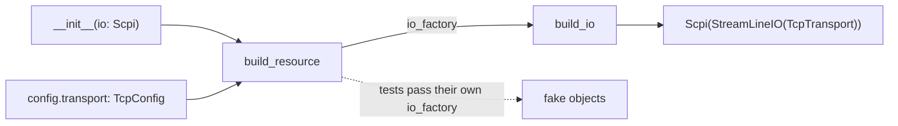
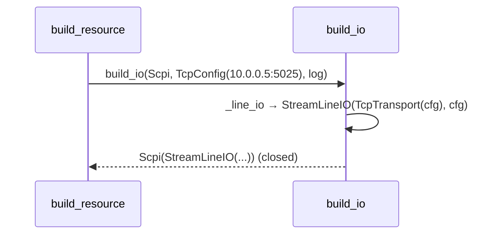

# ADR-0018: I/O injection: building what a driver asks for from what the profile says

| | |
|---|---|
| **Status** | accepted |
| **Date** | 2026-10-21 |
| **Module(s)** | `mastif.resources.transports.factory` |
| **Layer** | resources |
| **Related** | ADR-0011 (drivers annotate I/O parameters); ADR-0013 (configs); ADR-0014–0017 (the I/O types); ADR-0024 (tests replace the factory) |

## 1. Summary

`build_io(want, config, logger)` turns two facts into one unopened I/O object:

- the I/O type a driver asked for in its `__init__` annotation
- the transport config from the station profile

For example, `Scpi` plus a `TcpConfig` gives `Scpi(StreamLineIO(TcpTransport))`.
`IO_TYPES` lists what can be injected. The one idea to remember: *drivers never
construct connections, so fakes can be substituted at exactly the same point.*

## 2. The problem, from first principles

- **Two people know two halves.** The driver author knows *what kind* of I/O the device
  needs (SCPI over lines, a raw stream, datagrams). The station owner knows *where* the
  device is (an IP, a COM port, a VISA string). Neither should need the other's
  knowledge.
- **The combinations must be checked.** SCPI over UDP doesn't exist. A driver asking for
  a datagram channel on a TCP config is a definition mistake. Both should be reported
  clearly.
- **Testing should use the same path.** If tests build drivers differently from
  stations, the station's construction path goes untested.

## 3. Where it sits in the system

## 4. Decision

1. **The injectable types are**
   `IO_TYPES = (StreamTransport, LineIO, Scpi, DatagramChannel, SshSession,
   NativeLibrary)`.
2. **The combination table:**

   | Requested | tcp | serial | visa | udp | telnet | ssh |
   |---|---|---|---|---|---|---|
   | `StreamTransport` | `TcpTransport` | `SerialTransport` | ✗ | ✗ | `TelnetTransport` | `SshStreamTransport` |
   | `LineIO` | `StreamLineIO(Tcp…)` | `StreamLineIO(Serial…)` | `VisaLineIO` | ✗ | `StreamLineIO(Telnet…)` | `StreamLineIO(SshStream…)` |
   | `Scpi` | `Scpi(StreamLineIO(Tcp…))` | `Scpi(StreamLineIO(Serial…))` | `Scpi(VisaLineIO)` | ✗ | `Scpi(StreamLineIO(Telnet…))` | `Scpi(StreamLineIO(SshStream…))` |
   | `DatagramChannel` | ✗ | ✗ | ✗ | `DatagramChannel` | ✗ | ✗ |
   | `SshSession` | ✗ | ✗ | ✗ | ✗ | ✗ | `SshSession` |

   `NativeLibrary` is built only from `kind: native` (ADR-0035), and `native` provides
   nothing else.

   A ✗ raises `DriverDefinitionError("cannot provide <Type> over a '<kind>' transport")`.
3. **Every returned object has `open()`/`close()`.** Wrappers pass them through. The
   station opens I/O *before* the driver's `open()`, and closes it *after* the driver's
   `close()` (ADR-0022).
4. **The factory is a parameter, not a global.** `build_resource(...,
   io_factory=build_io)` and `Station.build(..., io_factory=...)` accept any callable
   `(want, config, logger) -> object`.

## 5. Abstractions

| Name | Purpose |
|---|---|
| `IO_TYPES` | The types `@driver` recognises as injectable `__init__` annotations |
| `build_io(want, config, logger=None)` | Construct the object, unopened |
| `_stream`, `_line_io` | Private builders for the stream- and line-capable kinds |

## 6. Data flow

## 7. Errors

| Exception | Raised when | Meaning | Who catches it |
|---|---|---|---|
| `DriverDefinitionError` | an impossible combination | the driver's `Config.transport` allows a kind its I/O can't use | The station wraps it in `StationError` with the resource name. Fix the driver's transport type. |

## 8. Guarantees and invariants

- No I/O happens here. Objects are returned closed.
- The same config always yields the same object type.

## 9. Consequences

- **Positive:**
  - Drivers are medium-agnostic.
  - Fakes slot in through the same path.
  - Impossible combinations are named.
- **Negative:** new I/O types need a factory entry and an `IO_TYPES` update. That is
  deliberate: it is an ADR-worthy extension.

## 10. Alternatives considered

- **Drivers building their own I/O from config:** rejected (ADR-0011).
- **A registry of I/O builders that orgs can extend:** deferred. No need yet, and it
  would add an extension point to maintain.

## 11. Open questions and future work

- Org-defined I/O types, e.g. CAN or I²C adapters, via an extension point.

## 12. Code map

| What | Where |
|---|---|
| Implementation | `packages/mastif/src/mastif/resources/transports/factory.py` |
| Tests | `packages/mastif/tests/resources/test_transports.py`, `test_telnet.py`, `test_ssh.py` (parametrised combination tests) |
| Wiki | `docs/learn/architecture/transports.md` |

## History

- 2026-10-21: created.
- 2026-10-25: added the `telnet` and `ssh` columns and `SshSession` as an injectable type (ADR-0032, ADR-0033).
- 2026-10-25: added `NativeLibrary` from `kind: native` (ADR-0035).
