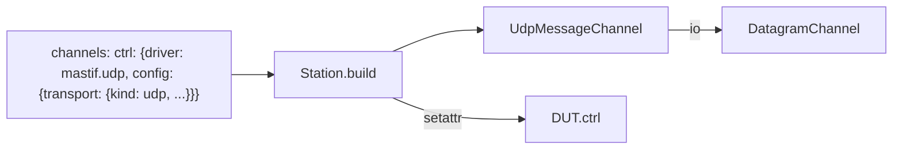

# ADR-0019: Built-in channel `mastif.udp`: a `MessageChannel` with no driver code

| | |
|---|---|
| **Status** | accepted |
| **Date** | 2026-10-21 |
| **Module(s)** | `mastif.resources.channels.udp` |
| **Layer** | resources |
| **Related** | ADR-0009 (`MessageChannel`); ADR-0017 (`DatagramChannel`); ADR-0012 (always registered); ADR-0023 (channels attached to DUTs) |

## 1. Summary

`UdpMessageChannel` (driver id `mastif.udp`) is a thin driver that exposes a
`DatagramChannel` as the standard `MessageChannel` contract. A DUT declares `ctrl:
MessageChannel = channel()`. The station profile then connects that channel to UDP
using only configuration. The one idea to remember: *common DUT plumbing is
configuration, not code.*

## 2. The problem, from first principles

- **Every org with UDP DUTs would write the same adapter:** a class that takes a UDP
  config, holds a datagram channel, and forwards `send`/`request`/`subscribe`.
- **Channels must be resources.** DUT channels are built, opened and closed by the
  station like any resource (ADR-0011, ADR-0022). The UDP behaviour therefore needs a
  registered driver id the profile can name.

## 3. Where it sits in the system



## 4. Decision

1. `@driver("mastif.udp", provides=[MessageChannel])`.
2. `Config.transport: UdpConfig`. The `DatagramChannel` is injected, and opened and
   closed by the station.
3. `send`, `request` and `subscribe` delegate directly to `DatagramChannel`. All
   semantics are those of ADR-0017.
4. It is always present in `Registry` through `BUILTIN_DRIVERS`.

## 5. Abstractions

| Name | Purpose |
|---|---|
| `UdpMessageChannel` | Adapter driver |
| `UdpMessageChannel.Config` | `transport: UdpConfig` |
| `send` / `request` / `subscribe` | Delegation |

## 6. Data flow

```
task → board.ctrl.request(...) → UdpMessageChannel.request → DatagramChannel.request → UDP
```

## 7. Errors

None of its own. Errors pass through from `DatagramChannel`: `TransportError` and
`TransportTimeout`.

## 8. Guarantees and invariants

Identical to `DatagramChannel`, because it is pure delegation.

## 9. Consequences

- **Positive:**
  - DUTs with UDP control need zero channel code.
  - A good minimal example of a channel driver.
- **Negative:** none significant.

## 10. Alternatives considered

- **Having DUTs build their own datagram channels:** rejected. It bypasses the station
  lifecycle and per-bench configuration.

## 11. Open questions and future work

- A TCP framed-message channel (length-prefixed) as another built-in, if demand appears.

## 12. Code map

| What | Where |
|---|---|
| Implementation | `packages/mastif/src/mastif/resources/channels/udp.py` |
| Tests | `packages/mastif/tests/resources/test_drivers.py`, plus doctests |
| Wiki | `docs/wiki/resources.md`, `docs/wiki/guides/write-a-dut.md` |

## History

- 2026-10-21: created.
