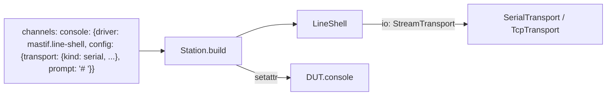
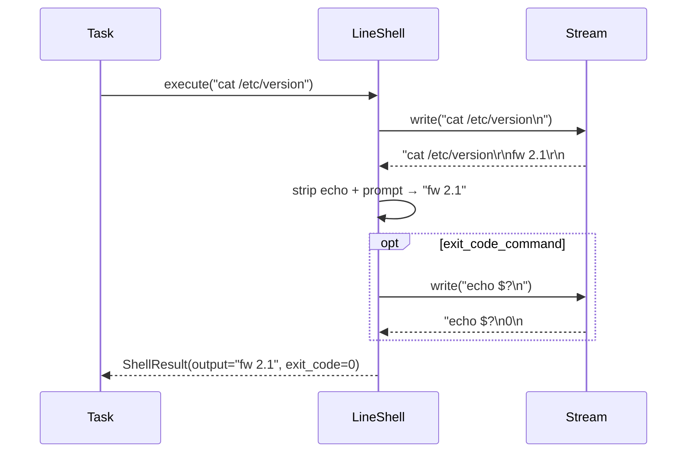

# ADR-0020: Built-in channel `mastif.line-shell`: a prompt-based console as a `Shell`

| | |
|---|---|
| **Status** | accepted |
| **Date** | 2026-10-21 |
| **Module(s)** | `mastif.resources.channels.shell` |
| **Layer** | resources |
| **Related** | ADR-0009 (`Shell`, `ShellResult`); ADR-0014 (stream); ADR-0012 (always registered); ADR-0023 (channels attached to DUTs) |

## 1. Summary

`LineShell` (driver id `mastif.line-shell`) turns a text console into the `Shell`
contract. The console may be a serial port, TCP (e.g. through a terminal server), Telnet, or an
interactive SSH shell.
`execute(cmd)` sends the command, reads until the prompt, removes the echoed command,
and returns the output. If configured, it also runs an exit-code command (`echo $?`) and
parses the result. The one idea to remember: *a DUT console becomes `execute(cmd) ->
ShellResult`, entirely from the profile.*

## 2. The problem, from first principles

- **Embedded DUTs very often expose a console:** U-Boot, Linux, an RTOS shell. Tests need
  to run commands and read their output.
- **Consoles are messy:**
  - they echo typed characters
  - they end output with a prompt that has no newline
  - they mix `\r\n` and `\n`
  - they print boot noise before the first prompt
- **Exit status isn't part of the output.** It must be asked for, and shells differ in
  whether they can report it at all.
- **Hangs must be bounded.** A command that never returns must time out, not stall the
  run.

## 3. Where it sits in the system

## 4. Decision

1. **Driver declaration.** `@driver("mastif.line-shell", provides=[Shell])`, with `io:
   StreamTransport` injected. It uses a stream rather than `LineIO`, because the prompt
   isn't newline-terminated.
2. **Config:**

   | Field | Default | Meaning |
   |---|---|---|
   | `transport` | (required) | serial, TCP, Telnet or SSH (interactive shell) |
   | `prompt` | `"$ "` | text marking "ready" |
   | `echo` | `true` | the console echoes commands |
   | `exit_code_command` | `null` | e.g. `"echo $?"` |
   | `sync_on_open` | `true` | send an empty line on open and wait for a prompt |
   | `settle_time` | 0.2 s | after that prompt, discard further prompts until the console is quiet this long |
   | `timeout` | 5 s | default wait for the prompt |

3. **`open()`** synchronises when `sync_on_open` is set. It sends the write terminator
   and reads until the prompt, which discards boot noise. It then keeps reading
   prompts until none arrives for `settle_time`. Without this, a prompt that was
   already waiting (after a login banner, typical for Telnet and SSH) plus the one
   answering the empty line would leave a stray prompt, and the first command would
   return empty output.
4. **`execute(command, timeout=None)`**:
   - Writes the command plus the write terminator, and reads until the prompt.
   - Normalises line endings.
   - Drops the first line if echo is on and that line equals the command.
   - Returns the stripped remainder as output.
   - If `exit_code_command` is set, runs it the same way and parses the result as an
     integer. Anything else raises `ProtocolError`.

## 5. Abstractions

| Name | Purpose | Behaviour |
|---|---|---|
| `LineShell` | Shell over a console | Provides `Shell`. |
| `LineShell.Config` | Console settings | Section 4. |
| `open()` | Synchronise to a fresh prompt | A missing prompt raises `TransportTimeout`. |
| `execute()` | Run one command | Returns `ShellResult(command, output, exit_code)`. |

## 6. Data flow

## 7. Errors

| Exception | Raised when | Meaning | Who catches it |
|---|---|---|---|
| `TransportTimeout` | the prompt doesn't appear in time (on open or execute) | wrong baud rate or prompt, DUT not booted, command hung | Let it propagate. A DUT driver may catch it to reboot. |
| `ProtocolError` | the exit-code command prints a non-integer | the shell doesn't support the configured exit-code command | Fix the profile. |
| `TransportError` | passes through from the stream | I/O failure | Let it propagate. |

## 8. Guarantees and invariants

- `execute` returns only after the prompt reappears, or raises.
- The output never contains the prompt, or the echoed command when echo is on.

## 9. Consequences

- **Positive:** most embedded consoles work with configuration alone.
- **Negative:**
  - A prompt string that also appears inside command output ends the read early. Choose
    distinctive prompts.
  - Login is handled by the transport (Telnet's `login_prompt`, SSH authentication),
    not by this driver; serial consoles that ask for a login aren't handled yet.
  - `settle_time` adds up to that long to every `open`.
  - ANSI colour codes are not stripped.

## 10. Alternatives considered

- **Using `LineIO`:** rejected. The prompt isn't line-terminated.
- **Regex prompts:** deferred. The plain-text prompt covers most consoles, and a regex
  could come later.

## 11. Open questions and future work

- Serial login sequences, regex prompts and ANSI stripping. For plain command
  execution over SSH, prefer `mastif.ssh-shell` (ADR-0034).

## 12. Code map

| What | Where |
|---|---|
| Implementation | `packages/mastif/src/mastif/resources/channels/shell.py` |
| Tests | `packages/mastif/tests/resources/test_drivers.py`, `test_telnet.py`, `test_ssh.py` (real Telnet and SSH servers), plus doctests (using `FakeStream`) |
| Wiki | `docs/learn/architecture/resources.md`, `docs/wiki/guides/write-a-dut.md` |

## History

- 2026-10-21: created.
- 2026-10-25: accepts Telnet and SSH transports (ADR-0032, ADR-0033); `open` now drains already-waiting prompts (`settle_time`), found while testing against a real SSH server.
