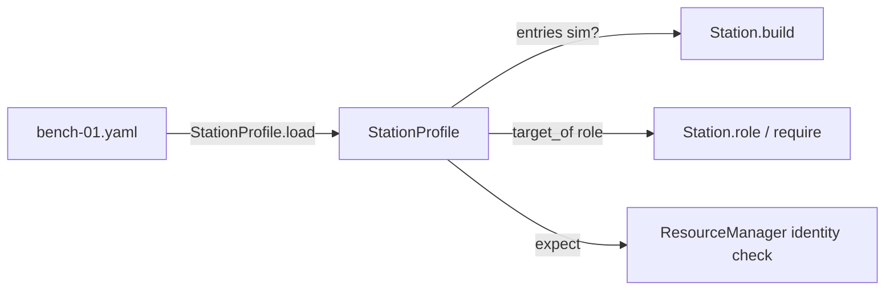
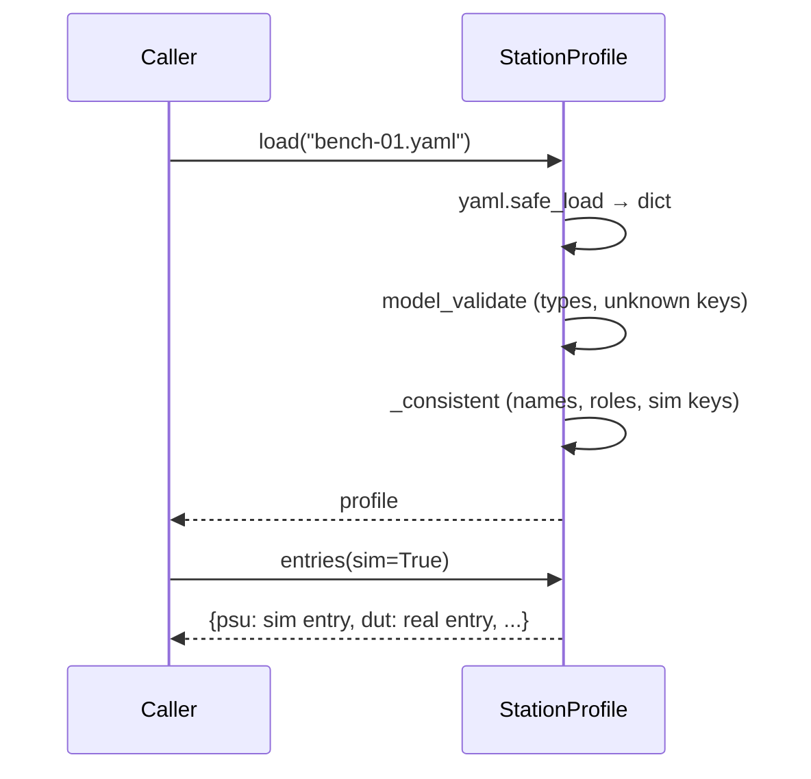

# ADR-0021: Station profile: the facts about one bench, as validated YAML

| | |
|---|---|
| **Status** | accepted |
| **Date** | 2026-10-21 |
| **Module(s)** | `mastif.station.profile` |
| **Layer** | station |
| **Related** | ADR-0010 (`expect:`); ADR-0013 (transport configs inside `config:`); ADR-0022 (open order); ADR-0023 (build and roles) |

## 1. Summary

A `StationProfile` is a YAML document describing one physical test station:

- **resources**: name → driver id, config, DUT channels, expected identity
- **roles**: the names tests use to reach resources
- **sim**: replacement entries for simulation

It holds facts only, never control flow. It is validated completely on load, with
errors that name the field. The one idea to remember: *moving tests to another bench
means changing this file, not the tests.*

## 2. The problem, from first principles

- **No two benches are identical.** Different instrument models, addresses, COM ports,
  serial numbers. That variation needs one place to live, outside both drivers and
  tests.
- **Tests must not know resource names.** If a test says `bench_psu_2`, it's tied to one
  bench. A test should say "the main supply" (a **role**). Each bench maps that role to
  whatever it has.
- **Simulation and hardware should share a profile.** Maintaining a separate sim
  profile per bench means the two drift apart. A small "replace these entries when
  simulating" section keeps them together.
- **Mistakes must be caught before power is applied:** typos, roles pointing at
  nothing, sim entries replacing nothing, malformed YAML.
- **Behaviour in config is a trap.** Once a YAML file grows `if`/`steps:`, it becomes an
  untested programming language. Profiles stay declarative.

## 3. Where it sits in the system



## 4. Decision

1. **The model:**

   ```yaml
   schema_version: 1          # optional, only 1 exists
   station: bench-01          # name recorded with every run
   description: ...           # free text
   resources:                 # opened in this order, closed in reverse
     <name>:
       driver: <org.id>
       config: {...}          # validated by the driver's Config
       channels:              # DUTs only
         <channel>: {driver: <id>, config: {...}}
       expect: {serial: A123} # identity fields that must match
       shared: false          # reserved (multi-DUT)
       slot: null             # reserved (multi-DUT)
   roles: {<role>: <resource> | <resource>.<child>}
   sim: {<resource>: <full replacement entry>}
   ```

2. **Validation on load:**
   - Resource and role names must match `^[A-Za-z_][A-Za-z0-9_-]*$`. Dots are reserved
     for `resource.child` targets.
   - Every role's root must be a resource.
   - Every `sim:` key must replace an existing resource.
   - Unknown keys anywhere are rejected (`extra="forbid"`).
   - All problems are reported together, in one `StationError`.
3. **A resource name is also a role.** `target_of(role)` returns `roles.get(role, role)`.
4. **`sim:` replaces whole entries**: driver, config, channels and expect. It does not
   merge with the real entry. The simulator's identity differs, so keeping the real
   `expect:` would always fail.
5. **Driver configs are opaque here.** `config:` stays a raw dict until `Station.build`
   validates it against the driver's `Config`. Only there is the driver known.
6. **Loading:**
   - `from_yaml(text, source=)` reports YAML syntax errors, and lists Pydantic errors
     one per line as `location: message`.
   - `load(path)` adds file-reading errors.

## 5. Abstractions

| Name | Purpose | Invariants and behaviour |
|---|---|---|
| `StationProfile` | Whole station | Immutable. Consistent names, roles and sim keys. |
| `ResourceEntry` | One instrument or DUT | `driver` required. `expect` values may be str, int or float (compared as text). |
| `ChannelEntry` | One DUT channel mapping | `driver` and `config`. |
| `from_yaml` / `load` | Parse and validate | Raise `StationError` with the source name. |
| `entries(sim=False)` | Entries to build | Profile order, with sim replacements when asked. |
| `target_of(role)` | Resolve a role name | Returns a resource name or `resource.child`. |

## 6. Data flow



## 7. Errors

| Exception | Raised when | Meaning | Who catches it |
|---|---|---|---|
| `StationError` | unreadable file; invalid YAML; schema errors (listed per line); invalid names; dangling roles; orphan sim entries | the profile is wrong | The CLI or engine shows the message. Fix the file. |

## 8. Guarantees and invariants

- A loaded profile is internally consistent. Driver existence and configs are checked
  later, by `Station.build`.
- Loading performs no hardware I/O.
- Resource order is preserved, and it defines the open order.

## 9. Consequences

- **Positive:**
  - Benches differ only in data.
  - Tests are portable.
  - One file covers both simulation and hardware.
- **Negative:**
  - Sim entries must repeat any config they need, because there is no merge.
  - No includes or inheritance between profiles yet.

## 10. Alternatives considered

- **Python station definitions:** rejected. They invite logic, are harder for
  non-programmers to edit safely, and can't be validated or diffed as cleanly.
- **Merging sim entries over real ones:** rejected (point 4).
- **Steps or recipes in the profile:** rejected. Control flow belongs in Python, where
  it can be tested.

## 11. Open questions and future work

- Profile layering (site defaults plus a bench overlay) and includes.
- Enforcing `shared`/`slot` once multi-DUT execution exists.
- A JSON Schema export for editor completion.

## 12. Code map

| What | Where |
|---|---|
| Implementation | `packages/mastif/src/mastif/station/profile.py` |
| Tests | `packages/mastif/tests/station/test_station.py`, plus doctests |
| Wiki | `docs/learn/architecture/station.md`, `docs/wiki/guides/write-a-station-profile.md` |

## History

- 2026-10-21: created.
