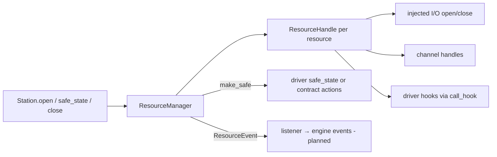
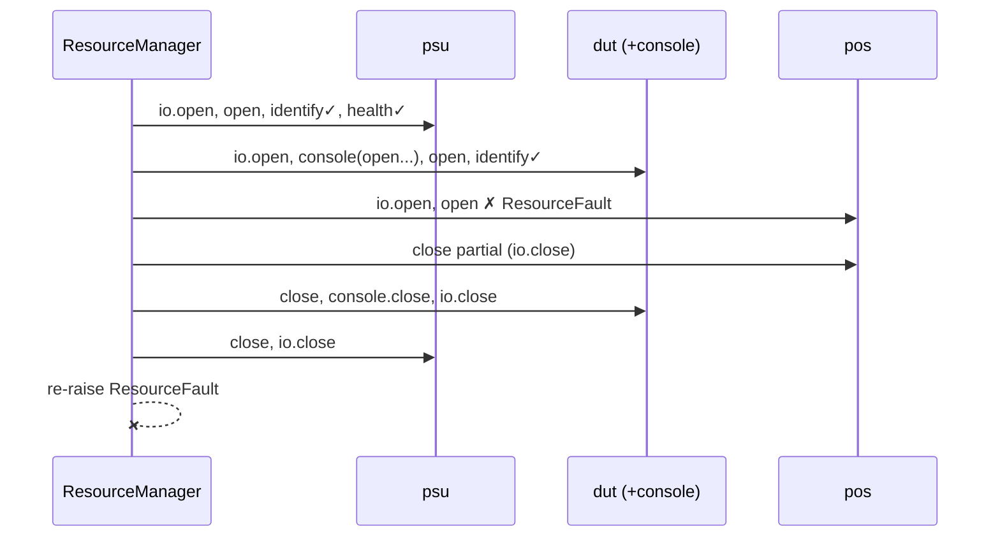

# ADR-0022: Resource manager: the safety-critical lifecycle, done once

| | |
|---|---|
| **Status** | accepted |
| **Date** | 2026-10-21 |
| **Module(s)** | `mastif.station.manager` |
| **Layer** | station |
| **Related** | ADR-0010 (identity and health); ADR-0011 (hooks, `make_safe`); ADR-0023 (owned by `Station`); ADR-0002 (errors) |

## 1. Summary

The `ResourceManager` opens a station's resources in profile order, verifies them,
makes them safe, and closes them in reverse.

Opening one resource means:

1. its I/O
2. its DUT channels
3. `open()`
4. `identify()`, checked against `expect:`
5. `health()`
6. `children()`

If anything fails, everything already opened is closed again before the error
surfaces. Safe state and close never stop at the first failure. Every step is reported
as a `ResourceEvent`. The one idea to remember: *the station is never left half-open,
and a failure never stops the others from being made safe.*

## 2. The problem, from first principles

- **Bring-up is where real-world failures cluster:** a supply switched off, the wrong
  unit in the fixture, a console with no prompt. The third of five resources failing
  must not leave the first two energised and connected.
- **Order matters for safety and correctness:**
  - A DUT's channels must be open before the DUT's `open()` uses them.
  - Identity must be checked *before* anything else is done to a device.
  - Shutdown must reverse bring-up, so dependents are released before what they depend
    on.
- **Abort must reach everything.** If an operator hits stop and one supply doesn't
  respond to "output off", the remaining instruments must still be made safe.
- **Nobody should re-implement this.** If each driver or test managed its own
  lifecycle, the ordering and rollback rules would differ, and safety would depend on
  the least careful author.
- **Observability.** The engine and UIs need to show bring-up progress, and record
  which resource failed and why.

## 3. Where it sits in the system

## 4. Decision

1. **`ResourceHandle`** holds everything about one resource at run time:
   - `built` (instance, config, I/O)
   - `entry` (profile)
   - `channels` (child handles)
   - `children`, `identity`, `health`, `is_open`
   - a private `_driver_opened` flag

   `state_snapshot()` returns the DUT state as JSON-ready data, for run snapshots.
2. **The open sequence per resource** (`_open_one`), in this order:
   1. open every injected I/O object
   2. open each channel handle, recursively, with the same rules
   3. `call_hook(open)`, which marks the driver as opened
   4. `identify()` if present. If the merged expectations (profile `expect:` plus the
      caller's `expect=`) are non-empty, they must match. Expectations without
      `identify()` raise `IdentityMismatch`.
   5. `health()` if present. `ok=False` raises `ResourceFault`.
   6. `children()` if present, stored for role resolution
   7. mark open and emit `opened`

   On any exception (`BaseException`, so `KeyboardInterrupt` is included), the manager
   emits `open_failed`, closes this resource's partial state, and re-raises.
3. **`open_all(expect=None)`** opens the handles in order. If one fails, every
   previously opened handle is closed in reverse and the error is re-raised. The
   `expect` argument carries **operator-supplied identities**, such as a scanned DUT
   serial.
4. **Closing one resource** (`_close_one`):
   - the driver's `close()`, but only if its `open()` ran
   - then channels in reverse
   - then I/O in reverse

   It collects errors and continues. It always clears `is_open` and `children`.
5. **`close_all()`** closes every opened handle in reverse. Afterwards, if any errors
   occurred, it raises a single `ResourceError` chained to the first.
6. **`safe_state_all()`** calls `make_safe` on every opened handle in reverse. It
   **never raises**: it returns `{name: exception}` for failures and emits
   `safe_state` / `safe_state_failed`. Resources with no safe-state action emit
   `safe_state` with detail `"no safe-state action"`.
7. **Events.** A `ResourceEvent(resource, phase, detail)` is emitted for: `opening`,
   `opened`, `open_failed`, `safe_state`, `safe_state_failed`, `closed`,
   `close_failed`. Every event is also logged. A listener that raises is logged and
   ignored, so a broken UI can't stop a shutdown.

## 5. Abstractions

| Name | Purpose | Invariants and behaviour |
|---|---|---|
| `ResourceHandle` | Run-time record of one resource | `instance` and `spec` shortcuts. `state_snapshot()` gives a dict or `None`. |
| `ResourceManager(handles, listener=None, logger=None)` | Lifecycle executor | Opens in the order given. |
| `open_all(expect=None)` | Bring-up with rollback | All or nothing. |
| `safe_state_all()` | Make everything safe | Never raises. Returns failures. |
| `close_all()` | Tear down | Attempts everything, then raises if anything failed. |
| `opened` | Currently open handles | In opening order. |
| `ResourceEvent`, `Phase`, `Listener` | Observability | `Phase` is a closed set of string literals. |

## 6. Data flow

**Normal end of a run** (planned engine): `safe_state_all()`, then `close_all()`.

## 7. Errors

| Exception | Raised when | Meaning | Who catches it, and what they do |
|---|---|---|---|
| `IdentityMismatch` | expected identity differs, or can't be verified | the wrong device or unit is connected | The engine aborts before tasks run. The operator fixes the bench. |
| `ResourceFault` | `health()` reports not ok | the device is unfit | Fix or replace it. |
| `ResourceError` | `close_all` had errors | some resource didn't close cleanly | Log it. The station may need a manual check. |
| anything from hooks or I/O | opening failed | see that error | Rollback has already happened. The error is unchanged. |

`safe_state_all` deliberately returns failures instead of raising.

## 8. Guarantees and invariants

- After `open_all` raises, no resource is left open.
- `safe_state_all` attempts every opened resource, whatever fails.
- `close_all` attempts every close step of every opened resource.
- A driver's `close()` is called only if its `open()` was called.
- Ordering: open follows profile order; safe state and close follow its reverse.

## 9. Consequences

- **Positive:**
  - Safety and ordering are centralised and tested once.
  - Drivers implement only steps.
  - Progress is observable.
- **Negative:**
  - The order is sequential. Slow instruments open one after another.
  - Hooks have no per-step timeouts beyond what transports enforce.
- **Risks:** a driver `open()` that blocks forever without I/O. Drivers should use
  transport timeouts.

## 10. Alternatives considered

- **Context managers per driver (`with psu:`):** rejected. They spread lifecycle and
  rollback logic across tests, and nested `with` blocks can't express "make all safe
  even if one fails".
- **Raising from safe state:** rejected. The first failure would stop the rest.
- **Parallel open:** deferred. It complicates ordering and rollback; revisit for large
  stations.

## 11. Open questions and future work

- Per-resource scope (open per run or per task) and reconnect policies.
- Timeouts per lifecycle step.
- Locks for `shared` resources on multi-DUT stations.

## 12. Code map

| What | Where |
|---|---|
| Implementation | `packages/mastif/src/mastif/station/manager.py` |
| Tests | `packages/mastif/tests/station/test_station.py` (ordering, rollback, identity, health, safe state, events) |
| Wiki | `docs/wiki/station.md`, `docs/wiki/life-of-a-station.md` |

## History

- 2026-10-21: created.
