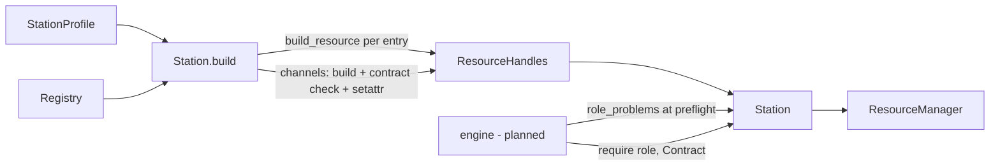
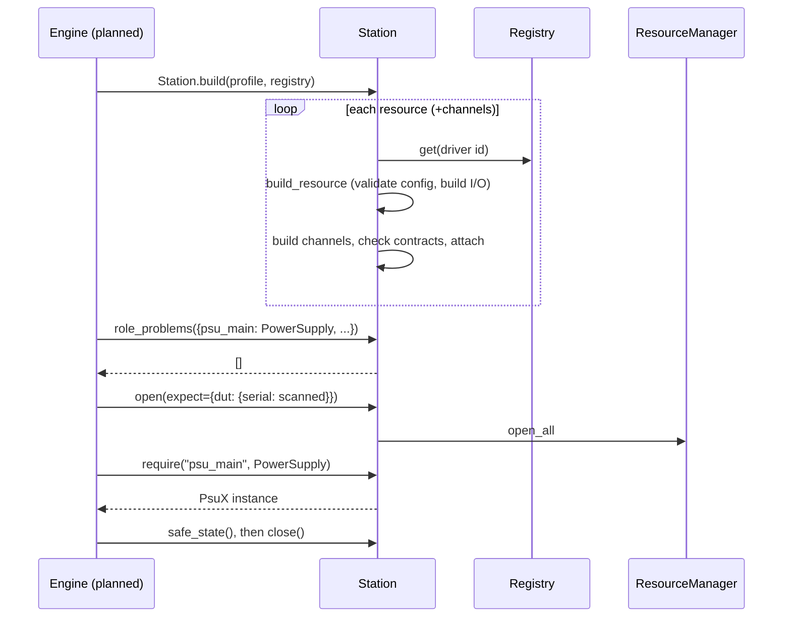

# ADR-0023: Station: the composition root and role resolution

| | |
|---|---|
| **Status** | accepted |
| **Date** | 2026-10-21 |
| **Module(s)** | `mastif.station.station`, `mastif.station.errors` |
| **Layer** | station |
| **Related** | ADR-0012 (registry); ADR-0011 (`build_resource`, channels); ADR-0021 (profile); ADR-0022 (lifecycle); ADR-0008 (contract checks) |

## 1. Summary

`Station` is the single place where a profile, the registry and the drivers come
together, in two separate phases:

- **`Station.build`** constructs every resource and DUT channel and validates
  everything, **without any I/O**.
- **`open`/`safe_state`/`close`** perform the I/O through the `ResourceManager`.

Tests and the engine reach hardware only through **roles**: `role(name)` and
`require(name, Contract)`. `role_problems()` checks all roles before anything opens.
The one idea to remember: *wiring happens in one place, and it fails before power is
applied.*

## 2. The problem, from first principles

- **Someone must connect the pieces.** Profile entries name driver ids. The registry
  maps ids to classes. Classes need configs and I/O. DUTs need their channels attached.
  Tests need objects by role. If this wiring is scattered, every test re-does part of
  it, inconsistently. This is the "composition root" idea: wire everything in exactly
  one place.
- **Validate before touching anything.** An unknown driver id, a config typo or a DUT
  channel mapped to the wrong kind of driver must all be found *before* a supply turns
  on. Finding them takes no I/O, so the work can be split.
- **Tests need capabilities, checked.** A task asking for `psu_main` as a `PowerSupply`
  should fail clearly if the bench maps `psu_main` to a relay bank. Ideally that is
  found in a preflight check, before a 2-hour run starts.
- **Composite resources** (a positioner controller with axes) and **DUT channels**
  should also be reachable by role, as `pos.az` or `dut.console`.

## 3. Where it sits in the system

- **Layer:** station. It is above resources and below the engine.
- **Upstream:** the planned engine, org scripts and notebooks, and tests.
- **Downstream:** `Registry`, `build_resource`, the transport factory, the
  `ResourceManager` and the contract checks.

## 4. Decision

1. **`Station.build(profile, registry, *, sim=False, io_factory=build_io,
   listener=None, logger=None, settings=None)`**. For each entry in `profile.entries(sim)`:
   - look up the driver; `DriverNotFound` becomes `StationError("resource 'x': ...")`
   - call `build_resource`; config `ValidationError`s become `StationError` with
     `location: message` details, and `DriverDefinitionError` (e.g. an impossible I/O
     combination) becomes `StationError`
   - handle channels:
     - mapped channels the DUT doesn't declare are an error
     - a missing required channel is an error
     - a missing optional channel is skipped (it reads as `None`)
     - each mapped channel is built as its own handle named `dut.console`
     - the channel driver must provide the declared contract
     - the channel instance is then attached with `setattr`
2. **No I/O in `build`.** It is safe to run anywhere, e.g. to validate profiles in CI.
3. **Role resolution:**
   - `role(name)` resolves through `profile.target_of`.
   - A plain resource name returns the instance.
   - `root.child` returns a channel (available after build), or an entry of
     `children()` (available after open).
   - If neither exists, a `RoleError` says why, including "children are known only once
     the station is open".
4. **Contract checks.** `require(role, contract)` resolves the role, then checks
   `DriverSpec.provides_contract` for resources, or `satisfies` structurally for
   children. A failure raises `RoleError`.
5. **`role_problems(requirements)`** is the station half of preflight. It returns a
   list of messages for unknown roles and contract mismatches. It skips child roles
   that can only be checked once open; `require` checks them again at run time.
6. **Lifecycle delegation.**
   - `open(expect=)`, `safe_state()` and `close()` delegate to the `ResourceManager`.
   - `identities()` gives the identities seen while opening, for the run manifest.
   - As a context manager, `with` opens the station on entry. On exit it runs safe
     state and then close, even when the block raised.
7. **Errors** live in `mastif.station.errors`: `StationError` (profile or build
   problems) and its subclass `RoleError` (role lookup or contract problems).

## 5. Abstractions

| Name | Purpose | Invariants and behaviour |
|---|---|---|
| `Station` | Built station | Holds `profile`, `handles`, `sim`, `manager`. `name` is the profile's station name. |
| `Station.build(..., settings=None)` | Composition root | No I/O. Raises `StationError` on any wiring problem, including a driver needing settings when none were given. Keeps the settings as `station.settings`. |
| `resource(name)` | Handle by profile name | Raises `StationError` if unknown. |
| `role(role)` | Object playing a role | Raises `RoleError`. |
| `require(role, contract)` | Role, checked against a contract | Raises `RoleError`. |
| `role_problems(reqs)` | Preflight | Never raises. Returns messages. |
| `identities()` | Provenance | Only resources that identified. |
| `open` / `safe_state` / `close`, `with` | Lifecycle | See ADR-0022. |
| `StationError`, `RoleError` | Station errors | See section 7. |

## 6. Data flow

## 7. Errors

| Exception | Raised when | Meaning | Who catches it, and what they do |
|---|---|---|---|
| `StationError` | unknown driver; invalid config; impossible I/O; unknown, missing or incompatible channels; `resource()` with an unknown name | the profile doesn't fit the installed drivers | Show it and fix the profile. Raised before any I/O. |
| `RoleError` | unknown role; child not available; contract not provided | tests and bench don't match | Preflight reports it before the run. During a run it becomes ERROR. |
| lifecycle errors | from `open`/`close` | see ADR-0022 | see ADR-0022 |

## 8. Guarantees and invariants

- `build` performs no I/O, and either returns a fully wired station or raises.
- Every DUT's required channels are attached before the station can be opened.
- A role that passes `require` provides the contract, by declaration or by structure.

## 9. Consequences

- **Positive:**
  - Tests are completely decoupled from bench wiring.
  - Profiles can be validated in CI.
  - Preflight catches test/bench mismatches before a run.
- **Negative:**
  - Child roles can only be checked at run time.
  - There are two names to understand: resources (bench facts) and roles (test
    vocabulary). The glossary and guides explain them.

## 10. Alternatives considered

- **Tests looking up resources by name:** rejected. It ties tests to benches.
- **Validating lazily on first use:** rejected. Failures would arrive mid-run, with
  hardware energised.
- **Dependency-injection frameworks:** rejected as overkill. This one class is the
  whole composition root.

## 11. Open questions and future work

- Multi-slot stations: one station with several DUT slots, with role resolution scoped
  per slot.
- Profile-level preflight of driver-specific constraints.

## 12. Code map

| What | Where |
|---|---|
| Implementation | `packages/mastif/src/mastif/station/station.py`, `packages/mastif/src/mastif/station/errors.py` |
| Tests | `packages/mastif/tests/station/test_station.py`, plus doctests |
| Wiki | `docs/wiki/station.md`, `docs/wiki/life-of-a-station.md` |

## History

- 2026-10-21: created.
- 2026-10-25: `Station.build(settings=...)` passes the application settings (ADR-0026) to
  every driver and channel that asks for them. A driver needing settings on a station
  built without them is a `StationError`.
