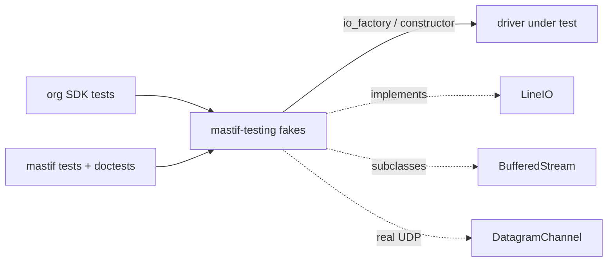
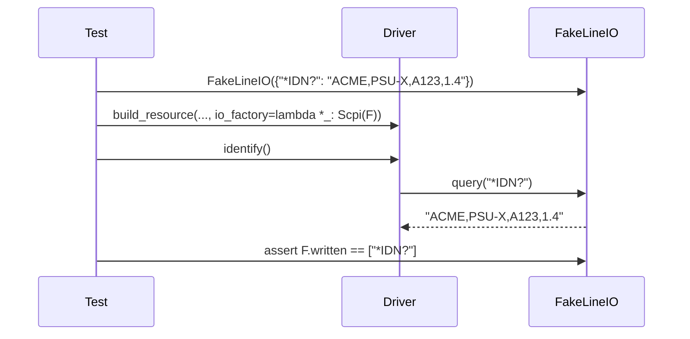

# ADR-0024: Testing fakes: behavioural stand-ins for hardware

| | |
|---|---|
| **Status** | accepted |
| **Date** | 2026-10-21 |
| **Module(s)** | `mastif_testing.fakes` (package `mastif-testing`) |
| **Layer** | testing (depends on `mastif.resources`) |
| **Related** | ADR-0014/0015/0017 (the interfaces faked); ADR-0018 (injection point); ADR-0025 (conformance) |

## 1. Summary

`mastif-testing` provides fakes for the transport interfaces:

- `FakeLineIO`: scripted replies to text commands
- `FakeStream`: fed bytes, with the real framing code
- `FakeSshSession`: scripted command results, for DUT code using SSH
- `FakeNativeLibrary` and `set_out`: Python stand-ins for a vendor DLL's functions
- `FakeDatagramPeer`: a real UDP peer on localhost

Drivers and DUT code can then be tested in CI without hardware, through the same
injection path the station uses. The one idea to remember: *fakes behave like silent,
slow or chatty devices, so tests catch real bugs; mocks only check that calls happened.*

## 2. The problem, from first principles

- **Drivers must be tested on every commit,** but instruments are in a lab and DUTs are
  scarce.
- **Mocks lie about behaviour.** A mock returns whatever you told it, even for a command
  the driver never sent, and never times out. Tests pass while the driver is broken.
  `AGENTS.md` mandates fakes instead.
- **Faithfulness matters at the edges.** Framing (partial reads, two replies in one
  packet), timeouts and unsolicited messages are exactly where drivers break. Fakes
  must reproduce them.
- **Org SDK authors need the same tools as mastif's own tests.** That is why fakes ship
  as a package, not as test utilities hidden in mastif's repo.

## 3. Where it sits in the system

- **Package:** `mastif-testing`, a separate distribution installed in test environments.
  It depends on `mastif`; `mastif` never depends on it.

## 4. Decision

1. **`FakeLineIO(replies)`** implements `LineIO`:
   - `replies` maps a command line to a reply, or to a list of successive replies.
     The last entry of a list repeats.
   - `write_line` records the line in `written` and queues its scripted reply.
   - `read_line` pops the queue. **An empty queue raises `TransportTimeout`**, as a
     silent device would.
   - `feed(line)` queues unsolicited lines.
   - `opened` and `closed` count lifecycle calls.
2. **`FakeStream(timeout=0.05)`** subclasses `BufferedStream`, so framing, deadlines and
   string encoding behave exactly as over TCP. `feed(bytes)` makes data readable;
   `sent` accumulates written bytes. Each fed chunk is delivered separately, which
   tests reassembly.
3. **`FakeDatagramPeer(responder)`** is a real UDP socket on `127.0.0.1` with a thread:
   - `responder(payload) -> reply | None` answers each datagram.
   - `received` records every payload.
   - `push(msg)` sends unsolicited datagrams to the last sender.
   - `port` gives the listening port.
   - It is a context manager, for cleanup.
4. **`FakeSshSession(commands)`** stands in for `SshSession` (ADR-0033):
   - `commands` maps a command line to its output (`str`, exit code 0), a full
     `ShellResult`, or an exception instance to raise (e.g. a `TransportTimeout`).
   - Unknown commands return exit code 127 and "command not found" on stderr, as a
     real shell would.
   - `ran` records commands; running while closed raises `TransportError`.
5. **`FakeNativeLibrary(functions)`** stands in for `NativeLibrary` (ADR-0035):
   - each function is a callable, a fixed return code, or a list of codes served in
     order (the last repeats)
   - it enforces the real rules: declare before calling, unknown names raise
     `TransportError`, calls while closed raise `TransportError`, and a declaration's
     `StatusCheck` is applied
   - `calls` records `(name, args)`
   - `set_out(ref, value)` writes through a `byref()`/`pointer()` argument, as the C
     function would fill an output parameter.

## 5. Abstractions

| Name | Implements | Key behaviour |
|---|---|---|
| `FakeLineIO` | `LineIO` | Scripted replies; a timeout when nothing is queued; records writes. |
| `FakeStream` | `StreamTransport` (via `BufferedStream`) | Real framing; fed chunks; records sends. |
| `FakeDatagramPeer` | a UDP peer | Real sockets; responder function; `push` for broadcasts. |
| `FakeSshSession` | `SshSession` (by shape) | Scripted results; exit 127 for unknown commands; records commands. |
| `FakeNativeLibrary` | `NativeLibrary` (by shape) | Python functions for vendor functions; same declaration rules; records calls. |
| `set_out` | a C output parameter | Fills `byref(x)` / `pointer(x)`. |
| `Reply` | type | `str \| list[str]`. |

## 6. Data flow

## 7. Errors

| Exception | Raised when | Meaning |
|---|---|---|
| `TransportTimeout` | `FakeLineIO.read_line` with nothing queued; `FakeStream` reads past the fed data | the driver expected a reply the script didn't provide, i.e. a test or driver bug |
| `TransportError` | `FakeDatagramPeer.push` before any client has sent | the test sequencing is wrong |

## 8. Guarantees and invariants

- Fakes never invent replies. Unscripted commands produce no reply.
- `FakeDatagramPeer` releases its port on exit.

## 9. Consequences

- **Positive:**
  - Hardware-free tests through the real code paths.
  - The same tools for org SDKs and for mastif.
  - Doctests can show realistic examples.
- **Negative:**
  - Scripts need care for stateful devices: every reply must be listed.
  - `FakeDatagramPeer` uses real sockets, so it can be slightly slower and needs
    localhost networking.

## 10. Alternatives considered

- **`unittest.mock`:** rejected (section 2).
- **Full instrument simulators:** out of scope here. Orgs can write sim *drivers*
  selected by the profile's `sim:` section; these fakes sit at the transport level.

## 11. Open questions and future work

- Fake serial ports with baud-rate errors.
- Record/replay of real sessions into fake scripts.

## 12. Code map

| What | Where |
|---|---|
| Implementation | `packages/mastif-testing/src/mastif_testing/fakes.py` |
| Tests | used across `packages/mastif/tests/resources/*`, plus doctests |
| Wiki | `docs/wiki/testing-kit.md`, `docs/wiki/guides/test-your-driver.md` |

## History

- 2026-10-21: created.
- 2026-10-25: added `FakeSshSession` (ADR-0033).
- 2026-10-25: added `FakeNativeLibrary` and `set_out` (ADR-0035).
