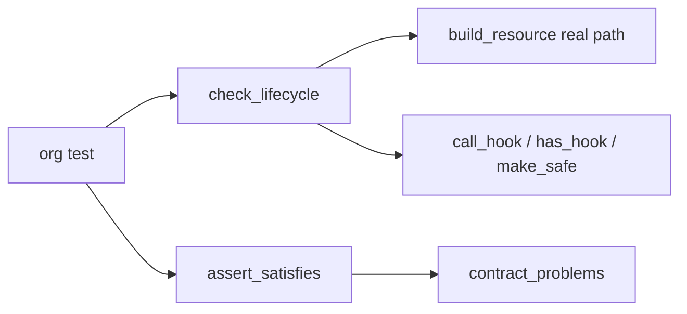
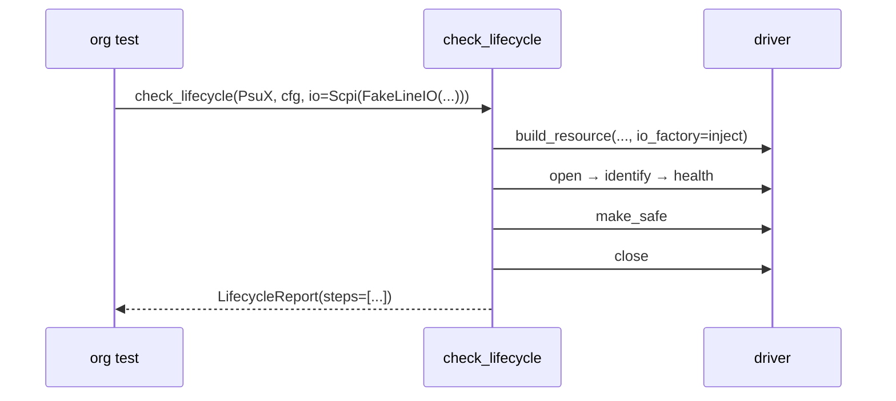

# ADR-0025: Conformance kit: one standard check for every driver

| | |
|---|---|
| **Status** | accepted |
| **Date** | 2026-10-21 |
| **Module(s)** | `mastif_testing.conformance` |
| **Layer** | testing |
| **Related** | ADR-0008 (contracts); ADR-0011 (build path, hooks); ADR-0022 (the lifecycle being imitated); ADR-0024 (fakes) |

## 1. Summary

Two helpers let any driver be vetted in plain pytest:

- `assert_satisfies(cls, Contract)` fails with one line per contract problem.
- `check_lifecycle(cls, config, **fakes)` builds the driver through the real
  `build_resource` path, with the given fakes injected. It then runs the station's
  sequence (`open`, `identify`, `health`, safe state, `close`) and reports which step
  failed, and why.

The one idea to remember: *if a driver passes `check_lifecycle` with fakes, the station
can drive it.*

## 2. The problem, from first principles

- **Every driver must meet the same obligations:**
  - build from its config
  - survive open and close
  - return a real `Identity` and a healthy `Health`
  - reach a safe state

  Writing those checks per driver is repetitive, and easy to get subtly wrong.
- **Failures should point at the step.** "TypeError in test" is useless. "acme.psu-x:
  step 'identify' failed: ..." is actionable.
- **Org authors don't know the station's internals,** and shouldn't need to.

## 3. Where it sits in the system

## 4. Decision

1. **`assert_satisfies(cls, contract)`** raises an `AssertionError` listing each
   `ContractProblem`.
2. **`check_lifecycle(cls, config, **io)`**:
   - It requires a fake for every I/O parameter, keyed by parameter name. Missing ones
     are reported before building.
   - It injects them by matching the requested type to the parameter's annotation.
   - The steps, each recorded in `report.steps`:
     1. `build`
     2. `open` (if present)
     3. `identify` (if present; must return `Identity`)
     4. `health` (if present; must be ok)
     5. `safe_state` (if any action ran, via `make_safe`)
     6. `close` (if present)
   - Any exception becomes `AssertionError("<id>: step '<name>' failed: <error>")`,
     with the cause chained.
3. **`LifecycleReport`** returns `instance`, `identity`, `health`, `safe_state_ran` and
   `steps`, for further assertions, e.g. on what a fake recorded.

## 5. Abstractions

| Name | Purpose |
|---|---|
| `assert_satisfies(cls, contract)` | Contract conformance, as a test assertion |
| `check_lifecycle(cls, config, **io)` | Lifecycle conformance with fakes |
| `LifecycleReport` | What was observed |

## 6. Data flow

## 7. Errors

| Exception | Raised when | Meaning |
|---|---|---|
| `AssertionError` | a missing fake; a failing step; `identify` not returning `Identity`; `health` not ok; contract problems | the driver doesn't conform; the message names the step |

## 8. Guarantees and invariants

- It uses the same construction and safe-state code as the station, so passing
  conformance is meaningful.
- The order mirrors the `ResourceManager`. I/O opening is skipped, because fakes need no
  opening.

## 9. Consequences

- **Positive:**
  - Uniform, cheap driver quality checks.
  - Clear failure messages.
- **Negative:**
  - It doesn't exercise channels or children.
  - Health is expected to be ok at rest, so a driver whose fakes report a fault must be
    tested differently.

## 10. Alternatives considered

- **Leaving lifecycle testing to each org:** rejected (section 2).
- **Running a full `Station` in conformance:** rejected. It needs a profile and a
  registry, which is heavier than needed for a unit test.

## 11. Open questions and future work

- Channel and child coverage.
- Optional checks that `safe_state` is idempotent.

## 12. Code map

| What | Where |
|---|---|
| Implementation | `packages/mastif-testing/src/mastif_testing/conformance.py` |
| Tests | `packages/mastif-testing/tests/test_conformance.py`, plus doctests |
| Wiki | `docs/learn/architecture/testing-kit.md`, `docs/wiki/guides/test-your-driver.md` |

## History

- 2026-10-21: created.
