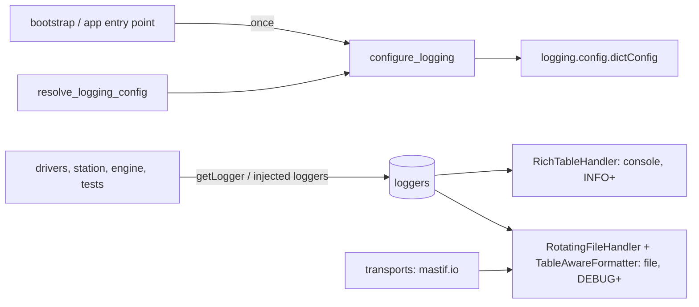
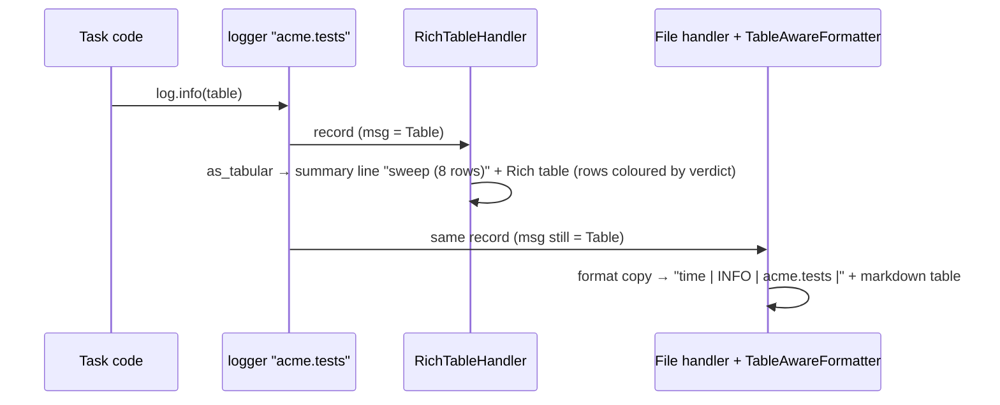

# ADR-0027: Logging: operator console, complete file, tables as tables

| | |
|---|---|
| **Status** | accepted |
| **Date** | 2026-10-25 |
| **Module(s)** | `mastif.infra.logs` (and the bundled `mastif/infra/default_logging.yaml`) |
| **Layer** | infra |
| **Related** | ADR-0026 (logging config can come from settings); ADR-0029 (bootstrap configures logging); ADR-0006 (kernel `Table` results render as tables); ADR-0014–0017 (transports trace on `mastif.io`) |

## 1. Summary

mastif uses Python's standard `logging`, configured once with a standard `dictConfig`
(YAML, a dict, or the bundled default). It adds:

- a **Rich console handler** with a level colour theme
- a **table-aware file formatter**
- two extra levels, **TRACE** (5) and **SUCCESS** (25), plus a logger class with
  `trace()` and `success()`
- table rendering: logging a kernel `Table` or a pandas DataFrame shows a real table on
  the console and a markdown table in the file

The default sends instrument byte traffic (`mastif.io`) to the file only. The one idea to
remember: *configure once at start-up, then everything just calls `logging.getLogger`.*

## 2. The problem, from first principles

- **Two audiences.**
  - Operators watch the console during a run. It must be readable and colour-coded,
    without protocol noise.
  - Engineers investigating a failure read the file afterwards. It must contain
    everything, with timestamps, including every byte exchanged with instruments.
- **Test data is often tabular:** sweeps over channels, DataFrames. Printed with
  `str()`, it is unreadable on a console and unparseable in a file.
- **Some messages are positive milestones** ("step passed"), and some are below
  DEBUG (raw traffic). Standard levels have no names for these.
- **Logging is process-global in Python.** Configuring it as an *import side effect*,
  or as a side effect of loading settings (as the old project did), makes behaviour
  depend on import order, and surprises tests. It must be an explicit call.
- **Shared records must not be corrupted.** One record is passed to every handler. A
  handler or filter that rewrites `record.msg` changes what the *next* handler sees. In
  the old project's design, the file filter's markdown could end up on the console.
- **pandas is heavy.** DataFrame support must not force it on every installation.

## 3. Where it sits in the system

- **Layer:** infra.
- **Upstream:** application entry points (via `bootstrap`). Every module that logs uses
  plain `logging.getLogger`.
- **Downstream:** stdlib `logging`, Rich and PyYAML. pandas is optional and detected
  without importing it.

## 4. Decision

1. **Standard `dictConfig` is the configuration format.** Nothing is proprietary, so
   any Python logging knowledge applies.
2. **`configure_logging(config=None, *, log_dir=None, level=None, rich_tracebacks=True)`**
   is the *only* function that changes global logging state, and only when called. In
   order, it:
   1. registers the TRACE and SUCCESS level names
   2. installs `MastifLogger` as the logger class
   3. loads the config (YAML path, mapping, or the bundled default)
   4. rewrites relative handler `filename`s to sit under `log_dir`, creating it if
      needed (the working directory if `log_dir` isn't given)
   5. applies the optional root `level` override
   6. calls `dictConfig`; invalid configs raise `ConfigError`
   7. optionally installs Rich tracebacks, with locals
3. **Resolution order** (`resolve_logging_config(settings, config_dir)`), first match
   wins:
   1. `logging.yaml`/`logging.yml` in the config directory
   2. a `logging` section in the settings
   3. the bundled default
4. **The bundled default:**
   - Console (`RichTableHandler`): INFO and above, message only.
   - File (`RotatingFileHandler`): DEBUG and above, `mastif.log`, rotated at 10 MB with
     5 backups, UTF-8, formatted as `time | level | logger | message` by
     `TableAwareFormatter`.
   - `mastif.io`: file only, propagation off.
   - Root: DEBUG.
5. **Tables never mutate records.**
   - `as_tabular(message)` recognises kernel `Table`s (adding a verdict column, with
     rows coloured by verdict) and pandas DataFrames (by type module name, without
     importing pandas).
   - The console handler prints a one-line summary record, then a Rich table.
   - The file formatter formats a *copy* of the record with markdown.
   - `extra={"title": ...}` overrides the title.
6. **Extra levels.** `TRACE = 5`, `SUCCESS = 25`, and `MastifLogger.trace()` /
   `.success()`.
7. **`Loggers`** is a stateless convenience: `loggers.traffic`, `loggers["acme.x"]`.

## 5. Abstractions

| Name | Purpose | Invariants and behaviour |
|---|---|---|
| `configure_logging(...)` | Apply process-wide logging configuration | The only global mutation. Raises `ConfigError`. |
| `resolve_logging_config(settings=None, config_dir=None)` | Choose which configuration to use | Returns a fresh dict. Raises `ConfigError` on a broken `logging.yaml`. |
| `default_logging_config()` | The bundled default | A fresh copy on every call. |
| `RichTableHandler` | Console handler | Level theme. Tables as summary plus a Rich table. Writes to stderr by default. |
| `TableAwareFormatter` | File formatter | Tables become markdown. Never mutates the record. |
| `as_tabular(message, title=None)` | Recognise a table | Returns `TabularData` or `None`. |
| `TabularData` | Extracted table | `title`, `columns`, `rows` (text), `row_styles`. |
| `to_markdown(data)` / `to_rich_table(data)` | Renderers | Markdown escapes pipes. |
| `MastifLogger` | Logger with `trace`/`success` | Installed by `configure_logging`. |
| `TRACE`, `SUCCESS`, `THEME` | Levels and colours | — |
| `Loggers` | Name-based access | Stateless. |

## 6. Data flow

## 7. Errors

| Exception | Raised when | Meaning | Who catches it |
|---|---|---|---|
| `ConfigError` | `logging.yaml` unreadable or not a mapping; `dictConfig` rejects the config (unknown class, bad level...) | the logging configuration is wrong | The entry point shows it and exits. |

Errors while *emitting* records follow stdlib behaviour: `handleError` prints to stderr
and never raises into application code.

## 8. Guarantees and invariants

- Importing `mastif.infra.logs` changes nothing global.
- Records are never mutated by mastif's handlers or formatters.
- With the default configuration, `mastif.io` traffic never reaches the console.
- pandas is never imported by mastif.

## 9. Consequences

- **Positive:**
  - Readable consoles and complete files.
  - Tables just work, including mastif's own results.
  - Plain stdlib logging everywhere else.
- **Negative:**
  - Logging is still global by Python's design. Tests touching configuration must
    restore state, as the test suite's fixture does.
  - Rich tracebacks with locals may show sensitive values in crash output. Disable them
    with `rich_tracebacks=False` where that matters.
- **Risks:** heavy tables flooding the console. Log big tables at DEBUG.

## 10. Alternatives considered

- **loguru or structlog:** rejected. Both are extra paradigms, and mastif and org code
  should use the stdlib API every Python developer knows.
- **A record-mutating filter for files** (the old design): rejected. Handler order
  could corrupt console output (section 2).
- **Making pandas a dependency:** rejected. Detection by type keeps it optional
  (`mastif[pandas]`).
- **Configuring logging inside `create_settings`:** rejected. That is a hidden side
  effect. `bootstrap` does both explicitly (ADR-0029).

## 11. Open questions and future work

- Per-run log files (one file per run folder) once the engine's run store exists.
- Structured (JSON) file output for log aggregation.
- An event-stream handler that forwards logs to UIs.

## 12. Code map

| What | Where |
|---|---|
| Implementation | `packages/mastif/src/mastif/infra/logs.py` |
| Bundled config | `packages/mastif/src/mastif/infra/default_logging.yaml` |
| Tests | `packages/mastif/tests/infra/test_logs.py`, plus doctests |
| Wiki | `docs/wiki/infra.md`, `docs/wiki/guides/bootstrap-an-application.md` |

## History

- 2026-10-25: created. Rebuilt from scratch with the old project's features (Rich
  console, rotating file, DataFrame tables, traffic logger, Rich tracebacks), fixing
  record mutation and import-time side effects.
