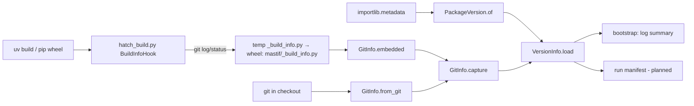

# ADR-0028: Version information: package version plus git state, embedded or live

| | |
|---|---|
| **Status** | accepted |
| **Date** | 2026-10-25 |
| **Module(s)** | `mastif.infra.version`, `packages/mastif/hatch_build.py` (build hook) |
| **Layer** | infra |
| **Related** | ADR-0029 (bootstrap logs it); ADR-0007 (run identity); planned engine ADRs (run manifests record it) |

## 1. Summary

`VersionInfo` combines two things:

- the installed **distribution version** (`PackageVersion`, read from package metadata)
- **git information** (`GitInfo`): commit, branch, date, author, subject, and whether
  the tree had uncommitted changes

Git information is **embedded into wheels at build time** by a hatch build hook. In a
development checkout it is captured **live** with `git`. If neither works, it is
explicitly `unavailable`. The one idea to remember: *every run can say exactly which
software produced it, even on a station with no git.*

## 2. The problem, from first principles

- **A version string isn't enough during development.** Two stations can both report
  `0.4.0.dev0` while running different commits, or one with local edits. Traceability
  needs the commit, and the dirty flag.
- **Stations run installed wheels,** usually without git or a source checkout. The
  commit must therefore be captured when the wheel is built, and travel inside it.
- **Development needs live information.** An embedded file in the source tree would
  freeze the commit at the last build or sync. That is stale, and misleading.
- **No sentinels.** The old project returned version `0.0.0` and empty strings when
  information was missing. Those look like real values. Missing information must be
  stated as missing (ADR-0002).
- **The build environment is minimal.** A hatch hook runs in an isolated environment
  with only hatchling installed, so it can't import mastif or its dependencies.

## 3. Where it sits in the system



## 4. Decision

1. **`PackageVersion`.**
   - `PackageVersion.of(distribution)` reads `importlib.metadata`.
   - A distribution that isn't installed raises `VersionError`. There is no `0.0.0`.
   - `parse` extracts major, minor and patch from a PEP 440 string. A string that
     doesn't start with a release number raises `VersionError`.
   - `is_prerelease` detects dev, a, b and rc versions.
2. **`GitInfo`** has `source` set to `"embedded"`, `"runtime"` or `"unavailable"`, plus
   optional fields. `unavailable()` is the explicit "we don't know".
3. **Capture order.** `GitInfo.capture(module, cwd)` tries, in order:
   1. `<module>._build_info.BUILD_INFO`, written at build time
   2. live `git` in `cwd`, where each command has a 10 s timeout
   3. otherwise, `unavailable`
4. **The build hook (`hatch_build.py`):**
   - It is standard library only.
   - It **skips editable builds**, so development always uses live git.
   - It writes `_build_info.py` to a **temporary directory** and maps it into the wheel
     with `force_include`, so the source tree is never modified.
   - Outside a git repository, it writes nothing.
5. **`VersionInfo.load(distribution, module=None, cwd=None)`** combines both. `module`
   defaults to the distribution name with `-` replaced by `_`. `summary()` gives one
   line, e.g. `acme-sdk 1.2.0 | abc1234 on main | uncommitted changes`.
6. **Org SDKs reuse it.** They call `VersionInfo.load("acme-sdk")` and copy
   `hatch_build.py` with `PACKAGE` changed.

## 5. Abstractions

| Name | Purpose | Invariants and behaviour |
|---|---|---|
| `PackageVersion` | Installed version | Immutable. Fields: `distribution`, `version`, `major`, `minor`, `patch`. |
| `PackageVersion.of` / `.parse` | Read or parse | Raise `VersionError`. |
| `GitInfo` | Source-tree state | Immutable. `source` always says where the data came from. |
| `GitInfo.from_git(cwd)` | Live capture | Never raises. Gives `unavailable` on any failure. |
| `GitInfo.embedded(module)` | Read build-time info | Returns `None` if absent. |
| `GitInfo.capture(module, cwd)` | Best available | Embedded, then runtime, then unavailable. |
| `VersionInfo` | Version plus git | `summary()` and `str()`. |
| `BuildInfoHook` (hatch) | Embed git info in wheels | Skips editable builds. Never writes to `src/`. |

## 6. Data flow

**At build time:**

```
uv build → hatchling → BuildInfoHook.initialize("standard")
  → git log -1 / rev-parse / status → temp/_build_info.py
  → force_include → wheel contains mastif/_build_info.py
```

**At run time (installed wheel):** `VersionInfo.load("mastif")` → `PackageVersion.of` →
`GitInfo.embedded("mastif")` → `source="embedded"`.

**At run time (development checkout):** no `_build_info` exists → `GitInfo.from_git()` →
`source="runtime"`.

## 7. Errors

| Exception | Raised when | Meaning | Who catches it |
|---|---|---|---|
| `VersionError` | the distribution isn't installed; the version string is unparseable | the wrong distribution name, or broken packaging | The entry point. Fix the name or the install. |

Git problems never raise. They produce `GitInfo(source="unavailable")`, because missing
git is normal on stations.

## 8. Guarantees and invariants

- Missing information is explicit (`None` fields, `source="unavailable"`). It is never
  zeros or empty strings.
- The source tree is never modified by builds.
- Editable installs always report live git state.

## 9. Consequences

- **Positive:**
  - Precise provenance, on stations and in development.
  - No new runtime dependency.
  - Reusable by org SDKs.
- **Negative:**
  - The build hook duplicates a little git-capture logic, because it can't import
    mastif in the isolated build environment.
  - Runtime capture spawns `git` processes, a few milliseconds at start-up.
- **Risks:** building wheels outside the repository (e.g. from an sdist) yields no
  embedded info. Build from the repository in CI.

## 10. Alternatives considered

- **setuptools-scm / hatch-vcs** (version derived from git tags): deferred. The version
  is managed explicitly in `pyproject.toml` per `CONTRIBUTING.md`. These tools could
  replace that later, but they don't give the dirty flag or the subject at run time.
- **Writing `_build_info.py` into `src/`** (the old design): rejected. Editable installs
  would read a stale file.
- **Sentinel defaults** (`0.0.0`, `""`): rejected (ADR-0002).

## 11. Open questions and future work

- Recording the versions of all loaded org SDKs and drivers in run manifests.
- Optionally deriving the package version from git tags.

## 12. Code map

| What | Where |
|---|---|
| Implementation | `packages/mastif/src/mastif/infra/version.py` |
| Build hook | `packages/mastif/hatch_build.py`, enabled by `[tool.hatch.build.hooks.custom]` in `packages/mastif/pyproject.toml` |
| Tests | `packages/mastif/tests/infra/test_version_and_bootstrap.py`, plus doctests |
| Wiki | `docs/learn/architecture/infra.md` |

## History

- 2026-10-25: created. Rebuilt from scratch with the old project's features, removing
  sentinel defaults and the stale-file risk.
