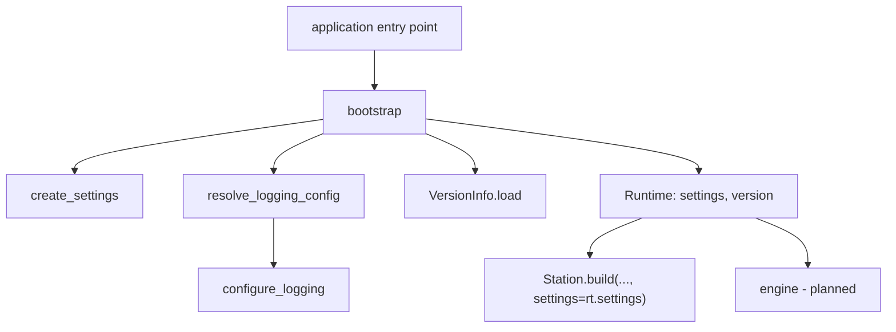
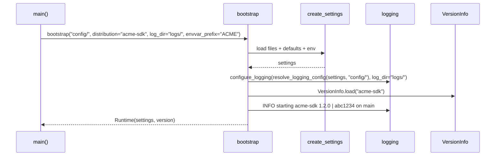

# ADR-0029: Bootstrap: the one call an application makes at start-up

| | |
|---|---|
| **Status** | accepted |
| **Date** | 2026-10-25 |
| **Module(s)** | `mastif.infra.bootstrap` |
| **Layer** | infra |
| **Related** | ADR-0026 (settings); ADR-0027 (logging); ADR-0028 (version); ADR-0023 (the station receives `runtime.settings`) |

## 1. Summary

`bootstrap(config_dir, *, distribution, log_dir, ...)` performs the start-up sequence
every mastif application needs, in the right order:

1. load the settings
2. configure logging, from the same config directory or settings
3. record and log which software version is running

It returns a `Runtime` holding the settings and version, which the application then
passes to its components. The one idea to remember: *this is the infra half of the
composition root: called once, at the very top, and nothing else in mastif calls it.*

## 2. The problem, from first principles

- **Every application repeats the same start-up:** CLI, service, UI back-end, notebook.
  Repetition produces drift:
  - logging configured before settings exist, so a `logging` section is ignored
  - logging never configured, so messages vanish
  - the version never recorded
- **Order matters.** Logging configuration may come from the settings or the config
  directory, and the version banner should go through the configured logging.
- **The old project hid part of this.** It configured logging inside its settings
  factory, so loading settings changed global state. Start-up should be explicit, and
  visible in one place.

## 3. Where it sits in the system

## 4. Decision

1. **`bootstrap(...)`** accepts:
   - the settings options (`config_dir`, `files`, `defaults`, `envvar_prefix`,
     `environments`, `env`, `load_dotenv`)
   - the logging options (`log_dir`, `log_level`, `rich_tracebacks`)
   - `distribution`, the application's package name, for version reporting
2. **It runs, in order:**
   1. `create_settings`
   2. `configure_logging(resolve_logging_config(settings, config_dir), ...)`
   3. `VersionInfo.load(distribution)`, if a distribution is given
   4. logs `starting 
` on `mastif.bootstrap`, plus the config directory at
      DEBUG
3. **It returns a frozen `Runtime(settings, version)`.** The application passes these
   explicitly. Nothing is stored globally.
4. **Using the pieces directly is fine.** `bootstrap` is a convenience, and nothing
   requires it. Advanced applications can call the three functions themselves, in the
   same order.

## 5. Abstractions

| Name | Purpose | Invariants and behaviour |
|---|---|---|
| `bootstrap(...)` | Start-up sequence | Fixed order. Raises `ConfigError` or `VersionError`. |
| `Runtime` | What the application passes on | Frozen. `version` is `None` when no distribution was named. |

## 6. Data flow

## 7. Errors

| Exception | Raised when | Who catches it |
|---|---|---|
| `ConfigError` | settings or logging configuration can't be loaded | `main()`: print it and exit with a non-zero code. |
| `VersionError` | `distribution` isn't installed | `main()`: fix the distribution name. |

## 8. Guarantees and invariants

- Settings exist before logging is configured, so logging can depend on them.
- The version banner goes through the configured logging.
- No global state is created beyond what `configure_logging` documents.

## 9. Consequences

- **Positive:**
  - Every application starts the same way.
  - Start-up fits on one line.
  - Order bugs are impossible when using it.
- **Negative:** one more function with many parameters. They mirror the underlying
  functions one to one.

## 10. Alternatives considered

- **Configuring logging inside `create_settings`** (the old design): rejected. It is a
  hidden side effect.
- **A singleton application object:** rejected. It's global state again. `Runtime` is
  returned and passed along.

## 11. Open questions and future work

- Adding the registry discovery and station build to a higher-level bootstrap in `api`,
  once the engine exists.

## 12. Code map

| What | Where |
|---|---|
| Implementation | `packages/mastif/src/mastif/infra/bootstrap.py` |
| Tests | `packages/mastif/tests/infra/test_version_and_bootstrap.py`, plus doctests |
| Wiki | `docs/wiki/infra.md`, `docs/wiki/guides/bootstrap-an-application.md` |

## History

- 2026-10-25: created.
