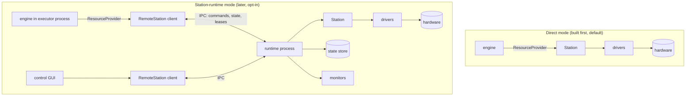
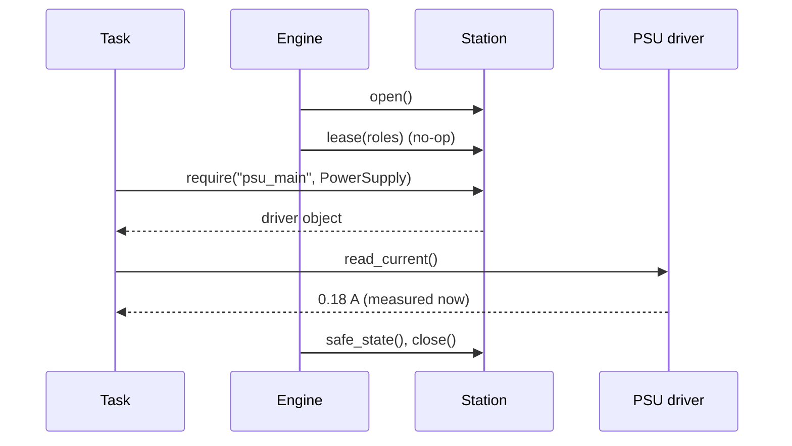
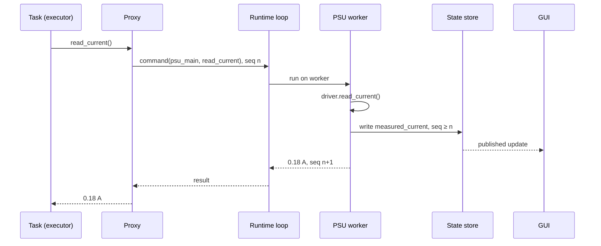

# ADR-0030: Execution topology: direct mode now, station runtime later

| | |
|---|---|
| **Status** | accepted as direction (direct mode is built first; the station runtime is designed here and built after the engine) |
| **Date** | 2026-10-25 |
| **Module(s)** | constrains the planned `mastif.engine`; designs the planned `mastif.runtime`; uses `mastif.station.Station` and `@driver(state=...)` |
| **Layer** | cross-cutting (station, engine, a future runtime package) |
| **Related** | ADR-0001 (layers); ADR-0008 (contracts); ADR-0011 (drivers, `state=`); ADR-0022 (resource manager); ADR-0023 (station, roles); ADR-0035 (vendor DLLs, child-process hosting) |

> **Who this is for:** an engineer who joined today. It answers a question everyone asks
> eventually: *which process owns the instruments?* It explains the two possible answers,
> argues both fairly, and lists the rules the engine must follow now so that either
> answer keeps working. Terms are explained on first use and collected in the
> [glossary](../learn/architecture/glossary.md). Practical advice behind this ADR is collected in the
> [field notes](../learn/architecture/field-notes.md).

## 1. Summary

mastif supports two ways of owning a station's hardware, behind the **same contracts**.
In **direct mode**, built first and the default, the test process owns the station: it
opens the instruments, measures and closes them. In **station-runtime mode**, built after
the engine, one long-lived process owns the station, and several applications use it at
once (a control GUI and the test executor), through **proxies** that implement the same
contracts as the real drivers. In the runtime, commands run **on demand** and return fresh
results; **monitors** that poll instruments in the background are **opt-in** per resource.
Every instrument declares a **state model**, and a test never accepts a value older than
its own command. The one idea to remember: *tasks and drivers are written once and run
unchanged in both modes, because tasks reach hardware only through `require(role,
Contract)`, and everything that crosses that boundary is serialisable.*

## 2. The problem, from first principles

### 2.1 The physical reality

A test station is a bench of instruments (power supplies, meters, analysers, switches,
chambers) and one or more DUTs (devices under test). Each instrument is reached through
something **exclusive**: a serial port only one process may open, a USB-TMC handle, a
vendor DLL session, a TCP port that accepts one client. Whoever opens it *owns* it until
they close it.

Two kinds of software want the bench:

- **The test executor** runs a plan: configure, measure, judge, record.
- **People and tools around it:**
  - an engineer with a control GUI who wants to switch the PSU on, look at a spectrum
    or watch the chamber temperature
  - a dashboard
  - a second executor for a second slot on the same bench

### 2.2 What goes wrong

- **Two processes, one port.** The GUI has the serial port open, so the executor can't
  open it, and the run fails before the first test. The usual cure (the GUI closes
  everything before a run) loses the GUI's view exactly when it's most interesting.
- **No eyes between tests.** A chamber overheats, or a PSU current-limits, while no test
  is running, and nobody notices until the next run fails strangely.
- **Slow open.** Some instruments take seconds to initialise (a vendor DLL loading
  calibration tables, a VISA session, a self-alignment). Opening per run, or worse per
  test, costs real time.
- **Blind polling corrupts tests.** The naive fix, a background loop reading every
  instrument every second, breaks tests in subtle ways (section 2.4).

### 2.3 The colleague's position: open, measure, close

A senior ATE engineer with more than 20 years' experience questioned the whole idea of a
shared runtime. His tests open the connection, make the measurement and close it again.
His argument, stated fairly:

- **Simple.** One process, one sequence, read top to bottom. No daemon, no IPC, no
  shared state.
- **Independent.** Each test starts from a known state. A crashed test leaves nothing
  running, and nothing holds a port.
- **Runs anywhere.** The same script runs on the bench, on a laptop against simulators,
  and in CI. There is no service to deploy, monitor or upgrade.
- **Cheap.** Constant polling hogs CPU, bus time and the instrument itself, for data
  nobody asked for. Holding instruments open locks out other tools, such as the vendor's
  own front-panel software.
- **Debuggable.** One stack trace, one log, one timeline.

He is right about all of it, for the setups he describes. The user keeps the runtime
vision, because the setups it serves (a GUI and an executor sharing one bench, safety
monitors, expensive connections) are real too. This ADR therefore makes his model the
**default** and the runtime an **opt-in**, and borrows his rule for the runtime itself:
*measure when asked, not continuously.*

### 2.4 Why blind polling harms tests

Five reasons, each from real stations:

1. **Staleness and causality.** A value polled 800 ms ago was measured *before* the test
   set the voltage. Reading it from a cache after configuring the DUT gives a result
   that is not caused by the test's own stimulus, and it may pass when it should fail.
2. **Interference with instrument state and error queues.** A poll is a command. It can
   change the measurement function or range, restart averaging, abort a sweep, or read
   (and so clear) the SCPI error queue, stealing the error the test was about to check.
   Interleaved between a test's "configure" and "read", it can turn a correct sequence
   into a wrong one.
3. **Measurement conditions.** Polling changes what is measured: a meter auto-ranging,
   self-heating from constant reads, extra traffic on the DUT's console changing its
   timing and load, an analyser re-triggering mid-average.
4. **Bus time.** GPIB and serial links are slow and often shared. A poll that takes
   200 ms delays the test's own commands by up to 200 ms, randomly, which makes timing
   and throughput unpredictable.
5. **Traceability.** A recorded result must say which command produced it, when, and
   under which settings. A cached poll can't. Auditors (and future you) need the
   measurement the test made under its own conditions.

### 2.5 Forces and constraints

- **Write once.** Tasks and drivers must not change between modes. Org SDKs must not
  have to choose.
- **Fresh by construction.** A test result must come from a measurement made after the
  test's own command.
- **Safety.** Some readings (temperature, overcurrent) are worth watching continuously,
  without disturbing tests.
- **Simplicity first.** The engine must be buildable and debuggable without any runtime.
- **Vendor DLLs** are often not thread-safe, sometimes 32-bit only, and sometimes crash
  the process that loaded them.

## 3. Where it sits in the system



- **Layer.** The runtime will be a new package above `station`, beside `engine`. Neither
  imports the other. The api/cli layer decides which `ResourceProvider` the engine
  gets: a local `Station`, or a `RemoteStation` client.
- **Upstream:** the engine (a client), GUIs and dashboards (clients).
- **Downstream:** `Station`, `ResourceManager`, drivers and transports, all unchanged.
- **What flows through it:** contract calls and their results (serialisable values),
  state snapshots and updates, and lease requests.

## 4. Decision

1. **Two modes behind the same contracts.**
   - **Direct mode** (the colleague's model): the test process builds and owns the
     `Station`: open, measure, close. It is built first and is the default.
   - **Station-runtime mode**: one long-lived process owns the `Station`. Clients (the
     test executor, a control GUI) get **proxies** implementing the same contracts. A
     task asking for `require("psu_main", PowerSupply)` receives the real driver in
     direct mode and a proxy in runtime mode, and can't tell the difference.
2. **Design now, build after the engine.** This ADR fixes the direction and the
   constraints. The runtime's own ADR will settle details, including the IPC technology.
3. **Runtime internals (design):**
   - **An asyncio control loop** accepts client requests, routes them and publishes
     state changes.
   - **One worker thread per resource.** Every call to a resource runs on that
     resource's own thread, so calls to one resource are **serialised** and calls to
     different resources run in parallel. Drivers stay synchronous; vendor DLLs always
     see the same thread (ADR-0035).
   - **Commands on demand.** A client's contract call is executed immediately on the
     resource's worker and returns a fresh result. Nothing is answered from a cache.
   - **Opt-in monitors.** A resource polls in the background only if its profile entry
     has a `monitor:` block:

     ```yaml
     resources:
       chamber_temp:
         driver: acme.thermo-x
         config: {transport: {kind: tcp, host: 10.0.0.7, port: 5025}}
         monitor:
           readings: [temperature]     # names the driver declares as monitorable
           interval: 5 s
           while_leased: pause         # pause (default) | continue
     ```

     Drivers declare which readings are **monitorable**: side-effect-free queries that
     change no instrument setting and don't touch the error queue. A thermometer or a
     PSU's measured current qualifies; a spectrum analyser trace qualifies only if
     reading it doesn't retrigger the sweep. `while_leased: pause` stops polling while a
     test holds the resource; `continue` is for pure safety readings on instruments the
     test doesn't drive.
   - **A state store.** For every resource it keeps the last value of each state field
     with a **timestamp** and a **sequence number** (a counter that increases with every
     write). Clients read **snapshots** or **subscribe** to changes (publish/subscribe),
     which is how GUIs stay live without polling the hardware themselves.
   - **Control leases.** A *lease* is exclusive control of a set of roles, held by one
     client. A test run takes a lease on the roles it requires for the duration of the
     run. GUIs may always observe state, but must request a lease for manual control,
     and get one only when no run holds those roles. Leases carry a holder id and a
     heartbeat, so a crashed client's lease expires.
   - **Crash isolation.** A resource can be hosted in a **child process** instead of a
     thread, so a vendor DLL that crashes takes down only its host. The same mechanism
     provides **32-bit host processes** for vendor DLLs that exist only as 32-bit
     builds (a 64-bit Python can't load them).
   - **IPC** is decided in the runtime's ADR. Candidates include a local socket with
     JSON or msgpack messages, and gRPC.
4. **Every instrument declares its state model.** `@driver(..., state=PsuState)` already
   exists (ADR-0011). It becomes the expected norm for instruments, not just DUTs. A
   state model holds:
   - **setpoints** (what the station asked for: voltage, frequency, span)
   - **output flags** (output enabled, RF on, relay closed)
   - **last readings** (measured current, temperature)

   Each field is a stamped value: the value, a timestamp and a sequence number.
   Monitors and GUIs read these models; the engine records them in run snapshots. A
   sketch (final names in the runtime ADR):

   ```python
   class PsuState(BaseModel):
       voltage_setpoint: Stamped[Quantity] | None = None
       output_enabled: Stamped[bool] | None = None
       measured_current: Stamped[Quantity] | None = None
   ```

5. **The freshness rule (read-after-write consistency).** Measurements are *retrieved
   from the state*, but a test first issues a **refresh command**:
   1. The test calls the measurement (in practice, the contract method itself, e.g.
      `psu.read_current()`; through a proxy, the call *is* the refresh command).
   2. The runtime records the command's sequence number *n*, performs the measurement on
      the resource's worker, and writes the result into the state with a sequence number
      ≥ *n*.
   3. The test receives that value. A test never accepts a value whose sequence number
      is lower than its own command's.

   Monitors write to the same state on their own schedule, for display and safety, and
   their values are visible to GUIs. A test may read them, but only through an explicit
   "latest state" call, never as a measurement result. In direct mode the rule holds
   trivially: the call runs the measurement and returns its value.
6. **Constraints the engine must respect now**, so the runtime can be added later
   without changing tasks, drivers or the engine:
   1. **Tasks reach hardware only through `require(role, Contract)`.** No task imports a
      driver, opens a transport, or holds a reference obtained any other way.
   2. **Contract arguments and return values stay serialisable:** `Quantity`, Pydantic
      models, enums, primitives (`int`, `float`, `str`, `bool`, `None`), `bytes`, and
      lists, tuples and dicts of these. Callbacks (`MessageChannel.subscribe`) and nested
      objects (DUT channels, composite children) are the known exceptions; proxies must
      adapt them (callbacks become remote subscriptions, nested objects become nested
      proxies).
   3. **The engine talks to a `ResourceProvider` interface**, not to `Station` directly:

      ```python
      class ResourceProvider(Protocol):
          def role(self, role: str) -> Any: ...
          def require(self, role: str, contract: type) -> Any: ...
          def open(self, expect: Mapping[str, Mapping[str, object]] | None = None) -> None: ...
          def safe_state(self) -> dict[str, Exception]: ...
          def close(self) -> None: ...
          def lease(self, roles: Collection[str], holder: str) -> AbstractContextManager[None]: ...
      ```

      `Station` satisfies it (the first five methods exist today; `lease` arrives with
      the engine). A future `RemoteStation` client satisfies it too.
   4. **The engine acquires control leases per run**, for exactly the roles the plan
      requires. In direct mode `lease` is a no-op.

## 5. Abstractions

Nothing in this ADR is built yet except `Station` and `@driver(state=...)`. These are
the planned abstractions, with their intended invariants.

| Name | Purpose | Invariants and key behaviour |
|---|---|---|
| **Direct mode** | The test process owns the station | One process; `Station` is the `ResourceProvider`; `lease` is a no-op. Default. |
| **Station runtime** | One process owns the station for many clients | Exactly one runtime per bench; it alone opens resources. |
| `ResourceProvider` | What the engine needs from "the station" | `require` checks the contract; `safe_state` never stops early; `close` is idempotent. |
| `RemoteStation` | Client-side `ResourceProvider` | Returns proxies, never driver objects. |
| **Proxy** | Client-side stand-in for a resource | Implements the same contract; each method call is one command to the runtime; driver errors are re-raised client-side with their original type. |
| **Resource worker** | The thread (or child process) that owns one resource | All calls to that resource run on it, in order. |
| **Monitor** | Background polling of declared readings | Off unless configured; only monitorable readings; pauses while leased by default. |
| **State store** | Last value per state field | Every write increases the sequence number; reads are snapshots; changes are published. |
| `Stamped[T]` | A state value with provenance | `value`, `timestamp`, `sequence`; produced only by the resource worker. |
| **Lease** | Exclusive control of roles | One holder per role; expires without heartbeat; reads are never blocked by a lease. |
| **Host process** | Child process hosting a resource | Optional per resource; may be 32-bit; its crash is reported as a fault of that resource only. |

## 6. Data flow

### 6.1 Direct mode (built first)



1. The engine opens the station: every resource, in order, with identity and health
   checks (ADR-0022).
2. The lease call does nothing.
3. A task asks for a role and receives the driver itself.
4. A measurement method runs the measurement and returns the fresh value.
5. At the end, safe state and close, exactly as today.

### 6.2 Station-runtime mode (later)



1. The executor's engine holds a lease on `psu_main` for the run.
2. The task calls `read_current()` on the proxy. The proxy sends a command and the
   runtime assigns it sequence number *n*.
3. The runtime queues the call on the PSU's worker thread, behind any command already
   running (a monitor poll, for example).
4. The worker runs the real driver method, writes the result into the state store with
   a sequence number ≥ *n*, and returns it.
5. The GUI, subscribed to the PSU's state, sees the new value at once without touching
   the hardware.
6. The task receives the fresh value. It never sees a value from before step 2.

**Failure paths:**

- **The driver raises** (e.g. `TransportTimeout`): the error crosses the IPC boundary
  and is re-raised in the task with the same type and the remote traceback as text. The
  engine treats it exactly as in direct mode.
- **A GUI requests manual control during a run:** the lease request is refused while the
  run holds the role. The GUI can still observe.
- **The executor crashes:** its lease heartbeat stops; the runtime puts the leased
  resources into safe state and releases the lease.
- **A DLL host process crashes:** the runtime marks that resource faulted, reports it,
  and may restart the host; other resources keep working.

## 7. Errors

No errors are added by this ADR. The runtime's ADR will define them; the expected set:

| Exception (proposed) | Raised when | What it means | Who should catch it |
|---|---|---|---|
| `LeaseConflict` | a client requests control of a role another client holds | someone else (usually a run) is in control | GUIs: show who holds it. The engine: fail preflight with the holder's name. |
| `RuntimeUnavailable` | a client can't reach the runtime | the runtime isn't running or crashed | Applications: tell the operator; never fall back to opening hardware directly. |
| `ResourceHostCrashed` (a `ResourceFault`) | a resource's host process died | the vendor library crashed | The engine: ERROR for the running task, then safe state. |

Errors raised by drivers pass through proxies unchanged in type, so `TransportError`,
`ProtocolError`, `IdentityMismatch` and `ResourceFault` (ADR-0002) mean the same in both
modes.

## 8. Guarantees and invariants

- Tasks and drivers are identical in both modes.
- A test result always comes from a measurement started after the test's own command
  (read-after-write consistency).
- Calls to one resource never overlap; calls to different resources may.
- No resource is polled unless its profile says so.
- One holder per role at a time; observation is never blocked.
- In direct mode, nothing runs in the background and no IPC exists.

## 9. Consequences

- **Positive:**
  - The engine is built and debugged in the simplest setting (direct mode) first.
  - The runtime can be added later without touching org code.
  - Benches that need a GUI next to the executor, safety monitors or expensive
    connections get them, opt-in.
  - The state-model norm gives every instrument a recordable state, useful in run
    snapshots even in direct mode.
- **Negative / costs:**
  - The serialisability constraint rules out some convenient contract designs (passing
    callables, returning live objects) or forces proxy adapters for them.
  - The engine talks to an interface instead of a concrete `Station`: a little more
    indirection.
  - The runtime is a second deployment mode to document, test and support.
  - Declaring a state model per instrument is extra work for driver authors.
- **Risks to watch:**
  - Contracts drifting into non-serialisable shapes before the runtime exists. Review
    contract signatures with constraint 2 of decision 6 (section 4) in mind.
  - Monitors declared too eagerly. Each monitorable reading must be reviewed against
    section 2.4.

## 10. Alternatives considered

- **Direct mode only.** Rejected as the *only* mode: it can't serve a GUI next to an
  executor, or watch a bench between runs. Kept as the default.
- **Runtime only.** Rejected: it forces a daemon on every user, including CI and laptops,
  and makes the simple case hard. This is the colleague's strongest argument.
- **Continuous polling with cached reads.** Rejected outright for test results
  (section 2.4). Monitors survive only as opt-in, non-interfering, display-and-safety
  polling.
- **Sharing instruments by opening and closing per call across processes.** Rejected:
  open is slow for many instruments, serial ports race, and instrument state set by one
  process is lost or corrupted by another.
- **Making drivers async.** Rejected: it forces every org driver to be async, and many
  vendor libraries are blocking. Per-resource worker threads keep drivers synchronous.

## 11. Open questions and future work

- The IPC technology and message schema.
- The exact `Stamped` and monitorable-reading declarations (`@driver(monitorable=...)` or
  a method decorator).
- How a GUI discovers the runtime (a well-known local port, a socket file, a settings
  entry).
- Multi-slot benches: several executors, each leasing its own slot's roles.
- How the layer contract expresses `engine` and `runtime` as independent siblings.

## 12. Code map

| What | Where |
|---|---|
| `Station` (today's `ResourceProvider`) | `packages/mastif/src/mastif/station/station.py` |
| State models (`@driver(state=...)`) | `packages/mastif/src/mastif/resources/driver.py` |
| Engine constraints | `docs/plan.md`, Part B |
| Runtime | not built; planned package `mastif.runtime` |
| Wiki | `docs/learn/architecture/index.md` (deployment modes), `docs/learn/architecture/field-notes.md` |

## History

- 2026-10-25: created, as direction. Direct mode first; the station runtime after the
  engine.
