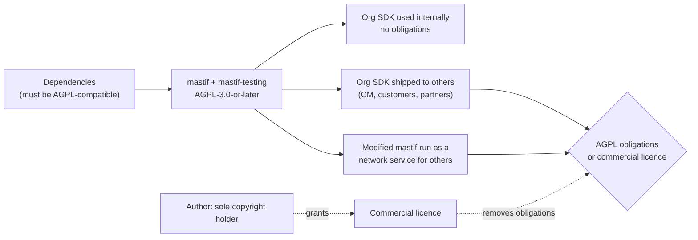
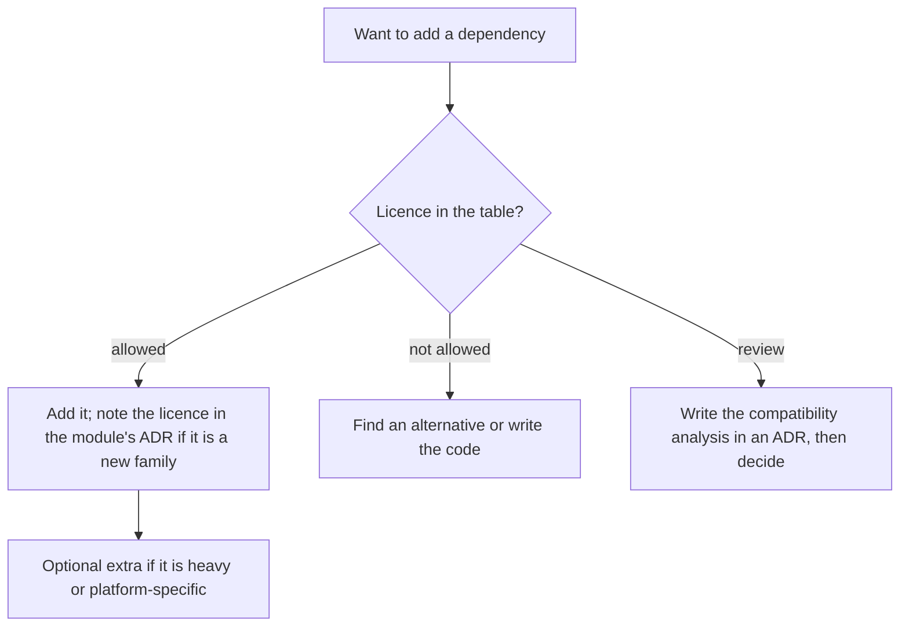

# ADR-0031: Licensing and dependency policy

| | |
|---|---|
| **Status** | accepted |
| **Date** | 2026-10-25 |
| **Module(s)** | the whole repository: `LICENSE`, `NOTICE`, both `pyproject.toml` files, `AGENTS.md`, `CONTRIBUTING.md` |
| **Layer** | cross-cutting |
| **Related** | ADR-0001 (packages and audiences); ADR-0033 (paramiko, the first LGPL dependency); ADR-0035 (vendor DLLs, which mastif never ships) |

> **Who this is for:** an engineer who joined today, who may never have had to think
> about software licences. It explains the licence families from scratch, then why
> mastif chose the one it did, and what that means for you when you add a dependency
> or build an org SDK. Terms are explained on first use and collected in the
> [glossary](../wiki/glossary.md). **This ADR is an engineering record, not legal
> advice.** A lawyer must confirm the commercial terms before any licence is sold.

## 1. Summary

mastif is licensed under the **GNU Affero General Public License, version 3 or any later
version (AGPL-3.0-or-later)**. The author also offers a separate **commercial licence**
for anyone who wants to use mastif without the AGPL's obligations. This is called *dual
licensing*. Dual licensing only works while one person holds all the copyright, so
**outside contributions are not accepted for now**. Dependencies must be
**AGPL-compatible**: permissive, LGPL, MPL-2.0 and GPL-3.0-compatible licences are
allowed; GPL-2.0-only, SSPL, non-commercial and proprietary licences are not. The one
idea to remember: *using mastif inside your own organisation is free and carries no
obligations; giving modified mastif, or software built on it, to someone else (or
running it as a network service for them) means offering them the source, unless you
buy a commercial licence.*

## 2. The problem, from first principles

### 2.1 Why a licence is needed at all

Copyright law gives the author of code exclusive rights to copy, modify and distribute
it. Code published with **no licence** is not free to use. Legally, nobody else may copy
it, and careful companies will refuse to touch it. Until this ADR, mastif's `NOTICE` said
exactly that: "All rights reserved. No licence is granted at this time." A licence is
the author's written permission, with conditions.

### 2.2 The licence families

| Family | Examples | What it asks of people who reuse the code | OSI open source? |
|---|---|---|---|
| **Permissive** | MIT, BSD-2/3-Clause, ISC, Apache-2.0, PSF-2.0 | Keep the copyright notice. Apache-2.0 adds a patent grant. You may close your changes and sell them. | yes |
| **Weak copyleft** | LGPL-2.1/3.0, MPL-2.0 | Changes *to the library itself* (LGPL), or to its files (MPL), must stay open. Code that merely uses the library may stay closed. | yes |
| **Strong copyleft** | GPL-2.0, GPL-3.0 | If you **distribute** a program that includes the code, the whole program must be offered under the GPL, with source. Private and internal use carries no obligations. | yes |
| **Network copyleft** | AGPL-3.0 | Like GPL-3.0, plus: if you **modify** it and let people **use it over a network**, you must offer *them* the source too (section 13). | yes |
| **Source-available** | BSL 1.1, FSL, PolyForm Shield/Noncommercial, Elastic License 2.0, SSPL | Code is readable, but some uses (competing products, commercial use, hosting) are forbidden, sometimes only for a few years. | **no** |
| **Proprietary** | vendor EULAs, "all rights reserved" | Only what the contract allows. | no |

**Copyleft** means: the freedom you received must be passed on. Anyone who receives the
software (or, for the AGPL, uses a modified version over a network) gets the source and
the same rights. **OSI** is the Open Source Initiative. It keeps the *Open Source
Definition* and the list of licences that meet it. Many company policies allow
"OSI-approved licences" and nothing else.

### 2.3 The user's requirements (from the walkthrough)

The licence was chosen in a walkthrough with the author. The requirements, in their
order of importance:

1. **Keep the right to earn from mastif.** The author wants to be able to sell
   commercial licences, support, or a product built on it, later.
2. **Stop others from taking it closed.** A company must not be able to wrap mastif in
   a proprietary product or hosted service and sell it without giving anything back.
3. **Internal use must stay free.** An organisation, including the author's own
   employer, must be able to build its own SDK on mastif and run it on its own stations
   at no cost and without legal friction.
4. **The source stays public**, so engineers can read, learn from and audit it.
5. **Room for a community later**, without giving up 1 and 2 today.

### 2.4 Why "no commercial use by others" is not open source

The first instinct was "free for everyone, but nobody else may make money with it".
That conflicts with the **Open Source Definition, criterion 6 ("No discrimination
against fields of endeavor")**: an open-source licence may not forbid use in a business.
Licences that do (for example PolyForm Noncommercial, or Creative Commons *NC*) are
*source-available*, not open source. That has real costs:

- Most company policies forbid source-available code, or need legal review for it,
  which defeats requirement 3.
- "Commercial use" is notoriously hard to define. Is an internal test station at a
  company "commercial"? Almost certainly yes, so requirement 3 would fail outright.

The goal behind the instinct is really requirement 2: stop *closed* commercial reuse.
Copyleft achieves exactly that, while staying open source.

### 2.5 Forces and constraints

- **Adoption vs protection.** The more protective the licence, the more organisations
  hesitate to adopt it.
- **Clarity.** Engineers and company lawyers must be able to understand the licence
  quickly. Well-known licences are reviewed once and then allowed by policy.
- **Revenue path.** A commercial option must exist, and it must be legally possible for
  the author to grant it.
- **Dependencies.** Whatever mastif is licensed under constrains which libraries it may
  use, and vice versa.
- **The ATE reality.** Organisations commonly ship test stations, or test software, to
  contract manufacturers and partners. That counts as *distribution*, and it is where
  copyleft obligations bite.

## 3. Where it sits in the system

The licence touches every artefact the project produces, and every dependency it
consumes.

- **Upstream** (what the policy constrains): every runtime, optional and development
  dependency, chosen under the rule in section 4.6.
- **Downstream** (who the licence affects): org SDK authors, organisations running
  stations, and anyone redistributing or hosting mastif.
- **What flows through it:** permission. The licence text travels with the code, in
  the repository and inside every wheel (`*.dist-info/licenses/`).

## 4. Decision

1. **Licence: AGPL-3.0-or-later** for `mastif` and `mastif-testing`, and for every
   future workspace package. The SPDX identifier is `AGPL-3.0-or-later`. "Or later"
   lets users take a future AGPL version if the FSF publishes one. Because the author
   holds all copyright, the project itself can always relicense anyway.
2. **Commercial licence on request.** The author offers mastif under separate written
   terms that remove the AGPL obligations. The terms are not part of this repository and
   must be reviewed by a lawyer before the first sale.
3. **Sole copyright: no outside contributions for now.** Dual licensing requires that
   the person selling the commercial licence owns all of the code. Accepting a patch
   under the AGPL alone would mean the author couldn't sell that code commercially.
   `CONTRIBUTING.md` therefore says external contributions are not accepted. If that
   changes, contributions will need a **CLA** (Contributor Licence Agreement: a contract
   in which the contributor grants the author the right to relicense their
   contribution). A DCO sign-off is not enough, because it only certifies origin and
   grants no relicensing right.
4. **Artefacts:**
   - `LICENSE`: the official AGPL-3.0 text, downloaded verbatim from
     `https://www.gnu.org/licenses/agpl-3.0.txt`, never retyped. Its line endings are
     pinned to LF in `.gitattributes`, so a checkout on Windows doesn't alter it.
   - `NOTICE`: the copyright line, the licence grant, the warranty disclaimer, and the
     commercial offer.
   - `pyproject.toml` of each package: `license = "AGPL-3.0-or-later"` and
     `license-files = ["LICENSE", "NOTICE"]` (PEP 639). PEP 639 forbids paths outside
     the package directory, so each package directory holds a byte-identical copy of
     both files. A test fails if a copy drifts from the root.
   - The build backend is pinned to `hatchling>=1.27`, the first version that writes
     PEP 639 metadata (`License-Expression`, `License-File`).
5. **Dependency rule: AGPL-compatible only** (replaces "permissive only"). See the table
   in 4.6. A dependency's licence is checked when it is added; a new licence family
   needs a note in the dependency's ADR.
6. **Dependency compatibility table:**

   | Licence of the dependency | Allowed? | Why |
   |---|---|---|
   | MIT, BSD-2/3-Clause, ISC, Zlib, PSF-2.0 | yes | Permissive; only the notice must be kept. |
   | Apache-2.0 | yes | Compatible with GPL-3.0 and AGPL-3.0 (not with GPL-2.0). |
   | LGPL-2.1, LGPL-3.0 (only or later) | yes | LGPL code may be combined with GPL-3.0 / AGPL-3.0 code. |
   | MPL-2.0 | yes | Section 3.3 allows combination with (A)GPL code, unless the file is marked "Incompatible With Secondary Licenses". |
   | GPL-3.0-only / -or-later, GPL-2.0-or-later | yes | GPL-3.0 section 13 and AGPL-3.0 section 13 explicitly allow combining the two. |
   | AGPL-3.0 | yes | Same licence. |
   | EPL-2.0, CDDL, others not listed | **review** | Depends on secondary-licence clauses; record the analysis in an ADR first. |
   | GPL-2.0-only, EPL-1.0, CDDL-1.0 | **no** | Incompatible with GPL-3.0, hence with AGPL-3.0. |
   | SSPL, BSL 1.1, Elastic License 2.0, Commons Clause | **no** | Source-available, with field-of-use restrictions. |
   | Non-commercial (PolyForm NC, CC BY-NC) | **no** | Forbids uses the AGPL allows. |
   | Proprietary, or no licence at all | **no** | No permission to redistribute. |

7. **Current dependencies were verified on 2026-10-25:**

   | Group | Packages | Licences |
   |---|---|---|
   | runtime | dynaconf, pydantic (+ pydantic-core, annotated-types, typing-inspection), PyYAML, rich (+ markdown-it-py, mdurl, Pygments), typing-extensions | MIT, BSD-2-Clause, PSF-2.0 |
   | optional extras | pyserial, pyvisa, pandas (+ numpy, python-dateutil, six, tzdata) | BSD, MIT, BSD-3-Clause, Apache-2.0 |
   | development and docs | pytest, ruff, ty, import-linter, mkdocs, mkdocs-material, mkdocstrings and their dependencies | MIT, BSD, ISC, Apache-2.0, plus MPL-2.0 (`certifi`, `pathspec`) |

   All are compatible. `certifi` and `pathspec` were technically outside the old
   permissive-only rule; they are only build tools and are fine under the new one.
8. **Vendor libraries are never shipped.** Drivers for vendor DLLs (ADR-0035) load
   libraries the user installs on their own station. mastif never commits,
   redistributes or bundles them.

## 5. Abstractions

A licence decision has no Python types; its "abstractions" are the obligations each
party takes on. These are the practical consequences, as best understood without a
lawyer.

| Who | Does | Obligation under AGPL-3.0 |
|---|---|---|
| An organisation | builds an org SDK on mastif and runs it on its own stations, by its own employees | **None.** Running and modifying privately is not "conveying". |
| An organisation | ships its SDK (or a station image containing mastif) to a contract manufacturer, customer or partner | The combined work is conveyed: recipients must receive the corresponding source under the AGPL, for mastif **and** for the SDK built on it. Or buy a commercial licence. |
| An organisation | runs a **modified** mastif as a network service that outside users interact with (e.g. a customer results portal) | Offer those users the source of the modified version (section 13). Or buy a commercial licence. |
| An organisation | uses unmodified mastif behind a network service | Section 13 is triggered by modification; unmodified use is the safest case. Confirm with a lawyer for the specific setup. |
| A vendor | sells a closed product built on mastif | Not allowed under the AGPL. Needs a commercial licence. |
| The author | sells commercial licences | Allowed, because the author owns all of the code. |

**Is an org SDK a "derived work"?** An SDK `import`s mastif and subclasses or decorates
its types, so the FSF's reading treats the SDK and mastif as one combined program. This
ADR assumes that reading, because it is the cautious one. It only matters once the SDK
is *conveyed* or hosted for others.

**What does "internal" cover?** Employees of the organisation, on the organisation's
equipment. Contractors working on the organisation's behalf are usually treated as
internal too, but that, and affiliates or subsidiaries, are exactly the cases to put to
a lawyer.

## 6. Data flow

How a new dependency is vetted:

Walk-through:

1. **Read the licence from the package metadata** (`License-Expression`, or the
   `License` field and classifiers) and confirm it in the project's repository.
2. **Look it up in the table** in section 4.6.
3. **Allowed:** add it. If it brings a licence family mastif doesn't use yet (e.g. the
   first LGPL dependency, paramiko in ADR-0033), say so in that module's ADR.
4. **Not allowed:** pick another library or write the code yourself.
5. **Review:** write the analysis down before adding anything.

How obligations flow when an org ships software (the failure path to avoid):

1. The org builds `acme-sdk` on mastif and ships a station image to a contract
   manufacturer.
2. That is conveying, so the contract manufacturer is entitled to the source of mastif
   and `acme-sdk` under the AGPL.
3. If the org can't or won't do that, it needs a commercial licence **before** shipping.

## 7. Errors

There are no runtime exceptions in this decision. The policy is enforced by people and
by one check:

| Check | Fails when | What it means | What to do |
|---|---|---|---|
| `tests/test_packaging.py` | a package's `LICENSE` or `NOTICE` differs from the root copy | someone edited one copy | Copy the root file over the package copy. Never edit `LICENSE`. |
| review of a new dependency | the licence is "no" or "review" in section 4.6 | the dependency would break the licence | Section 6. |

## 8. Guarantees and invariants

- `LICENSE` is the verbatim FSF text, byte for byte, in the repository and in every
  wheel.
- Every distribution's metadata states `License-Expression: AGPL-3.0-or-later`.
- Every runtime and optional dependency is AGPL-compatible.
- The author is the sole copyright holder of everything in the repository.

## 9. Consequences

- **Positive:**
  - mastif is real, OSI-approved open source. Engineers can read, run, modify and
    share it.
  - Internal use is free and without obligations, which covers the most common ATE
    case: an organisation's own stations.
  - Closed forks and closed hosted services are not possible without a commercial
    licence, which gives the author a revenue path.
  - The dependency pool grows: LGPL and MPL libraries (paramiko, for example) become
    usable.
- **Negative / costs:**
  - **Corporate AGPL bans.** Some large companies forbid AGPL software outright
    (Google's published open-source policy is the best-known example), and many require
    legal review for it. Some potential users will not adopt mastif for that reason
    alone. The commercial licence is the answer for them.
  - **Distributed SDKs are affected.** An organisation that ships its station software
    to contract manufacturers must either publish its SDK's source to them under the AGPL
    or buy a commercial licence. That is intended, but it must be explained clearly.
  - **No outside contributions.** Bug reports are welcome, patches are not, which slows
    community growth.
- **Risks to watch:**
  - Accidentally accepting a patch, which would dilute the copyright. Keep the
    contribution rule visible.
  - A dependency changing its licence in a new version (it has happened, e.g. to
    projects moving to SSPL or BSL). Re-check licences when upgrading major versions.
  - Selling licences without legal review.

## 10. Alternatives considered

| Option | What it is | Why it was rejected |
|---|---|---|
| **Stay unlicensed** | "All rights reserved" | Nobody may legally use it; fails requirements 3 and 4. |
| **Permissive (MIT / Apache-2.0)** | anyone may do anything, keeping the notice | Fails requirement 2: a company could ship a closed product on mastif. Leaves the author with no leverage to sell. |
| **GPL-3.0 + commercial** | copyleft on distribution only | Hosted services escape it: a vendor could run a modified mastif as a closed cloud service. AGPL closes that gap at no extra cost for internal users. |
| **LGPL / MPL** | weak copyleft | Only changes to mastif itself would have to stay open; closed SDKs and products on top would be free. Fails requirement 2. |
| **FSL (Functional Source License)** | source-available; forbids "competing use" for two years, then each release becomes Apache-2.0 or MIT | Not OSI; "competing use" is hard to apply to a framework; every release turns permissive after two years, so the protection keeps draining away. |
| **BSL 1.1 (Business Source License)** | source-available with a custom "additional use grant"; converts to an open licence after at most four years | Not OSI; the use grant would have to be drafted from scratch, and company lawyers review each BSL variant separately. |
| **PolyForm Shield** | any use except offering a product that competes with the licensor | Not OSI; "competes" is ambiguous and widens with whatever the author sells later, which makes adopters nervous. |
| **Non-commercial licences** | forbid commercial use | Not open source (section 2.4) and would forbid the internal-station use of requirement 3. |
| **SSPL** | AGPL-like, but hosting requires releasing the whole service stack | Not OSI, and widely banned. |

**Why AGPL-3.0-or-later + commercial won:** it is the only option that meets all five
requirements while remaining OSI-approved. Internal use is free (3). Closed
distribution and closed hosting are blocked (2) unless someone pays (1). The source is
public (4). A community remains possible later, through a CLA (5). The model is
well-trodden: MySQL and Qt (GPL family plus commercial), and Grafana and Nextcloud
(AGPL), are well-known projects that use copyleft as the free tier.

## 11. Open questions and future work

- **Commercial terms**, price and form: to be drafted with a lawyer before any sale.
- **Contributions:** when to open them, and which CLA to use.
- **Documentation licence:** the docs are currently covered by the repository licence.
  A documentation-specific licence (e.g. CC BY-SA 4.0) may be clearer.
- **SPDX headers** in every source file (`# SPDX-License-Identifier: AGPL-3.0-or-later`):
  not added yet; `LICENSE`, `NOTICE` and the package metadata cover the repository.
- **Automated licence checking** of the lock file in CI.

## 12. Code map

| What | Where |
|---|---|
| Licence text | `LICENSE`, `packages/*/LICENSE` |
| Copyright and commercial notice | `NOTICE`, `packages/*/NOTICE` |
| Package metadata | `packages/mastif/pyproject.toml`, `packages/mastif-testing/pyproject.toml` |
| Line-ending pin | `.gitattributes` |
| Copy-drift test | `packages/mastif/tests/test_packaging.py` |
| Rules for contributors | `AGENTS.md`, `CONTRIBUTING.md` |
| Wiki | `docs/wiki/licensing.md` |

## History

- 2026-10-25: created. Replaces the "permissive dependencies only" rule and the
  "no licence granted" notice.
