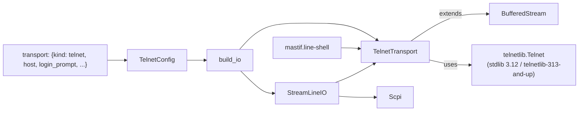
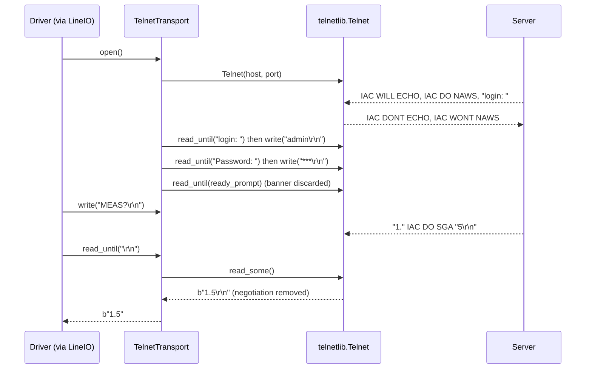

# ADR-0032: Telnet transport

| | |
|---|---|
| **Status** | accepted |
| **Date** | 2026-10-25 |
| **Module(s)** | `mastif.resources.transports.telnet`; `TelnetConfig` in `mastif.resources.transports.config` |
| **Layer** | resources |
| **Related** | ADR-0013 (configs); ADR-0014 (`BufferedStream`, which this extends); ADR-0015 / ADR-0016 (`LineIO`, `Scpi` on top); ADR-0018 (factory); ADR-0020 (`mastif.line-shell` over Telnet); ADR-0031 (dependency licences) |

> **Who this is for:** an engineer who joined today. You need to know what a byte
> stream is in mastif ([ADR-0014](0014-byte-streams.md)); everything Telnet-specific is
> explained here. Terms are in the [glossary](../learn/architecture/glossary.md).

## 1. Summary

`TelnetTransport` is a `StreamTransport` over a Telnet connection, built from a
`transport: {kind: telnet, ...}` block. It strips Telnet's in-band option negotiation
from the data, refuses every option the server proposes, escapes the `0xFF` byte on
the way out, and can log in during `open`. The protocol work is done by `telnetlib`,
the standard-library module removed in Python 3.13, supplied on 3.13+ by the
`telnetlib-313-and-up` package (the same code, PSF licence) and on 3.12 by the stdlib.
The one idea to remember: *a Telnet device looks exactly like a TCP or serial device to
drivers, because negotiation never reaches them.*

## 2. The problem, from first principles

- **Real instruments speak Telnet.** RF switch matrices, digital I/O boxes, power
  distribution units and terminal servers commonly offer an ASCII command set on
  port 23 instead of a raw socket.
- **Telnet is not raw TCP.** The server mixes *negotiation* into the data stream:
  three-byte sequences starting with `IAC` (byte 255), such as `IAC WILL ECHO` ("I will
  echo your input") or `IAC DO NAWS` ("tell me your window size"). With a plain
  `TcpTransport`:
  - the first reply arrives prefixed with binary garbage, and parsing fails
  - negotiation in the middle of a reply splits a number in two (`"1." IAC DO SGA "5"`)
  - the server waits for answers that never come, and some servers stall
  - a `0xFF` byte in the driver's own data is read by the server as a command
- **Logins.** Many boxes ask `login:` and `Password:` before accepting commands, and
  greet with a banner afterwards. If that banner isn't skipped, the driver reads it as
  the reply to its first command.
- **`telnetlib` left the stdlib in Python 3.13** (PEP 594). mastif supports 3.12 and
  later, so it needs a source for the protocol code on both.
- **Forces:** no hand-rolled protocol code (the plan asked for an existing library);
  a light core; drivers unchanged across TCP, serial and Telnet; a profile mistake
  (wrong prompt) must fail clearly at `open`, not hang.

## 3. Where it sits in the system



- **Layer:** resources/transports, beside TCP and serial.
- **Upstream:** the factory (ADR-0018), which builds it for `StreamTransport`, `LineIO`
  and `Scpi` requests; `mastif.line-shell` (ADR-0020).
- **Downstream:** `telnetlib.Telnet` and, through it, a TCP socket.
- **What flows through it:** bytes. Negotiation is consumed inside; only data comes out.

## 4. Decision

1. **Use `telnetlib`, not our own protocol code, and not `telnetlib3`.**
   - Python ≥ 3.13: the `telnetlib-313-and-up` package, a core dependency with the
     marker `python_version >= '3.13'`. It is the stdlib module, unchanged apart from
     the deprecation warning, under the PSF licence.
   - Python 3.12: the stdlib module. Its import-time `DeprecationWarning` is
     suppressed in `load_telnetlib()`, because the dependency is deliberate.
2. **`TelnetConfig(LineSettings)`**, `kind: telnet`:

   | Field | Default | Meaning |
   |---|---|---|
   | `host` | (required) | address |
   | `port` | 23 | Telnet port |
   | `read_termination` / `write_termination` | `"\r\n"` | the Telnet standard line ending (RFC 854), not `LineSettings`' `"\n"` |
   | `connect_timeout` | 5 s | the connection, and each prompt during `open` |
   | `login_prompt` / `username` | `None` | given together, or not at all |
   | `password_prompt` | `"Password: "` | |
   | `password` | `None` | a `SecretStr`, never shown in reprs or logs; needs a username |
   | `ready_prompt` | `None` | text marking "ready for commands"; everything before it is discarded |

3. **`TelnetTransport(BufferedStream)`** supplies the four raw hooks:
   - `_connect`: open `telnetlib.Telnet(host, port, timeout=connect_timeout)`; then, if
     configured, answer `login_prompt` with the user name and `password_prompt` with the
     password (each followed by the write terminator); then wait for `ready_prompt`.
     Any failure closes the connection before raising.
   - `_send`: `Telnet.write`, which doubles `IAC` bytes.
   - `_receive(timeout)`: set the socket timeout, then `Telnet.read_some()`, which
     keeps reading until it has *data*, answering negotiation as it goes. A socket
     timeout returns `b""`, which `BufferedStream` turns into `TransportTimeout`. An
     empty read means the server hung up: `TransportError`.
   - `_disconnect`: `Telnet.close()`.
4. **Option policy: refuse everything.** `telnetlib`'s default answers `DONT` to every
   `WILL` and `WONT` to every `DO`. A command client needs no options, and agreeing to
   ones it doesn't implement (server echo, terminal size) changes what the server sends.
5. **Factory:** Telnet provides `StreamTransport`, `LineIO` (as `StreamLineIO`) and
   `Scpi` (ADR-0018). `mastif.line-shell` accepts it (ADR-0020).

## 5. Abstractions

| Name | Purpose | Invariants and behaviour |
|---|---|---|
| `TelnetConfig` | Where the Telnet device is, and how to log in | Frozen, `extra="forbid"`. `login_prompt` and `username` come together; `password` needs them. Passwords are `SecretStr`. |
| `TelnetTransport` | `StreamTransport` over Telnet | Name `telnet://host:port`. Inherits buffering, framing, deadlines and tracing from `BufferedStream`. Data read never contains negotiation; data written arrives verbatim. Login traces show `***` instead of the password. |
| `load_telnetlib()` | Import `telnetlib` on any supported Python | No warning escapes; a missing module raises `TransportError` with the install command. |

Example:

```python
tn = TelnetTransport(
    TelnetConfig(
        host="10.0.0.9", login_prompt="login: ", username="admin", password="...", ready_prompt="> "
    )
)
tn.open()  # connects, logs in, skips the banner up to "> "
tn.write(b"SETA=1\r\n")
tn.read_until(b"\r\n")  # b"1"
```

## 6. Data flow



1. **Connect.** `telnetlib` opens the socket.
2. **Negotiate.** Whenever bytes are read, `telnetlib` removes `IAC` sequences and
   answers each with a refusal.
3. **Log in** (optional). Each prompt must arrive within `connect_timeout`.
4. **Wait for ready** (optional). Banner text up to `ready_prompt` is discarded.
5. **Exchange data.** `BufferedStream` frames lines from the clean data.

**Failure paths:** a refused connection raises `TransportError` at step 1. A wrong or
missing prompt raises `TransportTimeout` at step 3 or 4, naming the prompt and showing
the last bytes received; the connection is closed. A server hanging up mid-run raises
`TransportError` on the next read.

## 7. Errors

| Exception | Raised when | What it means | Who catches it |
|---|---|---|---|
| `TransportError` ("cannot connect") | the TCP connection fails | wrong host or port, device off, firewall | The station reports it as a resource that failed to open. Fix the profile or the bench. |
| `TransportTimeout` ("no 'login: ' prompt") | a login, password or ready prompt doesn't appear | the profile's prompt text is wrong, or the device is busy | Fix the prompt in the profile. |
| `TransportError` ("connection lost during login") | the server hangs up during login | usually wrong credentials | Check the credentials. |
| `TransportTimeout` | no data within the read timeout | slow or silent device | Let it propagate; the task ERRORs. |
| `TransportError` ("closed by peer" / "receive failed") | the server hung up | session limit, idle timeout, device reboot | Let it propagate. |
| `TransportError` ("needs the telnetlib module") | `telnetlib` is missing | a broken installation on 3.13+ | Install `telnetlib-313-and-up`. |
| `pydantic.ValidationError` | half-specified login | profile mistake | The station wraps it in `StationError`. |

## 8. Guarantees and invariants

- Negotiation bytes never reach the caller; every byte the caller writes arrives as
  data.
- `open` either returns with the session logged in and ready, or raises with the
  connection closed.
- No warning is emitted on import on any supported Python.
- Passwords never appear in reprs or traces.

## 9. Consequences

- **Positive:**
  - Telnet devices need no special driver code: `LineIO`, `Scpi` and `mastif.line-shell`
    just work.
  - The protocol code is mature (decades in the stdlib) and is not ours to maintain.
  - Zero transitive dependencies.
- **Negative / costs:**
  - `telnetlib-313-and-up` is a small single-maintainer repackaging. If it disappears,
    the module is a single PSF-licensed file that could be vendored.
  - Two sources for one module, depending on the Python version.
  - `telnetlib3` also installs a top-level `telnetlib.py`. If an environment has both,
    whichever installed last wins; both provide the same API.
  - Login failure is detected only indirectly (a timeout waiting for the next prompt).
- **Risks:** servers that require a specific option (e.g. binary mode) to work. None of
  the targeted devices need one; the option policy can become configurable if one does.

## 10. Alternatives considered

| Option | Why rejected |
|---|---|
| **`telnetlib3`** (ISC) | asyncio-based: a synchronous wrapper runs an event loop on a background thread per connection. It brings `wcwidth` and, on Windows, `blessed`; ships a large surface (servers, MUD support, fingerprinting); and installs its own top-level `telnetlib.py` shim. Far more than a command client needs. |
| **Write our own minimal Telnet** | Protocol code is easy to get subtly wrong (partial `IAC` sequences across packets, `IAC IAC` escaping, subnegotiation). The plan asked for an existing library once the licence allowed one. |
| **Plain `TcpTransport`** | Negotiation bytes would corrupt replies (section 2). |
| **Vendoring `telnetlib`** | Possible later; a dependency keeps the provenance clear and the code untouched. |

## 11. Open questions and future work

- A `login_failed` pattern (e.g. `"Login incorrect"`) for a direct error instead of a
  timeout.
- Configurable option policy, if a device needs an option accepted.
- Regex prompts.

## 12. Code map

| What | Where |
|---|---|
| Implementation | `packages/mastif/src/mastif/resources/transports/telnet.py` |
| Config | `packages/mastif/src/mastif/resources/transports/config.py` (`TelnetConfig`) |
| Tests | `packages/mastif/tests/resources/test_telnet.py` (a real localhost Telnet server) |
| Wiki | `docs/learn/architecture/transports.md` |

## History

- 2026-10-25: created.
