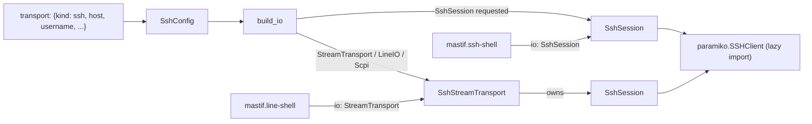
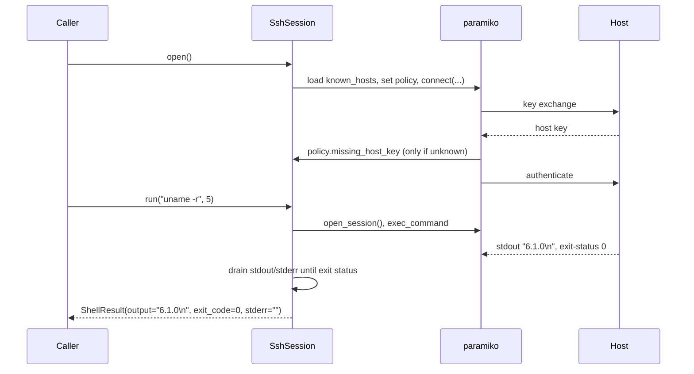

# ADR-0033: SSH transports: command sessions and interactive shells

| | |
|---|---|
| **Status** | accepted |
| **Date** | 2026-10-25 |
| **Module(s)** | `mastif.resources.transports.ssh`; `SshConfig` in `mastif.resources.transports.config` |
| **Layer** | resources |
| **Related** | ADR-0009 (`ShellResult`, which gains `stderr`); ADR-0013 (configs); ADR-0014 (`BufferedStream`); ADR-0018 (factory, `SshSession` injectable); ADR-0020 (`mastif.line-shell` over SSH); ADR-0034 (`mastif.ssh-shell`); ADR-0031 (paramiko is LGPL, allowed) |

> **Who this is for:** an engineer who joined today. You should know what a byte stream
> ([ADR-0014](0014-byte-streams.md)) and I/O injection ([ADR-0018](0018-io-injection.md))
> are. SSH concepts are explained as they appear; terms are in the
> [glossary](../learn/architecture/glossary.md).

## 1. Summary

Two I/O types reach hosts over SSH, both built from `transport: {kind: ssh, ...}`.
`SshSession` runs commands, each in its own SSH *exec channel*, and returns
`ShellResult(command, output, exit_code, stderr)` with the real exit status and error
output kept separate. `SshStreamTransport` opens an *interactive shell channel* and
presents it as a `StreamTransport`, so `LineIO`, `Scpi` and `mastif.line-shell` work over
SSH. Both use paramiko, an optional extra (`mastif[ssh]`) imported only when a connection
opens. Host keys are always checked: unknown hosts are refused by default, and a changed
key is always refused. The one idea to remember: *use `SshSession` (or `mastif.ssh-shell`)
to run commands; use the stream only when the target offers nothing but an interactive
CLI.*

## 2. The problem, from first principles

- **Linux DUTs are reached over SSH.** Tests read versions, flash firmware, start
  services and check logs. They need each command's output and, crucially, whether it
  succeeded.
- **Consoles make that fragile.** Over an interactive shell, output arrives mixed with
  the echoed command, the prompt, colour codes, and stderr. The exit code needs a second
  command (`echo $?`), which itself can be confused by output. SSH has a better
  primitive: an **exec channel** runs one command, streams stdout and stderr separately,
  and reports the exit status in the protocol.
- **Some targets only offer an interactive CLI** (a vendor menu, a network appliance), so
  a stream over a shell channel is still needed.
- **Security matters even in a lab.** SSH proves the server's identity with a **host
  key**, checked against a **known-hosts** file. Skipping the check (as many scripts do
  with "auto-add") means anyone on the network can impersonate the DUT and capture the
  password. But freshly flashed DUTs get a new key every time, so a "trust on first
  use" mode is needed too.
- **The system `ssh` client is not a reliable dependency.** Containers and minimal images
  often lack it, password prompts need a terminal, and parsing its output is fragile.
- **Forces:** a light core (SSH stacks pull in cryptography), testability without a
  real server, credentials that never leak into logs, and clear errors for the four
  common failures: unreachable, unknown key, changed key, wrong credentials.

## 3. Where it sits in the system



- **Layer:** resources/transports.
- **Upstream:** the factory; `mastif.ssh-shell` (ADR-0034); `mastif.line-shell`
  (ADR-0020); org drivers that ask for `session: SshSession` directly.
- **Downstream:** paramiko's `SSHClient`, or a fake passed as `client_factory`.
- **What flows through it:** commands in; `ShellResult` out (sessions). Bytes both ways
  (streams).

## 4. Decision

1. **paramiko, as the optional extra `mastif[ssh]`.** It is LGPL-2.1, which the licence
   policy allows (ADR-0031). It stays optional only to keep the core light (it brings
   `cryptography`, `bcrypt` and `pynacl`). It is imported inside `open`, so mastif
   imports and validates SSH configs without it. A missing extra raises `TransportError`
   with the install command.
2. **`SshConfig(LineSettings)`**, `kind: ssh`:

   | Field | Default | Meaning |
   |---|---|---|
   | `host`, `port` | (required), 22 | address |
   | `username` | (required) | |
   | `password` | `None` | `SecretStr` |
   | `key_file`, `key_passphrase` | `None` | private key (`~` expanded); passphrase is a `SecretStr` |
   | `known_hosts` | `strict` | `strict` or `accept_new` |
   | `known_hosts_file` | `None` | extra known-hosts file, also where `accept_new` saves keys |
   | `connect_timeout` | 10 s | TCP connect, banner and authentication |
   | `LineSettings` fields | `"\n"`, ASCII, 2 s | used by the stream; `timeout` is also `SshSession.run`'s default |

   If neither `password` nor `key_file` is given, the SSH agent and the default keys
   (`~/.ssh/id_*`) are tried. If either is given, only it is used.
3. **Host-key policies**, implemented as small classes duck-typed to paramiko's policy
   interface:
   - `strict`: refuse unknown hosts, with a message giving the `ssh-keyscan` command and
     the `accept_new` option.
   - `accept_new`: add the key, log a warning, and save it to `known_hosts_file` if set.
   - A **changed** key is refused by paramiko in both modes; mastif's message says it may
     be a man-in-the-middle attack or a reinstalled host.
   - The user's own `~/.ssh/known_hosts` is always loaded, plus `known_hosts_file`.
4. **`SshSession`**: one connection; `run(command, timeout)` opens a fresh exec channel per
   command, collects stdout and stderr separately until the exit status arrives and both
   are drained, then closes the channel. A deadline covers the whole command; on expiry
   the channel is closed and `TransportTimeout` raised. Output is decoded with the
   config's encoding, replacing undecodable bytes. Exit status `-1` (no status sent)
   becomes `exit_code=None`.
5. **`SshStreamTransport(BufferedStream)`** owns its own `SshSession` and opens a shell
   channel on a pseudo-terminal (`term="dumb"` to discourage colour codes, width 512 so
   long commands don't wrap in the echo). A closed shell raises `TransportError`, not a
   timeout.
6. **`ShellResult` gains `stderr: str = ""`** (ADR-0009). Consoles leave it empty.
7. **Factory:** `SshSession` from `ssh` only; `StreamTransport`, `LineIO` and `Scpi` from
   `ssh` via the shell stream. `SshSession` joins `IO_TYPES` (ADR-0018).
8. **Testability:** both classes take `client_factory`, a callable returning an
   unconnected client. Tests pass a fake with paramiko's method names; SDK authors use
   `mastif_testing.FakeSshSession` instead (ADR-0024).

## 5. Abstractions

| Name | Purpose | Invariants and key behaviour |
|---|---|---|
| `SshConfig` | Where the host is, who to log in as, how to trust it | Frozen, `extra="forbid"`; secrets are `SecretStr`. |
| `SshSession` | Run commands | Name `ssh://user@host:port`. `open` is idempotent; `close` is safe to repeat. `run` returns only after the command finished, or raises. Commands don't share shell state (each `run` is a fresh shell, like `ssh host cmd`). |
| `SshSession.run(command, timeout=None)` | One command | Returns raw output (trailing newlines kept). Non-zero exit is *returned*, not raised. |
| `SshSession.invoke_shell()` | Open an interactive channel | Used by the stream; raises `TransportError` if refused. |
| `SshStreamTransport` | Interactive shell as a stream | Owns its session; closing the stream closes both. |
| `ClientFactory` | Type of `client_factory` | `Callable[[], Any]` returning an unconnected client. |

Example:

```python
ssh = SshSession(SshConfig(host="192.168.1.60", username="root", key_file="~/.ssh/id_ed25519"))
ssh.open()
r = ssh.run("systemctl is-active app")
r.output, r.exit_code, r.stderr  # ("active\n", 0, "")
```

## 6. Data flow



1. **Open.** Known hosts are loaded and the policy installed before connecting.
2. **Host key check.** Known and matching: continue. Unknown: the policy decides.
   Changed: paramiko refuses.
3. **Authenticate** with the configured credential, or agent and default keys.
4. **Run.** A new exec channel per command; stdout and stderr are read as they arrive
   until the exit status is in and both buffers are empty.
5. **Return** the result; the channel is closed in all cases.

**Failure paths:** unknown host (strict), changed key and failed authentication all raise
`TransportError` from `open`, with the client closed. A hung command raises
`TransportTimeout` after the deadline. A dropped connection raises `TransportError` on
the next `run`.

## 7. Errors

| Exception | Raised when | What it means | Who catches it |
|---|---|---|---|
| `TransportError` ("pip install 'mastif[ssh]'") | paramiko isn't installed | missing extra | Install it. |
| `TransportError` ("not in known_hosts") | unknown host, `strict` | identity unverified | Add the key (`ssh-keyscan`), or choose `accept_new` deliberately. |
| `TransportError` ("host key has CHANGED") | key differs from known_hosts | possible attack, or the host was reinstalled | A human verifies, then removes the old key. Never automate this away. |
| `TransportError` ("authentication failed") | wrong user, password or key | credentials | Fix the profile. |
| `TransportError` ("connection timed out" / "cannot connect") | unreachable | network or power | Station reports the resource as failed. |
| `TransportTimeout` | a command didn't finish in time | hung or slow command | Let it propagate (task ERROR), or pass a longer `timeout`. |
| `TransportError` ("connection lost" / "failed") | connection dropped | DUT rebooted, network | A DUT driver may reconnect after a reboot. |
| `TransportError` ("shell closed by peer") | interactive shell exited | `exit` sent, or idle logout | Let it propagate. |

## 8. Guarantees and invariants

- Host keys are always verified; nothing in mastif connects to a host whose key changed.
- Secrets never appear in reprs or logs.
- `run` never returns before the command finished, and never hangs past its deadline.
- stdout and stderr are never mixed by `run`.
- Importing mastif never imports paramiko.

## 9. Consequences

- **Positive:**
  - Linux DUT commands get real exit codes and clean output.
  - Interactive-only targets still work, through the stream.
  - Works in containers without OpenSSH.
  - Fully testable without a server (fake client), and the test suite also runs a real
    in-process SSH server when paramiko is installed.
- **Negative / costs:**
  - A heavy optional dependency tree (cryptography and friends).
  - `run` waits with a 5 ms poll when nothing is ready, rather than blocking on a
    selector; simple and portable, but not zero-cost for very long commands.
  - Each `run` is a separate shell: `cd` doesn't persist. Documented; chain with `&&`.
  - Only paramiko's authentication methods are supported (no Kerberos/GSSAPI
    configuration exposed yet).
- **Risks:** `accept_new` is convenient and therefore tempting everywhere. It is opt-in
  per resource, and logs a warning every time it trusts a key.

## 10. Alternatives considered

| Option | Why rejected |
|---|---|
| **System `ssh` via subprocess** | Often missing in containers; password prompts need a TTY; output and errors are harder to separate reliably. |
| **asyncssh** (EPL-2.0 or GPL-2.0-or-later) | asyncio-only, so a background loop per connection, like `telnetlib3`. Allowed by the licence policy under its GPL option, but paramiko is synchronous, mature and the de-facto standard. |
| **paramiko as a core dependency** | Its cryptography stack is heavy for users who never use SSH. |
| **Auto-add unknown host keys by default** | Silently trusts impostors; rejected for security. `accept_new` exists as an explicit opt-in. |
| **Only a stream (no exec channel)** | Loses real exit codes and stderr separation, the main reason to use SSH. |
| **Raising on non-zero exit codes** | Whether a non-zero exit is a failure is the test's decision (`result.ok`). |

## 11. Open questions and future work

- SFTP / SCP file transfer (firmware images, log retrieval), likely as `SshSession.put`
  / `get`.
- Keep-alives for long idle sessions; automatic reconnect after a DUT reboot.
- Jump hosts (bastions) and SSH config file support.

## 12. Code map

| What | Where |
|---|---|
| Implementation | `packages/mastif/src/mastif/resources/transports/ssh.py` |
| Config | `packages/mastif/src/mastif/resources/transports/config.py` (`SshConfig`) |
| Tests | `packages/mastif/tests/resources/test_ssh.py` (fake client, plus a real in-process server) |
| Fake for SDK authors | `packages/mastif-testing/src/mastif_testing/fakes.py` (`FakeSshSession`) |
| Wiki | `docs/learn/architecture/transports.md` |

## History

- 2026-10-25: created.
