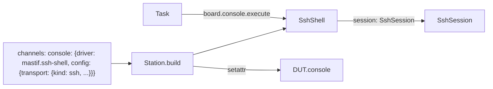
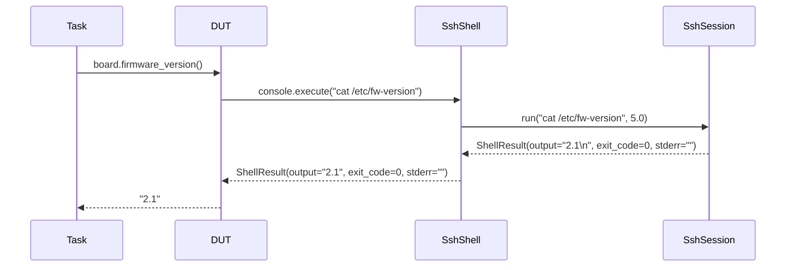

# ADR-0034: Built-in channel `mastif.ssh-shell`: SSH command execution as a `Shell`

| | |
|---|---|
| **Status** | accepted |
| **Date** | 2026-10-25 |
| **Module(s)** | `mastif.resources.channels.ssh` |
| **Layer** | resources |
| **Related** | ADR-0009 (`Shell`, `ShellResult`); ADR-0012 (always registered); ADR-0020 (`mastif.line-shell`, its console sibling); ADR-0023 (channels attached to DUTs); ADR-0033 (`SshSession`) |

> **Who this is for:** an engineer who joined today. A *channel* is a named way into a DUT,
> declared on the DUT class as `console: Shell = channel()` and mapped to a driver in the
> station profile ([ADR-0011](0011-drivers-and-duts.md)). See the
> [glossary](../wiki/glossary.md).

## 1. Summary

`SshShell` (driver id `mastif.ssh-shell`) provides the `Shell` contract by running each
command through `SshSession.run`, an SSH exec channel. It returns real exit codes and
keeps stderr separate, with no prompts or echo to strip. It ships with mastif and is
always in the `Registry`, so a Linux DUT's console channel needs no driver code. The one
idea to remember: *switching a DUT's console from serial to SSH is a profile change, not
a code change.*

## 2. The problem, from first principles

- **DUT code is written against `Shell`**, not against a medium. The same board may be
  reached over its serial console on one bench and over SSH on another.
- **`mastif.line-shell` over an SSH stream works but wastes SSH's strengths.** It must
  strip echo and prompts and ask for `$?` with a second command (ADR-0020).
- **SSH exec channels already give the clean shape `Shell` wants**: output, error output
  and exit status per command.
- **Forces:** identical `ShellResult` shape across shells, so DUT code doesn't care which
  one the profile chose; zero org code for the common case.

## 3. Where it sits in the system



- **Upstream:** DUT code calling `self.console.execute(...)`, and tasks through the DUT.
- **Downstream:** `SshSession` (ADR-0033), injected and opened by the station.

## 4. Decision

1. `@driver("mastif.ssh-shell", provides=[Shell])`, with `session: SshSession` injected.
2. **Config:** `transport: SshConfig` (required), `timeout` (default 5 s, the default
   wait per command).
3. **`execute(command, timeout=None)`** calls `session.run(command, timeout or the
   configured timeout)` and returns the result with `output` and `stderr` stripped of
   surrounding whitespace, matching `mastif.line-shell`.
4. **A non-zero exit code is returned, not raised.** The test decides (`result.ok`).
5. **Registered by default** in `BUILTIN_DRIVERS`, next to `mastif.line-shell` and
   `mastif.udp`.

## 5. Abstractions

| Name | Purpose | Behaviour |
|---|---|---|
| `SshShell` | `Shell` over SSH exec | Provides `Shell`; one exec channel per command, so shell state (`cd`, `export`) doesn't persist between commands. |
| `SshShell.Config` | Settings | `transport: SshConfig`, `timeout > 0`. |
| `execute()` | Run one command | `ShellResult(command, output, exit_code, stderr)`, stripped. |

```yaml
dut:
  dut: demo.widget-board
  channels:
    console: {driver: mastif.ssh-shell,
              config: {transport: {kind: ssh, host: 192.168.1.60, username: root,
                                   key_file: ~/.ssh/id_ed25519}}}
```

## 6. Data flow



1. The task calls a DUT method; the DUT calls its console channel.
2. `SshShell` forwards to `SshSession.run` with the effective timeout.
3. The session runs the command in a fresh exec channel and returns the raw result.
4. `SshShell` strips whitespace and returns.

**Failure path:** a hung command raises `TransportTimeout` from the session, which passes
through unchanged.

## 7. Errors

| Exception | Raised when | Meaning | Who catches it |
|---|---|---|---|
| `TransportTimeout` | the command doesn't finish in time | hung or slow command | Let it propagate, or pass a longer `timeout`. |
| `TransportError` | passes through from the session | connection failure | Let it propagate; a DUT driver may reconnect after a reboot. |

Connection-time errors (unknown host key, authentication) are raised when the station
opens the session, before this driver is used (ADR-0033).

## 8. Guarantees and invariants

- `execute` returns only after the command finished, or raises.
- `exit_code` is the command's real status (or `None` if the server sent none).
- `output` never contains stderr.

## 9. Consequences

- **Positive:** Linux DUTs need no driver code for their console; DUT code is portable
  between serial, Telnet and SSH consoles.
- **Negative:** no persistent shell state between commands, unlike a console. Commands
  that need it must chain (`cd /x && ./run`), or the profile uses `mastif.line-shell` over
  an SSH stream instead.

## 10. Alternatives considered

- **Only `mastif.line-shell` over an SSH stream:** rejected as the default. It loses real
  exit codes and stderr, and depends on prompt matching. It remains available.
- **One persistent shell with markers around each command:** rejected. Marker parsing is
  fragile, and the exec channel already provides exactly what is needed.

## 11. Open questions and future work

- An option to raise on non-zero exit codes, if DUT code commonly wants it.
- Environment variables per command (`env:` in the config).

## 12. Code map

| What | Where |
|---|---|
| Implementation | `packages/mastif/src/mastif/resources/channels/ssh.py` |
| Tests | `packages/mastif/tests/resources/test_ssh.py`, plus doctests (using `FakeSshSession`) |
| Wiki | `docs/wiki/resources.md`, `docs/wiki/guides/write-a-dut.md` |

## History

- 2026-10-25: created.
