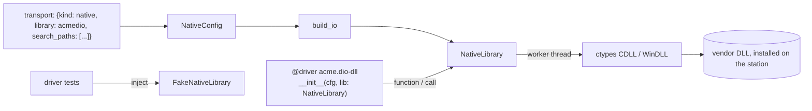
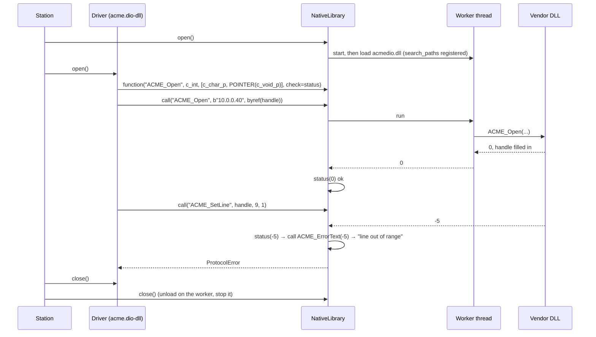

# ADR-0035: Native vendor libraries

| | |
|---|---|
| **Status** | accepted |
| **Date** | 2026-10-25 |
| **Module(s)** | `mastif.resources.transports.native`; `NativeConfig` in `mastif.resources.transports.config` |
| **Layer** | resources |
| **Related** | ADR-0002 (error model); ADR-0011 (drivers, injection); ADR-0013 (configs); ADR-0018 (factory); ADR-0024 (`FakeNativeLibrary`); ADR-0030 (32-bit host processes, crash isolation); ADR-0031 (vendor binaries are never shipped) |

> **Who this is for:** an engineer who joined today and has to write a driver for an
> instrument that only comes with a vendor DLL. You need to know what a driver is
> ([ADR-0011](0011-drivers-and-duts.md)). C-interop terms (calling convention, prototype,
> output parameter) are explained below and in the [glossary](../learn/architecture/glossary.md). The
> step-by-step how-to is the guide [Wrap a vendor DLL](../wiki/guides/wrap-a-vendor-dll.md).

## 1. Summary

`NativeLibrary` is an injectable I/O type for instruments driven through a vendor's
native library (a Windows DLL or a shared object). It is built from `transport: {kind:
native, library: ...}`, loads the library on `open` and unloads it on `close`. Drivers
must **declare every function's prototype** (`function(name, restype, argtypes)`) before
calling it (`call(name, *args)`), which prevents the classic 64-bit pointer truncation.
By default every call runs on **one dedicated thread**, because many vendor libraries are
not thread-safe. `StatusCheck` turns the usual "status code, then ask for the error text"
pattern into a `ProtocolError` carrying the vendor's message. Load failures become
`TransportError` with a hint. The one idea to remember: *a vendor DLL becomes just another
injected transport, with the C-interop pitfalls handled once.*

## 2. The problem, from first principles

### 2.1 The situation

Many instruments ship with a vendor SDK: a library such as `acmedio.dll` exporting C
functions like `int ACME_Open(const char *ip, void **handle)`. The library speaks the
instrument's private protocol over USB, PCIe or the network. Often there is no
documented wire protocol at all, so the library *is* the interface. Typical examples
are spectrum analysers on USB, counter and DIO cards, and networked lab boxes whose SDK
opens a session handle to an IP address.

Python calls such libraries through **ctypes**, the standard-library foreign-function
interface. ctypes is powerful and unforgiving.

### 2.2 What goes wrong without a framework

- **Pointer truncation.** Unless told otherwise, ctypes assumes a function returns a C
  `int` (32 bits). A function returning a 64-bit handle or pointer silently loses its top
  half, and the next call using it crashes the process, sometimes far from the cause.
  The cure is to declare each function's **prototype**: its return type (`restype`) and
  argument types (`argtypes`).
- **Thread safety.** Many vendor libraries are not thread-safe, or tie a session to the
  thread that opened it. Python code that calls from a UI thread and a worker thread
  corrupts state.
- **Dependent DLLs.** `acmedio.dll` loads `acmeusb.dll` from its install folder. Since
  Python 3.8, Windows doesn't search `PATH` or the current folder for dependencies of a
  library loaded by Python, so loading fails with "could not find module (or one of its
  dependencies)" even though the file is right there.
- **Calling conventions.** On 32-bit Windows many vendor DLLs use `stdcall` (the
  `WINAPI` convention), not `cdecl`. The wrong one corrupts the stack. (On 64-bit Windows
  the two are the same, but the profile should still say what the vendor documents.)
- **Error codes.** Functions return status codes, and a second function translates a code
  into text. Without a helper, drivers either ignore codes (a failed `SetLine` looks like
  success) or repeat the same boilerplate everywhere.
- **Architecture.** A 32-bit DLL can never be loaded into a 64-bit Python process. The
  Windows error is "%1 is not a valid Win32 application", which tells nobody what to do.
- **Licensing.** Vendor libraries are proprietary. They must never be committed or
  redistributed (ADR-0031); each station installs its own.

### 2.3 Forces

- Drivers stay short and synchronous, like every other mastif driver.
- Testable without the vendor library (CI has no vendor SDK installed).
- The library's location is a station fact, so it lives in the profile.
- No new dependencies: ctypes is in the standard library.

## 3. Where it sits in the system

- **Layer:** resources/transports. It is I/O, injected like a socket.
- **Upstream:** org drivers that ask for `lib: NativeLibrary`; the factory (ADR-0018); the
  station, which opens it before the driver's `open()` and closes it after `close()`.
- **Downstream:** ctypes and the operating system's loader.
- **What flows through it:** function calls with ctypes arguments in; converted return
  values out; status codes turned into errors.

## 4. Decision

1. **`NativeConfig`**, `kind: native` (not a `LineSettings`: there are no lines):

   | Field | Default | Meaning |
   |---|---|---|
   | `library` | (required) | a path, or a name resolved through `search_paths` and then the system search |
   | `search_paths` | `[]` | folders searched for the library; on Windows also registered with `os.add_dll_directory` while the library is open, so dependent DLLs are found |
   | `calling_convention` | `cdecl` | `cdecl` or `stdcall`; `stdcall` is Windows-only and is refused elsewhere at `open` |
   | `thread_confined` | `true` | run every call on one dedicated thread |

2. **Name resolution** (`resolve_library`): a value containing a folder is used as is;
   otherwise each search path is tried with the platform's file names (`acmedio.dll`;
   `libacmedio.so`; `libacmedio.dylib`); then `ctypes.util.find_library`; then the bare
   name.
3. **`NativeLibrary`**:
   - `open()`: start the worker thread (if confined), register the DLL directories, load
     the library **on the worker thread** (`WinDLL` for stdcall, `CDLL` for cdecl), and
     bind every function declared so far. Any failure undoes all of it.
   - `function(name, restype, argtypes, check=None)`: declare a prototype. Required
     before `call`. `argtypes` must be a list (`[]` for none). It may be called before or
     after `open`; declarations survive `close` and are re-bound on the next `open`.
   - `call(fn, *args)`: run the declared function, on the worker thread if confined, then
     apply the declaration's `check`. Calls from the worker thread itself run inline, so a
     `StatusCheck` that calls the library's error-text function can't deadlock.
   - `close()`: unload the library on the thread that loaded it, stop the worker, and
     remove the DLL directories. Unload errors are logged, never raised.
4. **`StatusCheck(ok=(0,), error_text=None)`**: a callable `(status, what) -> status`
   that raises `ProtocolError(f"{what} returned status {code}: {vendor text}")` for codes
   not in `ok`. If `error_text` itself fails, the original failure is still raised.
5. **Error translation:**
   - Load failures raise `TransportError` with `load_error_hint`: a missing file or
     dependency (check `library` and `search_paths`), or the wrong architecture (a 32-bit
     DLL needs a 32-bit host process; ADR-0030).
   - A missing symbol raises `TransportError` (usually the wrong library version).
   - Undeclared functions and arguments that don't match `argtypes` raise
     `DriverDefinitionError`: both are driver bugs.
   - An `OSError` from inside a call (Windows reports an access violation this way)
     raises `TransportError`.
   - A failed status check raises `ProtocolError`.
6. **Factory:** `NativeLibrary` is in `IO_TYPES` and is built only from `kind: native`
   (ADR-0018).
7. **Testing:** `mastif_testing.FakeNativeLibrary` implements the same methods, with Python
   callables (or fixed or successive status codes) in place of the vendor's functions, and
   the same rules (declare first, unknown names refused). `set_out(ref, value)` fills
   output parameters (`byref(x)` / `pointer(x)`) the way a C function would (ADR-0024).
8. **Vendor libraries are never committed.** `.gitignore` excludes `*.dll`, `*.so` and
   `*.dylib`; paths come from the station profile.

## 5. Abstractions

| Name | Purpose | Invariants and key behaviour |
|---|---|---|
| `NativeConfig` | Which library, where, how to call it | Frozen, `extra="forbid"`; `library` non-empty. |
| `NativeLibrary` | The loaded library as injectable I/O | Name `native:<library>`. Never calls an undeclared function. With confinement, every load, call and unload happens on one thread. `open` either fully succeeds or leaves nothing behind. |
| `NativeLibrary.function()` | Declare a prototype | Validates `argtypes`; binds immediately if open. Returns a `NativeFunction`. |
| `NativeLibrary.call()` | Call a declared function | Accepts a name or a `NativeFunction`. Blocks until the library returns; a hung vendor call can't be interrupted from Python. |
| `NativeLibrary.path` | What was loaded | For logs and bug reports. |
| `NativeFunction` | A validated declaration | Frozen: `name`, `restype`, `argtypes` (a tuple), `check`. Built with `NativeFunction.declare`. |
| `StatusCheck` | Status code → success or `ProtocolError` | Pure apart from calling `error_text`. |
| `resolve_library()` | Name → path | Pure apart from the injectable `exists` / `find`. |
| `library_candidates()` | File names per platform | Pure. |
| `load_error_hint()` | Load error → advice | Pure; recognises Windows, Linux and macOS wordings. |
| `Loader` | Type of the `loader` parameter | `(path, calling_convention) -> library`; tests inject their own. |

## 6. Data flow

1. **Open.** The station opens the library before the driver: the worker thread starts,
   the DLL directories are registered and the library is loaded on the worker.
2. **Declare.** The driver declares its functions in its own `open()`, each optionally
   with a `StatusCheck`.
3. **Call.** Each call is queued to the worker, executed, and its result returned.
   Output parameters are filled in by the library through `byref` arguments.
4. **Check.** A failing status triggers the error-text function (itself a library call,
   queued normally) and raises `ProtocolError` with the vendor's text.
5. **Close.** The driver closes its session; then the station closes the library, which
   unloads it on the worker thread and stops the worker.

**Failure paths:** a load failure raises `TransportError` from step 1 and the station
reports the resource as failed to open, with nothing left loaded. A missing symbol raises
`TransportError` at declaration. A driver bug (undeclared function, wrong argument type)
raises `DriverDefinitionError` at the first call.

## 7. Errors

| Exception | Raised when | What it means | Who catches it, and what they do |
|---|---|---|---|
| `TransportError` ("cannot load ... Check `library` and `search_paths`") | the file or one of its dependencies isn't found | wrong path, missing install, missing dependent DLL | Fix the profile, or add the dependency's folder to `search_paths`. |
| `TransportError` ("... needs a 32-bit host process") | wrong architecture (Windows error 193, wrong ELF class, Mach-O mismatch) | a 32-bit DLL in 64-bit Python, or not a library | Use a 64-bit build of the vendor SDK, or wait for host processes (ADR-0030). |
| `TransportError` ("'stdcall' is Windows-only") | stdcall requested elsewhere | profile written for another platform | Fix the profile. |
| `TransportError` ("no function 'X'") | the library doesn't export a declared name | wrong library version | Install the version the driver expects. |
| `TransportError` ("not open") | a call while closed | lifecycle bug | Use the library only between the station's open and close. |
| `TransportError` ("failed inside the library") | the OS reported a fault during the call | vendor bug or bad pointer | Check the prototypes; report to the vendor. |
| `DriverDefinitionError` ("called before being declared", "argtypes must be a list", "don't match the declared argtypes") | driver mistakes | the driver is wrong | Fix the driver. |
| `ProtocolError` ("X returned status N: text") | a `StatusCheck` failed | the instrument or library refused the operation | Usually let it propagate (task ERROR). A driver may catch specific codes it knows how to recover from. |

A process crash inside the vendor library cannot be caught at all. That is what the
child-process hosting in ADR-0030 is for.

## 8. Guarantees and invariants

- No undeclared function is ever called.
- With `thread_confined`, the library is loaded, called and unloaded on one thread only.
- `open` is all-or-nothing; `close` always finishes and can be repeated.
- Declarations survive `close`/`open` cycles.
- The vendor's error text, when available, is in the exception message.
- mastif never ships, downloads or commits a vendor library.

## 9. Consequences

- **Positive:**
  - Vendor-DLL instruments fit the normal driver model: injected I/O, typed config,
    fakes in tests, the same lifecycle.
  - The most common crash (pointer truncation) is designed out.
  - Thread-safety problems are avoided by default.
  - Driver tests run on any platform without the vendor SDK.
- **Negative / costs:**
  - Every call crosses a thread boundary when confined (tens of microseconds), which is
    negligible next to instrument I/O but measurable in tight loops.
  - `os.add_dll_directory` is process-wide: one library's search paths are visible to
    others loaded while it is open.
  - Hung vendor calls can't be timed out.
  - A crash inside the library still takes down the process until host processes exist.
  - On Linux and macOS, `search_paths` locate the library itself but cannot add folders
    for its dependencies at run time (the loader reads `LD_LIBRARY_PATH` /
    `DYLD_LIBRARY_PATH` at process start).
- **Risks:** fakes drifting from the real library's behaviour. Keep fake behaviours
  minimal and check them against the real library on a bench.

## 10. Alternatives considered

| Option | Why rejected |
|---|---|
| **Drivers use ctypes directly** | Every driver would repeat (or forget) prototypes, thread confinement, search paths and error translation, and couldn't be tested without the DLL. |
| **cffi** | A good library, but an extra dependency, and its ABI mode offers nothing ctypes lacks for this purpose. |
| **Compiled wrappers (Cython, pybind11)** | Needs a compiler per platform and per vendor SDK; far too heavy for driver authors. |
| **Optional prototypes** | Convenient, and exactly how the truncation crash happens. |
| **No thread confinement by default** | Safe only for libraries documented as thread-safe, which most vendor SDKs are not. Confinement can be turned off per resource. |
| **Load in-process only, forever** | Can't serve 32-bit DLLs or isolate crashes; ADR-0030 plans host processes. |

## 11. Open questions and future work

- Child-process and 32-bit hosting (ADR-0030), behind the same `NativeLibrary` interface.
- Callbacks from the library into Python (`CFUNCTYPE`), which must also respect thread
  confinement.
- A per-call timeout via host processes.

## 12. Code map

| What | Where |
|---|---|
| Implementation | `packages/mastif/src/mastif/resources/transports/native.py` |
| Config | `packages/mastif/src/mastif/resources/transports/config.py` (`NativeConfig`) |
| Fake | `packages/mastif-testing/src/mastif_testing/fakes.py` (`FakeNativeLibrary`, `set_out`) |
| Tests | `packages/mastif/tests/resources/test_native.py` (system-library smoke tests, the example driver) |
| Guide | `docs/wiki/guides/wrap-a-vendor-dll.md` |

## History

- 2026-10-25: created.
