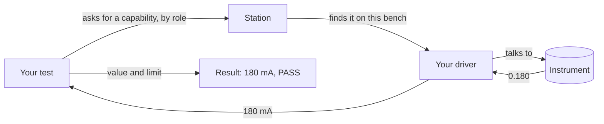

# What is mastif?

mastif is the org-centric hardware testing framework and platform. It's a Python foundation that an organisation builds all of its automated test equipment (ATE) software on: one way to write tests, one way to integrate instruments, and one kind of evidence, across every product, station and team.

Let's unpack that, because each part of it matters.

**Hardware testing** means software that connects instruments such as power supplies and analysers, exercises a *device under test* (DUT), and records what happened, so that someone can decide whether the product is good.

**A framework** means that mastif owns the difficult, repetitive parts, and calls your code at defined points. You write what's specific to your product, and it handles the units, verdicts, hardware lifecycle and records.

**A platform** means a shared foundation on which applications are built. Here, that foundation is the testing framework and its extension points. Your organisation chooses the deployment, distribution and recordkeeping services around it. The [project status](../../learn/status.md) identifies the implemented and planned framework features.

**Org-centric** is the part that sets it apart. Most test tools are built for one test, one bench or one engineer. mastif is built for the organisation that owns all of them, and it stays out of what makes your organisation different. Your drivers, tests and interfaces live in packages you own, and mastif never imports them by name.

## How the pieces fit

Here's a test, and what happens when it runs:

The test doesn't know what instrument it's using. The driver doesn't know what counts as a pass. The bench's file says what's plugged in. Each of those can change without disturbing the others, and that's the idea the whole framework is built on.

## What mastif is not

It helps to be clear about the edges.

- **It isn't a measurement library.** It doesn't know how to compute a spectrum or fit a
  curve. Use NumPy, SciPy or whatever suits you, and hand mastif the result.
- **It isn't an instrument control library.** It doesn't ship a driver for every
  instrument. It gives you the tools to write one in an afternoon, and you own it.
- **It isn't a safety system.** It attempts safe shutdown carefully and reports what it
  couldn't do. Protecting people and equipment from a dangerous condition is the job of
  hardware interlocks.
- **It isn't a user interface.** It gives your UI a clean foundation to build on, so that
  the UI can be designed around your operators rather than around your instruments.

## Recap

mastif is a foundation for an organisation's test software. It handles what's the same at every station, and it leaves your product knowledge to you.

Next, let's look at the problem it exists to solve.

**Next:** [What mastif wants to solve](problem.md)
