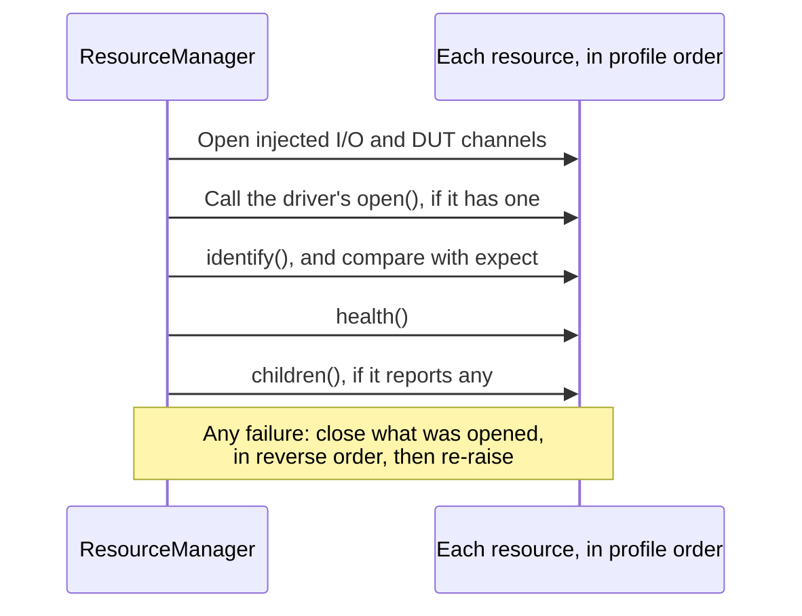

# Opening, checking, and closing a station

A measurement takes a few milliseconds. Everything around it (connecting, checking, shutting down) is
where test software tends to go wrong, and where going wrong can have physical consequences. This
chapter is about how mastif handles that lifecycle, and we'd encourage you not to skim it. It's probably
the most important behaviour in the framework.

!!! success "Works today"
    Everything on this page runs against the current code, with no hardware.

## Why this is hard

Picture a bench with three things on it: a supply, a meter and a DUT. Let's think through what "opening" has
to do.

Suppose the supply opens fine, and the meter's connection is refused. Now what? You can't run the test, and you
can't just raise an exception and walk away, since the supply is already open and holding a connection. If that
supply has an exclusive port, nobody else can use it until the process dies. So a partial failure has to be
unwound, and only what was actually opened should be touched.

Now think about the end of a run. The supply's output is on. The meter has just timed out because someone knocked its
cable. Python is unwinding an exception. What has to happen?

- The supply's output has to go off. The meter's failure must not prevent it.
- The connections have to close, and they probably need to close in a sensible order, since the DUT might rely on the
  supply.
- The original timeout must not get lost, because it's the actual story, and the failures during cleanup must not get
  lost either.

Writing that correctly once, in a `finally` block, is doable but fiddly. Writing it correctly in every test, forever, is not
realistic. So this logic belongs in one place, tested thoroughly, and never rewritten. That place is `ResourceManager`, which
the station uses on your behalf. [ADR-0022](../../../adr/0022-resource-manager.md) calls it "the safety-critical lifecycle, done
once", which is a fair description.

## Give the station a scope

Using it is easy, since a station is a context manager:

```python title="excerpt: station is already built"
with station:
    supply = station.require("supply", PowerSupply)
    supply.set_voltage(5 * V)
    supply.output(True)
    current = supply.measure_current()
```

Entering the block opens everything. Leaving it, by any route, makes everything safe and closes it. The `with` block isn't just
tidier than `open()` and `close()` calls: it makes it impossible to forget, and it covers the exception path by construction.

## Watch it happen

We've written a small program to let you watch this, including a failure. It uses a simulated supply that can be told to stop answering,
and it passes a *listener* to the station, which gets told about each lifecycle step.

```python title="docs/examples/learn_lifecycle.py, the interesting part"
--8<-- "examples/learn_lifecycle.py:66:104"
```

Run it:

<!-- termynal: {title: "Real transcript · learn_lifecycle.py"} -->
```console
$ uv run python docs/examples/learn_lifecycle.py
A normal run:
  built: nothing has been opened yet
  [bench_supply] opening
  [bench_supply] opened  (serial=SIM-002)
    supply output -> ON
    measured 180 mA
    supply output -> OFF
  [bench_supply] safe_state
  [bench_supply] closed
The cable falls out mid-measurement:
  built: nothing has been opened yet
  [bench_supply] opening
  [bench_supply] opened  (serial=SIM-002)
    supply output -> ON
    supply output -> OFF
  [bench_supply] safe_state
  [bench_supply] closed
  the test raised TransportTimeout: bench_supply: no reply to MEAS:CURR? within 2.0 s
```

Compare those two runs. In the second, the measurement never completed, and yet **the output still went off** and the resource still
closed. Then, *after* all of that, the original exception arrived at our `except` block, intact.

Now go back and look at the `with` block in the script. There's no `try`, no `finally`, and no call to turn the output off.

Hold on, though: nobody wrote a `safe_state` method on this driver either, so where did `output -> OFF` come from? It came from
the contract. `PowerSupply` declares `@contract(safe_state=lambda psu: psu.output(False))`, so any driver providing it inherits that
behaviour. A driver can define its own `safe_state()` method when it has something more specific to do, and that takes priority.

## What opening does

Let's look at what happens to each resource, in the order they appear in the profile.



The order is deliberate. Identity gets checked before your code can do anything with the device, and health before it's handed over.

Note one subtlety: the driver's own `open()` runs *before* identity is verified, because many drivers need it in order to be able to
ask. So keep `open()` conservative. Establish communication, by all means, but don't apply stimulus, because at that point you don't yet
know you're talking to the right device.

If anything fails, whatever has already opened gets closed, in reverse, and you get the original error. **A failed open leaves nothing open.**

You can also check something that only becomes known at run time, such as the serial number an operator just scanned for this particular unit:

```python title="excerpt"
station.open(expect={"dut": {"serial": "SN-42"}})
```

## Safe state and close are different things

It's tempting to think that closing a connection cleans up. It doesn't. Closing a TCP socket to a power supply leaves the output on, with nobody
connected to it. So these are two different steps, and they run in this order:

| Step | What it means | How it behaves on failure |
|---|---|---|
| **Safe state** | Put the *hardware* in a known, harmless condition | Tries every resource, never stops early, collects the failures |
| **Close** | Release the *connection* | Tries every step of every resource, raises at the end if anything failed |

Both run in reverse profile order, so if the DUT is listed after its supply, the DUT goes first, and the supply that powers it goes off afterwards.

The phrase "never stops early" is the key design decision. If the meter fails, the supply still gets its chance. A cleanup routine that stops at the
first error is one that leaves a supply energised because a meter's cable was loose.

## What we guarantee, and what we can't

Here are the guarantees, stated as exactly as we can manage:

- A failed open leaves nothing open.
- Identity is checked before your code gets the resource.
- Safe state is **attempted** on every open resource, even if others fail.
- Close is **attempted** on every step of every open resource.
- Every step is reported to the station's listener.

Notice the word "attempted". If the cable to the supply is out, no software can reach it. mastif will try, the attempt will fail, the failure will be
reported, and the output will still be on. All the software can honestly promise is to try, in the right order, and to tell you the truth about what
happened. So we don't claim more than that, and neither should your documentation or your UI.

There's another honest limit: each of these steps calls a driver, and a driver can block. A vendor library that hangs forever will hang the cleanup too.
We take this up properly in [Cancellation, timeouts, and cleanup](../../../learn/system-design/cancellation.md).

## Recap

- The lifecycle lives **in one place** and is written once, so that no test ever has to get it right.
- `with station:` opens on entry, and on the way out it runs **safe state, then close**, whatever happened in between.
- A failed open **rolls back**. Cleanup **never stops early**, and your original exception still reaches you afterwards.
- **Safe state and close are different steps.** One deals with hardware, and the other with connections.
- The promise is an honest **attempt with a true report**, not a certainty about physics.

That's the bench sorted. We've got a station that opens, measures and closes safely. All that's left is to install everything on the machine that runs it.

**Next:** [Running and deploying on a station PC](deploy.md)
