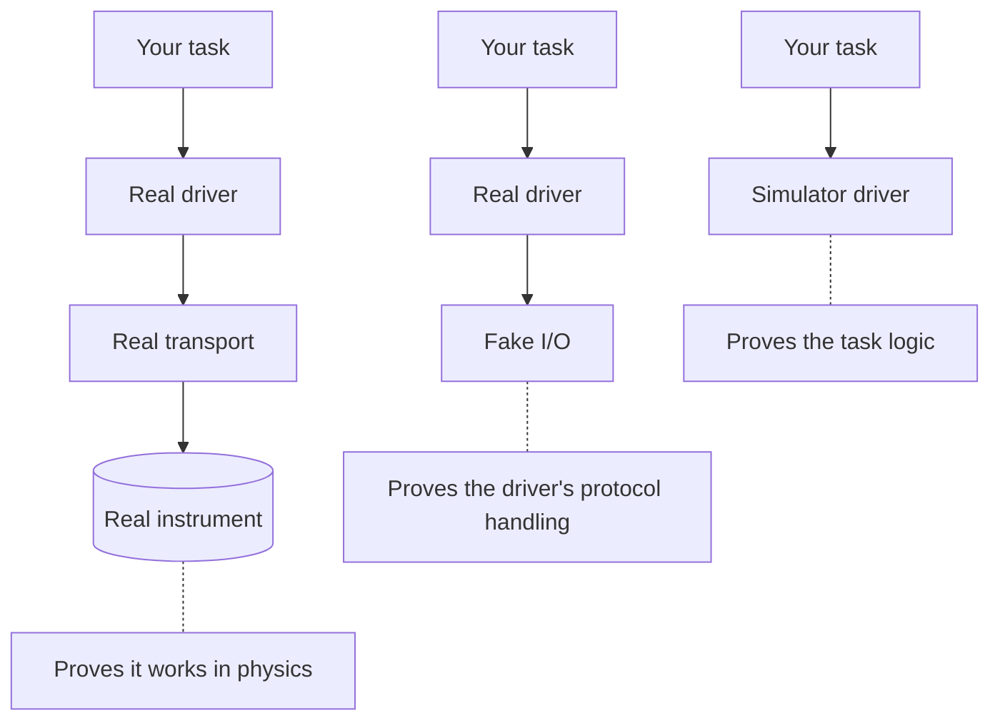

# Working with simulated resources

Benches are expensive, shared, and usually busy. If you can only find out whether your test logic
works by queueing for one, your feedback loop is measured in days. So in this chapter we'll make
the test fully runnable on your laptop, and be honest about what that does and doesn't prove.

!!! success "Works today"
    Everything on this page runs against the current code, with no hardware.

## A simulator is just another driver

You don't need a special simulation mode for this, and we've deliberately avoided having one.
Remember that a test asks for a capability by role. If something else provides that capability, the test
can't tell. So a simulator is an ordinary driver:

```python title="docs/examples/learn_station.py, the driver part"
--8<-- "examples/learn_station.py:18:64"
```

It keeps its setpoints in memory, and it returns whichever current you configured. It's about as simple as
a driver can be, and yet everything above it is the real code: the same profile parser, the same station,
the same lifecycle, the same result. Let's run it:

<!-- termynal: {title: "Real transcript · learn_station.py"} -->
```console
$ uv run python docs/examples/learn_station.py
idle_current: 180 mA -> PASS
after cleanup: output enabled = False
idle_current: 300 mA -> FAIL
after cleanup: output enabled = False
```

Changing a single number in the profile gave us a passing board and a failing one, on demand, in
milliseconds. Real hardware can't offer you that.

## One profile, two benches

You could keep a separate simulated profile, but there's a more convenient option when you want a simulated
twin of a real bench. Add a `sim:` section to the real profile:

```yaml title="stations/bench-01.yaml"
station: bench-01
resources:
  bench_supply:
    driver: acme.psu-x
    config:
      transport: {kind: tcp, host: 192.0.2.10, port: 5025}
    expect: {serial: A123}
roles:
  supply: bench_supply
sim:
  bench_supply:                # Replaces the resource of the same name
    driver: demo.learn-supply
    config: {current_ma: 180}
    expect: {serial: SIM-001}
```

Now the same file builds either way, and you choose when you build it:

```python title="excerpt: profile and registry as in the previous chapter"
real = Station.build(profile, registry)            # Talks to the instrument
simulated = Station.build(profile, registry, sim=True)  # Uses the simulator
```

Roles stay the same, so the test can't tell which one it got.

There are two behaviours here that you should know about, as they're easy to assume wrongly.

**A `sim:` entry replaces the whole resource.** It isn't merged. In the example above, the `transport` and the
serial are gone, which is why the entry supplies its own `expect`. We did it this way because merging invites
surprises: a real configuration value leaking into a simulator, for instance.

**A resource with no `sim:` entry stays real.** This is the one to watch. `sim=True` doesn't forbid hardware. If a
profile has three resources and two `sim:` entries, you get a mixed station, in which the third instrument gets
opened for real. Sometimes that's exactly what you want: real instrument, simulated DUT, for example. But if you
mean "this run must touch no hardware", check it. You can see precisely what would be selected:

```python title="excerpt: print what a sim build would use"
for name, entry in profile.entries(sim=True).items():
    print(name, entry.driver)
```

## Simulating the bad days

A happy-path simulator is only half the value. The real payoff comes from being able to rehearse the situations you'd
never deliberately create on a bench. A driver can take configuration, so a simulator can be told to misbehave:

```python title="excerpt of docs/examples/learn_lifecycle.py"
class Config(DriverConfig):
    loses_connection: bool = False

def measure_current(self) -> Amps:
    if self.cfg.loses_connection:
        raise TransportTimeout("bench_supply: no reply to MEAS:CURR? within 2.0 s")
    return 180 * mA
```

Now you can find out what your application does when a cable falls out mid-measurement, as often as you like. We'll run
this exact script in the chapter after next. A good simulator grows a small list of these: a reading out of limits, a
timeout, a health fault, the wrong serial number.

## What a simulator proves, and what it doesn't

We want to be precise here, because over-trusting a simulator is a classic way to get hurt.

| A simulated run tells you | It doesn't tell you |
|---|---|
| Your task's logic does what you meant | Whether the real instrument behaves that way |
| The profile, roles and contracts fit together | Whether the driver's commands are right |
| Your verdicts, reports and failure handling work | Anything about settling time or noise |
| The plan runs in the order you expect | Anything at all about the DUT |

Our simulator returns 180 mA the instant you turn the output on. A real board has an inrush, boots for two seconds, and
then settles. A test that passes against the simulator might read mid-inrush on a real bench, and fail, or worse, pass.

Note also that replacing a driver means you aren't testing that driver. The simulator skips all of the real driver's
command formatting and parsing. There's a separate tool for that job, [fake I/O](../hardware-integration/fake-io.md), which keeps
the real driver and scripts the instrument beneath it. You'll want both, as they answer different questions:



## Recap

- A **simulator is a normal driver**, so the test and the station can't tell it apart.
- A profile's **`sim:` section** replaces whole resources when you build with `sim=True`, and anything without an entry
  stays real.
- Simulators are most valuable for **rehearsing failures** you'd never stage on a bench.
- A simulated run proves your logic. It doesn't prove your driver, and it doesn't prove physics.

Speaking of physics, it's time to meet some.

**Next:** [Connecting real hardware](hardware.md)
