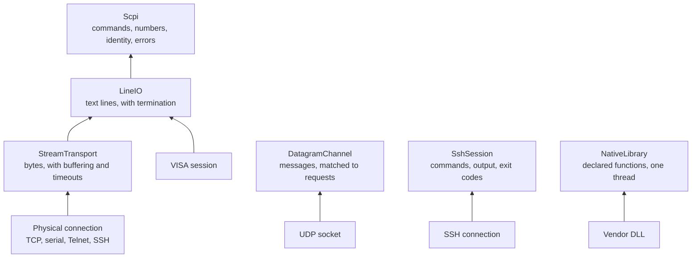

# Communicating with a device

TCP delivers bytes. A serial port delivers bytes. Your test wants a current in milliamperes. Between those two facts lies a stack of small problems which every instrument driver in history has had to solve: where does one message end? What was that the reply to? How long should I wait? What do I do if the reply is nonsense?

mastif solves each of these in its own layer. You choose how far up the stack to start, based on how your device behaves. This chapter tours that stack, and shows you how to pick.

!!! success "Works today"
    Everything on this page runs against the current code. Examples use fake I/O, so no hardware is needed.

## The stack



The rule is simple: **ask for the highest layer that matches your device**, and the layers beneath it are handled for you.

| Your device | Ask for | Why |
|---|---|---|
| Speaks SCPI | `io: Scpi` | You get number parsing, `*IDN?` and the error queue for free |
| Speaks text commands, but not SCPI | `io: LineIO` | Line framing is handled |
| Speaks a binary protocol | `io: StreamTransport` | You control the framing |
| Uses UDP | `io: DatagramChannel` | Replies are matched to requests |
| Is a host you run commands on | `session: SshSession` | Real exit codes |
| Only offers a vendor library | `lib: NativeLibrary` | Safe function calls |

Your driver says which interface it wants, and the profile says how it's connected. That separation means that a SCPI driver works over TCP, serial, VISA, Telnet or an SSH shell with no change to its code.

## Text commands with `Scpi`

If your instrument speaks SCPI, your driver will be short, since `Scpi` has handled most of what's awkward:

```python
from mastif.resources.transports import Scpi
from mastif_testing import FakeLineIO

fake = FakeLineIO({
    "*IDN?": "ACME,PSU-X,A123,1.4",
    "MEAS:CURR?": "+1.8000E-01",
    "SYST:ERR?": '0,"No error"',
})
io = Scpi(fake)
io.open()

print(io.identify().serial)                    # A123
print(io.query_quantity("MEAS:CURR?", "A"))    # 0.18 A
print(io.query_float("MEAS:CURR?"))            # 0.18
print(io.errors())                             # []
io.write("OUTP ON")

io.close()
```

`query_float` understands SCPI's number formats, such as `+1.8000E-01`. And as you saw in [the failures chapter](../writing-tests/failures.md#a-map-of-what-can-go-wrong), it turns the overflow marker `9.9E37` into a `ProtocolError`, so that the reading can't reach your test posing as a real value.

If your instrument reports errors through its queue rather than in its replies, you can make `Scpi` check after each write:

```python title="excerpt"
io = Scpi(line_io, check_errors=True)
```

That's slower, since it adds a round trip to each write. It's very useful while bringing up a driver, though, because a command the instrument silently rejected now raises an exception on the line that sent it, rather than causing a confusing reading three commands later.

## Text without SCPI

Many devices speak a simple text protocol of their own. `LineIO` handles the framing: where one message ends and the next begins.

```python
from mastif_testing import FakeLineIO

io = FakeLineIO({"READ TEMP": "T=41.5C"})
io.open()
reply = io.query("READ TEMP")
print(reply)  # T=41.5C
```

Your driver does the parsing, and this is exactly where you should be strict:

```python
from mastif.kernel.units import Quantity, Unit
from mastif.resources.errors import ProtocolError


def parse_temperature(reply: str) -> Quantity:
    if not reply.startswith("T=") or not reply.endswith("C"):
        raise ProtocolError(f"unexpected temperature reply: {reply!r}")
    try:
        return float(reply[2:-1]) * Unit("degC")
    except ValueError:
        raise ProtocolError(f"unparseable temperature reply: {reply!r}") from None


print(parse_temperature("T=41.5C"))  # 41.5 degC
```

Look at the error message. It includes the actual reply, using `!r` so that invisible characters show up. When this fails at 2 a.m., that message might just be the only clue anybody has, and a stray `\r` is a very common cause.

Line endings differ between devices, and you set them in the profile rather than in the code. Getting them wrong is the most frequent cause of "it works in a terminal but times out in my driver":

```yaml title="in a profile"
transport: {kind: serial, port: COM3, baudrate: 115200, read_termination: "\r\n", write_termination: "\r"}
```

## Binary protocols

For a binary protocol, ask for a stream and do your own framing. Here's a typical length-prefixed frame:

```python
from mastif_testing import FakeStream

stream = FakeStream()
stream.open()
stream.feed(bytes([0xAA, 0x03]) + b"abc")

header = stream.read_exactly(2)
assert header[0] == 0xAA
payload = stream.read_exactly(header[1])
print(payload)  # b'abc'
stream.close()
```

There's an important property here: **a read may return part of a message.** TCP doesn't preserve message boundaries, and what you sent as one packet may arrive as three. `read_exactly` and `read_until` handle this for you, buffering until they have what you asked for or the timeout has passed. If you ever find yourself
calling a raw `recv` and assuming it returned a complete message, that's a bug waiting for a busy network.

Also, `write` never adds a terminator to what you give it, as a stray byte would corrupt a binary frame.

## Datagrams

UDP is different again. Messages arrive whole, but they might not arrive at all, might come in the wrong order, or might be a notification that has nothing to do with what you just asked. So when you send a request, you need to say what the answer looks like:

```python
from mastif.resources.transports import DatagramChannel, UdpConfig
from mastif_testing import FakeDatagramPeer


def respond(message: bytes) -> bytes | None:
    return b"CURRENT 0.180" if message == b"READ CURRENT" else None


with FakeDatagramPeer(respond) as peer:
    channel = DatagramChannel(UdpConfig(host="127.0.0.1", port=peer.port))
    channel.open()
    try:
        reply = channel.request(b"READ CURRENT", match=lambda m: m.startswith(b"CURRENT "))
        print(reply)  # b'CURRENT 0.180'
    finally:
        channel.close()
```

The waiter is registered before the request gets sent, so an instant reply can't slip through unnoticed. Everything that doesn't match goes to subscribers instead, and it's never mistaken for your answer. You'll find more in the [UDP recipe](../../../learn/recipes/udp.md).

## Choosing a timeout

Each of these layers has a timeout, and what value to choose isn't a detail. It's a statement about how the device works.

Too short, and a perfectly healthy instrument, doing a slow measurement, produces a `TransportTimeout`. Too long, and a dead cable takes minutes to discover, on every call, on every run.

The default of 2 seconds works for a simple query. For longer operations, pass a timeout for that one call rather than raising the default for everything:

```python title="excerpt: a slow sweep"
def measure_peak(self, centre, span):
    self.io.write(f"FREQ:CENT {centre.magnitude('Hz')}")
    self.io.write(f"FREQ:SPAN {span.magnitude('Hz')}")
    return self.io.query_quantity("CALC:MARK:Y?", "dBm", timeout=30.0)
```

If you find yourself writing `time.sleep` in a driver, ask yourself if the instrument offers a way to know when it's done. `Scpi.wait()` uses the standard `*OPC?` query, which waits for pending operations to finish, and that's usually both faster and more correct.

## Translating failures

The last job of this layer is to make sure that nothing above it needs to know which library you're using. A driver above `Scpi` gets this for free. If your driver calls a library directly, then translate what it raises:

```python title="excerpt"
try:
    raw = self.vendor.read()
except vendor.CommError as error:
    raise TransportError(f"{self.name}: lost connection: {error}") from error
except vendor.Timeout as error:
    raise TransportTimeout(f"{self.name}: read timed out") from error
```

| Exception | It means | For example |
|---|---|---|
| `TransportError` | The connection failed | Refused, port missing, peer closed |
| `TransportTimeout` | No answer in time | The instrument is off or busy, or the line ending is wrong |
| `ProtocolError` | An answer that makes no sense | Not a number, a bad checksum, an error status |
| `ResourceFault` | The device says it's faulty | Over-temperature |

Start each message with what it's about, and chain the cause with `from error`, so that the vendor's own message is kept.

Should you retry? In a driver, only retry what's safe to repeat: reads, generally. Never automatically retry a command that changes something, without thinking through what happens if the first attempt actually succeeded, but its reply got lost. There's more on this in
[Failure propagation and recovery](../../../learn/system-design/recovery.md).

## Recap

- Ask for the **highest layer** that fits your device, and the profile decides how it's connected.
- Be **strict when parsing**. Raise `ProtocolError`, and include the actual reply in the message.
- Streams don't preserve message boundaries, so use **`read_exactly` and `read_until`**.
- **Timeouts are statements** about the device. Use a longer one per call for slow operations, and prefer `wait()` to `sleep`.
- **Translate library errors** into mastif's, so that nothing above needs to know the library exists.

So now we can talk to a device. But how do we know which device we're talking to, and whether it's in any condition to be used?

**Next:** [Identity, health, and safe state](identity.md)
