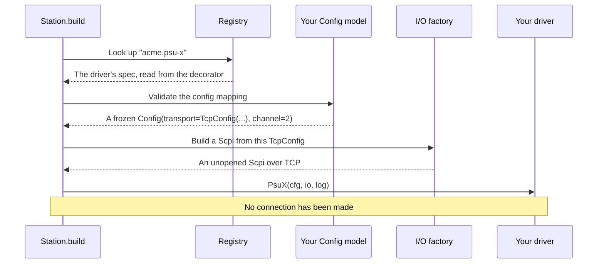

# Driver configuration and injected dependencies

In your first driver, a `Scpi` object simply appeared in the constructor, with nobody having obviously created it. That can feel like magic the first time you see it, and magic in a framework is a reasonable thing to be suspicious of. So let's open this up and see exactly
what happens. As you'll see, it's simple, and it's also strict.

!!! success "Works today"
    Everything on this page runs against the current code, with no hardware.

## Why a driver shouldn't build its own connection

Consider the alternative:

```python title="the approach we are avoiding"
class PsuX:
    def __init__(self, host: str, port: int) -> None:
        self.sock = socket.create_connection((host, port))
```

It's only two lines, and it has already made three decisions on your behalf. This driver works only over TCP. It connects the moment you create it, so you can't validate a station without the hardware being there. And to test it, you need either a real instrument or a
fake TCP server.

The fix is to have the driver *ask* for what it needs, and let something else build it. That's **dependency injection**, and it requires no framework at all: you just pass things as parameters. (There's a [background chapter](../../../learn/fundamentals/injection.md) if that's a new
idea to you.) What mastif adds is a builder which reads your annotations, so that you don't need to wire things up by hand.

## What you can ask for

The station looks at your `__init__` signature, and it knows how to supply these:

| You annotate a parameter as | You receive |
|---|---|
| Your nested `Config` class | The validated config from the profile |
| `Scpi` | A SCPI helper over whatever connection the profile describes |
| `LineIO` | Text-line I/O |
| `StreamTransport` | Raw bytes, for binary protocols |
| `DatagramChannel` | UDP messages, matched to their requests |
| `SshSession` | Command execution over SSH |
| `NativeLibrary` | A loaded vendor library |
| `logging.Logger` | A logger named after this resource |
| `Settings` | The application's settings, if your code needs them |

Anything else must have a default value, or the decorator refuses your class when it's imported:

```text title="Real output, from an unannotated parameter"
DriverDefinitionError: demo.learn-supply: __init__ parameter 'cfg' can't be supplied by mastif;
annotate it with the Config class, an I/O type, logging.Logger, Settings, or give it a default
```

This is deliberately not a general dependency container. It won't construct arbitrary classes, it doesn't read a global registry of services, and there's no scanning. There's a short, fixed list, and you're told at import time if you've stepped outside it.

## The journey from YAML to your constructor

Let's follow this profile entry through the whole process:

```yaml title="stations/bench-01.yaml"
bench_supply:
  driver: acme.psu-x
  config:
    transport: {kind: tcp, host: 192.0.2.10, port: 5025, timeout: 2.0}
    channel: 2
```

```python title="the driver it refers to — excerpt"
@driver("acme.psu-x", provides=[PowerSupply])
class PsuX:
    class Config(DriverConfig):
        transport: TcpConfig | VisaConfig
        channel: int = 1

    def __init__(self, cfg: Config, io: Scpi, log: logging.Logger) -> None:
        self.cfg = cfg
        self.io = io
        self.log = log
```

Here's what `Station.build` does for this one resource.



The important thing is that **each step can fail clearly, and they all happen before any device is touched.** A bad port, an unknown key, or a transport that can't work with what the driver asked for: all of these raise a `StationError` that names the resource.

The I/O factory has its own table of what works with what, as not every pairing makes sense. A `DatagramChannel` can be built from a `UdpConfig` but not from a `TcpConfig`, and a SCPI helper needs something that can carry lines of text. If you ask for an impossible combination, you find
out right here.

## Accepting several kinds of connection

Your `Config` says what your driver is willing to work with. By widening the type of `transport`, the same driver can reach an instrument in several ways, with no change to its code:

```python
from mastif.resources.driver import DriverConfig
from mastif.resources.transports import SerialConfig, TcpConfig, VisaConfig


class Config(DriverConfig):
    transport: TcpConfig | SerialConfig | VisaConfig
    channel: int = 1


print(Config.model_validate({"transport": {"kind": "tcp", "host": "h", "port": 5025}}).channel)
```

The `kind` key picks the model. Only allow the ones you've really tested. If your driver has only been tried over TCP, saying so is more honest than claiming it works with everything.

## Your own configuration

Beyond `transport`, a driver's `Config` can hold whatever the driver needs to know. Think about which facts go here.

```python
from pydantic import Field

from mastif.resources.driver import DriverConfig
from mastif.resources.transports import TcpConfig


class Config(DriverConfig):
    transport: TcpConfig
    channel: int = Field(default=1, ge=1, le=4)
    settle_seconds: float = Field(default=0.05, ge=0)
```

A constraint like `ge=1, le=4` isn't just tidy. A profile saying `channel: 7` is rejected while building, on any machine, rather than sending a bad command to an instrument on the day.

Here's how to tell what goes where, which is the same question we asked of [test parameters](../writing-tests/parameters.md):

| The value | Where it goes |
|---|---|
| How to reach this instrument | `transport`, in the profile |
| Which output channel this bench uses | Driver `Config`, in the profile |
| How long this device takes to settle | Driver `Config`, with a sensible default |
| What current is acceptable | **Not here.** It belongs in the task's config |

And don't let secrets end up where they shouldn't. Transport passwords are `SecretStr`, so they don't appear in logs or error messages. Use the same type for any secret in your own `Config`.

## Don't touch the device in `__init__`

This is worth a section of its own, because it's the single rule that everything else leans on.

```python title="the constructor's whole job"
def __init__(self, cfg: Config, io: Scpi) -> None:
    self.cfg = cfg
    self.io = io
```

The object you've been handed isn't open yet, so any attempt to use it here will fail. Move anything that talks to the device into `open()`, which the station calls once the I/O is ready:

```python title="the right place for start-up commands"
def open(self) -> None:
    self.io.write(f"INST:NSEL {self.cfg.channel}")
```

It's this rule that gives a station its two-phase behaviour, where a profile can be fully validated on a machine with no instruments attached.

## Test through the same door

The most useful thing about all of this is that a test can use exactly the same construction route as the station, swapping out just the final I/O:

```python
from mastif.kernel.units import Amps, Volts
from mastif.resources.driver import DriverConfig, build_resource, driver, spec_of
from mastif.resources.std import PowerSupply
from mastif.resources.transports import Scpi, TcpConfig
from mastif_testing import FakeLineIO


@driver("demo.io-example", provides=[PowerSupply])
class IoExample:
    class Config(DriverConfig):
        transport: TcpConfig
        channel: int = 1

    def __init__(self, cfg: Config, io: Scpi) -> None:
        self.cfg, self.io = cfg, io

    def set_voltage(self, voltage: Volts) -> None:
        self.io.write(f"VOLT{self.cfg.channel} {voltage.magnitude('V'):.3f}")

    def set_current_limit(self, current: Amps) -> None: ...
    def output(self, enabled: bool) -> None: ...
    def measure_voltage(self) -> Volts: ...
    def measure_current(self) -> Amps: ...


fake = FakeLineIO()
built = build_resource(
    spec_of(IoExample),
    {"transport": {"kind": "tcp", "host": "h", "port": 1}, "channel": 2},
    name="supply",
    io_factory=lambda *_: Scpi(fake),
)
print(built.instance.cfg.channel)  # 2
```

This tests more than calling `IoExample(...)` by hand would, since it also exercises your `Config` validation and your constructor's annotations. A test can also go a step further: pass an `io_factory` to `Station.build` and you've got a complete station running on fakes, using the
real profile.

## Recap

- A driver **asks** for its dependencies with annotations, and the station **builds** them from the profile.
- There's a **short, fixed list** of what can be asked for, and you'll hear about mistakes at import time.
- `Config` declares what's allowed under `config:`. Unknown keys and bad values are rejected before anything's opened.
- **Never touch the device in `__init__`.** That's what `open()` is for.
- Tests can use the **same construction route**, with a fake at the very bottom.

Now that the driver has a connection, let's talk about how to use it well.

**Next:** [Communicating with a device](communication.md)
