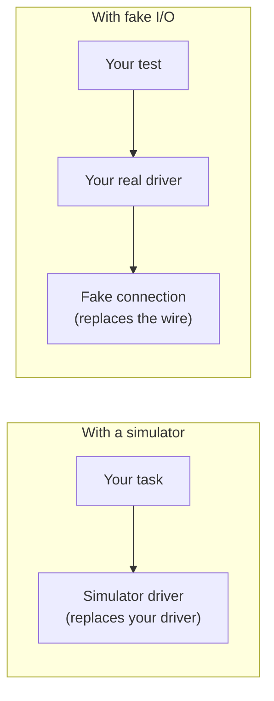

# Testing drivers with fake I/O

Most driver bugs aren't subtle. They're a wrong command string, a misread unit, a parser that chokes on `+1.8E-01`, or a timeout that's handled badly. They're easy to fix once you've seen them, and they take half a day to see on a real bench, assuming you can get one.

This chapter is about catching those bugs at your desk in milliseconds, and it's the reason we've insisted on injecting I/O all along.

!!! success "Works today"
    Everything on this page runs against the current code, using the `mastif-testing` package.

## A fake is not a simulator

We've met two substitutes for hardware now, and they replace different things. It's worth being clear, as they answer different questions.



A **simulator** stands in for the whole driver. Your driver's code isn't involved, so a simulator tells you about the task above it.

**Fake I/O** stands in for the connection. All your driver's code runs for real: formatting commands, parsing replies, handling errors. Only the bytes are scripted. So that's what you use to test the driver itself.

## Scripting an instrument

`FakeLineIO` takes a dictionary of what each command replies:

```python
from mastif.resources.transports import Scpi
from mastif_testing import FakeLineIO

fake = FakeLineIO({
    "*IDN?": "ACME,PSU-X,A123,1.4",
    "MEAS:CURR?": ["0.10", "0.18"],
})
io = Scpi(fake)
io.open()

print(io.query_float("MEAS:CURR?"))  # 0.1
print(io.query_float("MEAS:CURR?"))  # 0.18
print(io.query_float("MEAS:CURR?"))  # 0.18: the last entry repeats

io.write("OUTP ON")
print(fake.written)
```

A list gives a sequence of replies, and that's very useful for testing things like polling until ready. Everything written is recorded in `fake.written`, so you can check what was sent. And here's a useful detail: if a command has no scripted reply, then reading raises `TransportTimeout`, just as a silent instrument would. So your error handling gets exercised by default.

## Test both directions

A good driver test checks what goes out and what comes back. Here's a small driver and a proper set of tests for it:

```python
import pytest

from mastif.kernel.units import A, Amps, V, Volts, mA, mV
from mastif.resources.driver import DriverConfig, build_resource, driver, spec_of
from mastif.resources.errors import ProtocolError, TransportTimeout
from mastif.resources.std import PowerSupply
from mastif.resources.transports import Scpi, TcpConfig
from mastif_testing import FakeLineIO


@driver("demo.tested", provides=[PowerSupply])
class Tested:
    class Config(DriverConfig):
        transport: TcpConfig

    def __init__(self, cfg: Config, io: Scpi) -> None:
        self.io = io

    def set_voltage(self, voltage: Volts) -> None:
        self.io.write(f"VOLT {voltage.magnitude('V'):.4f}")

    def set_current_limit(self, current: Amps) -> None:
        self.io.write(f"CURR {current.magnitude('A'):.4f}")

    def output(self, enabled: bool) -> None:
        self.io.write("OUTP ON" if enabled else "OUTP OFF")

    def measure_voltage(self) -> Volts:
        return self.io.query_quantity("MEAS:VOLT?", "V")

    def measure_current(self) -> Amps:
        return self.io.query_quantity("MEAS:CURR?", "A")


def make(replies=None):
    fake = FakeLineIO(replies or {})
    built = build_resource(
        spec_of(Tested),
        {"transport": {"kind": "tcp", "host": "h", "port": 1}},
        name="psu",
        io_factory=lambda *_: Scpi(fake),
    )
    return built.instance, fake


def test_voltage_is_sent_in_volts_whatever_the_caller_used():
    psu, fake = make()
    psu.set_voltage(5000 * mV)
    assert fake.written == ["VOLT 5.0000"]


def test_current_reply_is_read_as_amperes():
    psu, _ = make({"MEAS:CURR?": "0.180"})
    assert psu.measure_current().magnitude("mA") == 180


def test_scpi_number_format_is_understood():
    psu, _ = make({"MEAS:CURR?": "+1.8000E-01"})
    assert psu.measure_current() == 180 * mA


def test_overrange_is_an_error_not_a_huge_reading():
    psu, _ = make({"MEAS:CURR?": "9.9E37"})
    with pytest.raises(ProtocolError):
        psu.measure_current()


def test_garbage_reply_is_an_error():
    psu, _ = make({"MEAS:CURR?": "banana"})
    with pytest.raises(ProtocolError):
        psu.measure_current()


def test_silence_is_a_timeout():
    psu, _ = make()
    with pytest.raises(TransportTimeout):
        psu.measure_current()


test_voltage_is_sent_in_volts_whatever_the_caller_used()
test_current_reply_is_read_as_amperes()
test_scpi_number_format_is_understood()
test_overrange_is_an_error_not_a_huge_reading()
test_garbage_reply_is_an_error()
test_silence_is_a_timeout()
```

Look at the names of those tests. Only the first two cover the happy path. The other four are about bad days, and those are the tests that earn their keep, because a driver's error paths are the code that rarely runs, and exactly what you most need to behave well on the day that it does.

Notice as well that we used `build_resource`, so these tests also go through the real configuration validation and constructor injection.

## Choose the right fake

There's a fake for each layer of [the communication stack](communication.md). Choose the one that sits right under the layer you're testing:

| To test | Use | It stands in for |
|---|---|---|
| A driver using `Scpi` or `LineIO` | `FakeLineIO` | A connection that carries lines of text |
| A driver using `StreamTransport`, or line framing | `FakeStream` | A connection that carries raw bytes |
| A driver using `DatagramChannel` | `FakeDatagramPeer` | A UDP device, on a real local socket |
| A driver using `SshSession` | `FakeSshSession` | Command execution |
| A driver using `NativeLibrary` | `FakeNativeLibrary` | A vendor DLL |

`FakeStream` is the one for testing the hard parts of a binary protocol, because you control exactly how the bytes arrive, including splitting up a message:

```python
from mastif_testing import FakeStream

stream = FakeStream()
stream.open()

stream.feed(b"HEL")      # Half of a message arrives...
stream.feed(b"LO\n")     # ...and then the rest

print(stream.read_until(b"\n"))  # b'HELLO'
stream.close()
```

`FakeDatagramPeer` is a little different. It uses a real local socket and a background thread, so it's free of hardware, but not entirely free of I/O. This occasionally matters on a locked-down CI machine, or in a test that's sensitive to timing.

## Testing a whole station on fakes

You can run an entire station on fakes, with the real profile, by passing an `io_factory` to `Station.build`:

```python title="excerpt: profile is your real bench profile"
station = Station.build(
    profile,
    Registry([Tested]),
    io_factory=lambda want, transport, log: Scpi(FakeLineIO(SCRIPTED_REPLIES)),
)
with station:
    supply = station.require("supply", PowerSupply)
    ...
```

Your real profile gets parsed, your real driver built, and the real lifecycle runs: everything except for the wire. It's a useful integration test, because it can find mistakes in the way that all these pieces fit together.

## Keep your fakes honest

A fake's only as good as the truth of its script. The classic trap is a fake that replies what you assumed the device replies, which then confirms your assumption, and which is wrong. You've now got a passing test and a broken driver.

Two habits help.

**Capture real replies.** When you have some time with the actual instrument, record what it really says, and paste that into your tests. Real replies have surprising formats: trailing spaces, odd number formats, an extra line.

```python
REPLIES_FROM_A_REAL_PSU_X = {
    "*IDN?": "ACME,PSU-X,A123,1.4.2-rc1",     # Captured from unit A123, firmware 1.4.2
    "MEAS:CURR?": "+1.80021E-01",
}
```

**When you find a bug on a bench, add a test.** If an instrument sent something that broke your parser, capture exactly that as a new case. You'll never have to find this bug again, and neither will anybody else.

## What this doesn't prove

Passing these tests shows that your driver behaves correctly against your *model* of the device. Things they can't tell you include:

- Whether the real device has the timing you assumed.
- Whether commands interact in ways that the manual didn't mention.
- Whether your settling time is long enough.
- Whether the reading is physically accurate.

For those you still need a bench, but you'll arrive with far fewer bugs, and any that remain will be about the instrument, rather than a typo in your format string.

## Recap

- **Fake I/O** keeps your driver real, and replaces only the wire. A **simulator** replaces the driver.
- Test **both directions**, and spend most of your effort on the bad replies.
- There's a **fake for each layer** of the stack. Pick the one right under what you're testing.
- Keep them honest by **capturing real replies**, and turn each bench-discovered bug into a test.

Those tests are all ones that you write. mastif also offers a check you don't have to write at all.

**Next:** [Checking contract and lifecycle conformance](conformance.md)
