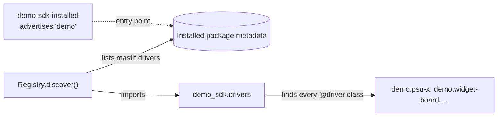

# Packaging and discovering an organisation SDK

You've got contracts, drivers and DUT types, tested and working. Now they need to get to the stations, and to every test package in your organisation, in a form that can be versioned and rolled back, and which doesn't involve anybody copying a folder.

This is where the "core plus SDK" idea stops being an architecture diagram and becomes something that you can install.

!!! success "Works today"
    Driver discovery through entry points is implemented. Discovering test packages and loop types is a design preview.

## An SDK is an ordinary Python package

There's no plugin format to learn, and no special build step. Your SDK is a normal distribution which depends on mastif:

```text title="demo-sdk/"
demo-sdk/
├── pyproject.toml
├── src/demo_sdk/
│   ├── __init__.py
│   ├── contracts.py      # The capabilities your tests use
│   ├── drivers/          # One module per instrument
│   │   ├── __init__.py
│   │   └── psu_x.py
│   └── duts/
│       └── widget.py
└── tests/
```

```toml title="pyproject.toml"
[project]
name = "demo-sdk"
version = "2.1.3"
dependencies = ["mastif>=0.4"]

[project.entry-points."mastif.drivers"]
demo = "demo_sdk.drivers"
```

The last two lines are what connect it to mastif, so let's look at them closely.

## Entry points: how mastif finds you without knowing you

Here's a real design constraint. mastif must not import your code by name, because then it wouldn't be a generic framework, and every organisation would need to modify it. But a station profile says `driver: demo.psu-x`, so somehow mastif has to find that class.

Python's packaging system has a standard mechanism for this, called **entry points**. An installed package can advertise a named thing in a named group, and any other code can list what's been advertised, without knowing who installed it. `mastif.drivers` is the group that mastif reads:



The entry point can name a module, a class, or a list of classes. If you name a module, then every decorated class in that module gets found. Be aware that this means the module's own namespace, not all of its submodules, so make sure yours imports what you want to expose:

```python title="src/demo_sdk/drivers/__init__.py"
from demo_sdk.drivers.psu_x import PsuX
from demo_sdk.duts.widget import WidgetBoard

__all__ = ["PsuX", "WidgetBoard"]
```

Your application then asks for whatever's installed:

```python
from mastif.resources.registry import Registry

registry = Registry.discover()
print(sorted(registry.ids()))  # ['mastif.line-shell', 'mastif.ssh-shell', 'mastif.udp'], plus yours
```

Discovery happens when you call it, rather than as a side effect of `import mastif`. That has a practical benefit: importing the framework never fails because somebody's SDK has a bug in it. It also means that a broken SDK gets reported at a known point, and with a useful message.

**A question we get asked:** if a test project uses your SDK, does it need to declare the entry point too? No. The entry point belongs to the package which *contains* the drivers. Once `demo-sdk` is installed, its drivers can be discovered by anything in that environment. Test projects simply list `demo-sdk` in their dependencies.

## Explicit registries for tests

For tests, you often don't want discovery. A developer's machine might have anything installed, and you'd like your test to depend only on what it names. So you can list exactly which drivers you mean:

```python title="excerpt"
registry = Registry([PsuX, SimSupply])
```

This also includes mastif's built-in channels by default, and it's what all of the examples in this course have used.

If two drivers claim the same id, then discovery fails and tells you. It has to, as a profile that says `driver: demo.psu-x` must mean exactly one thing.

## Versioning your SDK

An SDK is depended upon by many things, so changing it deserves some care. It helps to think about who gets affected:

| You change | Who it affects | How to treat it |
|---|---|---|
| A driver's internals | Nobody, if it's still correct | Patch release |
| A new driver or DUT type | Nobody | Minor release |
| A new optional config field | Nobody | Minor release |
| A new required config field | Every profile using that driver | Major release |
| A new method on a contract | Every driver providing it | Major release |
| The **meaning** of a method | Every test that uses it, silently | Avoid; write a new method |

That last row is the dangerous one. If `measure_current` changes from peak to average, nothing raises, the tests keep passing, and every result changes in meaning. So when semantics change, make the change visible by creating a new name.

The other half of this is recording what ran. mastif's version helper reads your installed package's metadata, so a run's manifest can state exactly what code executed:

```python
from mastif.infra.version import VersionInfo

print(VersionInfo.load("mastif").summary())
```

A result only means something if you can say which version of the driver produced it. See [Software versions and reproducibility](../../../learn/operations/reproducibility.md).

## Beyond drivers

Your organisation's tasks and loop types get discovered in the same way, through their own entry-point groups:

```toml title="pyproject.toml — preview"
[project.entry-points."mastif.drivers"]
demo = "demo_sdk.drivers"

[project.entry-points."mastif.loops"]
demo = "demo_sdk.loops"

[project.entry-points."mastif.test_packages"]
widget = "widget_tests"
```

The result is a tidy deployment model. Tests, drivers and loop types are all wheels, installed with standard tools. mastif finds them, and a station is whatever versions you've installed there.

## Where to keep it

Some practical advice, since you'll need to decide on this.

**Host your own package index**, even a simple one, so that stations can install by version. If some stations are on isolated networks, a wheel on a file share works too. Wheels are just files.

**Lock your dependencies** for each deployment. With `uv lock`, you can recreate precisely what was running on a given date, which matters when someone asks you about a result from last year.

**Don't commit vendor binaries.** A vendor's DLL belongs on the station, installed by the vendor's installer, and it's pointed to by the [station profile](../../../learn/recipes/native-library.md). Your SDK wraps it, and doesn't ship it. There's a licensing reason for that too.

!!! note "Licensing"
    mastif is licensed under AGPL-3.0-or-later, with a commercial licence available from its author. If you're planning to distribute an SDK or a product built on it, have a look at [Licensing](../../../wiki/licensing.md) and take appropriate advice.

## You've finished the integration path

Let's see where that leaves you. You can write a driver for any instrument, and a DUT type for your product. You can test them both without hardware, check they fit the framework, and ship them as a versioned package. Every test in your organisation can then use them, without knowing how they work.

## Recap

- An **SDK is an ordinary Python package**. It advertises its drivers through the `mastif.drivers` entry point.
- **Discovery happens when you ask**, so that mastif never needs to name your code.
- **Explicit registries** keep your tests independent of whatever's installed.
- Treat **a change in meaning** as the most serious kind of change, and record which versions ran.

Your drivers are ready. All that's left is to bring everything together on a real bench.

**Next:** [Station profiles and roles](../deploying/profiles.md)
