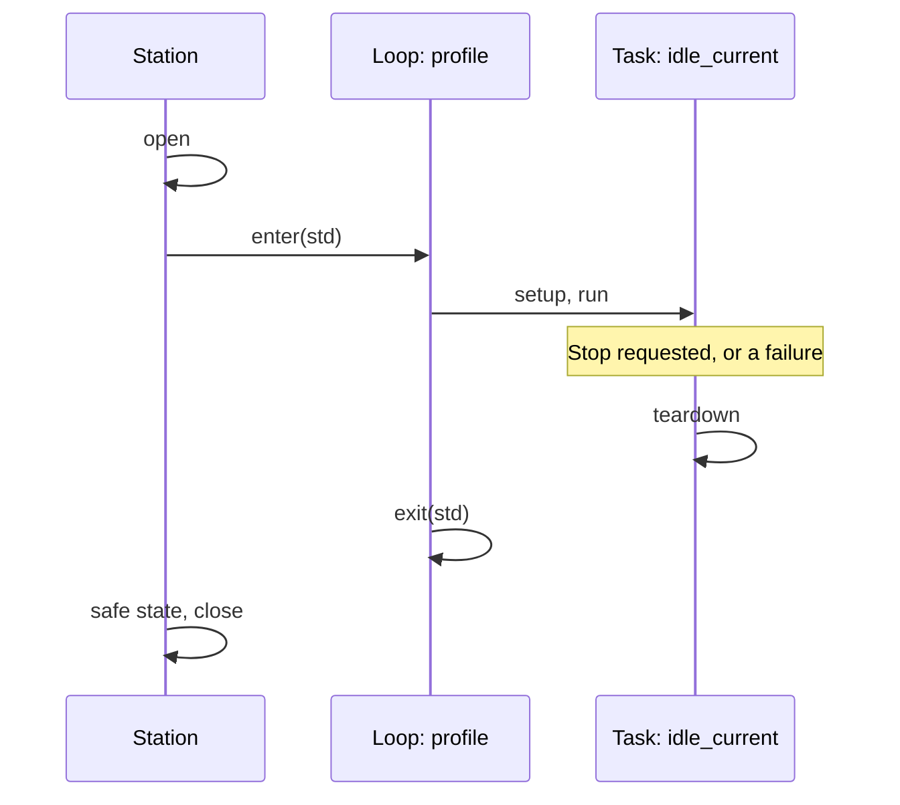
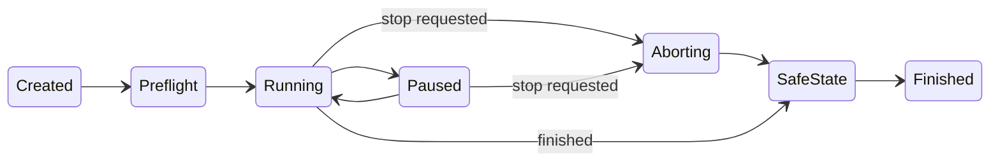

# Setup, cleanup, and cancellation

An operator presses Stop. What should happen?

It sounds simple until you think about the state of the bench at that moment. A voltage is applied, and a board is halfway through a
restart. A driver is blocked, waiting for an instrument to answer. The software configuration was changed by a loop that hasn't exited yet.
"Stop" can't mean "halt immediately", because halting immediately is how hardware gets left in a state nobody intended.

In this chapter we'll work out what stopping should mean, starting from what must be undone.

!!! example "Part implemented, part preview"
    The station's safe state and close work today. Task hooks, loop exits and the engine's abort sequence are a design preview.

## Everything you do has an undo, at some level

Things get set up at different levels of a run, and each has its own lifetime. A connection might last for the whole run, a software
configuration for one iteration of a loop, and a relay setting for one task. Whatever you set up, you want it undone at the *matching* level:

| Set up in | Lasts for | Undone in |
|---|---|---|
| Station open | The whole run | Station safe state and close |
| A loop's `enter` | One iteration of that loop | That loop's `exit` |
| A task's `setup` | One task | That task's `teardown` |
| A `with` block in `run` | A few lines | The end of that block |

This forms a stack. Things get set up from the outside in, and undone from the inside out. So at any moment in a run, the current state of the
bench corresponds to a stack of entered scopes, and stopping means unwinding that stack, one level at a time.



The nice part of this picture is that *a normal finish and an abort take the same route*. There isn't a separate error path that gets tested rarely
and fails when it matters, since the same teardown and exit code runs every time.

## Write local cleanup in ordinary Python

Inside a task, ordinary Python tools are fine for small scopes:

```python title="preview"
def run(self, ctx):
    self.matrix.route("source", "dut_in")
    try:
        ctx.measure("gain", self.meter.measure_power(), ...)
    finally:
        self.matrix.clear()
```

You might ask whether that belongs in `teardown`. Either works. If something is established in `setup`, undo it in `teardown`. If it only lasts a few lines
inside `run`, a `try/finally` keeps cause and effect together.

## Make cleanup safe to repeat

There's one property that all cleanup code should have: **it must be safe to run when the thing it undoes didn't happen.**

`teardown` runs even if `setup` failed halfway. The station's safe state runs even if your `teardown` already turned the output off. So cleanup will sometimes be
undoing something that isn't there, or doing something twice.

```python title="preview"
def setup(self, ctx):
    self.supply.output(True)         # Might have failed...
    self.handle = self.board.begin_capture()   # ...before this

def teardown(self, ctx):
    self.supply.output(False)        # Fine to repeat
    if self.handle is not None:      # Don't assume setup finished
        self.board.end_capture(self.handle)
```

Here, a teardown that assumed `setup` had completed would raise an `AttributeError` during cleanup, and that's precisely when you can least afford another
surprise.

## What stopping really means

Now let's look at the operator's Stop button. The thing to understand is that **stopping is a request**, and it has to be honoured co-operatively. Here's why. Say the
task's thread is inside a driver, blocked on a socket or inside a vendor's DLL. Python can't safely kill a thread there, because that thread might hold the library's
internal state, and interrupting it could corrupt it, or it could leave the instrument in a state nobody knows about. So the engine has to wait for the call to come
back.

This gives us a sequence, and the engine treats it as explicit states, not an afterthought in a `finally` block:



And in practice, when you press stop:

1. **The request is recorded immediately**, as an event. The UI can say "stopping" right away, and it's the truth.
2. **No new work is scheduled.** The current item is the last one.
3. **The active operation finishes**, reaches a checkpoint, or hits its own timeout.
4. **The stack unwinds**: `teardown`, then loop `exit`s, innermost first.
5. **The station makes everything safe**, and closes.
6. **The run finishes as ABORTED**, with a record of what was completed and what cleanup succeeded.

Long-running tasks need a way to cooperate, or a stop would have to wait until the task finished by itself. That's what `ctx.checkpoint()` is for. It's a declared point in
your code where a pause or abort may take effect:

```python title="preview"
def run(self, ctx):
    for point in self.config.sweep_points:
        ctx.checkpoint()      # A pause or an abort can take effect here
        self.source.set_frequency(point)
        ...
```

## Pause is the same mechanism

Pausing uses the same checkpoints, along with the boundaries between items. The current operation finishes, and the run waits there with the bench exactly as it is, until
someone resumes or aborts. This is handy when an operator needs to look at something, or when a chamber door has been opened.

## Asking the operator something

Some test steps need a person: connect this cable, check that this LED is lit. `ctx.prompt` blocks the task until someone answers:

```python title="preview"
def run(self, ctx):
    answer = ctx.prompt("Is the green LED lit?", choices=["yes", "no"], timeout=120)
    ctx.check("led_lit", answer == "yes", detail=f"operator answered {answer}")
```

The engine doesn't know or care how the question reaches the person. In a terminal it's stdin, and in your UI it's whatever you've designed. An abort while waiting on a prompt
unwinds in exactly the same way as any other.

## When a stop doesn't stop

We need to be honest about the awkward case. Suppose a vendor library hangs forever. There's no safe way to interrupt that thread. So the UI should say "stopping, waiting for
`bench_meter`", and it should keep saying so. It should never show "stopped" until it's true.

For drivers that are known to do this, the [station runtime](../../../learn/system-design/execution-modes.md) offers a stronger tool: hosting that resource in a child process, which *can* be killed. But
killing a host process doesn't tell you what state the physical instrument is in, either. Ending a process and making hardware safe are two separate things. And so a physical interlock,
and an operator's judgement, remain part of the design of any station that could do harm.

??? question "Still open in this design"
    When an abort and a cleanup failure happen together, the run's verdict is ABORTED, but the cleanup failure must stay visible. What's the best way of presenting both in a UI? We keep both
    facts in the record. How to show them is something we'd value your input on.

## Recap

- Setup and cleanup form a **stack**: station, then loops, then tasks. A normal finish and an abort unwind it the same way.
- Cleanup must be **safe to repeat**, and it mustn't assume that setup finished.
- Stop is a **co-operative request**. It takes effect at item boundaries and `ctx.checkpoint()`.
- A run moves through **explicit states**, so "stopping" and "stopped" are never confused, and a UI can tell the truth.
- If an operation truly won't return, we **say so**. We don't pretend.

That's a complete procedure. Before it grows any further, let's see how to lay it out as a real project.

**Next:** [Packaging a test project](packaging.md)
