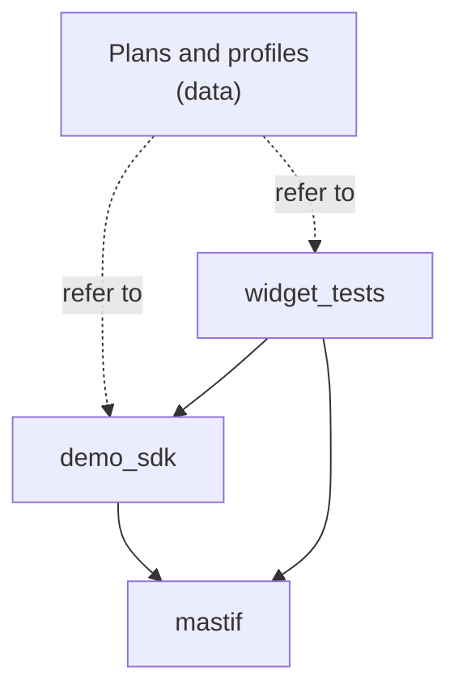

# Packaging a test project

Tasks, plans, and soon drivers, DUT types and loop types: one file's worth of tutorial code won't hold all of that. So let's arrange it the way a real organisation would. The goal is for the layout to answer a question that comes up constantly: *where does this go, and who's allowed to change it?*

!!! example "Part implemented, part preview"
    Python packaging and driver discovery through entry points work today. Discovering test packages, and any `mastif new` template, are a design preview.

## Start from a template

We'd like nobody to have to work this out from scratch, so a new project should begin with:

<!-- termynal: {title: "Mock of the intended experience · a new test project"} -->
```console
$ mastif new widget-tests --sdk demo-sdk
Created widget-tests/
  src/widget_tests/       Your tasks
  plans/                  What to run
  stations/               Your benches
  tests/                  Tests for your tests
Next: cd widget-tests && mastif validate plans/smoke.yaml --station stations/sim.yaml --sim
```

A standard layout pays for itself the first time somebody moves between teams, as every project looks the same.

## The layout

For a small organisation, one repository with two packages works well:

```text title="suggested layout"
widget-project/
├── pyproject.toml
├── src/
│   ├── demo_sdk/               # Knows about hardware and the product
│   │   ├── contracts.py        #   Capabilities specific to you
│   │   ├── drivers/            #   One module per instrument
│   │   ├── duts/               #   Your product's behaviour
│   │   └── loops.py            #   Your loop types
│   └── widget_tests/           # Knows about the procedure
│       ├── idle_current.py     #   One task per file, usually
│       └── ripple.py
├── plans/                      # What to run, and in what order
│   ├── smoke.yaml
│   └── widget-acceptance.yaml
├── stations/                   # What's plugged in
│   ├── sim.yaml
│   └── bench-01.yaml
├── config/                     # Application settings
│   └── settings.toml
└── tests/                      # Tests for all of the above
    ├── test_drivers.py         #   With fake I/O
    ├── test_tasks.py           #   On a simulated station
    └── golden/                 #   Expected plan expansions
```

Here's what each part knows, and just as importantly, what it doesn't.

| Part | Knows about | Doesn't know about | Changes when |
|---|---|---|---|
| **SDK** | Instruments, product commands | Limits, sequences, benches | A new instrument or product feature appears |
| **Tests** | Procedures, acceptance criteria | Addresses, commands | Requirements change |
| **Plans** | Order, values, policies | How tasks work, which bench | The procedure changes |
| **Profiles** | Addresses, serial numbers, roles | Anything about tests | Equipment changes |
| **Settings** | Where logs go, deployment details | Limits, equipment | Deployment changes |

If a pull request to change a limit also has to change a driver, something has drifted into the wrong place, and the table above tells you where.

## The direction of dependencies

Arrows only ever point one way:



Tests import your SDK for its DUT types and contracts. The SDK imports mastif. Neither mastif nor your SDK ever imports anything from your tests. mastif finds what you've installed through **entry points**, a
standard part of Python packaging:

```toml title="pyproject.toml"
[project.entry-points."mastif.drivers"]
demo = "demo_sdk.drivers"

[project.entry-points."mastif.test_packages"]    # Preview
widget = "widget_tests"
```

The first of those works today, and you can see it being used by `Registry.discover()`. A question that often comes up: does a test project using your SDK have to declare the driver entry point as well? No. The
entry point belongs to whichever package contains the drivers. Once `demo_sdk` is installed in an environment, its drivers can be found from anywhere in that environment. Test projects simply depend on it.

## One package or several?

It's reasonable to begin with both in one distribution. Split them into separately installable packages when their lives diverge, not because the diagram has two boxes. You'll know it's time when:

- Different teams own them.
- They need to release on different schedules, for instance when one SDK supports several products' test packages.
- Something that doesn't test anything needs your drivers, like a control GUI.

Once a project is laid out like this, `uv build` turns it into a wheel: a single versioned file you can install on a station. We'll do exactly that [at the end of the tutorial](../deploying/deploy.md).

## Recap

- An SDK knows about **hardware and the product**, tests know about **procedures**, plans about **order**, and profiles about **what's plugged in**.
- Dependencies **only point one way**, and mastif finds your packages through **entry points**.
- A test package is a normal **Python wheel**.

Our tasks have been recording results all along, without us looking closely at what those are. Let's do that now.

**Next:** [Measurements and units](measurements.md)
