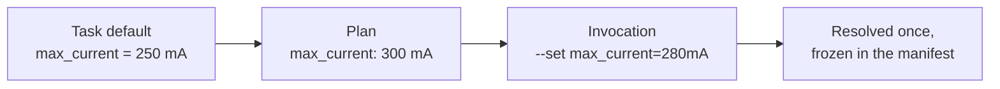

# Test parameters and configuration

Our 250 mA limit is correct for one product. The next revision allows 300 mA, and a low-power variant only 150 mA.
You could copy the task three times, but we both know how that ends. So we need configuration, and this turns out to
be one of those topics where a little clarity up front saves years of confusion.

!!! example "Design preview"
    `TaskConfig` and the engine's value resolution are part of the design. Pydantic validation and settings are
    implemented, so the validation behaviour shown here is real.

## Three kinds of configuration

Most configuration trouble comes from putting everything into one big file, whereupon nobody can tell what's a fact about
the bench, what's a product requirement, and what's merely a preference. The first thing to do is to separate them, because
they differ in who owns them and how often they change.

| Kind | Example | Owner | Where it lives |
|---|---|---|---|
| **Task input** | Maximum idle current | The test author | The task's config, set by a plan |
| **Bench fact** | Instrument address, serial number | Whoever runs the bench | The station profile |
| **Application setting** | Log directory, report location | Whoever deploys the software | Application settings |

Here's a useful test for where something goes. Ask: *if I moved this test to a different bench, should this value change?* If yes,
it's a bench fact. *If I tested a different product, should it change?* Then it's a task input. *If I deployed this to a different
site?* Then it's a setting.

Getting this wrong does real damage. If a current limit lives in a bench's profile, then two benches can apply different limits to
the same product, without anyone having decided that they should.

## A task's configuration is a model

```python title="demo_tests/idle_current.py — preview"
from mastif.api import TaskConfig
from mastif.kernel.units import Quantity, V, mA


class IdleCurrentConfig(TaskConfig):
    """What a plan may change about the idle current check."""

    voltage: Quantity = 5 * V
    max_current: Quantity = 250 * mA
```

A `TaskConfig` is a Pydantic model, the same way a driver's `Config` is, so you get real validation: wrong types are rejected, and so
are unknown fields. That second part matters a great deal. In a loose configuration system, a typo in `max_curent` is silently ignored,
and your test runs against the default limit, passing boards it shouldn't. Here's that behaviour on the real driver configuration model:

```text title="Real output, from a misspelled driver config"
StationError: resource 'bench_supply': invalid config: curent_ma: Extra inputs are not permitted
```

Using `Quantity` here means that a limit can't be given without its unit. You can write `250 mA` or `0.25 A`, and they mean the same thing.
A bare `250` is rejected as ambiguous.

The task reads its values through `self.config`, and by that point they're guaranteed to be valid:

```python title="preview"
def run(self, ctx):
    ctx.measure("idle_current", self.supply.measure_current(), Limits.at_most(self.config.max_current))
```

## Where values come from

A value can be given in several places, and the rule for which one wins should be easy to hold in your head. There are three levels, and
the most specific wins:



The last box is the important one. **Values get resolved once, before the run starts, and the resolved values are written to the run's
manifest.** From then on, nothing can change them. A report never has to go and read a configuration file that somebody edited last week to
find out what limit was applied, because the answer is in the record of that run.

We're also deliberately keeping this to three levels. It's tempting to add layers for site, product family and station class. Every layer
makes the question "what limit did this run use?" harder to answer in your head, so we'd want strong evidence before adding another.

## Passing values between tasks

Now for a subtle one. Suppose an early task measures an offset, and later tasks have to use it. In the code we described earlier, this is
the point where somebody reaches for a global variable, or a shared dictionary, and the invisible coupling between tasks begins. Test 7 now
secretly depends on test 3.

We still need the value to get across, so let's make the dependency something you declare:

```python title="demo_tests/calibration.py — preview"
from mastif.api import ContextValue, Task, requires
from mastif.kernel.units import Quantity


class SupplyOffset(ContextValue):
    """The difference between the setpoint and what the meter sees."""

    offset: Quantity


class MeasureOffset(Task):
    id = "measure_offset"
    produces = (SupplyOffset,)

    def run(self, ctx):
        ...
        ctx.outputs.put(SupplyOffset(offset=measured - setpoint))


class IdleCurrent(Task[IdleCurrentConfig]):
    id = "idle_current"
    needs = (SupplyOffset,)

    def setup(self, ctx):
        correction = ctx.inputs.get(SupplyOffset).offset
        self.supply.set_voltage(self.config.voltage - correction)
```

`SupplyOffset` is a typed value in the run's shared context. A task that creates one declares it in `produces`, and a task that uses one
declares it in `needs`. It looks like a small amount of ceremony, so let's see what it buys.

**The dependency can be seen and checked.** Before the run starts, the engine confirms that everything a task needs is produced by something
earlier in the plan. If you reorder the plan so that `idle_current` runs first, you find out immediately, rather than through a `KeyError` an hour
in.

**A task can run standalone.** `IdleCurrent` needs an offset, not `MeasureOffset`, so you can run it alone by supplying the value from a file or
borrowing it from an earlier run. If you do neither, it's reported as SKIPPED with a clear reason, because the requirement can't be met.

```console
mastif task demo_tests.idle_current --station stations/bench-01.yaml --context-from runs/20261031T090000Z-3fa9c2
```

**It survives a crash.** These are Pydantic models, so they serialise. The context is written to the run's snapshot, so when a run resumes, the offset
is still there, without having to re-measure anything. [We'll see that shortly](../first-results/progress.md#surviving-a-crash).

**It knows about loops.** A value is stored against the loop position that produced it. An offset measured at 5 V isn't confused with one measured at
12 V. The engine gives you the one that matches where you are.

## Application settings

The third kind of configuration is about the software's own deployment: where logs go, which report format to use, and so on. This part already works today:

```python
from pydantic import BaseModel

from mastif.infra import bootstrap
from mastif.infra.config import section


class Reports(BaseModel):
    directory: str = "runs"
    keep_days: int = 90


runtime = bootstrap(
    defaults={"reports": {"directory": "/data/runs"}},
    envvar_prefix="DEMO",
    rich_tracebacks=False,
)
reports = section(runtime.settings, "reports", Reports)
print(reports.directory)  # /data/runs
```

There's one rule here that mastif enforces in its own code, and that we'd recommend for yours: **settings are never global.** You build one object at the
entry point of your application, and you pass it to whatever needs it. There's no `from config import settings` waiting at the top of a module, doing file I/O
at import time and making your code impossible to test with different values. The chapter on [settings and bootstrap](../../../learn/operations/bootstrap.md) goes into
detail.

Keep the separation in mind, though. Acceptance limits aren't deployment settings, and a `production=true` flag shouldn't quietly select a different limit deep
inside a driver.

## Recap

- Separate **task inputs, bench facts and application settings**. They have different owners and they change for different reasons.
- A **`TaskConfig`** is a validated model. Unknown fields are rejected, and physical values must carry their units.
- Values resolve **once, before the run**, and get frozen in the manifest.
- Tasks exchange data through **declared context values**, which keeps the dependency visible, checkable and resumable.

Our tasks keep asking for a power supply, without us saying what that really means. Let's fix that.

**Next:** [Resources and capabilities](resources.md)
