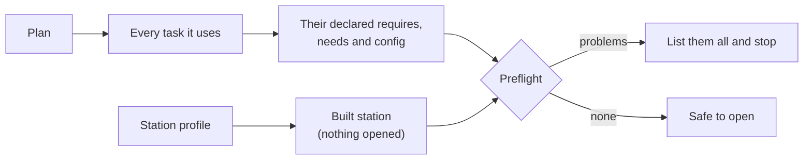

# Requesting resources from a test

Imagine a test plan that runs for four hours. Its last task needs a signal generator, and this bench doesn't have one.
With an ordinary script you find out at hour four, at the moment the code reaches that line. The board has been cycled for
nothing, the slot on the bench has gone, and somebody has to start over.

Everything needed to catch that was known before the run started. So let's catch it then.

!!! example "Part implemented, part preview"
    `Station.require` and `Station.role_problems` work today. Having the engine gather requirements from tasks automatically is
    a design preview.

## Asking for a resource

There are two parts to a request: the role you want, and what it must be able to do.

```python title="in a task — preview"
class IdleCurrent(Task[IdleCurrentConfig]):
    supply: PowerSupply = requires("supply")
```

By the time `setup` runs, `self.supply` is a ready-to-use object, open and verified. Your annotation does double duty here. It tells
your editor what methods are available, and it tells the engine which contract to check at preflight.

Today, without the engine, the equivalent is one call on an opened station:

```python
from mastif.kernel.units import Amps, Volts, mA
from mastif.resources.driver import DriverConfig, driver
from mastif.resources.identity import Identity
from mastif.resources.registry import Registry
from mastif.resources.std import PowerSupply, Shell
from mastif.station import Station, StationProfile
from mastif.station.errors import RoleError


@driver("demo.learn-supply", provides=[PowerSupply])
class SimSupply:
    class Config(DriverConfig):
        current_ma: float = 180

    def __init__(self, cfg: Config) -> None:
        self.cfg = cfg

    def identify(self) -> Identity:
        return Identity(serial="SIM-001")

    def set_voltage(self, voltage: Volts) -> None: ...
    def set_current_limit(self, current: Amps) -> None: ...
    def output(self, enabled: bool) -> None: ...
    def measure_voltage(self) -> Volts: ...
    def measure_current(self) -> Amps: return self.cfg.current_ma * mA


profile = StationProfile.from_yaml("""
station: demo-bench
resources:
  bench_supply: {driver: demo.learn-supply}
roles:
  supply: bench_supply
""")
station = Station.build(profile, Registry([SimSupply]))

with station:
    supply = station.require("supply", PowerSupply)
    print(supply.measure_current())  # 180 mA

    try:
        station.require("supply", Shell)
    except RoleError as error:
        print(error)
```

There's also a looser `station.role("supply")`, which gives you the object without checking any contract. Prefer `require` in tests. It says what you
expect, and it fails at the line where the expectation is wrong, rather than later with an `AttributeError` that has nothing to do with the cause.

## Preflight: checking before you touch anything

`role_problems` is the check you want here. Since it reports problems rather than raising, you can show someone
everything that's wrong in a single pass.

```python title="continuing the example above; nothing is opened"
needs = {"supply": PowerSupply, "console": Shell}
for problem in station.role_problems(needs):
    print(problem)
```

```text title="Real output"
no role 'console'; known roles: bench_supply, supply
```

In a direct application today, you write that `needs` mapping yourself. The engine builds it for you, since every task declares its requirements on the
class. That's a large part of the case for declaring them:



Here's what `mastif validate` will check, all without opening anything:

<!-- termynal: {title: "Mock of the intended experience · validate finds problems"} -->
```console
$ mastif validate plans/widget-acceptance.yaml --station stations/bench-02.yaml
Plan widget-acceptance (24 items)
  ✓ Plan structure and loop types
  ✓ Task configuration
  ✗ tx_power: role 'rf_source' not found; known roles: supply, meter, dut
  ✗ idle_current: role 'supply' (acme.usb-psu) does not provide PowerSupply
  ✗ gain_check: needs SupplyOffset, but nothing before it produces one

3 problems. Nothing was opened.
```

It took about a second, and it saved four hours. And since it needs no hardware, it can run in continuous integration. Every plan can be checked against every
station's profile on every commit, so a change that breaks a bench's compatibility is caught at review time, instead of on the production floor.

## What preflight can't know

Let's be honest about the limits, because a check that overclaims is worse than no check.

Preflight confirms that **the setup is consistent**. Everything that needs a live connection is still unknown at this stage.

| Question | When you find out |
|---|---|
| Is the role defined, and does its driver provide the contract? | Preflight |
| Is the configuration valid? | Preflight |
| Is the instrument powered on and reachable? | Opening |
| Is it the instrument we expected? | Opening |
| Is it healthy? | Opening |
| Does this sub-resource exist? | Sometimes only after opening |
| Is it physically capable of this measurement? | Only by qualification |
| Will the test pass? | Only by running it |

The row about sub-resources is worth a closer look. Some instruments only report their channels or axes once connected, through a `children()` hook. A role like
`positioner.azimuth` can't be fully checked until then. The station knows this, and it reports the difference between "that's definitely wrong" and "I can't check
that yet", rather than failing a bench that's actually fine.

## What a request doesn't give you

Getting a resource doesn't mean nobody else is using it. In direct mode, your process is the only one that has it, so this doesn't come up. But once a station is shared
between a test and a GUI, the question of who may control an instrument right now becomes crucial. That's handled by [leases](../../../learn/system-design/resource-lifetimes.md), and the
declaration on your task is precisely what the engine uses to acquire them. You won't need to change your task when that day comes, which is rather the point of doing it
this way.

The name in `require` also shouldn't change with circumstances. Report which role was requested, which contract was checked, and which real resource answered. That chain is
what lets you explain a result later, without anyone having to look at driver construction.

## Recap

- A task **declares** the role and the contract it needs.
- **Preflight** checks a whole plan against a built station, reporting everything at once, without touching hardware.
- It can even run in **CI**, against the profile of every station.
- It proves the setup is consistent. Reachability, identity and health come at **opening**, and physics comes from **qualification**.

So far we've been thinking about one task at a time. Let's put a few of them together.

**Next:** [Combining tests into a plan](plans.md)
