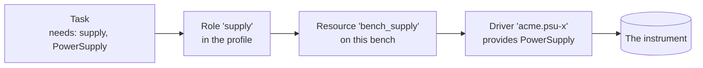

# Resources and capabilities

Our test needs a reading from a device, and that immediately raises a design question which shapes the whole framework:

> How should a test talk to an instrument?

Let's work out the answer from the problem.

!!! success "Works today"
    Contracts, drivers and role resolution are implemented. Where a task's `requires()` appears,
    it's marked as a preview, and we show the equivalent call you can make today.

## The obvious way, and what it costs

The most obvious approach is for the test to import the instrument's driver and use it:

```python title="the approach we are avoiding — not mastif"
from acme_drivers import AcmePsuX

psu = AcmePsuX("10.0.0.5", 5025)
psu.set_voltage(5.0)
current = psu.measure_current()
```

It's short and clear, and it welds together three facts that have nothing to do with each other:
what the test wants to do, which product the bench happens to own, and where that product is
plugged in.

Now the lab buys a different supply, and this test has to change, though the requirement it
checks is the same as ever. So does every other test that used a supply. Want to run on your
laptop with no hardware at all? That's a code change too, or an awkward flag threaded through
every test. And you certainly can't tell, without running it, which instruments a given test
needs.

The fix is an old idea in software, and it applies here very neatly: **depend on what something
can do, not on what it is.**

## A contract is a capability

A **contract** describes something a test needs, without saying who provides it. In mastif it's a
plain Python `Protocol`. Here's the one we've been using, trimmed down from `mastif.resources.std`:

```python title="excerpt of mastif/resources/std.py"
@contract(safe_state=lambda psu: psu.output(False))
class PowerSupply(Protocol):
    """A programmable DC supply channel. Safe state: output off."""

    def set_voltage(self, voltage: Volts) -> None: ...
    def set_current_limit(self, current: Amps) -> None: ...
    def output(self, enabled: bool) -> None: ...
    def measure_voltage(self) -> Volts: ...
    def measure_current(self) -> Amps: ...
```

That's the whole of it. There are no SCPI commands in there, and there's no port. It's five methods
that describe what a power supply *is* from the point of view of a test. Notice the types, too:
`set_voltage` takes `Volts`, so even the capability's vocabulary carries units.

Look at the decorator as well, since we'll return to it. It says that the safe thing to do with
anything providing this contract is to turn its output off. The framework can now make *any* power
supply safe, including one that didn't exist when the framework was written.

A contract can also be as small as you need. If your test only reads a current, there's no reason
to demand a whole supply:

```python
from typing import Protocol

from mastif.kernel.units import Amps


class CurrentReader(Protocol):
    def measure_current(self) -> Amps: ...
```

mastif ships a few contracts in `mastif.resources.std`, covering what nearly every station has:
`PowerSupply`, `SignalSource`, `PowerMeter`, `Switch`, `Relay`, and `Shell` and `MessageChannel` for
talking to a DUT. They're a convenience, not a requirement, and you're expected to define your own for
whatever your organisation really uses. You'll learn how in [Defining a capability
contract](../hardware-integration/contracts.md).

## A driver is one way of providing it

A **driver** is a class that implements a contract for one kind of device. Because a `Protocol` is
structural, the driver doesn't have to inherit from anything. It only has to have the right methods
and declare what it provides:

```python title="excerpt of docs/examples/learn_driver.py"
@driver("demo.learn-scpi", provides=[PowerSupply])
class LearnSupply:
    class Config(DriverConfig):
        transport: TcpConfig

    def __init__(self, cfg: Config, io: Scpi) -> None:
        self.io = io

    def set_voltage(self, voltage: Volts) -> None:
        self.io.write(f"VOLT {voltage.magnitude('V'):.4f}")

    def measure_current(self) -> Amps:
        return self.io.query_quantity("MEAS:CURR?", "A")

    ...
```

Here's the instrument's language, and here's the only place it needs to live. A driver is also where
units cross the boundary: `.magnitude('V')` turns our quantity into the bare number this instrument
wants, and `query_quantity(..., "A")` attaches the unit to the reply.

The decorator checks the claim as soon as Python imports the class. Say you forget a few methods:

```text title="Real output"
ContractMismatch: demo.bad2 does not provide PowerSupply: set_current_limit: missing,
output: missing, measure_voltage: missing, measure_current: missing
```

You get that when the module loads, on your machine, and not at 3 a.m. when an operator's test reaches
that method for the first time.

A simulator is also just a driver. `SimSupply` in the [station example](../../../examples/learn_station.py)
provides the same contract using nothing but memory, and as far as a test is concerned, it's a power
supply. That's what makes the laptop-to-bench story possible.

## A role is a job on a bench

Now the last part. A test needs a way to say *which* power supply it wants. Even with only one
capability, a bench can have several supplies: one for the board, one for a fixture. So a test asks by
**role**, a stable name for a job:

```python title="in a task — preview"
supply: PowerSupply = requires("supply")
```

```python title="what you can write today — excerpt"
supply = station.require("supply", PowerSupply)
```

Both say the same thing: *give me whatever fills the `supply` role, and make sure it really can behave
as a `PowerSupply`.* The second half is a check rather than a formality. If the bench has mapped the role
to something else, you get a clear error at that line, or better still, before the run starts.

With all three in place, you can see how a request gets resolved:



Each arrow is a decision that someone else owns, and each one can change without disturbing the ones to
its left. Changing the instrument affects only the last two boxes. Moving the test to another bench
changes the profile. And the test, on the left, has no idea any of it happened.

## What this gives you

Let's collect what we got for this indirection, because we've added concepts and they should pay for
themselves.

- **Replacing an instrument** means a new driver and a change in a profile. No test changes.
- **Running without hardware** means a simulator in the profile. No test changes.
- **Knowing a test's needs** is possible before it runs, since they're declared.
- **Testing a driver** needs no instrument, because the driver's I/O is passed in. We'll cover
  that in [Testing drivers with fake I/O](../hardware-integration/fake-io.md).
- **Sharing an instrument between processes** can be added later, by handing the test a stand-in object
  that implements the same contract. The test can't tell the difference. That's the entire basis of
  [the station runtime](../../../learn/system-design/execution-modes.md).

## The limit of the promise

We said this when we set out our principles, and it deserves repeating here, where it's most tempting to forget.

A contract checks that methods exist with compatible signatures. It says nothing about physics. Two drivers
can both provide `PowerSupply`, while one is a 30 V, 10 A bench supply with 1 mA resolution, and the other is
a 5 V USB module that can resolve 10 mA. If your 250 mA limit needs better than 1 mA accuracy, swapping them
will quietly make your test worse, with no error anywhere.

Interfaces make replacement *possible*. Qualifying that a replacement is good enough for your measurement
remains an engineering decision.

## Recap

- A **contract** describes what a test needs.
- A **driver** implements a contract for one kind of device, and it's the one place that device's
  language lives.
- A **role** names a job on a bench, and it's how a test asks for a resource without knowing what it is.

So a task asks for a capability by role. Let's look at exactly how it asks, and how much can be checked before anything runs.

**Next:** [Requesting resources from a test](requirements.md)
