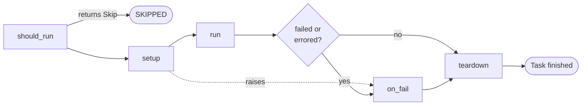

# Writing a reusable test

Let's come back to the task from [Your first test run](first-run.md), and look properly at why it's shaped the way it is.

This is where you'll spend most of your time as a test author, so we've put a lot of thought into making this class
easy to write and hard to get wrong.

!!! example "Design preview"
    `Task` and its hooks belong to the engine, which we're designing in these pages, so this code won't run yet.
    See the [roadmap](../../../wiki/roadmap.md) for what is built.

## How test code usually decays

Picture the kind of test module that real labs accumulate. It starts as one function. Then it needs some setup, so
that goes at the top. Someone adds a skip condition, and an `if` wraps the middle. A later test needs a value this
one computed, so it writes the value to a global. Then a configuration flag appears, read from a file somewhere in
the middle of the function, and a `try/except` is added because of something that happened once in production.

After a few years, three problems have crept in, and they're the ones we most want to design away.

**Nobody can tell what it needs.** Finding out which instruments a test uses means reading all of it, including the
branches. So you find out it needs a signal generator when it crashes forty minutes into a run.

**Tests depend on each other invisibly.** Test 7 reads a global that test 3 wrote. Test 7 therefore can't be run alone,
and running it on its own, to debug it, gives you a confusing failure that has nothing to do with test 7.

**Cleanup is whatever each author remembered.** Some tests turn the output off, some don't, and it's different on the
exception path.

All three share a root cause: a free-form function gives the framework nothing to hold on to. The framework can't know
what's in there until it runs. So rather than a bare function, a test in mastif fills in a structure.

## The shape of a task

Here's a task with every hook filled in, so you can see the whole of it at once.

```python title="demo_tests/idle_current.py — preview"
from mastif.api import Skip, Task, TaskConfig, requires
from mastif.kernel.limits import Limits
from mastif.kernel.units import Quantity, V, mA
from mastif.resources.std import PowerSupply

from demo_sdk import WidgetBoard


class IdleCurrentConfig(TaskConfig):
    voltage: Quantity = 5 * V
    max_current: Quantity = 250 * mA


class IdleCurrent(Task[IdleCurrentConfig]):
    """Check that the board stays within its idle current budget.

    Why: an elevated idle current is an early sign of a leaking component.
    """

    id = "idle_current"

    supply: PowerSupply = requires("supply")
    board: WidgetBoard = requires("dut")

    def should_run(self, ctx) -> Skip | None:
        if not self.board.has_idle_mode():
            return Skip("this hardware revision has no idle mode")
        return None

    def setup(self, ctx):
        self.supply.set_voltage(self.config.voltage)
        self.supply.set_current_limit(500 * mA)
        self.supply.output(True)
        self.board.wait_until_idle(timeout=10.0)

    def run(self, ctx):
        ctx.measure(
            "idle_current",
            self.supply.measure_current(),
            Limits.at_most(self.config.max_current),
        )

    def on_fail(self, ctx, outcome):
        ctx.check("console_log_captured", self.board.dump_log() != "", detail="kept for diagnosis")

    def teardown(self, ctx):
        self.supply.output(False)
```

The engine calls these hooks in a fixed order:



Let's go through each one, including why it's separate from the others.

### `should_run`: deciding not to

Some tests don't apply. A hardware revision has no idle mode, or a test is only meaningful on one firmware
configuration. You could put an early `return` in `run`, but then the report says the test ran and passed, when in
reality nothing was verified.

Returning a `Skip` records a SKIPPED verdict with your reason. It keeps "we chose not to check this" visibly separate from
"we checked and it was fine". The hook runs before `setup`, so a skipped test doesn't apply any stimulus.

### `setup`: establishing conditions

Everything your measurement depends on goes here: power on, configure, wait for readiness. If `setup` raises an exception, `run`
doesn't get called. That's a meaningful rule, since a measurement taken under conditions you failed to establish isn't evidence
of anything.

### `run`: the observation

This should be the shortest hook. Reading a well-written `run` should tell you what the test verifies, without any
scaffolding in the way.

Since a `run` can do a number of things in sequence, you can name its stages. Those names show up in the event stream and the
report, so a failure tells you which part of a long test it occurred in:

```python title="preview"
def run(self, ctx):
    with ctx.step("settle"):
        self.board.wait_until_idle(timeout=10.0)
    with ctx.step("measure"):
        ctx.measure("idle_current", self.supply.measure_current(), ...)
```

### `on_fail`: gathering evidence while you still can

When a test fails, the moment right after it is the most valuable one you'll ever get for diagnosis. The board is still in the
state that caused the problem. Five seconds later it won't be. `on_fail` runs immediately after a failure or an error, before
`teardown`, so you can dump a log, capture a trace, or read a register. It receives the outcome, so it can tell which happened.

### `teardown`: undoing what you did

It runs whatever happened before it, including if `setup` failed halfway. So it should cope with work that never got done, and
repeating an action should be harmless. Turning an off output off is fine.

Keep in mind that this is a *test-level* cleanup, undoing what this test did. The station's safe state still runs at the end of the
run as a backstop. They aren't redundant. If you switch a relay in `setup`, then `teardown` is what restores it for the next task;
safe state only runs once the whole run is over.

Any failure in `teardown` gets reported in its own right. It can't erase an earlier FAIL, and a passing result can't hide it.

## Failing, and failing right now

There are three ways of expressing a requirement inside `run`, and each has a different effect on what happens next.

| You write | If the requirement isn't met | Use it when |
|---|---|---|
| `ctx.measure(...)` or `ctx.check(...)` | Records a FAIL and **carries on** | Later steps are still meaningful |
| `ctx.require(...)` | Records a FAIL and **stops this task** | Later steps would be meaningless |
| `assert` | Records a FAIL and **stops this task** | You prefer plain Python |

So a test that measures four rails would use `measure` for each of them, because you want all four readings, even if the first is
bad. A test where the second step assumes the first worked should use `require`, since carrying on would be producing nonsense.

And anything else that goes wrong (a timeout, a `ProtocolError`, a bug in your code) is an exception. You should almost never catch those.
Let them propagate, and they'll become an ERROR, which is the truth. We cover this properly in [Failed checks and execution
errors](failures.md).

## Why declarations matter

Let's return to the class attribute, because this is the design decision everything else depends on.

```python title="preview"
supply: PowerSupply = requires("supply")
board: WidgetBoard = requires("dut")
```

Because these are declarations on the class, the engine can read them **without running your code**. Before it opens a single
instrument, it can walk every task in a plan and ask: does this bench have a `supply` role? Does it provide `PowerSupply`? It can report
every problem at once. Remember the forty-minute surprise from earlier? It's now a two-second error.

It's also a lease request, later on. When several clients share a station through the [runtime](../../../learn/system-design/execution-modes.md),
the engine uses exactly this list to know which instruments to reserve for the run, without you having to do anything.

And it's a piece of documentation which can't go stale, since a task that used an undeclared instrument simply couldn't get hold of it.

## A task can run on its own

Here's a requirement we hold onto firmly: **you can run any task by itself**, without the rest of the plan.

```console
mastif task demo_tests.idle_current --station stations/bench-01.yaml
```

When you're debugging test 7 on a bench, you don't want to run tests 1 to 6 first. It's also what makes a task testable in the
ordinary software sense, since you can run it against a simulated station in your CI.

For this to work, a task can't rely on invisible state from other tasks. But tasks often do need results from earlier ones, a
calibration offset for instance, so we've got a way of doing that explicitly, and you'll meet it in [Parameters and
configuration](parameters.md#passing-values-between-tasks).

## What belongs in a task, and what doesn't

A good rule of thumb is to ask who owns the knowledge.

| The knowledge | Where it goes |
|---|---|
| The command that reads this instrument's current | The **driver** |
| How to put this product into idle mode | The **DUT type**, in your SDK |
| Whether this revision has an idle mode | The **DUT type** |
| That idle current is worth checking at all | The **task** |
| What counts as acceptable | The **task's config**, set by the plan |
| Which supply is plugged into this bench | The **station profile** |

If you see a raw SCPI string in a task, it's in the wrong layer. If you see a pass or fail threshold in a driver, that's in the wrong layer too.
A driver shouldn't know what a good board looks like, since a different test might deliberately use it on a bad one.

When should you split a task in two? Not simply when it gets long. Split when the pieces need independent verdicts, when you'd want to run one
without the other, or when they need different setup. A single task can record several measurements if they describe one coherent thing. Granularity
shows up in your reports, so it's a decision about what you want to be able to say afterwards.

## Testing your test

A task is ordinary Python, so you can test the logic with an ordinary test framework, on a simulated station, without a bench:

```python title="tests/test_idle_current.py — preview"
from mastif_testing import run_task

from demo_tests import IdleCurrent


def test_fails_when_the_board_draws_too_much(sim_station):
    outcome = run_task(IdleCurrent, sim_station(current_ma=300))
    assert outcome.verdict == "fail"
```

There's something a bit unusual here that's worth saying out loud: testing test software is a real activity. A test that always passes is the most
dangerous bug in your organisation, as it produces confidence with no basis. So check that your tests can actually fail.

!!! note "Why a class, rather than a function?"
    A plain `def idle_current(ctx)` would be shorter, and frameworks like OpenHTF use that style very effectively. We chose a class for this reason:
    the moment a function needs setup, cleanup, a skip condition and a requirements list, these turn into decorators and conventions. A class makes
    the structure something you can see and something your editor can complete, and the framework can rely on it. It also gives `requires` somewhere
    natural to live. A test with only a `run` method is still just three lines.

## Recap

- A **task** fills in a fixed structure: `should_run`, `setup`, `run`, `on_fail`, `teardown`.
- **`teardown` always runs**, and `on_fail` catches the moment when the evidence is still there.
- **`measure` and `check` carry on**, whereas `require` and `assert` stop the task. Exceptions become ERROR.
- **Requirements are declared**, so the engine can read them before anything runs.
- **Any task can run on its own**, which is what makes it debuggable and testable.

Our `IdleCurrentConfig` has been sitting there without explanation. Let's look at configuration next, since it's one of those areas that seems simple until
it isn't.

**Next:** [Test parameters and configuration](parameters.md)
