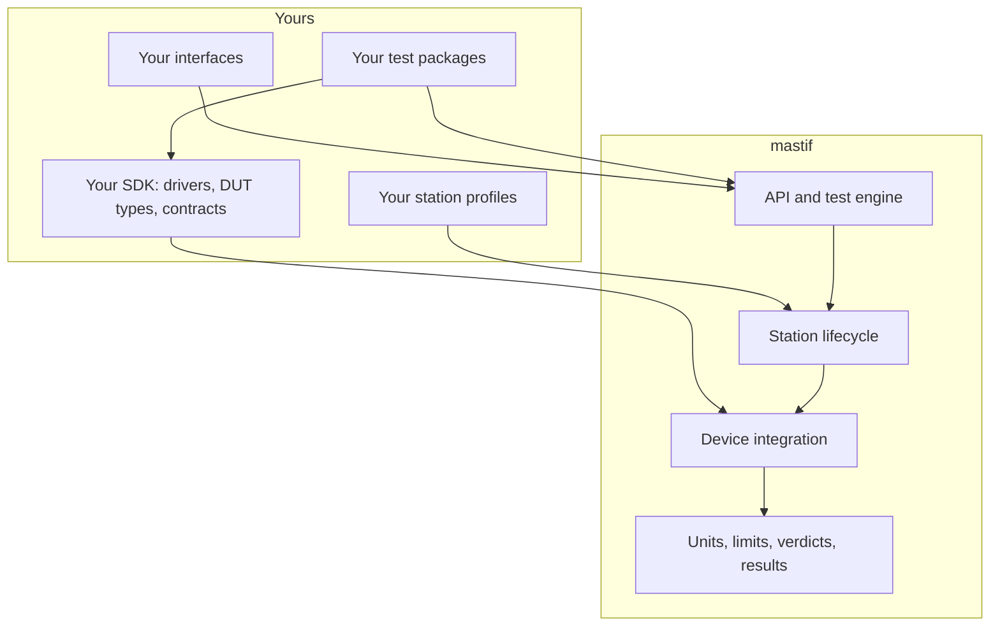

---
hide:
  - navigation
---

# mastif { .mastif-title }

{ .mastif-banner }

[](getting-started/tutorial/installation.md)
[](wiki/licensing.md)
[](learn/status.md)
[](https://docs.pydantic.dev/)
[](https://docs.astral.sh/uv/)
[](https://docs.astral.sh/ruff/)
[](https://docs.pytest.org/)
[](https://github.com/PuglyD/mastif)
{ .mastif-badges }

[Quick start](#quick-start){ .md-button .md-button--primary }
[What mastif solves](getting-started/intro/problem.md){ .md-button }
[The tutorial](getting-started/tutorial/writing-tests/first-run.md){ .md-button }
[Learn how it works](learn/index.md){ .md-button }

Most test tools are built for one test, one bench, or one engineer. mastif is built for the organisation that owns all of them: one way to write tests, one way to integrate instruments, and one kind of evidence, across every product, station and team. You build your SDK, tests and interfaces on top, and they stay yours.

## Built around your organisation

Every test system starts as a ten-line script. Then a second bench arrives, then a second product and a second team. Soon every station is an island, with its own copy of the drivers, its own idea of what passed, and results scattered through text files.

Those problems have nothing to do with what you make, so mastif solves them once, in a foundation, and leaves everything specific to your organisation in packages you own.



mastif never imports your code by name. It finds your packages when they're installed, so you can upgrade the framework, swap an instrument, or add a product without forking anything.

| What an organisation needs | How mastif provides it | State |
|---|---|---|
| Instruments integrated once, used everywhere | An SDK of drivers behind stable contracts | Works today |
| The same behaviour on every bench | Validated profiles and one hardware lifecycle | Works today |
| Evidence you can compare and defend | Structured results with computed verdicts | Works today |
| One way to write and sequence tests | Tasks, plans and loops, shipped as versioned wheels | Designed |
| Runs that survive a crash and can be reconstructed | Run records, manifests and resume | Designed |
| Benches that several applications can share | A station runtime that owns the hardware | Designed |

mastif is in early development: the framework's foundation is built, and its engine and optional station runtime are [designed in the open](learn/system-design/specification.md). Your organisation chooses the deployment and shared services around that foundation. The [roadmap](wiki/roadmap.md) says exactly where things stand.

## Quick start

You need Python 3.12+, Git and [uv](https://docs.astral.sh/uv/). You don't need any hardware.

### 1. Install

```console
git clone https://github.com/PuglyD/mastif.git
cd mastif
uv sync
```

### 2. Describe a bench, and test it

A short YAML description says what's on the bench, and a few lines of Python test it. The test asks for a *power supply* by role, and it has no idea which one it's getting.

```python title="docs/examples/quickstart.py"
--8<-- "examples/quickstart.py:test"
```

Here the supply is simulated, so you can run this anywhere. It's already in the repository, so there's nothing to copy.

??? note "The simulated driver"
    A driver is the one class that knows a device's language. This one keeps everything in memory.

    ```python
    --8<-- "examples/quickstart.py:driver"
    ```

### 3. Run it

<!-- termynal: {title: "Real transcript · quickstart.py"} -->
```console
$ uv run python docs/examples/quickstart.py
output on
idle_current: 180 mA -> PASS
output off
```

Look at the last line. Nothing in the test turned the output off. The station did that on the way out of the `with` block, and it would have done the same if the test had crashed.

### 4. Now break it

The interesting part of a test system is what it does on a bad day. Change one thing at a time in `BENCH` and run it again.

| Change | What you get |
|---|---|
| `current_ma: 300` | `idle_current: 300 mA -> FAIL`, and the output still goes off |
| `serial: OTHER` | `IdentityMismatch: bench_psu: serial is 'SIM-001', expected 'OTHER'`, before the test runs |
| `curent_ma: 180` | `StationError: resource 'bench_psu': invalid config: curent_ma: Extra inputs are not permitted`, before anything opens |
| `supply: wrong_name` | `StationError: role 'supply' points to unknown resource 'wrong_name'` |

That's the idea in four lines: a bad unit is a FAIL, the wrong instrument is refused, and a typo never reaches the hardware.

### 5. Use a real instrument

Write a [driver](getting-started/tutorial/hardware-integration/first-driver.md) for it, and change the profile. The test stays exactly as it is.

```yaml title="the same bench, with a real supply"
resources:
  bench_psu:
    driver: acme.psu-x
    config:
      transport: {kind: tcp, host: 192.0.2.10, port: 5025}
    expect: {serial: A123}
```

The same driver works over TCP, serial, VISA, Telnet or SSH by changing `transport`, and vendor DLLs are supported too.

## What you get today

**Values that can't lose their unit.** `0.18 * A` stays a quantity from the driver to the record. Comparing volts with amps raises an error at that line, rather than passing silently. [Measurements and units →](getting-started/tutorial/writing-tests/measurements.md)

**Verdicts that can't contradict the evidence.** A result computes its own verdict, and recomputes it when loaded. There's no way to record 300 mA against a 250 mA limit and call it a pass. [Limits and verdicts →](getting-started/tutorial/writing-tests/limits.md)

**Tests that don't know what instrument they're using.** A test asks for a capability by role. Swapping a supply means a new driver and a line in a profile. [Resources and capabilities →](getting-started/tutorial/writing-tests/resources.md)

**Setup mistakes found with no hardware attached.** Profiles, drivers and roles are fully checked before anything opens, so this works on a laptop. [Station profiles →](getting-started/tutorial/deploying/profiles.md)

**Cleanup that's done once and done carefully.** Failed opens roll back. Safe state reaches every instrument, even when one of them has failed, and your original error still arrives. [The station lifecycle →](getting-started/tutorial/deploying/lifecycle.md)

**Drivers you can test at your desk.** Scripted fakes behave like real devices, including going silent, and conformance checks take a couple of lines. [Testing with fake I/O →](getting-started/tutorial/hardware-integration/fake-io.md)

## Where it's going

!!! example "Design preview: this code doesn't run yet"
    The test engine and station runtime are designed, and they aren't built. See the [roadmap](wiki/roadmap.md).

Tests become classes with a defined lifecycle, and a plan decides what runs, in what order. You can read exactly what a run will do before anything is powered:

=== "A task"

    ```python title="preview"
    class IdleCurrent(Task[IdleCurrentConfig]):
        id = "idle_current"

        supply: PowerSupply = requires("supply")

        def setup(self, ctx):
            self.supply.set_voltage(self.config.voltage)
            self.supply.output(True)

        def run(self, ctx):
            ctx.measure("idle_current", self.supply.measure_current(),
                        Limits.at_most(self.config.max_current))

        def teardown(self, ctx):
            self.supply.output(False)
    ```

=== "A plan"

    ```yaml title="preview"
    name: widget-acceptance
    loops:
      profile: {type: demo.firmware_profile, values: [std, lowpower]}
      voltage: {type: values, values: [4.75 V, 5 V, 5.25 V]}
    order: [profile, voltage, task]    # Change the loop order with one line
    sequence:
      - task: idle_current
      - task: ripple
    policies: {on_fail: continue, on_error: stop_run}
    ```

=== "A run"

    <!-- termynal: {title: "Mock of the intended experience"} -->
    ```console
    $ mastif plan plans/widget-acceptance.yaml --station stations/bench-01.yaml
    12 items · loop transitions: profile 2, voltage 6 · nothing was opened
    $ mastif run plans/widget-acceptance.yaml --station stations/bench-01.yaml
    PASS  12 passed in 41 s
    Run folder: runs/20261031T090000Z-3fa9c2/
    $ mastif resume 20261031T090000Z-3fa9c2    # After a crash, carry on where it stopped
    ```

Beyond that, one long-lived process can own the bench, so a control GUI and a running test can share it, with no changes to your tests. [Read the system design →](learn/fundamentals/index.md)

## Where to go next

| You want to | Go to |
|---|---|
| Decide whether this is for you | [Why mastif?](getting-started/intro/why-mastif.md) |
| Understand the design | [System design](learn/system-design/concepts.md) |
| See what's built, and how | [Architecture as built](learn/architecture/index.md) |
| Write a test | [Your first test run](getting-started/tutorial/writing-tests/first-run.md) |
| Connect an instrument | [Your first driver](getting-started/tutorial/hardware-integration/first-driver.md) |
| Look up an exact signature | [API reference](reference/kernel/index.md) |
| See why something was decided | [Design decisions](adr/index.md) |
