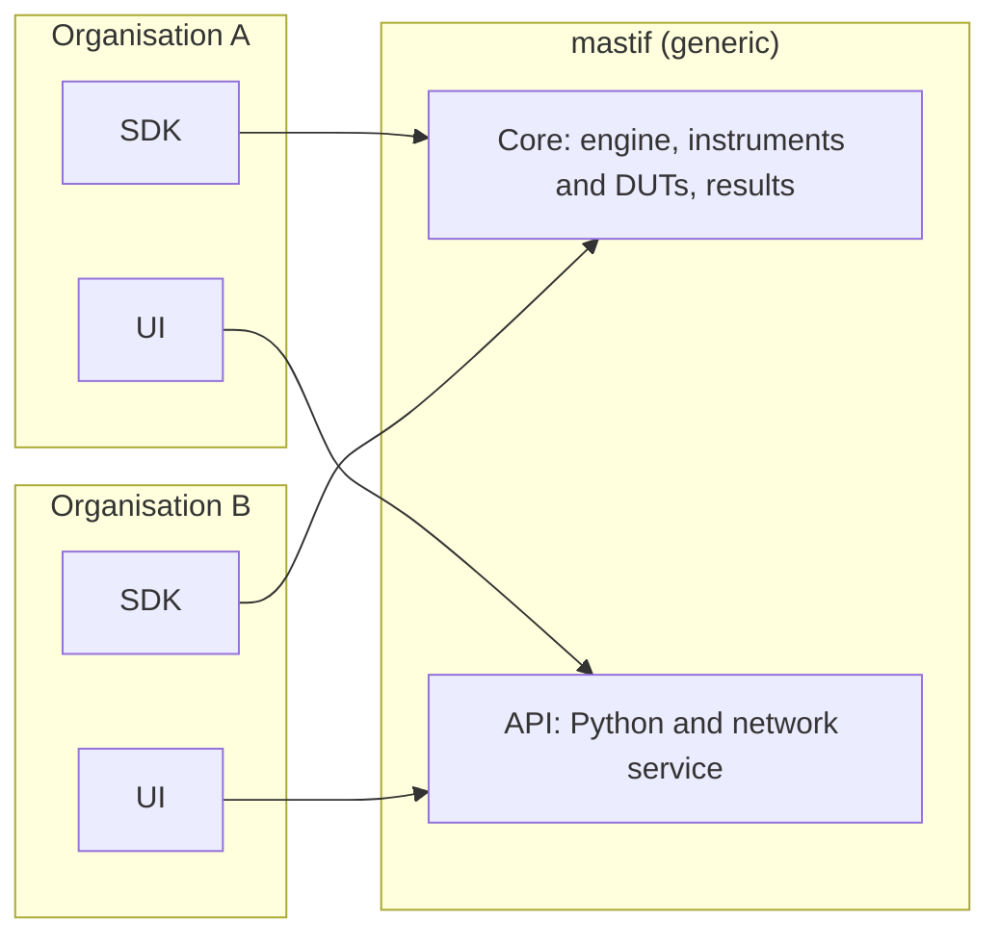
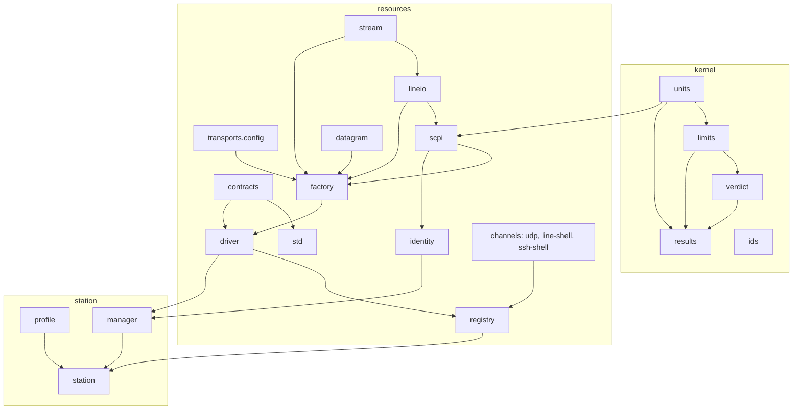

# Architecture as built

So far we've been talking about the design: what the whole system should eventually do. This section changes register. These chapters describe **the code that exists today**, how it's organised and why, so that you can open any file in the repository and know what it's for and what it's allowed to depend on.

We'll start with the overall structure, then follow one bench through its whole life, and then go through each package from the bottom up.

!!! success "Works today"
    This section describes the implemented layers. Where something belongs to the engine or runtime, it says so.

## What's a framework's job here?

mastif is meant to be a generic foundation that any organisation can build its test software on. Two organisations using it might have nothing in common but the framework:

That leads to the first rule of the code: **anything true at every test station goes in the core, and anything specific to one product goes in that organisation's SDK.** Values with units, limits and verdicts, instruments with a lifecycle, benches described by profiles: those are universal. An amplifier's calibration settings, a board's boot sequence, one vendor's commands: those aren't. If a concept makes sense for only one kind of product, it doesn't belong here, however useful it might be.

## The layers

The code is arranged in layers, and each answers one question.

| Layer | The question it answers | State |
|---|---|---|
| `kernel` | What do values, limits, verdicts and results *mean*? | Built |
| `infra` | How does an application load settings, set up logging, and know its version? | Built |
| `resources` | How is a piece of hardware described, built and talked to? | Built |
| `station` | Which hardware is on *this* bench, under which roles, and how is it brought up and made safe? | Built |
| `engine` | How is a test plan run: tasks, loops, results, events, resume? | Designed |
| `api` | What stable surface do authors, SDKs and UIs use? | Designed |
| `cli` | How do I run it from a terminal? | Designed |

There's one rule, and it's enforced: **a layer may import only the layers below it.** `import-linter` fails the build otherwise, so this can't slowly erode.

Why be so strict? Three forces push in that direction.

**Generality.** If a lower layer learned something about a product or an engine, it could never be reused without it. Keeping dependencies pointing down means the bottom stays generic.

**Change isolation.** UIs and drivers change often. Verdict rules and record formats must hardly ever change. Layers put the things that change quickly on top of the things that mustn't.

**Testability.** The logic that makes decisions lives in pure code at the bottom, with no I/O. So a verdict calculation can be tested in microseconds, and the code that does touch the outside world is pushed to the edges.

If you've read [Architectural styles and patterns](../system-design/styles-and-patterns.md), you'll recognise this as a modular monolith, with ports and adapters at the device boundary. [ADR-0001](../../adr/0001-layered-architecture.md) has the decision in full.

## Where your code plugs in

mastif **never imports organisation code by name**. That's what keeps the core generic, and it means there's a short, explicit list of ways in.

| You provide | How | How it's found |
|---|---|---|
| Contracts | A plain `typing.Protocol` | Imported by your own drivers and tests |
| Drivers and DUT types | `@driver` and `@dut` classes | `Registry.discover()`, through the `mastif.drivers` entry point |
| Station profiles | YAML files | `StationProfile.load` |
| Loop types and test packages | Designed | Designed entry points |

## How the built modules connect

Here's the dependency picture for everything that exists. Don't try to memorise it. Come back to it when you're reading a module and want to know what sits around it.

## Rules that apply everywhere

A few conventions hold throughout the code, and knowing them will save you from surprises.

**Errors are typed, and never replaced with sentinel values.** A method that can't produce a reading raises an exception. It never returns `0` or `None` to mean "that didn't work". See [ADR-0002](../../adr/0002-error-model.md) and the [error map](errors.md).

**Importing a module has no side effects.** Nothing registers itself globally, reads a file, or opens a connection on import. So importing mastif can't fail because of what's on your machine.

**Data models are frozen, and unknown keys are errors.** They're Pydantic models with `extra="forbid"`, which means that a typo in a configuration file is caught rather than ignored.

**I/O is injected.** The same code path runs against real hardware and against fakes, so a test exercises the real logic.

**Every docstring example is a doctest.** The test suite runs them, so documentation examples can't silently go out of date.

## Who owns the instruments today

Instruments sit behind exclusive handles, so one process owns a station at a time. Today that's your own process, which is **direct mode**. The alternative, a long-lived **station runtime**, is designed but isn't built:

| | Direct mode | Station runtime |
|---|---|---|
| **Who owns the station** | The test process | One long-lived runtime process |
| **Who can use it** | That one process | Several clients at once |
| **What `require` returns** | The driver itself | A proxy implementing the same contract |
| **Background polling** | None | Only opt-in monitors from the profile |
| **State** | Built, and the default | Designed in [ADR-0030](../../adr/0030-execution-topology.md) |

The full reasoning is in [Direct execution and a persistent station runtime](../system-design/execution-modes.md).

## Recap

- **Generic things go in the core**, and product things go in your SDK.
- **Layers import only downward**, and a tool enforces it.
- Your code plugs in through a **short list of explicit extension points**, and mastif never names it.

The best way to see how these fit together is to follow one bench through a complete run.

**Next:** [Life of a station](life-of-a-station.md)
