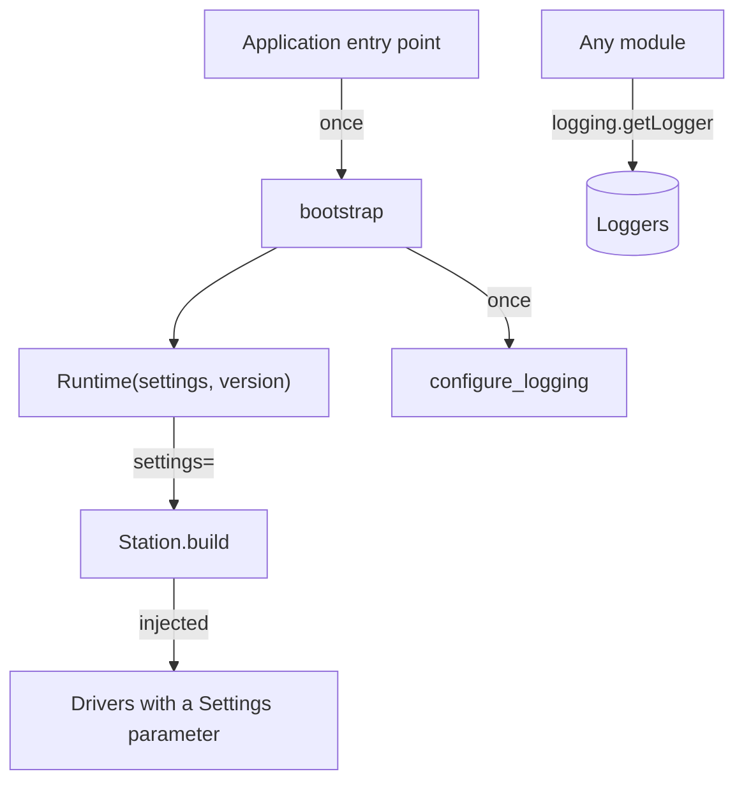

# Infra

Every application built on mastif needs the same plumbing: configuration from files and the environment, logging that serves both operators and whoever's investigating a failure, and a record of which software is running.

None of this is test logic. All of it does I/O, so it can't live in the pure kernel. So it gets its own layer, just above the kernel, where everything higher up can use it.

!!! success "Works today"
    Everything on this page runs against the current code. **Package:** `mastif.infra`. **API:** [reference](../../reference/infra/index.md). **Guide:** [Settings and bootstrap](../operations/bootstrap.md).

## The rule that shapes everything: build once, pass explicitly



**There's no global settings object.** Settings are created once, at the top of the application, and passed to whatever needs them. So tests can build their own without interfering with one another, and every dependency on configuration can be seen in a signature.

Logging is the one exception, because Python makes logging global. It's configured once, by an explicit call, and never at import time.

## Settings

Settings come from [Dynaconf](https://www.dynaconf.com/), wrapped so that they're built explicitly.

```python title="excerpt: the directory and files must exist"
from mastif.infra import create_settings

settings = create_settings(
    "C:/stations/bench-01/config",              # Every .toml, .yaml, .json and .ini, sorted
    files=["C:/stations/bench-01/local.yaml"],  # Machine-specific overrides
    defaults={"station": {"retries": 1}},       # Lowest precedence
    envvar_prefix="ACME",                       # ACME_STATION__RETRIES=5
)
print(settings.station.name)                    # Dotted access
print(settings.get("operator.language", "en"))  # With a default
```

From lowest precedence to highest, it's `defaults`, then directory files in sorted order, then `files`, then environment variables. Nested sections merge. Number your files (`00-base.toml`, `10-site.yaml`) to control the order.

Since a Dynaconf object is flexible, a typo can go unnoticed until the value's used. So a component should ask for a **typed section**, which validates everything at once and raises a `ConfigError` listing each bad field:

```python
from pydantic import BaseModel

from mastif.infra import create_settings, section


class StationSettings(BaseModel):
    name: str
    retries: int = 1


settings = create_settings(defaults={"station": {"name": "bench-01"}})
print(section(settings, "station", StationSettings).retries)  # 1
```

A driver can ask for settings by annotating a parameter, and `Station.build(profile, registry, settings=settings)` supplies them.

!!! warning "About `environments=True`"
    This enables Dynaconf's `[default]` and `[production]` sections, but it then *ignores every key outside those sections*. That's an easy way to lose settings without noticing, and it's why this is off by default.

## Logging

With the bundled defaults, you get three destinations:

| Destination | Level | Content |
|---|---|---|
| Console (Rich, colour-coded) | INFO and above | Messages, with tables shown as tables |
| `mastif.log` (rotating, 10 MB, 5 files) | DEBUG and above | `time \| level \| logger \| message`, with tables as Markdown |
| The `mastif.io` logger | DEBUG | Instrument byte traffic, **to the file only** |

The third is the one you'll be glad of later. When an instrument misbehaves, every byte on the wire is already in the log, so you don't need to reproduce the failure with extra logging switched on.

Your code just uses the standard library:

```python title="excerpt: after bootstrap has configured logging"
import logging

log = logging.getLogger("acme.tests")
log.info("powering board")
log.success("power-up complete")   # An extra level, 25, added by configure_logging
log.info(sweep_table)              # A Table: a real table on the console, Markdown in the file
```

To customise it, put a standard `logging.yaml` in `dictConfig` format into your config directory, or add a `logging:` section to your settings. `mastif/infra/default_logging.yaml` is a good starting point. Relative file names get placed under `log_dir`. Pandas DataFrames also work, with `mastif[pandas]`. ([ADR-0027](../../adr/0027-logging.md))

## Version information

When someone asks what ran, you need an answer that's true.

```python
from mastif.infra.version import VersionInfo

print(VersionInfo.load("mastif").summary())
```

That gives you something like `mastif 0.1.0.dev0 | edc1568 on main | uncommitted changes`. `info.git.source` tells you where the commit came from:

| Value | Meaning |
|---|---|
| `embedded` | From an installed wheel, written at build time |
| `runtime` | From git, asked live in a development checkout |
| `unavailable` | Not known, and it says so |

There's never a fake `0.0.0`. Wheels get their commit embedded by `packages/mastif/hatch_build.py`, and your SDK can copy that file and change `PACKAGE`. ([ADR-0028](../../adr/0028-version-information.md))

## Bootstrap

`bootstrap` does all of the above, in the right order, in one call, and it returns a small `Runtime` holding the settings and version.

```python
from mastif.infra import bootstrap

runtime = bootstrap(defaults={"station": {"name": "demo"}}, rich_tracebacks=False)
print(runtime.settings.station.name)  # demo
```

Don't confuse that `Runtime` with the [station runtime](../system-design/execution-modes.md). The name's unfortunate, as this one is just a small dataclass. ([ADR-0029](../../adr/0029-bootstrap.md))

## Recap

- **Settings are built once and passed explicitly**, and logging is configured once, by an explicit call.
- **Precedence** goes from defaults, through sorted files and extra files, to environment variables.
- **`section`** gives a validated view of what a component depends on.
- Logs include **all instrument traffic**, and version information **never invents a value**.

With that plumbing in place, we can start describing hardware.

**Next:** [Resources](resources.md)
